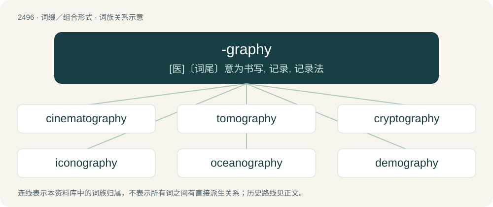

# 2597 · -graphy — \[医\]〔词尾〕意为书写, 记录, 记录法

[总目录](../00_总目录_按常用程度.md)

**类型**：词缀／组合形式　｜　**来源语言**：见词源记录

## 核心含义与来源

- 核心含义：\[医\]〔词尾〕意为书写, 记录, 记录法
- 英文含义：Something written or otherwise represented in the specified manner, or about a specified subject.
- 词形：-graphy

**来源记录 1**（后缀／后置成分；Something written or otherwise represented in the specified manner, or about a specified subject.）

From French -graphie, inherited from Latin -graphia, borrowed from Ancient Greek -γραφία (-graphía), from γραφή (graphḗ, “writing, drawing, description”). By surface analysis, -graph + -y.

## 词族图

## 单词速览（常用到不常用）

| 单词 | 音标 | 释义 |
|---|---|---|
| [cinematography](#w-1) | 英 /ˌsɪn.ə.məˈtɒɡ.ɹə.fiː/ | n. 电影制片术；\[医\] \[外科手术\]电影照相术 |
| [tomography](#w-2) | 英 /təˈmɒɡɹəfi/；美 /təˈmɑɡɹəfi/ | n. X线断层摄影术；\[医\] X线体层照相术, X线断层照相术 |
| [cryptography](#w-3) | /kɹɪpˈtɒɡ.ɹə.fi/ | n. 密码使用法, 密码学；\[计\] 密码学 |
| [iconography](#w-4) | /ˌaɪkəˈnɒɡɹəfi/ | n. 图像材料, 图示法, 肖像研究；\[医\] 影像学, 影像塑造术 |
| [oceanography](#w-5) | 英 /ˌəʊʃjəˈnɒɡɹəfi/；美 /ˌoʊʃəˈnɑɡɹəfi/ | n. 海洋学 |
| [demography](#w-6) | 英 /dɪˈmɒɡɹəfi/ | n. 人口统计学；\[医\] 人口学, 人口统计学 |
| [ethnography](#w-7) | 英 /ɛθˈnɒɡɹəfi/；美 /ɛθˈnɑɡɹəfi/ | n. 人种论, 人种学；\[医\] 人种志 |
| [historiography](#w-8) | 英 /hɪˌstɒɹiˈɒɡɹəfi/；美 /hɪˌstɔɹiˈɑɡɹəfi/ | n. 编史, 历史之编纂 |
| [cartography](#w-9) | 英 /kɑːˈtɒɡɹəfi/；美 /kɑɹˈtɑɡɹəfi/ | n. 地图制作, 制图学, 制图 |
| [videography](#w-10) | /,vidiˈɔ^rəfi/ | 电视录像制作, 录像片(或盘)摄制, 摄像 |
| [mammography](#w-11) | /məˈmɔ^rəfi/ | n. 早期胸部肿瘤X射线测定法；\[医\] 乳房X线照相术 |
| [stratigraphy](#w-12) | 美 /stɹəˈtɪɡ.ɹəfi/ | n. 地层学, 地层情况；\[医\] 体层X线照相术, 断层X线照相术 |
| [crystallography](#w-13) | 英 /ˌkɹɪstəˈlɒɡɹəfi/；美 /ˌkɹɪstəˈlɑɡɹəfi/ | n. 结晶学；\[化\] 晶体学; 结晶学 |
| [radiography](#w-14) | /.reidiˈɒgrəfi/ | n. 射线照相术；\[化\] 射线照相术; 放射线照相术; 射线照相法; 放射线照相法 |
| [orthography](#w-15) | 英 /ɔːˈθɒɡɹəfi/；美 /ɔɹˈθɑɡɹəfi/ | n. 正确拼字, 拼字法, 正字法 |
| [angiography](#w-16) | 美 /ˌæn.d͡ʒiˈɑ.ɡɹə.fi/ | n. 血管造影术；\[医\] 血管造影术, 血管照相术, 血管学 |
| [telegraphy](#w-17) | 英 /təˈlɛɡɹəfi/；美 /təˈlɛɡɹəfi/ | n. 电报学, 电信术, 电报通讯, 电报机装置；\[电\] 电报术 |
| [filmography](#w-18) | /filˈmɔ^rəfi/ | (某一导演摄制或名演员导演的)全部影片目录 |
| [hagiography](#w-19) | 英 /ˌhæɡiˈɒɡɹəfi/；美 /ˌhæɡiˈɒɡɹəfi/ | n. 圣徒传, 圣徒言行录 |
| [hydrography](#w-20) | 英 /haɪˈdɹɒɡ.ɹə.fi/；美 /haɪˈdɹɑɡ.ɹə.fi/ | n. 水文学, 水道测量术 |
| [electroencephalography](#w-21) | /əlɛktɹəʊɛnsɛfəˈlɒɡɹəfi/ | n. 脑电图记录, 脑电图；\[计\] 脑电图显示, 脑电图描记术 |
| [sonography](#w-22) | /səˈnɔ^rəfi/ | n. \[医\]超声波检查法, 超声波扫描术 |

## 逐词详解

### 1. cinematography

**词性**：名词　｜　**音标**：英 /ˌsɪn.ə.məˈtɒɡ.ɹə.fiː/

**中文释义**：n. 电影制片术；\[医\] \[外科手术\]电影照相术

**英文义项**：The art, process, or job of filming movies. / Motion picture photography.

**构词拆分**：cinematograph + -y；cinemato- + -graphy

**词源与演化**：

From cinematograph + -y. Compare French cinématographie. Possibly analysable as cinemato- + -graphy.

**例句**：

> Although the cinematography was well-executed, the sound effects were amateurish.

### 2. tomography

**词性**：名词　｜　**音标**：英 /təˈmɒɡɹəfi/；美 /təˈmɑɡɹəfi/

**中文释义**：n. X线断层摄影术；\[医\] X线体层照相术, X线断层照相术

**英文义项**：Imaging by (virtual) sections or sectioning.

**构词拆分**：tomo- + -graphy

**词源与演化**：

From tomo- + -graphy.

**例句**：

> MRI stands for Magnetic Resonance Imaging, whereas CT stands for Computed Tomography.

### 3. cryptography

**词性**：名词　｜　**音标**：/kɹɪpˈtɒɡ.ɹə.fi/

**中文释义**：n. 密码使用法, 密码学；\[计\] 密码学

**英文义项**：The discipline that embodies the principles, means, and methods for transforming data to hide its semantic content, prevent unauthorized use, or detect modifications, while also ensuring information security through confidentiality, integrity, authentication, and nonrepudiation.

**构词拆分**：crypto- + -graphy

**词源与演化**：

From crypto- + -graphy.

**例句**：

> Nowadays, cryptography is often used to make online communications and transactions more secure.

### 4. iconography

**词性**：名词　｜　**音标**：/ˌaɪkəˈnɒɡɹəfi/

**中文释义**：n. 图像材料, 图示法, 肖像研究；\[医\] 影像学, 影像塑造术

**英文义项**：A set of specified or traditional symbolic forms associated with the subject or theme of a stylized genre of art. / The art of representation by pictures or images; the description or study of portraiture or representation, as of persons.

**构词拆分**：icono- + -graphy

**词源与演化**：

From icono- + -graphy.

**用法示例／搭配（非完整句）**：

> the iconography of the ancients

该用例对应义项：The art of representation by pictures or images; the description or study of portraiture or representation, as of persons.

### 5. oceanography

**词性**：名词　｜　**音标**：英 /ˌəʊʃjəˈnɒɡɹəfi/；美 /ˌoʊʃəˈnɑɡɹəfi/

**中文释义**：n. 海洋学

**英文义项**：The exploration and scientific study of the oceans and ocean floor.

**构词拆分**：ocean + -graphy

**词源与演化**：

From ocean + -ography.

**例句**：

> Oceanography was pioneered by voyages of exploration.

### 6. demography

**词性**：名词　｜　**音标**：英 /dɪˈmɒɡɹəfi/

**中文释义**：n. 人口统计学；\[医\] 人口学, 人口统计学

**英文义项**：The study of the characteristics of human populations, especially with regards to their makeup and fluctuations and the social causes behind these. / The study of the structure and population dynamics of other lifeforms, such as mammals, insects, plants, etc.

**构词拆分**：demo- (“people”) + -graphy (“written representation of”)

**词源与演化**：

From demo- (“people”) + -graphy (“written representation of”) (From Ancient Greek δῆμος (dêmos, “people”) and Ancient Greek -γραφία (-graphía), from γραφή (graphḗ, “writing, drawing, description”)).

**例句**：

> Due to its geography and demography, conquering Panjshir by force is considered extremely difficult.

### 7. ethnography

**词性**：名词　｜　**音标**：英 /ɛθˈnɒɡɹəfi/；美 /ɛθˈnɑɡɹəfi/

**中文释义**：n. 人种论, 人种学；\[医\] 人种志

**英文义项**：The branch of anthropology that scientifically describes specific human cultures and societies. / An ethnographic work.

**构词拆分**：ethno- + -graphy

**词源与演化**：

From ethno- + -graphy.

**例句**：

> Her ethnography of urban youth explored how music shapes identity and belonging.

### 8. historiography

**词性**：名词　｜　**音标**：英 /hɪˌstɒɹiˈɒɡɹəfi/；美 /hɪˌstɔɹiˈɑɡɹəfi/

**中文释义**：n. 编史, 历史之编纂

**英文义项**：The writing of history; a written history. / The study of the discipline and practice of history and the writings of past historians.

**构词拆分**：historio- + -graphy

**词源与演化**：

From historio- + -graphy.

### 9. cartography

**词性**：名词　｜　**音标**：英 /kɑːˈtɒɡɹəfi/；美 /kɑɹˈtɑɡɹəfi/

**中文释义**：n. 地图制作, 制图学, 制图

**英文义项**：The creation of charts and maps based on the layout of a territory's geography. / An illustrative discussion of a topic.

**构词拆分**：carto- (“map”) + -graphy

**词源与演化**：

From French cartographie, from carte (“map”) (ultimately from Ancient Greek χάρτης (khártēs, “map”)) + -graphie (“-graphy”) (from γράφω (gráphō, “write”)); carto- (“map”) + -graphy.

**例句**：

> The cartography department is responsible for creating detailed maps of the region.

### 10. videography

**词性**：名词　｜　**音标**：/,vidiˈɔ^rəfi/

**中文释义**：电视录像制作, 录像片(或盘)摄制, 摄像

**英文义项**：The art and technology of producing moving (video) images on photosensitive surfaces, and its digital counterpart. / The occupation of making videos.

**构词拆分**：video- + -graphy

**词源与演化**：

From video- + -graphy.

**例句**：

> Alberto was paying Isabella for her videography and photography skills.

### 11. mammography

**词性**：名词　｜　**音标**：/məˈmɔ^rəfi/

**中文释义**：n. 早期胸部肿瘤X射线测定法；\[医\] 乳房X线照相术

**英文义项**：X-ray examination of the breasts for diagnosing and locating abnormalities, especially tumours.

**构词拆分**：mammo- + -graphy

**词源与演化**：

From mammo- + -graphy.

**例句**：

> Mammography can mean the difference between life and death for millions of women.

### 12. stratigraphy

**词性**：名词　｜　**音标**：美 /stɹəˈtɪɡ.ɹəfi/

**中文释义**：n. 地层学, 地层情况；\[医\] 体层X线照相术, 断层X线照相术

**英文义项**：The study of rock layers and the layering process (stratification). / The layering of deposits, with newer remains overlaying older ones, forming a chronology of the site.

**构词拆分**：stratum + -graphy

**词源与演化**：

From stratum + -graphy c. 1841–1865.

### 13. crystallography

**词性**：名词　｜　**音标**：英 /ˌkɹɪstəˈlɒɡɹəfi/；美 /ˌkɹɪstəˈlɑɡɹəfi/

**中文释义**：n. 结晶学；\[化\] 晶体学; 结晶学

**英文义项**：The experimental science of determining the arrangement of atoms in solids. / The study of crystals.

**构词拆分**：crystal + -graphy

**词源与演化**：

From crystal + -ography.

### 14. radiography

**词性**：名词　｜　**音标**：/.reidiˈɒgrəfi/

**中文释义**：n. 射线照相术；\[化\] 射线照相术; 放射线照相术; 射线照相法; 放射线照相法

**英文义项**：The process of making radiographs, and the science of analyzing them.

**构词拆分**：radio- + -graphy

**词源与演化**：

From radio- + -graphy.

### 15. orthography

**词性**：名词　｜　**音标**：英 /ɔːˈθɒɡɹəfi/；美 /ɔɹˈθɑɡɹəfi/

**中文释义**：n. 正确拼字, 拼字法, 正字法

**英文义项**：A method of representing a language or the sounds of language by written symbols; spelling. / A set of conventions for writing a language, including norms of spelling, capitalization, emphasis, hyphenation, punctuation, and word breaks.

**构词拆分**：ortho- (prefix meaning ‘proper, right; straight’) + -graphy (suffix denoting something written or otherwise represented in a specified manner, or about a specified subject)

**词源与演化**：

The noun is derived from Late Middle English ortografie, ortographie (“spelling”) \[and other forms\], and then either: \* from Anglo-Norman ortografie, Middle French orthographie, ortografie, ortographie (“correct spelling; orthographic projection”) (compare Old French ortografie; modern French orthographe (“spelling, orthography”), orthographie (“orthographic project, orthography”)); or \* from their etymon Latin orthographia (“correct spelling; building elevation”), from Koine Greek ὀρθογραφία (orthographía, “correct spelling”), from Ancient Greek ορθο- (ortho-, prefix meaning ‘right, proper; upright’) (from ὀρθός (orthós, “straight; erect, upright; correct, true”), ultimately from Proto-Indo-European \*h₃erdʰ- (“to grow, increase; high; upright”)) + -γραφίᾱ (-graphíā, suffix meaning ‘drawing; writing’) (from γρᾰ́φω (grắphō, “to cut into, scratch; to write”), ultimately from Proto-Indo-European \*gerbʰ- (“to carve”)). The English word is analyzable as ortho- (prefix meaning ‘proper, right; straight’) + -graphy (suffix denoting something written or otherwise represented in a specified manner, or about a specified subject). The verb is derived from the noun. First use appears before c. 1460. Cognates \* Catalan ortografia \* Italian ortografia \* Portuguese ortografia, orthografia (obsolete) \* Spanish ortografía

**例句**：

> No orthography has been developed for the written form of the language.

### 16. angiography

**词性**：名词　｜　**音标**：美 /ˌæn.d͡ʒiˈɑ.ɡɹə.fi/

**中文释义**：n. 血管造影术；\[医\] 血管造影术, 血管照相术, 血管学

**英文义项**：A medical imaging technique in which an X-ray image is taken to visualize the inside of blood vessels and organs of the body, with particular interest in the arteries, veins and the heart chambers.

**构词拆分**：angio- + -graphy

**词源与演化**：

From angio- + -graphy.

**例句**：

> I need to perform a pulmonary angiography.

### 17. telegraphy

**词性**：名词　｜　**音标**：英 /təˈlɛɡɹəfi/；美 /təˈlɛɡɹəfi/

**中文释义**：n. 电报学, 电信术, 电报通讯, 电报机装置；\[电\] 电报术

**英文义项**：Any process for transmitting arbitrarily long messages over a long distance using a code, especially by means of electrified wires or radio waves using Morse code. / The science and techniques used to enact this process.

**构词拆分**：telegraph + -y；telegraph + -y (suffix forming abstract nouns)；tele- (“far, distant, telegraph”) + -graphy (“writings on a subject, area of study, etc.”)

**词源与演化**：

From telegraph + -y (suffix forming abstract nouns), q.v., equivalent to tele- (“far, distant, telegraph”) + -graphy (“writings on a subject, area of study, etc.”).

### 18. filmography

**词性**：名词　｜　**音标**：/filˈmɔ^rəfi/

**中文释义**：(某一导演摄制或名演员导演的)全部影片目录

**英文义项**：A selective list of movie titles that share a similar characteristic such as the same genre, the same director, the same actor etc.

**构词拆分**：film + -graphy

**词源与演化**：

From film + -ography.

### 19. hagiography

**词性**：名词　｜　**音标**：英 /ˌhæɡiˈɒɡɹəfi/；美 /ˌhæɡiˈɒɡɹəfi/

**中文释义**：n. 圣徒传, 圣徒言行录

**英文义项**：The study of saints and the documentation of their lives. / A biography of a saint.

**构词拆分**：hagio- + -graphy

**词源与演化**：

From hagio- + -graphy.

### 20. hydrography

**词性**：名词　｜　**音标**：英 /haɪˈdɹɒɡ.ɹə.fi/；美 /haɪˈdɹɑɡ.ɹə.fi/

**中文释义**：n. 水文学, 水道测量术

**英文义项**：The scientific measurement and description of the physical features and conditions of navigable waters and the shoreline.

**构词拆分**：hydro- + -graphy

**词源与演化**：

From hydro- + -graphy.

**例句**：

> Hydrography is the science that measures and describes the physical features of bodies of water.

### 21. electroencephalography

**词性**：名词　｜　**音标**：/əlɛktɹəʊɛnsɛfəˈlɒɡɹəfi/

**中文释义**：n. 脑电图记录, 脑电图；\[计\] 脑电图显示, 脑电图描记术

**英文义项**：The measurement and recording of electrical activity in the brain for diagnostic purposes.

**构词拆分**：electro- + encephalo- + -graphy

**词源与演化**：

From electro- + encephalo- + -graphy.

### 22. sonography

**词性**：名词　｜　**音标**：/səˈnɔ^rəfi/

**中文释义**：n. \[医\]超声波检查法, 超声波扫描术

**英文义项**：night writing

**构词拆分**：sono- + -graphy

**词源与演化**：

From sono- + -graphy.
