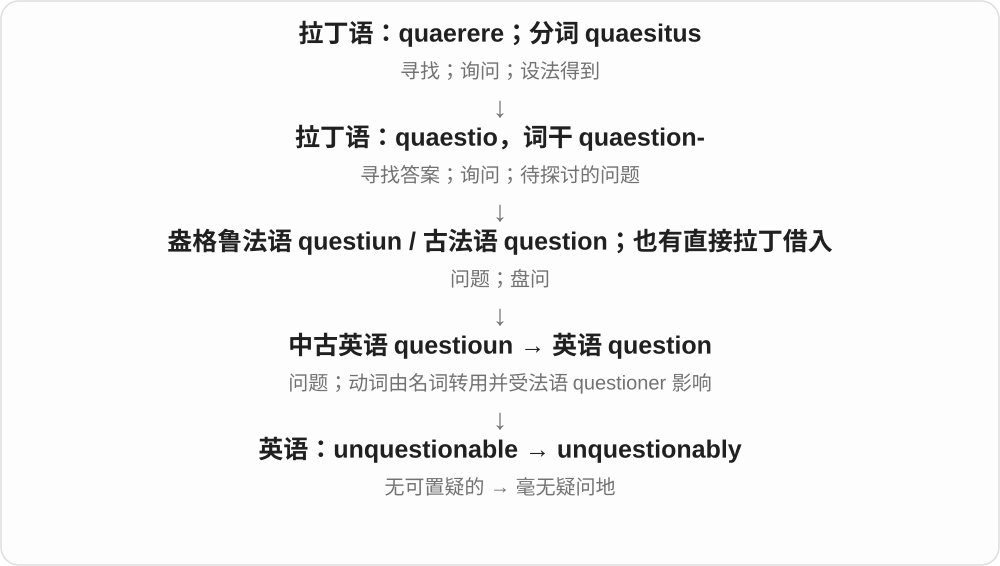

# 2602 · -ably — -able 形容词构成副词时常见的 -ably 形式

[逐词精讲目录](../00_逐词精讲目录.md) · [总目录](../00_总目录_按常用程度.md)

## 核心词根与来源

看清 -able 与 -ly 的衔接，再学每个整词的实际语气。presumably 只是合理推想，undeniably、unquestionably 则常把肯定程度推高。

**-ABLY：把某种性质变成做事方式，或对整句话的判断**

presumable → presumably；undeniable → undeniably；unquestionable → unquestionably。

- **合理推测**：presumably
- **强调难以否认、没有疑问**：undeniably · unquestionably

## 词形与演化规律

-able + -ly → -ably；presume → presumable → presumably。

## 单词速览（按词族由简到繁）

同一基础词的相关扩展放在一起，先读基础形式，再读扩展；各组之间优先读常用的。具体词源关系见各词讲解。

| 单词 | 音标 | 核心意思 |
|---|---|---|
| [presumably](#w-1) | 英 /prɪˈzjuːməbli/；美 /prɪˈzuːməbli/ | 想必、大概、据推测 |
| [unquestionably](#w-2) | /ʌnˈkwestʃənəbli/ | 毫无疑问地；无可争议地 |
| [undeniably](#w-3) | /ˌʌndɪˈnaɪəbli/ | 不可否认地；确实 |

## 逐词讲解

### 1. presumably — 想必、大概、据推测

**音标**：英 /prɪˈzjuːməbli/；美 /prɪˈzuːməbli/

**先抓住这个画面**

门口鞋子不在，人也没应声：你推想他大概出去了。presumably 给出的就是这种有根据、但尚未直接确认的判断。

**怎么拆**

presumable + -ly；-able 接 -ly 时变为 -ably。底层 presume 表先作推定，presumable 是可合理推想的。

**怎么变成今天的意思**

**presume → presumable**  
认为大概如此 → 可以合理推测的

↓

**presumable + -ly → presumably**  
大概、想必；按目前情况推想

Presumably, ... 可以放句首，也能放句中。语气通常是根据情况想必如此，事实仍可能另有解释。

**常见搭配与例句**

Presumably, ...；will presumably ...。

> The lights are off, so presumably everyone has gone home.

灯都关了，想必大家已经回家了。

> She will presumably contact us when she arrives.

她到了之后大概会联系我们。

**别混淆**

presumably 与 probably 意思接近，前者更容易突出这是说话者按情况作的推想；两者都不是百分之百保证。

### 2. unquestionably — 毫无疑问地；无可争议地

**音标**：/ʌnˈkwestʃənəbli/

**先抓住这个画面**

unquestionably 像把结论下面画一道实线：“这一点可以确定。”

**怎么拆**

unquestionable + -ly，-ble 变为 -bly。

**怎么变成今天的意思**

常放在形容词、最高级或整个判断之前，加强肯定。说 unquestionably the best 时，是强烈的评价，不意味着完成了某种客观证明。

**常见搭配与例句**

unquestionably true；unquestionably important；unquestionably the best。

> The new design is unquestionably easier to use.

新设计无疑更容易使用。

> She is unquestionably one of the team’s most reliable players.

她毫无疑问是队里最可靠的队员之一。

**别混淆**

probably 表示很可能；unquestionably 几乎不保留怀疑余地，语气强很多。

### 3. undeniably — 不可否认地；确实

**音标**：/ˌʌndɪˈnaɪəbli/

**先抓住这个画面**

承认一个事实很明显，同时仍可继续讨论它的其他方面。

**怎么拆**

undeniable + -ly，-able 变 -ably；修饰形容词、动词或整句话。

**怎么变成今天的意思**

**拉丁语 negare**  
否认、拒绝，说“不”

↓

**拉丁语 de- + negare → denegare**  
加强拒绝、否认

↓

**古法语 denoier → 中古英语 denyen → deny**  
否认；拒绝给予

↓

**英语 deniable → undeniable → undeniably**  
可否认 → 无法否认 → 确实、不可否认地

undeniably talented 是确实有才华；undeniably, the plan has risks 是先承认风险事实。它可以与 but 连用，承认一点而保留另一个判断。

**常见搭配与例句**

undeniably important；undeniably talented；undeniably true。

> The design is undeniably elegant, but it is difficult to build.

这个设计确实优雅，但很难建造。

> She is undeniably the most experienced member of the team.

她无疑是团队中经验最丰富的成员。

**别混淆**

probably 表示很可能；undeniably 表示说话者认为此事无法否认，确定程度更强。

## 这一组要分清什么

不是所有 -ably 都说能够做某事；副词意义取决于底层形容词和整句话。

## 串起来练习

Presumably the plan will work, but its cost is undeniably high.

这个计划想必行得通，但费用之高无可否认。
