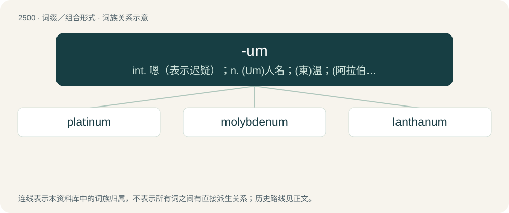

# 2602 · -um — int. 嗯（表示迟疑）；n. (Um)人名；(柬)温；(阿拉伯)乌姆

[总目录](../00_总目录_按常用程度.md)

**类型**：词缀／组合形式　｜　**来源语言**：见词源记录

## 核心含义与来源

- 核心含义：int. 嗯（表示迟疑）；n. (Um)人名；(柬)温；(阿拉伯)乌姆
- 英文含义：Denotes singular grammatical number.
- 词形：-um

**多个词源／构词路径**：同一拼写可能有不同来源；以下按词性和含义分别列出。

**来源记录 1**（后缀／后置成分；Denotes singular grammatical number.）

From the homographic case endings of the nominative, accusative, and vocative forms of numerous neuter Latin second declension nouns.

**来源记录 2**（后缀／后置成分；Denotes transitive verbs in the trade pidgins used between English-speakers and indigenous populations; used derogatorily by extension in English by addition to any verb, transitive or not.）

Possibly from 'em.

## 词族图

## 单词速览（常用到不常用）

| 单词 | 音标 | 释义 |
|---|---|---|
| [platinum](#w-1) | /ˈplæt.ɪn.əm/ | n. 白金, 铂, 银灰色；\[化\] 铂Pt |
| [molybdenum](#w-2) | /məˈlɪbdɪnəm/ | n. 钼；\[化\] 钼 |
| [lanthanum](#w-3) | /ˈlænθənəm/ | n. 镧；\[化\] 镧La |

## 逐词详解

### 1. platinum

**词性**：形容词　｜　**音标**：/ˈplæt.ɪn.əm/

**中文释义**：n. 白金, 铂, 银灰色；\[化\] 铂Pt

**英文义项**：Of a whitish grey colour, like that of the metal. / Of a musical recording that has sold over one million copies (for singles), or two million (for albums).

**词源与演化**：

From Spanish platina (“little silver”) del Pinto ("of the Pinto") + -um. It was called "little" (or "lesser") silver because the metal was found as an impurity in gold, and del Pinto for the Pinto River in Gran Colombia where Europeans discovered it being mined by Native Americans. Doublet of platina.

**例句**：

> We can offer the platinum service for fifty dollars extra.

该用例对应义项：Very expensive, or of very high quality.

### 2. molybdenum

**词性**：名词　｜　**音标**：/məˈlɪbdɪnəm/

**中文释义**：n. 钼；\[化\] 钼

**英文义项**：A chemical element (symbol Mo) with an atomic number of 42: a silvery metal, not found as a free element, used in steel alloys. / A single atom of this element.

**词源与演化**：

From New Latin molybdaenum, from molybdaena (“any of various substances resembling lead”), from Ancient Greek μολύβδαινα (molúbdaina, “a plummet, piece of lead”), from μόλυβδος (mólubdos, “lead; graphite”), from an Anatolian word cognate with Lydian 𐤪𐤠𐤭𐤦𐤥𐤣𐤠 (mariwda, “dark”), from Proto-Indo-European \*morkʷ-iyo-, from a root \*morkʷ- (“dark”), cognate with English murk. Cf. Latin plumbum nigrum 'lead'. The suffix is + -um (“a chemical element”). Attested since the last quarter of 18th century.

**用法示例／搭配（非完整句）**：

> a quadruple bond between molybdenums

该用例对应义项：A single atom of this element.

### 3. lanthanum

**词性**：名词　｜　**音标**：/ˈlænθənəm/

**中文释义**：n. 镧；\[化\] 镧La

**英文义项**：A chemical element (symbol La) with an atomic number of 57: a soft, ductile, silvery-white metal that tarnishes slowly when exposed to air. / An atom of this element.

**构词拆分**：Ancient Greek λανθάνω (lanthánō, “to escape notice”) + -um (“a chemical element”)

**词源与演化**：

From Ancient Greek λανθάνω (lanthánō, “to escape notice”) + -um (“a chemical element”), because it had gone long undetected in mineral ores.
