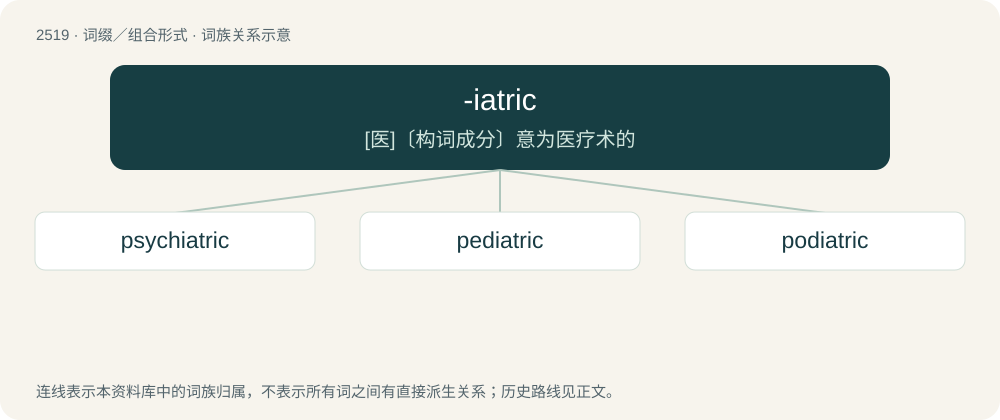

# 2623 · -iatric — \[医\]〔构词成分〕意为医疗术的

[总目录](../00_总目录_按常用程度.md)

**类型**：词缀／组合形式　｜　**来源语言**：见词源记录

## 核心含义与来源

- 核心含义：\[医\]〔构词成分〕意为医疗术的
- 英文含义：Of or relating to a physician.
- 词形：-iatric

**来源记录 1**（后缀／后置成分；Of or relating to a physician.）

From Ancient Greek ἰᾱτρικός (iātrikós, “medical”), from ἰατρός (iatrós, “doctor”) + -ικός (-ikós, “-ic”).

## 词族图

## 单词速览（常用到不常用）

| 单词 | 音标 | 释义 |
|---|---|---|
| [psychiatric](#w-1) | /ˌsaɪ.kiˈæt.ɹɪk/ | a. 精神病学的, 医精神病的；\[医\] 精神病学的 |
| [pediatric](#w-2) | /ˌpiːdiːˈætrɪk/ | a. 小儿科的；\[医\] 儿科的 |
| [podiatric](#w-3) |  | \[医\]（手）足医的 |

## 逐词详解

### 1. psychiatric

**词性**：形容词　｜　**音标**：/ˌsaɪ.kiˈæt.ɹɪk/

**中文释义**：a. 精神病学的, 医精神病的；\[医\] 精神病学的

**英文义项**：Of, or relating to, psychiatry.

**构词拆分**：psychiatry + -ic；psych- + -iatric

**词源与演化**：

From psychiatry + -ic or psych- + -iatric.

**例句**：

> Excessive use of the Internet is not a medical or psychiatric issue.

### 2. pediatric

**词性**：形容词　｜　**音标**：/ˌpiːdiːˈætrɪk/

**中文释义**：a. 小儿科的；\[医\] 儿科的

**英文义项**：Of or pertaining to pediatrics, the branch of medicine dealing with the care and treatment of children and adolescents.

**构词拆分**：pedo- (“child”) + -iatric

**词源与演化**：

From pedo- (“child”) + -iatric.

**例句**：

> The hospital has established a pediatric intensive care unit.

该用例对应义项：Of or pertaining to pediatrics, the branch of medicine dealing with the care and treatment of children and adolescents.

### 3. podiatric

**词性**：形容词

**中文释义**：\[医\]（手）足医的

**英文义项**：Of or pertaining to podiatry, the medical specialty concerned with the foot

**构词拆分**：podiatry + -ic；pod- + -iatric

**词源与演化**：

From podiatry + -ic or pod- + -iatric.
