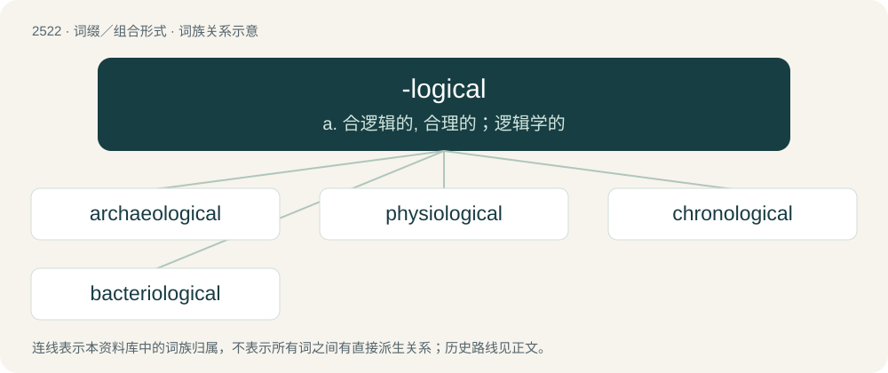

# 2627 · -logical — a. 合逻辑的, 合理的；逻辑学的

[总目录](../00_总目录_按常用程度.md)

**类型**：词缀／组合形式　｜　**来源语言**：见词源记录

## 核心含义与来源

- 核心含义：a. 合逻辑的, 合理的；逻辑学的
- 英文含义：Used to form adjectival forms of nouns ending in -logy.
- 词形：-logical

**来源记录 1**（后缀／后置成分；Used to form adjectival forms of nouns ending in -logy.）

From -logy + -ical.

## 词族图

## 单词速览（常用到不常用）

| 单词 | 音标 | 释义 |
|---|---|---|
| [archaeological](#w-1) | /.ɑːkiəˈlɒdʒikl/ | a. 考古学的, 考古学上的 |
| [physiological](#w-2) | 英 /ˌfɪz.i.əˈlɒd͡ʒ.i.kəl/；美 /ˌfɪz.i.əˈlɑ.d͡ʒɪ.kəl/ | a. 生理学的, 生理学上的, 生理机能的；\[医\] 生理学的, 生理的 |
| [chronological](#w-3) | 英 /ˌkɹɒnəˈlɒd͡ʒɪkəl/；美 /ˌkɹɑnəˈlɑd͡ʒɪkəl/ | a. 年代学的, 按时间顺序的, 按照年月顺序的；\[计\] 编年的, 按年月日顺序的 |
| [bacteriological](#w-4) | /bæk,tiəriəˈlɔdʒikəl/ | a. 细菌学的, 细菌学上的；\[医\] 细菌学家, 细菌学者 |

## 逐词详解

### 1. archaeological

**词性**：形容词　｜　**音标**：/.ɑːkiəˈlɒdʒikl/

**中文释义**：a. 考古学的, 考古学上的

**英文义项**：Relating to the science or research of archaeology.

**构词拆分**：archaeology + -ical + archaeo- + -logical

**词源与演化**：

From archaeology + -ical. By surface analysis, archaeo- + -logical.

**例句**：

> A dramatic archaeological discovery.

该用例对应义项：related to or dealing with or devoted to archaeology

### 2. physiological

**词性**：形容词　｜　**音标**：英 /ˌfɪz.i.əˈlɒd͡ʒ.i.kəl/；美 /ˌfɪz.i.əˈlɑ.d͡ʒɪ.kəl/

**中文释义**：a. 生理学的, 生理学上的, 生理机能的；\[医\] 生理学的, 生理的

**英文义项**：Of, or relating to physiology. / Relating to the action of a drug when given to a healthy person, as distinguished from its therapeutic action.

**构词拆分**：physio- + -logical + physiology + -ical + -al；physio- + -logical；physiology + -ical

**词源与演化**：

Either from physio- + -logical (equivalent to physiology + -ical) or Latin physiologicus + -al.

**例句**：

> My attitude to the comma is physiological; the more breath I have, the fewer commas I use.

### 3. chronological

**词性**：形容词　｜　**音标**：英 /ˌkɹɒnəˈlɒd͡ʒɪkəl/；美 /ˌkɹɑnəˈlɑd͡ʒɪkəl/

**中文释义**：a. 年代学的, 按时间顺序的, 按照年月顺序的；\[计\] 编年的, 按年月日顺序的

**英文义项**：Relating to time, or units of time. / In order of time from the earliest to the latest.

**构词拆分**：chrono- + -logical + chronology + -ical；chrono- + -logical；chronology + -ical

**词源与演化**：

From chrono- + -logical or chronology + -ical.

**例句**：

> He is 67 in chronological age, but has the mind and body of someone 55.

该用例对应义项：Relating to time, or units of time.

### 4. bacteriological

**词性**：形容词　｜　**音标**：/bæk,tiəriəˈlɔdʒikəl/

**中文释义**：a. 细菌学的, 细菌学上的；\[医\] 细菌学家, 细菌学者

**英文义项**：Of or pertaining to bacteriology.

**构词拆分**：bacterio- + -logical

**词源与演化**：

From bacterio- + -logical.
