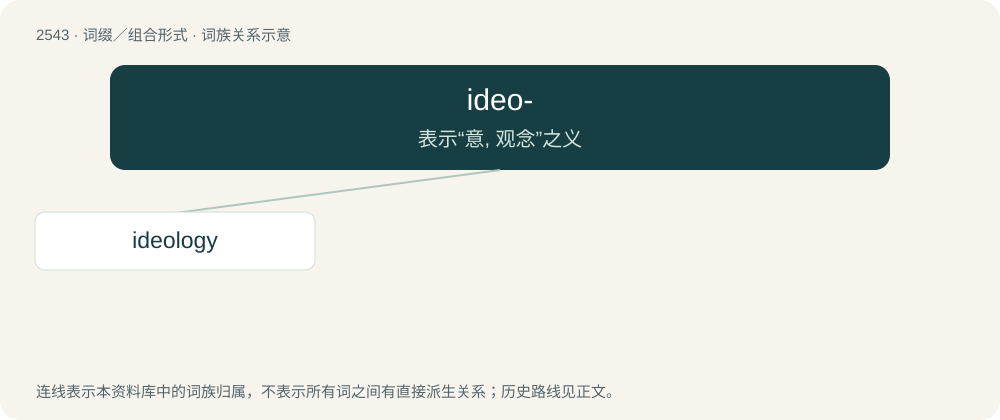

# 2648 · ideo- — 表示“意, 观念”之义

[总目录](../00_总目录_按常用程度.md)

**类型**：词缀／组合形式　｜　**来源语言**：见词源记录

## 核心含义与来源

- 核心含义：表示“意, 观念”之义
- 英文含义：Idea, image.
- 词形：ideo-

## 词族图

## 单词速览（常用到不常用）

| 单词 | 音标 | 释义 |
|---|---|---|
| [ideology](#w-1) | 英 /ˌaɪ.diːˈɒl.ə.d͡ʒiː/；美 /aɪ.diˈɑ.lə.d͡ʒi/ | n. 思想体系, 意识形态, 观念学, 空论；\[医\] 观念学, 观念形态 |

## 逐词详解

### 1. ideology

**词性**：名词　｜　**音标**：英 /ˌaɪ.diːˈɒl.ə.d͡ʒiː/；美 /aɪ.diˈɑ.lə.d͡ʒi/

**中文释义**：n. 思想体系, 意识形态, 观念学, 空论；\[医\] 观念学, 观念形态

**英文义项**：Doctrine, philosophy, body of beliefs or principles belonging to an individual or group. / The study of the origin and nature of ideas.

**构词拆分**：ideo- + -logy

**词源与演化**：

Borrowed from French idéologie, from idéo- + -logie (equivalent to English ideo- + -logy). Cognate with, but not derived from, idea. Coined 1796 by Antoine Destutt de Tracy. Modern sense of “doctrine” attributed to use of related idéologue (“ideologue”) by Napoleon Bonaparte as a term of abuse towards political opponents in early 1800s.

**例句**：

> A dictatorship bans things, that do not conform to its ideology, to secure its reign.

该用例对应义项：Doctrine, philosophy, body of beliefs or principles belonging to an individual or group.
