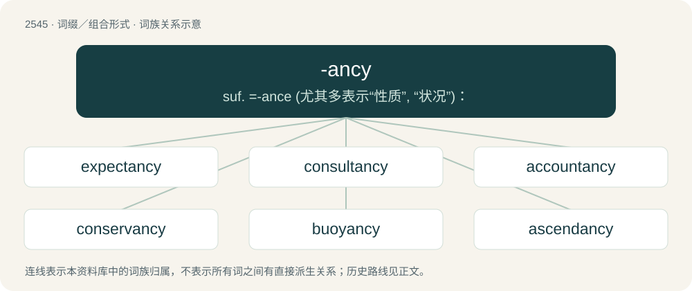

# 2650 · -ancy — suf. =-ance (尤其多表示“性质”, “状况”)：

[总目录](../00_总目录_按常用程度.md)

**类型**：词缀／组合形式　｜　**来源语言**：见词源记录

## 核心含义与来源

- 核心含义：suf. =-ance (尤其多表示“性质”, “状况”)：
- 英文含义：Added to verbs and adjectives to form nouns conveying a condition or quality associated with the verb.
- 词形：-ancy

**来源记录 1**（后缀／后置成分；Added to verbs and adjectives to form nouns conveying a condition or quality associated with the verb.）

From Latin -antia, -entia, with influence from French -ance, French -ancie, Spanish -ancia, etc.

## 词族图

## 单词速览（常用到不常用）

| 单词 | 音标 | 释义 |
|---|---|---|
| [expectancy](#w-1) | 英 /ɪkˈspɛkt(ə)nsi/；美 /ɪkˈspɛktənsi/ | n. 期待, 期望的事物, 嘱望, 希望, 期望, 预期；\[医\] 预期 |
| [consultancy](#w-2) | 英 /kənˈsʌl.tən.si/ | n. 商量, 协商, 磋商, 会诊, 与...商量, 咨询, 请教, 找(医生)看病, 查阅, 考虑；\[经\] 咨询业务, 咨询服务 |
| [accountancy](#w-3) | 美 /əˈkaʊnt.ən.si/ | n. 会计工作, 会计学；\[经\] 会计工作, 会计学术, 会计职业 |
| [conservancy](#w-4) | /kənˈsəːvənsi/ | n. 保存, 保护, 管理；\[医\] 保存; 保护, 管理 |
| [buoyancy](#w-5) | 英 /ˈbɔɪ.ən.si/ | n. 浮力, 弹性, 快活, 轻快, (股票市场)保持高价；\[化\] 浮力; 浮扬性 |
| [ascendancy](#w-6) | /əˈsɛndənsi/ | n. 优势, 支配地位 |
| [malignancy](#w-7) | /məˈlɪɡ.nən.si/ | n. 恶意, 邪恶, 恶性肿瘤；\[医\] 恶性 |

## 逐词详解

### 1. expectancy

**词性**：名词　｜　**音标**：英 /ɪkˈspɛkt(ə)nsi/；美 /ɪkˈspɛktənsi/

**中文释义**：n. 期待, 期望的事物, 嘱望, 希望, 期望, 预期；\[医\] 预期

**英文义项**：Expectation or anticipation; the state of expecting something. / The state of being expected.

**构词拆分**：expectant + -cy；expect + -ancy

**词源与演化**：

From expectant + -cy or expect + -ancy.

**例句**：

> An indicator of expectancy in development.

该用例对应义项：something expected (as on the basis of a norm)

### 2. consultancy

**词性**：名词　｜　**音标**：英 /kənˈsʌl.tən.si/

**中文释义**：n. 商量, 协商, 磋商, 会诊, 与...商量, 咨询, 请教, 找(医生)看病, 查阅, 考虑；\[经\] 咨询业务, 咨询服务

**英文义项**：A consultant or consulting firm. / The services offered by a consultant.

**构词拆分**：consultant + -cy；consult + -ancy

**词源与演化**：

From consultant + -cy or consult + -ancy.

**例句**：

> For a PR campaign like never before, one needs a consultancy of unprecedented scope and power.

该用例对应义项：A consultant or consulting firm.

### 3. accountancy

**词性**：名词　｜　**音标**：美 /əˈkaʊnt.ən.si/

**中文释义**：n. 会计工作, 会计学；\[经\] 会计工作, 会计学术, 会计职业

**英文义项**：The function of compiling and providing financial information primarily by reports referred to as financial statements, including bookkeeping, systems design, analysis and interpretation of accounting information. / A company or organisation that performs such a function.

**构词拆分**：From account + -ancy.

**词源与演化**：

From account + -ancy.

**例句**：

> She studied accountancy before joining a firm.

该用例对应义项：The function of compiling and providing financial information primarily by reports referred to as financial statements, including bookkeeping, systems design, analysis and interpretation of accounting information.

### 4. conservancy

**词性**：名词　｜　**音标**：/kənˈsəːvənsi/

**中文释义**：n. 保存, 保护, 管理；\[医\] 保存; 保护, 管理

**英文义项**：The conservation of a resource. / An organization dedicated to the conservation of natural resources.

**构词拆分**：conservant + -cy；conserve + -ancy

**词源与演化**：

From conservant + -cy or conserve + -ancy.

**例句**：

> Zimbabwe has moved 100 elephants from a congested conservancy in the south to another park near the border with Zambia.

### 5. buoyancy

**词性**：名词　｜　**音标**：英 /ˈbɔɪ.ən.si/

**中文释义**：n. 浮力, 弹性, 快活, 轻快, (股票市场)保持高价；\[化\] 浮力; 浮扬性

**英文义项**：The upward force on a body immersed or partly immersed in a fluid. / The ability of an object to stay afloat in a fluid.

**构词拆分**：buoyant + -cy；buoy + -ancy

**词源与演化**：

From buoyant + -cy or buoy + -ancy.

**例句**：

> A body with negative buoyancy will sink in water.

### 6. ascendancy

**词性**：名词　｜　**音标**：/əˈsɛndənsi/

**中文释义**：n. 优势, 支配地位

**英文义项**：The quality of being in the ascendant; dominant control, supremacy. / A quantitative attribute of an ecosystem, defined as a function of the ecosystem's trophic network, and intended to indicate its ability to prevail against disturbance by virtue of its combined organization and size.

**构词拆分**：ascend + -ancy；ascendant + -cy

**词源与演化**：

From ascend + -ancy or ascendant + -cy. The use in ecology is due to Robert Ulanowicz.

**例句**：

> The ascendancy of monarchs is what keeps their subjects from rebellion.

### 7. malignancy

**词性**：名词　｜　**音标**：/məˈlɪɡ.nən.si/

**中文释义**：n. 恶意, 邪恶, 恶性肿瘤；\[医\] 恶性

**英文义项**：The state of being malignant or diseased. / A malignant cancer; specifically, any neoplasm that is invasive or otherwise not benign.

**构词拆分**：malignant + -cy；malign + -ancy

**词源与演化**：

From malignant + -cy or malign + -ancy or Latin malignantia.
