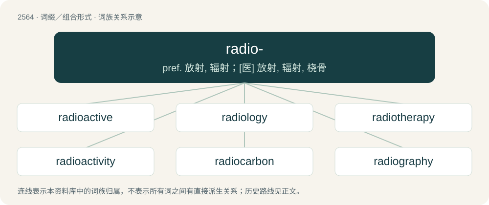

# 2669 · radio- — pref. 放射, 辐射；\[医\] 放射, 辐射, 桡骨

[总目录](../00_总目录_按常用程度.md)

**类型**：词缀／组合形式　｜　**来源语言**：见词源记录

## 核心含义与来源

- 核心含义：pref. 放射, 辐射；\[医\] 放射, 辐射, 桡骨
- 英文含义：radiation, radioactive
- 词形：radio-

**来源记录 1**（前缀／前置成分；radiation, radioactive）

Derived from Latin radius (“ray”). By surface analysis, clipping of radiation + -o-.

## 词族图

## 单词速览（常用到不常用）

| 单词 | 音标 | 释义 |
|---|---|---|
| [radioactive](#w-1) | 英 /ˌɹeɪdiəʊˈaktɪv/；美 /ˌɹeɪdioʊˈæktɪv/ | a. 放射性的, 有放射能的；\[医\] 放射性的, 放射的 |
| [radiology](#w-2) | 英 /ˌɹeɪdiˈɒlədʒi/；美 /ˌɹeɪdiˈɑlədʒi/ | n. 辐射学, 放射学；\[医\] 放射学 |
| [radiotherapy](#w-3) | /.reidiəuˈθerəpi/ | n. 放射疗法；\[医\] 放射疗法, 放射治疗 |
| [radioactivity](#w-4) | /ˌreɪdɪəʊakˈtɪvɪti/ | n. 放射性；\[化\] 放射性 |
| [radiocarbon](#w-5) | /.reidiəuˈkɑːbən/ | n. 放射性碳, 碳-14；\[化\] 放射性碳 |
| [radiography](#w-6) | /.reidiˈɒgrəfi/ | n. 射线照相术；\[化\] 射线照相术; 放射线照相术; 射线照相法; 放射线照相法 |
| [radioisotope](#w-7) | /.reidiəuˈaisətəup/ | n. 放射性同位素；\[化\] 放射性同位素 |
| [radionuclide](#w-8) | /,reidiəuˈnjuːklaid, -ˈnuː-/ | n. 放射性核素；\[化\] 放射性核素 |
| [radiometer](#w-9) | /.reidiˈɒmitə/ | n. 辐射计, 放射计；\[医\] 辐射计(光,热), 放射量计, 放射量测定器 |

## 逐词详解

### 1. radioactive

**词性**：形容词　｜　**音标**：英 /ˌɹeɪdiəʊˈaktɪv/；美 /ˌɹeɪdioʊˈæktɪv/

**中文释义**：a. 放射性的, 有放射能的；\[医\] 放射性的, 放射的

**英文义项**：Exhibiting radioactivity. / Dangerous and disgusting, particularly of people or ideas.

**构词拆分**：radio- + active

**词源与演化**：

Coined by Pierre Curie and Marie Curie in 1898 as French radio-actif, equivalent to English radio- + active.

**例句**：

> Even sleazy tactics and his radioactive mouth may not be able to contain this debacle.

该用例对应义项：Dangerous and disgusting, particularly of people or ideas.

### 2. radiology

**词性**：名词　｜　**音标**：英 /ˌɹeɪdiˈɒlədʒi/；美 /ˌɹeɪdiˈɑlədʒi/

**中文释义**：n. 辐射学, 放射学；\[医\] 放射学

**英文义项**：The specialty of medical imaging and its interpretation, originally and especially radiography but now including all imaging modalities, including ones that use no radiation (such as ultrasonography and magnetic resonance imaging).

**构词拆分**：radio- + -logy

**词源与演化**：

From radio- + -logy.

**例句**：

> A number of imaging techniques are employed in radiology, such as X-ray, MRI, and ultrasound.

### 3. radiotherapy

**词性**：名词　｜　**音标**：/.reidiəuˈθerəpi/

**中文释义**：n. 放射疗法；\[医\] 放射疗法, 放射治疗

**英文义项**：Synonym of radiation therapy.

**构词拆分**：radio- + therapy

**词源与演化**：

From radio- + therapy.

**例句**：

> Her first course of treatment was radiotherapy.

### 4. radioactivity

**词性**：名词　｜　**音标**：/ˌreɪdɪəʊakˈtɪvɪti/

**中文释义**：n. 放射性；\[化\] 放射性

**英文义项**：Spontaneous emission of ionizing radiation as a consequence of a nuclear reaction, or directly from the breakdown of an unstable nucleus. / The radiation so emitted; including gamma rays, alpha particles, neutrons, electrons, positrons, etc.

**构词拆分**：radioactive + -ity；radio- + activity

**词源与演化**：

From radioactive + -ity or radio- + activity.

**例句**：

> What do you think of when you hear the word "radioactivity"?

### 5. radiocarbon

**词性**：名词　｜　**音标**：/.reidiəuˈkɑːbən/

**中文释义**：n. 放射性碳, 碳-14；\[化\] 放射性碳

**英文义项**：A radioactive isotope of carbon, especially 146C.

**构词拆分**：radio- + carbon

**词源与演化**：

From radio- + carbon.

**例句**：

> Radiocarbon dating allows us to calculate the age of these skull at approximately 14,700 years.

### 6. radiography

**词性**：名词　｜　**音标**：/.reidiˈɒgrəfi/

**中文释义**：n. 射线照相术；\[化\] 射线照相术; 放射线照相术; 射线照相法; 放射线照相法

**英文义项**：The process of making radiographs, and the science of analyzing them.

**构词拆分**：radio- + -graphy

**词源与演化**：

From radio- + -graphy.

### 7. radioisotope

**词性**：名词　｜　**音标**：/.reidiəuˈaisətəup/

**中文释义**：n. 放射性同位素；\[化\] 放射性同位素

**英文义项**：A radioactive isotope of an element.

**构词拆分**：radio- + isotope

**词源与演化**：

From radio- + isotope.

### 8. radionuclide

**词性**：名词　｜　**音标**：/,reidiəuˈnjuːklaid, -ˈnuː-/

**中文释义**：n. 放射性核素；\[化\] 放射性核素

**英文义项**：a radioactive nuclide

**构词拆分**：radio- + nuclide

**词源与演化**：

From radio- + nuclide.

### 9. radiometer

**词性**：名词　｜　**音标**：/.reidiˈɒmitə/

**中文释义**：n. 辐射计, 放射计；\[医\] 辐射计(光,热), 放射量计, 放射量测定器

**英文义项**：A device that measures radiant energy.

**构词拆分**：radio- + -meter

**词源与演化**：

From radio- + -meter.
