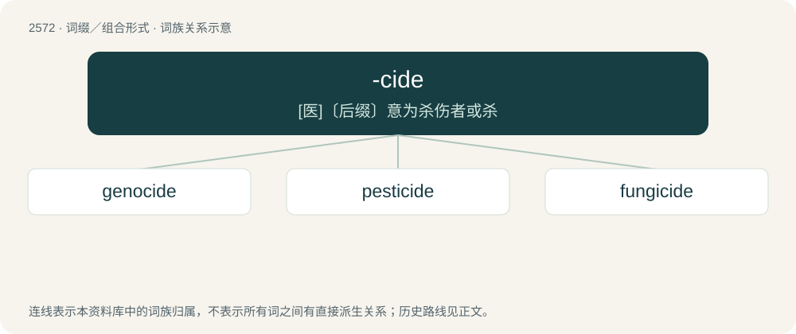

# 2677 · -cide — \[医\]〔后缀〕意为杀伤者或杀

[总目录](../00_总目录_按常用程度.md)

**类型**：词缀／组合形式　｜　**来源语言**：见词源记录

## 核心含义与来源

- 核心含义：\[医\]〔后缀〕意为杀伤者或杀
- 英文含义：killing
- 词形：-cide

**多个词源／构词路径**：同一拼写可能有不同来源；以下按词性和含义分别列出。

**来源记录 1**（后缀／后置成分；killing）

From Middle French -cide, from Latin -cīdium (“killing”).

**来源记录 2**（后缀／后置成分；killer）

From Middle French -cide, from Latin -cīda (“cutter, killer”), from caedō (“cut, kill”).

## 词族图

## 单词速览（常用到不常用）

| 单词 | 音标 | 释义 |
|---|---|---|
| [genocide](#w-1) | /ˈd͡ʒɛnəsaɪd/ | n. 种族灭绝, 灭绝整个种族的大屠杀；\[医\] 种族灭绝(侵略军队加害居民的罪行) |
| [pesticide](#w-2) | 英 /ˈpɛstɪsaɪd/；美 /ˈpɛstɪˌsaɪd/ | n. 杀虫剂；\[化\] 农药 |
| [fungicide](#w-3) | /ˈfʌŋɡɪsaɪd/ | n. 杀真菌剂；\[化\] 杀菌剂; 防霉剂 |

## 逐词详解

### 1. genocide

**词性**：名词　｜　**音标**：/ˈd͡ʒɛnəsaɪd/

**中文释义**：n. 种族灭绝, 灭绝整个种族的大屠杀；\[医\] 种族灭绝(侵略军队加害居民的罪行)

**英文义项**：The systematic and deliberate destruction of a group of people; typically by killing substantial numbers of them, on the basis of their ethnicity, religion, nationality, or similar grounds. / The systematic suppression of ideas or practices on the basis of cultural or ethnic origin; culturicide.

**构词拆分**：-cide + geno-；geno- + -cide (“killing”)

**词源与演化**：

From the stem of Ancient Greek γένος (génos, “race, kind”) (cognate with Latin gēns (“tribe, clan”), whence genus), corresponding to geno- + -cide (“killing”). Piecewise doublet of gendercide. Compare genticide. Coined by Polish Jewish lawyer Raphael Lemkin in 1943 or 1944 in reference to the Armenian Genocide (then known by other names; for more information, see Terminology of the Armenian genocide on Wikipedia), massacres of Assyrians (such as the Simele massacre and Seyfo) and the Jewish Holocaust.

**例句**：

> A genocide will always be followed by the denial that it ever happened.

该用例对应义项：The systematic and deliberate destruction of a group of people; typically by killing substantial numbers of them, on the basis of their ethnicity, religion, nationality, or similar grounds.

### 2. pesticide

**词性**：名词　｜　**音标**：英 /ˈpɛstɪsaɪd/；美 /ˈpɛstɪˌsaɪd/

**中文释义**：n. 杀虫剂；\[化\] 农药

**英文义项**：Anything, especially a synthetic substance but also any substance (e.g. sulfur), or virus, bacterium, or other organism, which kills or suppresses the activities of pests.

**构词拆分**：pest + -i- + -cide

**词源与演化**：

From pest + -i- + -cide.

**例句**：

> The pesticide degraded the health of the microbiome within the soil.

### 3. fungicide

**词性**：名词　｜　**音标**：/ˈfʌŋɡɪsaɪd/

**中文释义**：n. 杀真菌剂；\[化\] 杀菌剂; 防霉剂

**英文义项**：A substance used to kill fungus, whether yeasts, molds, mildews, or mushrooms.

**构词拆分**：fungi- + -cide

**词源与演化**：

From fungi- + -cide.
