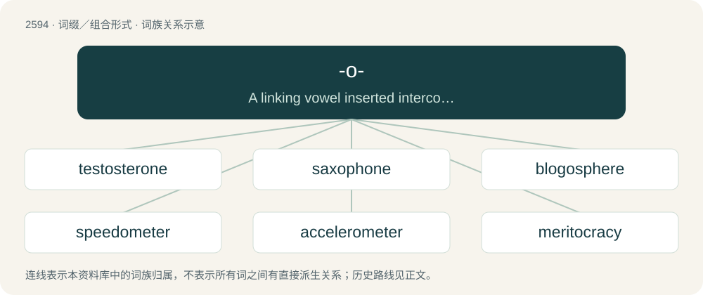

# 2694 · -o- — A linking vowel inserted interconsonantally between two morphemes, to ease pronunciation, without contributing to the meaning. It frequently joins words or combining forms of Ancie

[总目录](../00_总目录_按常用程度.md)

**类型**：词缀／组合形式　｜　**来源语言**：见词源记录

## 核心含义与来源

- 核心含义：A linking vowel inserted interconsonantally between two morphemes, to ease pronunciation, without contributing to the meaning. It frequently joins words or combining forms of Ancient Greek or Classical Latin origin in the classical compounds of New Latin and international scientific vocabulary, but it can also be used to join modern terms and even abbreviations, either formally or informally.
- 英文含义：A linking vowel inserted interconsonantally between two morphemes, to ease pronunciation, without contributing to the meaning. It frequently joins words or combining forms of Ancient Greek or Classical Latin origin in the classical compounds of New Latin and international scientific vocabulary, but it can also be used to join modern terms and even abbreviations, either formally or informally.
- 词形：-o-

**多个词源／构词路径**：同一拼写可能有不同来源；以下按词性和含义分别列出。

**来源记录 1**（interfix；A linking vowel inserted interconsonantally between two morphemes, to ease pronunciation, without contributing to the meaning. It frequently joins words or combining forms of Ancient Greek or Classical Latin origin in the classical compounds of New Latin and international scientific vocabulary, but it can also be used to join modern terms and even abbreviations, either formally or informally.）

Adopted from Latin -o-, originating ultimately from Ancient Greek -ο- (-o-). In English, the connective is found from the Middle English period in direct borrowings from Latin. Direct formations of English terms with the connective, always combining Greek or Latin roots, appear from the 16th or 17th century. From the 18th century, the suffix becomes productive in compounds where the second element is English. From about 1800, formations on all sorts of stems become common.

**来源记录 2**（interfix；a monoclonal antibody derived from a murine source）

Designated in the USAN guidelines for non-proprietary names of monoclonal antibodies.

## 词族图

## 单词速览（常用到不常用）

| 单词 | 音标 | 释义 |
|---|---|---|
| [testosterone](#w-1) | 英 /tɛˈstɒ.stə.ɹəʊn/；美 /tɛˈstɑ.stəˌɹoʊn/ | n. 睾丸激素；\[化\] 睾酮 |
| [saxophone](#w-2) | 英 /ˈsæksəˌfəʊ̯n/；美 /ˈsæksəˌfoʊ̯n/ | n. 萨克斯管；\[电\] 俱有余割平方辐射图案的线性排列天线 |
| [blogosphere](#w-3) | /ˈblɒɡ.əʊˌsfɪɚ/ | 博客世界 |
| [speedometer](#w-4) | 英 /spɪˈdɒm.ɪ.tə/；美 /spɪˈdɑ.mɪ.təɹ/ | n. 速度计, 里程计；\[机\] 里程计, 速度计 |
| [accelerometer](#w-5) | 美 /ækˌsɛl.əˈɹɑ.mə.tɚ/ | n. 加速度计；\[化\] 加速度计 |
| [meritocracy](#w-6) | 英 /mɛɹɪˈtɒkɹəsi/；美 /mɛɹəˈtɑkɹəsi/ | n. 精英领导阶级 |
| [lidocaine](#w-7) | 英 /ˈlɪd.ə(ʊ).keɪn/；美 /ˈlaɪ.dəˌkeɪn/ | \[化\] 利多卡因；\[医\] 利多卡因, 塞罗卡因 |
| [interferometer](#w-8) | /.intəfəˈrɒmitə/ | n. 干涉仪；\[化\] 干涉仪 |
| [propofol](#w-9) | 英 /ˈpɹəʊ.pəf.ɒl/；美 /ˈpɹoʊ.pəˌfoʊl/ | n. 异丙酚，常用的镇静剂为苯二氮䓬类药物如咪达唑仑midazolam其他药物有巴比妥酸盐异丙酚 |
| [interferometry](#w-10) | 英 /ˌɪn.tə.fəˈɹɒ.mɪ.tɹi/；美 /ˌɪn.(t)ɚ.fəˈɹɑ.mɪ.tɹi/ | n .干涉测量(法) |
| [linotype](#w-11) | /ˈlainəutaip/ | n. 整行铸造排字机；vi. 以整行排字机排字；vt. 以整行排字机排 |
| [vancomycin](#w-12) | /ˌvæŋ.kəˈmaɪ.sɪn/ | \[化\] 万古霉素；\[医\] 万古霉素 |
| [shambolic](#w-13) | 英 /ʃamˈbɒlɪk/；美 /(ˌ)ʃæmˈbɑlɪk/ | a. 大混乱的 |
| [erythromycin](#w-14) | 英 /ɪˌɹɪθ.ɹə(ʊ)ˈmʌɪ.sɪn/；美 /ɪˌɹɪθ.ɹəˈmaɪ.sn̩/ | n. 红霉素；\[化\] 红霉素 |
| [thrombocytopenia](#w-15) | 英 /ˌθrɒm.bə.sʌɪ.təˈpiːniə/ | n. 血小板减少症；\[医\] 血小板减少 |
| [norovirus](#w-16) | 英 /ˈnɒɹə(ʊ)vaɪɹəs/ | \[医\]诺洛病毒可引起病毒性胃肠炎 |
| [fibrinogen](#w-17) | /faiˈbrinədʒən/ | n. (血)纤维蛋白原；\[化\] 血纤蛋白原; 血纤维蛋白原 |
| [spironolactone](#w-18) | 英 /ˌspʌɪ.ɹən.ə(ʊ)ˈlæk.təʊn/；美 /ˌspaɪ.ɹən.oʊˈlækˌtoʊn/ | n. \[药\]安体舒通,螺内酯,螺旋内酯甾酮(一种利尿药) |
| [hallucinogen](#w-19) | 英 /ˌhæl.uːˈsɪn.ə.dʒən/；美 /həˈluː.sɪ.nə.d͡ʒɛn/ | n. 迷幻剂；\[化\] 致幻剂 |
| [cyclocross](#w-20) | /ˈsaɪkləʊˌkɹɒs/ | 【英文】A form of bicycle racing consisting of many laps of a short course featuring pavement, wooded trails, grass, steep hills and obstacles and requiring the rider to quickly dismount, carry the bike whilst navigating the |
| [meritocratic](#w-21) | /ˌmerɪtəˈkrætɪk/ | a. 精英管理的；贤能统治的 |
| [pentobarbital](#w-22) | 美 /ˌpɛn.təˈbɑɹ.bəˌtɔl/ | n. \[药\]戊巴比妥 |
| [doxorubicin](#w-23) | 英 /ˌdɒk.səʊˈɹuː.bɪs.ɪn/；美 /ˌdɑk.səˈɹu.bɪs.ɪn/ | \[化\] 阿霉素 |
| [furosemide](#w-24) | 美 /fjʊˈɹoʊ.səˌmaɪd/ | n. \[药\]速尿,速尿灵,利尿磺胺 |
| [eosinophilic](#w-25) | /-ˈfilik/ | \[医\] 嗜曙红的, 嗜酸性的 |
| [naturopathic](#w-26) | /,neitʃərə-ˈpæθik/ | \[医\] 自然医术的 |
| [plasminogen](#w-27) | /plæzˈminədʒin/ | \[化\] 纤溶酶原; 血纤维蛋白溶酶原 |
| [citalopram](#w-28) | 美 /saɪˈtæl.əˌpɹæm/ | 西酞普兰 |

## 逐词详解

### 1. testosterone

**词性**：名词　｜　**音标**：英 /tɛˈstɒ.stə.ɹəʊn/；美 /tɛˈstɑ.stəˌɹoʊn/

**中文释义**：n. 睾丸激素；\[化\] 睾酮

**英文义项**：A steroid hormone that stimulates development of male secondary sexual characteristics, produced mainly in the testes, but also in the ovaries and adrenal cortex. / Manly behavior, often of an aggressive or foolishly reckless nature.

**构词拆分**：testis + -o- + -sterone

**词源与演化**：

From test(is) + -o- + -sterone (“steroid hormone”).

**例句**：

> Mother encouraged James to rely more on intelligence and less on testosterone to deal with the neighbor's son.

该用例对应义项：Manly behavior, often of an aggressive or foolishly reckless nature.

### 2. saxophone

**词性**：名词　｜　**音标**：英 /ˈsæksəˌfəʊ̯n/；美 /ˈsæksəˌfoʊ̯n/

**中文释义**：n. 萨克斯管；\[电\] 俱有余割平方辐射图案的线性排列天线

**英文义项**：A single-reed instrument musical instrument of the woodwind family, usually made of brass and with a distinctive loop bringing the bell upwards. / Someone who plays the saxophone; a saxophonist.

**构词拆分**：Sax + -o- + -phone

**词源与演化**：

Borrowed from French saxophone, a combination of the surname of its inventor Adolphe Sax (1814–1894) + -o- + -phone (“something that makes a sound”), from Ancient Greek φωνή (phōnḗ, “sound, voice”). The first element surname is a variant of the German Sachs (“Saxon”). Analyzable as Sax + -o- + -phone.

**例句**：

> The saxophones typically sit behind the flutes in a concert band.

该用例对应义项：Someone who plays the saxophone; a saxophonist.

### 3. blogosphere

**词性**：名词　｜　**音标**：/ˈblɒɡ.əʊˌsfɪɚ/

**中文释义**：博客世界

**英文义项**：The totality of blogs, especially the unique jargon, cultures and shared interests created by their interconnection.

**构词拆分**：blog + -o- + -sphere

**词源与演化**：

From blog + -o- + -sphere. Possibly under the influence of biosphere, atmosphere, etc.

**例句**：

> Mary studies social psychology, and is currently researching the evolution of the European blogosphere.

### 4. speedometer

**词性**：名词　｜　**音标**：英 /spɪˈdɒm.ɪ.tə/；美 /spɪˈdɑ.mɪ.təɹ/

**中文释义**：n. 速度计, 里程计；\[机\] 里程计, 速度计

**英文义项**：An instrument located within the dashboard of a vehicle that measures and indicates the current speed of the vehicle. / Such a device incorporating an odometer.

**构词拆分**：speed + -o- + -meter

**词源与演化**：

From speed + -o- + -meter; by surface analysis, speed + -ometer.

**例句**：

> Your car's speedometer tells you the car's instantaneous speed, not its average speed.

### 5. accelerometer

**词性**：名词　｜　**音标**：美 /ækˌsɛl.əˈɹɑ.mə.tɚ/

**中文释义**：n. 加速度计；\[化\] 加速度计

**英文义项**：An instrument for measuring acceleration. / An instrument made for detecting and measuring vibrations.

**构词拆分**：accelerate + -o- + -meter

**词源与演化**：

From accelerate + -o- + -meter.

### 6. meritocracy

**词性**：名词　｜　**音标**：英 /mɛɹɪˈtɒkɹəsi/；美 /mɛɹəˈtɑkɹəsi/

**中文释义**：n. 精英领导阶级

**英文义项**：Rule by merit and talent. / A type of society where wealth, income, and social status are assigned through competition.

**构词拆分**：merit + -o- + -cracy

**词源与演化**：

From merit + -o- + -cracy, coined by British sociologist Alan Fox in 1956 in an article in Socialist Commentary from May 1956, used as a derisive term, and popularized by British sociologist Michael Young, Baron Young of Dartington in his book The Rise of the Meritocracy (1958).

**例句**：

> As a small nation without natural resources, Singapore relies on education and meritocracy to develop its economy.

该用例对应义项：Rule by merit and talent.

### 7. lidocaine

**词性**：名词　｜　**音标**：英 /ˈlɪd.ə(ʊ).keɪn/；美 /ˈlaɪ.dəˌkeɪn/

**中文释义**：\[化\] 利多卡因；\[医\] 利多卡因, 塞罗卡因

**英文义项**：A crystalline compound, C₁₄H₂₂N₂O, that is used in the form of its hydrochloride as a local anesthetic and as an antiarrhythmic agent.

**构词拆分**：(acetani)lid(e) + -o- + -caine

**词源与演化**：

From (acetani)lid(e) + -o- + -caine, from cocaine.

### 8. interferometer

**词性**：名词　｜　**音标**：/.intəfəˈrɒmitə/

**中文释义**：n. 干涉仪；\[化\] 干涉仪

**英文义项**：Any of several instruments that use the interference of waves to determine wavelengths and wave velocities, determine refractive indices, measure small distances, temperature changes, stresses, and many other useful measurements.

**构词拆分**：interfere + -o- + -meter

**词源与演化**：

From interfer(e) + -o- + -meter.

**例句**：

> The Laser Interferometer Space Antenna (LISA) is a space mission that will be able to detect gravitational waves.

### 9. propofol

**词性**：名词　｜　**音标**：英 /ˈpɹəʊ.pəf.ɒl/；美 /ˈpɹoʊ.pəˌfoʊl/

**中文释义**：n. 异丙酚，常用的镇静剂为苯二氮䓬类药物如咪达唑仑midazolam其他药物有巴比妥酸盐异丙酚

**英文义项**：A sedating and hypnotic agent C₁₂H₁₈O administered intravenously to induce and maintain anesthesia or sedation.

**构词拆分**：(diiso)prop(yl)ph(en)ol + -o-

**词源与演化**：

From contraction of (diiso)prop(yl)ph(en)ol + -o-.

### 10. interferometry

**词性**：名词　｜　**音标**：英 /ˌɪn.tə.fəˈɹɒ.mɪ.tɹi/；美 /ˌɪn.(t)ɚ.fəˈɹɑ.mɪ.tɹi/

**中文释义**：n .干涉测量(法)

**英文义项**：The design and use of optical or radio interferometers.

**构词拆分**：interfere + -o- + -metry

**词源与演化**：

From interfere + -o- + -metry.

### 11. linotype

**词性**：名词　｜　**音标**：/ˈlainəutaip/

**中文释义**：n. 整行铸造排字机；vi. 以整行排字机排字；vt. 以整行排字机排

**英文义项**：A form of typesetting machine in which a complete line of characters is set at once. / The slug produced by such a machine, or matter composed in such lines.

**构词拆分**：line + -o- + type

**词源与演化**：

Genericized trademark; presumably from line + -o- + type.

### 12. vancomycin

**词性**：名词　｜　**音标**：/ˌvæŋ.kəˈmaɪ.sɪn/

**中文释义**：\[化\] 万古霉素；\[医\] 万古霉素

**英文义项**：A glycopeptide antibiotic C₆₆H₇₅Cl₂N₉O₂₄ produced by the actinomycete Amycolaptosis orientalis, used in the form of its hydrochloride C₆₆H₇₅Cl₂N₉O₂₄·HCl against Gram-positive bacteria, especially staphylococci resistant to meticillin and enterococci.

**构词拆分**：vanquish + -o- + -mycin

**词源与演化**：

From vanquish + -o- + -mycin (“antibiotic produced by a Streptomyces strain”).

### 13. shambolic

**词性**：形容词　｜　**音标**：英 /ʃamˈbɒlɪk/；美 /(ˌ)ʃæmˈbɑlɪk/

**中文释义**：a. 大混乱的

**英文义项**：Chaotic, disorganised or mismanaged.

**构词拆分**：shambles + -o- + -ic (adjective)

**词源与演化**：

Possibly from shambles + -o- + -ic (adjective), in which the interconsonantal -o- avoids the /mbl/ consonant cluster. Possibly influenced by symbolic. Alternatively, possibly a blend of shambles + symbolic.

**例句**：

> It's a shambolic system.

该用例对应义项：(British slang) disorderly or chaotic

### 14. erythromycin

**词性**：名词　｜　**音标**：英 /ɪˌɹɪθ.ɹə(ʊ)ˈmʌɪ.sɪn/；美 /ɪˌɹɪθ.ɹəˈmaɪ.sn̩/

**中文释义**：n. 红霉素；\[化\] 红霉素

**英文义项**：An antibiotic similar to penicillin, used for the treatment of a number of bacterial infections. / A broad-spectrum macrolide antibiotic C₃₇H₆₇NO₁₃ produced by an actinomycete Saccharopolyspora erythraea (formerly Streptomyces erythreus) and similar in its effects to penicillin, administered orally or topically in the treatment of infections caused by Gram-positive bacteria.

**构词拆分**：-o- + -mycin

**词源与演化**：

From (Streptomyces) erythr(eus) + -o- + -mycin (“antibiotic from a Streptomyces strain”).

### 15. thrombocytopenia

**词性**：名词　｜　**音标**：英 /ˌθrɒm.bə.sʌɪ.təˈpiːniə/

**中文释义**：n. 血小板减少症；\[医\] 血小板减少

**英文义项**：An abnormally low number of platelets in the blood.

**构词拆分**：thrombocyte + -o- + -penia

**词源与演化**：

From thrombocyte + -o- + -penia.

### 16. norovirus

**词性**：名词　｜　**音标**：英 /ˈnɒɹə(ʊ)vaɪɹəs/

**中文释义**：\[医\]诺洛病毒可引起病毒性胃肠炎

**英文义项**：Norovirus, the genus of Norwalk virus, which causes gastric distress in humans.

**构词拆分**：Norwalk + -o- + virus

**词源与演化**：

From Nor(walk) + -o- + virus.

**例句**：

> The norovirus causes nausea, vomiting, diarrhea and stomach cramping.

该用例对应义项：Norovirus, the genus of Norwalk virus, which causes gastric distress in humans.

### 17. fibrinogen

**词性**：名词　｜　**音标**：/faiˈbrinədʒən/

**中文释义**：n. (血)纤维蛋白原；\[化\] 血纤蛋白原; 血纤维蛋白原

**英文义项**：A protein that in humans plays a role in the formation of clots.

**构词拆分**：fibrin + -o- + -gen

**词源与演化**：

From fibrin + -o- + -gen.

### 18. spironolactone

**词性**：名词　｜　**音标**：英 /ˌspʌɪ.ɹən.ə(ʊ)ˈlæk.təʊn/；美 /ˌspaɪ.ɹən.oʊˈlækˌtoʊn/

**中文释义**：n. \[药\]安体舒通,螺内酯,螺旋内酯甾酮(一种利尿药)

**英文义项**：A steroid drug which acts as an antimineralocorticoid (for which purpose it is used in the treatment of certain types of edema and hypertension) and an antiandrogen (for which purpose it is used as part of some types of hormone therapy, especially for transgender women).

**构词拆分**：spiro- + -one + -o- + lactone

**词源与演化**：

From spiro- + -one + -o- + lactone.

### 19. hallucinogen

**词性**：名词　｜　**音标**：英 /ˌhæl.uːˈsɪn.ə.dʒən/；美 /həˈluː.sɪ.nə.d͡ʒɛn/

**中文释义**：n. 迷幻剂；\[化\] 致幻剂

**英文义项**：Any substance tending to induce hallucination.

**构词拆分**：hallucination + -o- + -gen

**词源与演化**：

From hallucination + -o- (interconsonantal) + -gen (“producer”).

**例句**：

> Being a psychoactive agent, a hallucinogen can cause you to dissociate.

### 20. cyclocross

**词性**：名词　｜　**音标**：/ˈsaɪkləʊˌkɹɒs/

**英文义项**：A form of bicycle racing consisting of many laps of a short course featuring pavement, wooded trails, grass, steep hills and obstacles and requiring the rider to quickly dismount, carry the bike whilst navigating the obstruction and remount in one motion.

**构词拆分**：cycle + -o- + cross (country)

**词源与演化**：

From cycle + -o- + cross (country).

### 21. meritocratic

**词性**：形容词　｜　**音标**：/ˌmerɪtəˈkrætɪk/

**中文释义**：a. 精英管理的；贤能统治的

**英文义项**：Pertaining to a meritocracy.

**构词拆分**：merit + -o- + -cratic；meritocrat + -ic

**词源与演化**：

From merit + -o- + -cratic or meritocrat + -ic.

### 22. pentobarbital

**词性**：名词　｜　**音标**：美 /ˌpɛn.təˈbɑɹ.bəˌtɔl/

**中文释义**：n. \[药\]戊巴比妥

**英文义项**：A narcotic and sedative barbiturate drug (trademark Nembutal) formerly used to relieve insomnia.

**构词拆分**：pent(yl) + -o- + barbital

**词源与演化**：

From pent(yl) + -o- + barbital.

### 23. doxorubicin

**词性**：名词　｜　**音标**：英 /ˌdɒk.səʊˈɹuː.bɪs.ɪn/；美 /ˌdɑk.səˈɹu.bɪs.ɪn/

**中文释义**：\[化\] 阿霉素

**英文义项**：An anthracycline antibiotic drug (trademark Adriamycin) with broad antineoplastic activity that is obtained from a bacterium (Streptomyces peucetius subsp. caesius) and is administered in the form of its hydrochloride C₂₇H₂₉NO₁₁·HCl in chemotherapy.

**构词拆分**：deoxy- + -o- + -rubicin

**词源与演化**：

From d(e)ox(y)- + -o- + -rubicin (“daunorubicin derivative”).

### 24. furosemide

**词性**：名词　｜　**音标**：美 /fjʊˈɹoʊ.səˌmaɪd/

**中文释义**：n. \[药\]速尿,速尿灵,利尿磺胺

**英文义项**：A diuretic (trademark Lasix) used in the treatment of congestive heart failure and edema.

**构词拆分**：fur(yl) + -o- + -semide (“alteration of s(ulfon)amide”)

**词源与演化**：

Probably from fur(yl) + -o- + -semide (“alteration of s(ulfon)amide”).

### 25. eosinophilic

**词性**：形容词　｜　**音标**：/-ˈfilik/

**中文释义**：\[医\] 嗜曙红的, 嗜酸性的

**英文义项**：That is readily stained with eosin. / Of, pertaining to an eosinophil or to eosinophilia.

**构词拆分**：eosin + -o- + -philic

**词源与演化**：

From eosin + -o- + -philic.

### 26. naturopathic

**词性**：形容词　｜　**音标**：/,neitʃərə-ˈpæθik/

**中文释义**：\[医\] 自然医术的

**英文义项**：Relating to naturopathy or to naturopaths

**构词拆分**：nature + -o- + -pathic

**词源与演化**：

From nature + -o- + -pathic.

### 27. plasminogen

**词性**：名词　｜　**音标**：/plæzˈminədʒin/

**中文释义**：\[化\] 纤溶酶原; 血纤维蛋白溶酶原

**英文义项**：The inactive precursor to plasmin; profibrinolysin

**构词拆分**：plasmin + -o- + -gen

**词源与演化**：

From plasmin + -o- + -gen.

**例句**：

> There are several effective anti-clotting agents that doctors can use to clear these clogged blood vessels, including one called tissue plasminogen activator, or tPA.

### 28. citalopram

**词性**：名词　｜　**音标**：美 /saɪˈtæl.əˌpɹæm/

**中文释义**：西酞普兰

**英文义项**：A drug that functions as a SSRI and is administered orally in the form of its hydrobromide C₂₀H₂₁FN₂O·HBr to treat depression and anxiety. It is marketed under the trademark Celexa.

**构词拆分**：cy(ano)- + (ph)thal(imide) + -o- + pr(opyl)am(ine)

**词源与演化**：

Probably from cy(ano)- + (ph)thal(imide) + -o- + pr(opyl)am(ine).
