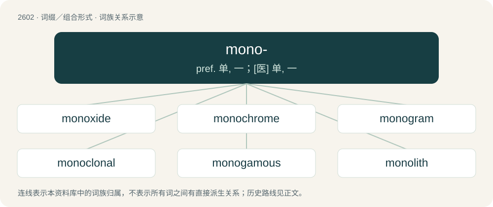

# 2701 · mono- — pref. 单, 一；\[医\] 单, 一

[总目录](../00_总目录_按常用程度.md)

**类型**：词缀／组合形式　｜　**来源语言**：见词源记录

## 核心含义与来源

- 核心含义：pref. 单, 一；\[医\] 单, 一
- 英文含义：one, single, only
- 词形：mono-

**来源记录 1**（前缀／前置成分；one, single, only）

From Ancient Greek μονο- (mono-), combining form of μόνος (mónos, “alone, only, sole, single”).

## 词族图

## 单词速览（常用到不常用）

| 单词 | 音标 | 释义 |
|---|---|---|
| [monoxide](#w-1) | /məˈnɒksʌɪd/ | n. 一氧化物；\[医\] 一氧化物 |
| [monochrome](#w-2) | 英 /ˈmɒn.əˌkɹəʊm/；美 /ˈmɑn.əˌkɹoʊm/ | n. 单色画, 单色, 黑白；a. 单色的, 黑白的；\[计\] 单色 |
| [monogram](#w-3) | 英 /ˈmɒ.nəˌɡɹæm/；美 /ˈmɑ.nəˌɡɹæm/ | 【英文】A sentence consisting of only one line, or an epigram consisting of only one verse, of poetry. |
| [monoclonal](#w-4) | 英 /ˌmɒn.əˈkləʊ.nəl/；美 /ˌmɑn.əˈkloʊ.nəl/ | a. \[生\]单克隆的 |
| [monogamous](#w-5) | 英 /məˈnɒɡəməs/；美 /məˈnɑɡəməs/ | a. 一夫一妻制的 |
| [monolith](#w-6) | 英 /ˈmɒn.ə.lɪθ/；美 /ˈmɑn.əˌlɪθ/ | n. 巨型独石, 大独石碑 |
| [monochromatic](#w-7) | /.mɒnəukrəuˈmætik/ | a. 单色的, 单频的；\[化\] 单色的 |
| [monomer](#w-8) | 英 /ˈmɒnəmə/；美 /ˈmɑnəmɚ/ | n. 单体；\[化\] 单体 |
| [monorail](#w-9) | 英 /ˈmɒnəɹeɪl/；美 /ˈmɑnəɹeɪl/ | n. 单轨铁路；\[化\] 单轨梁 |
| [monotheistic](#w-10) | 英 /ˌmɒnə(ʊ)θɪˈɪstɪk/；美 /ˌmɑnəθiˈɪstɪk/ | a. 一神论的 |
| [monotheism](#w-11) | /ˌmɑnoʊ̯ˈθiɪzm̩/ | n. 一神论, 一神教 |
| [monolingual](#w-12) | /ˌmɒ.nəʊˈlɪŋ.ɡwəl/ | a. 单语的, 仅用一种语言的 |
| [monoamine](#w-13) | /mɒnəʊˈeɪmiːn/ | \[化\] 一元胺 |
| [monotype](#w-14) | /ˈmɑnoʊˌtaɪp/ | n. 莫诺铸排机, 单型；vt. 用单字铸排机排(字) |
| [monoculture](#w-15) | /ˈmɒnəˌkʌlt͡ʃə(ɹ)/ | n. 单一栽培, 单作；\[经\] 单一农作物 |
| [monosyllabic](#w-16) | 英 /ˌmɒnə(ʊ)sɪˈlabɪk/ | a. 单音节的 |
| [monotherapy](#w-17) | /mɒnəʊˈθerəpɪ/ | \[医\]单一疗法 |
| [monocular](#w-18) | 英 /mənˈɒk.jə.lə(ɹ)/ | a. 单眼的, 单眼用的 |
| [monolayer](#w-19) | /ˈmɔnəuˈleiə/ | n. 单层；\[计\] 单层 |
| [mononuclear](#w-20) |  | n. 单核细胞；a. 单核的 |
| [monopole](#w-21) | /ˈmɔnəpəul/ | 【英文】A magnetic monopole. |
| [monounsaturated](#w-22) | /ˌmɒnəʌnˈsætʃəˌreɪtɪd/ | a. 单不饱和的 |
| [monoclinic](#w-23) | /mɒnə(ʊ)ˈklɪnɪk/ | a. \[晶体\] 单斜的；\[晶体\] 单斜晶体的 |
| [monoplane](#w-24) | /ˈmɒnəplein/ | n. 单翼机；\[机\] 单翼飞机 |
| [monohydrate](#w-25) | /mɒnə(ʊ)ˈhaɪdreɪt/ | n. 一水合物；一水化物 |
| [monophosphate](#w-26) | /,mɔnəˈfɔsfeit/ | n. 一磷酸盐；\[医\] 一磷酸盐 |
| [mononucleosis](#w-27) | 美 /ˌmɑnoʊnukliˈoʊsɪs/ | \[医\] 单核细胞增多\[症\] |

## 逐词详解

### 1. monoxide

**词性**：名词　｜　**音标**：/məˈnɒksʌɪd/

**中文释义**：n. 一氧化物；\[医\] 一氧化物

**英文义项**：Any oxide containing a single oxygen atom in each molecule or formula unit.

**构词拆分**：mon- + oxide

**词源与演化**：

Formed as mon- + oxide; compare the earlier dioxide, pentoxide, and tetroxide.

**例句**：

> Carbon monoxide is a poisonous substance formed by the incomplete combustion of carbon compounds.

### 2. monochrome

**词性**：名词　｜　**音标**：英 /ˈmɒn.əˌkɹəʊm/；美 /ˈmɑn.əˌkɹoʊm/

**中文释义**：n. 单色画, 单色, 黑白；a. 单色的, 黑白的；\[计\] 单色

**英文义项**：A black and white image, especially such a photograph. / A painting executed in shades of a single colour.

**构词拆分**：mono- + -chrome

**词源与演化**：

From Ancient Greek μονόχρωμος (monókhrōmos), from μόνος (mónos, “one”) + χρῶμα (khrôma, “color”); mono- + -chrome.

**例句**：

> In comparison to a colour print, a monochrome print is less expensive.

### 3. monogram

**词性**：名词　｜　**音标**：英 /ˈmɒ.nəˌɡɹæm/；美 /ˈmɑ.nəˌɡɹæm/

**英文义项**：A sentence consisting of only one line, or an epigram consisting of only one verse, of poetry.

**构词拆分**：mono- + -gram

**词源与演化**：

Formed as mono- + -gram, by analogy with epigram.

### 4. monoclonal

**词性**：形容词　｜　**音标**：英 /ˌmɒn.əˈkləʊ.nəl/；美 /ˌmɑn.əˈkloʊ.nəl/

**中文释义**：a. \[生\]单克隆的

**英文义项**：genetically engineered from a single clone; used especially of a protein or antibody

**构词拆分**：mono- + clonal

**词源与演化**：

From mono- + clonal.

**例句**：

> The purified antibodies, known as monoclonal antibodies, were infused intravenously into rhesus monkeys infected with a virus very similar to HIV.

### 5. monogamous

**词性**：形容词　｜　**音标**：英 /məˈnɒɡəməs/；美 /məˈnɑɡəməs/

**中文释义**：a. 一夫一妻制的

**英文义项**：Involving marriage to one person at a time. / Characterized by mutual sexual and romantic exclusivity.

**构词拆分**：mono- + -gamous

**词源与演化**：

From mono- + -gamous.

**例句**：

> Unlike most other rodents, beaver pairs are monogamous, staying together for multiple breeding seasons.

### 6. monolith

**词性**：名词　｜　**音标**：英 /ˈmɒn.ə.lɪθ/；美 /ˈmɑn.əˌlɪθ/

**中文释义**：n. 巨型独石, 大独石碑

**英文义项**：A large, single block of stone which is a natural feature; or a block of stone or other similar material used in architecture and sculpture, especially one carved into a monument in ancient times. / Anything massive, uniform, and unmovable, especially a towering and impersonal cultural, political, or social organization or structure.

**构词拆分**：mono- + -lith

**词源与演化**：

The noun is borrowed from French monolithe (“object made from a single block of stone”), from Middle French monolythe (“made from a single block of stone”) (rare), and from their etymon Latin monolithus (“made from a single block of stone”), from Ancient Greek μονόλιθος (monólithos, “made from a single block of stone”), from μονο- (mono-, prefix meaning ‘alone; single’) (from μόνος (mónos, “alone; only, unique”), ultimately from Proto-Indo-European \*mey- (“little, small”)) + λίθος (líthos, “a stone; stone as a substance”); analysable as mono- + -lith. The English word is cognate with German monolith (“made from a single block of stone”). The verb is derived from the noun.

**例句**：

> There was a monolith in the middle of nowhere. That was pretty strange.

### 7. monochromatic

**词性**：形容词　｜　**音标**：/.mɒnəukrəuˈmætik/

**中文释义**：a. 单色的, 单频的；\[化\] 单色的

**英文义项**：Having only one color, represented by differing hues and tints. For example shades in a black and white television. / Perceptive of only one color; unable to distinguish colors; total color blindness.

**构词拆分**：mono- + chromatic

**词源与演化**：

From mono- + chromatic, mono- from Ancient Greek μόνος (mónos, “alone, only, sole, single”), chromatic from Ancient Greek χρῶμα (khrôma, “color”).

**例句**：

> Hopefully our world will never become monolingual, monocultural or monochromatic!

### 8. monomer

**词性**：名词　｜　**音标**：英 /ˈmɒnəmə/；美 /ˈmɑnəmɚ/

**中文释义**：n. 单体；\[化\] 单体

**英文义项**：A relatively small molecule which can be covalently bonded to other monomers to form a polymer or oligomer.

**构词拆分**：mono- + -mer

**词源与演化**：

From mono- + -mer.

### 9. monorail

**词性**：名词　｜　**音标**：英 /ˈmɒnəɹeɪl/；美 /ˈmɑnəɹeɪl/

**中文释义**：n. 单轨铁路；\[化\] 单轨梁

**英文义项**：a railroad system where the trains run on one rail / a train running on a single rail

**构词拆分**：mono- + rail

**词源与演化**：

Borrowed from French monorail, equivalent to mono- + rail.

**例句**：

> Benedito will ride the monorail at the theme park.

### 10. monotheistic

**词性**：形容词　｜　**音标**：英 /ˌmɒnə(ʊ)θɪˈɪstɪk/；美 /ˌmɑnəθiˈɪstɪk/

**中文释义**：a. 一神论的

**英文义项**：Believing in a single god, deity, spirit, etc., especially for an organized religion, faith, or creed.

**构词拆分**：mono- + theistic

**词源与演化**：

From mono- + theistic.

**例句**：

> Islam is a monotheistic religion sharing common elements with Judaism and Christianity.

### 11. monotheism

**词性**：名词　｜　**音标**：/ˌmɑnoʊ̯ˈθiɪzm̩/

**中文释义**：n. 一神论, 一神教

**英文义项**：Belief in the One True God, defined by More as personal, immaterial and trinitarian. / The belief in a single deity (one god or goddess); especially within an organized religion.

**构词拆分**：mono- + theism

**词源与演化**：

A learned 17th-century coinage, mono- + theism, from (μονός (monós, “one”)) and (θεός (theós, “god, deity”) + -ισμός (-ismós)) The term parallels the earlier polytheism, atheism (the simplex theism being slightly later). The term was coined by Henry More, ca. 1660, in explicit juxtaposition with both atheism and polytheism. It was redefined through etymological fallacy by Daniel Webster ca. 1828.

### 12. monolingual

**词性**：形容词　｜　**音标**：/ˌmɒ.nəʊˈlɪŋ.ɡwəl/

**中文释义**：a. 单语的, 仅用一种语言的

**英文义项**：Knowing or using a single language; written or spoken in a single language.

**构词拆分**：mono- + lingual

**词源与演化**：

From mono- + lingual.

**例句**：

> If we lived in a monolingual world, it would be a nightmare.

### 13. monoamine

**词性**：名词　｜　**音标**：/mɒnəʊˈeɪmiːn/

**中文释义**：\[化\] 一元胺

**英文义项**：Any compound having a single amino functional group, especially a neurotransmitter.

**构词拆分**：mono- + -amine

**词源与演化**：

From mono- + -amine.

### 14. monotype

**词性**：名词　｜　**音标**：/ˈmɑnoʊˌtaɪp/

**中文释义**：n. 莫诺铸排机, 单型；vt. 用单字铸排机排(字)

**英文义项**：A print made by creating the design using oil paint or printer's ink on metal or glass, then transferring the image directly to paper. / The technique of making such prints.

**构词拆分**：mono- + type；mono- + -type

**词源与演化**：

From mono- + type or mono- + -type. The printing technique is so called because it allows only one impression to be taken.

### 15. monoculture

**词性**：名词　｜　**音标**：/ˈmɒnəˌkʌlt͡ʃə(ɹ)/

**中文释义**：n. 单一栽培, 单作；\[经\] 单一农作物

**英文义项**：The cultivation of a single crop at a time. / A culture or society that lacks diversity; a society marked by monoculturalism.

**构词拆分**：mono- + culture

**词源与演化**：

From mono- + culture.

**例句**：

> Stop maize monoculture, and reestablish multiple cropping, to combat the loss of landscape and soil diversity.

### 16. monosyllabic

**词性**：形容词　｜　**音标**：英 /ˌmɒnə(ʊ)sɪˈlabɪk/

**中文释义**：a. 单音节的

**英文义项**：Consisting of one syllable. / Using monosyllables, speaking in monosyllables; curt.

**构词拆分**：mono- + syllabic

**词源与演化**：

Borrowed from Late Latin monosyllabicus, from Latin monosyllabus, from Hellenistic Ancient Greek μονοσύλλαβος (monosúllabos). By surface analysis, monosyllable + -ic or mono- + syllabic.

**用法示例／搭配（非完整句）**：

> monosyllabic responses

该用例对应义项：Using monosyllables, speaking in monosyllables; curt.

### 17. monotherapy

**词性**：名词　｜　**音标**：/mɒnəʊˈθerəpɪ/

**中文释义**：\[医\]单一疗法

**英文义项**：A therapy which is administered by itself

**构词拆分**：mono- + therapy

**词源与演化**：

From mono- + therapy.

### 18. monocular

**词性**：形容词　｜　**音标**：英 /mənˈɒk.jə.lə(ɹ)/

**中文释义**：a. 单眼的, 单眼用的

**英文义项**：Having one eye. / Related to a monocle.

**构词拆分**：mono- + ocular

**词源与演化**：

From mono- + ocular.

**例句**：

> The pirate was observing the sea with his monocular.

### 19. monolayer

**词性**：名词　｜　**音标**：/ˈmɔnəuˈleiə/

**中文释义**：n. 单层；\[计\] 单层

**英文义项**：A layer of material that is one molecule thick / A layer of tissue that is one cell thick

**构词拆分**：mono- + layer

**词源与演化**：

From mono- + layer.

### 20. mononuclear

**词性**：形容词

**中文释义**：n. 单核细胞；a. 单核的

**英文义项**：Having a single nucleus. / monocyclic.

**构词拆分**：mono- + nuclear

**词源与演化**：

From mono- + nuclear.

### 21. monopole

**词性**：名词　｜　**音标**：/ˈmɔnəpəul/

**英文义项**：A magnetic monopole. / A monopole antenna.

**构词拆分**：mono- + pole

**词源与演化**：

From mono- + pole.

### 22. monounsaturated

**词性**：形容词　｜　**音标**：/ˌmɒnəʌnˈsætʃəˌreɪtɪd/

**中文释义**：a. 单不饱和的

**英文义项**：having a single double or triple bond

**构词拆分**：mono- + unsaturated

**词源与演化**：

From mono- + unsaturated.

### 23. monoclinic

**词性**：形容词　｜　**音标**：/mɒnə(ʊ)ˈklɪnɪk/

**中文释义**：a. \[晶体\] 单斜的；\[晶体\] 单斜晶体的

**英文义项**：Having three unequal axes with two perpendicular and one oblique intersections.

**构词拆分**：mono- + clinic

**词源与演化**：

From mono- + clinic.

### 24. monoplane

**词性**：名词　｜　**音标**：/ˈmɒnəplein/

**中文释义**：n. 单翼机；\[机\] 单翼飞机

**英文义项**：An airplane that has a single pair of wings.

**构词拆分**：mono- + plane

**词源与演化**：

From mono- + plane. The aviation sense was formed by analogy with biplane; compare French monoplan, as well as the earlier English aeroplane, multiplane, and triplane.

**例句**：

> By the mid-1930s, designs for new fighters and bombers were almost all monoplane designs.

该用例对应义项：An airplane that has a single pair of wings.

### 25. monohydrate

**词性**：名词　｜　**音标**：/mɒnə(ʊ)ˈhaɪdreɪt/

**中文释义**：n. 一水合物；一水化物

**英文义项**：A hydrate whose solid contains a single molecule of water of crystallization per molecule, or per unit cell

**构词拆分**：mono- + hydrate

**词源与演化**：

From mono- + hydrate.

### 26. monophosphate

**词性**：名词　｜　**音标**：/,mɔnəˈfɔsfeit/

**中文释义**：n. 一磷酸盐；\[医\] 一磷酸盐

**英文义项**：any compound containing a single phosphate unit

**构词拆分**：mono- + phosphate

**词源与演化**：

From mono- + phosphate.

### 27. mononucleosis

**词性**：名词　｜　**音标**：美 /ˌmɑnoʊnukliˈoʊsɪs/

**中文释义**：\[医\] 单核细胞增多\[症\]

**英文义项**：A viral infection marked by extreme fatigue, high fever, and swollen lymph nodes.

**构词拆分**：mono- + nucleus + -osis

**词源与演化**：

From mono- + nucleus + -osis.

**例句**：

> Mononucleosis is also known as the kissing disease.
