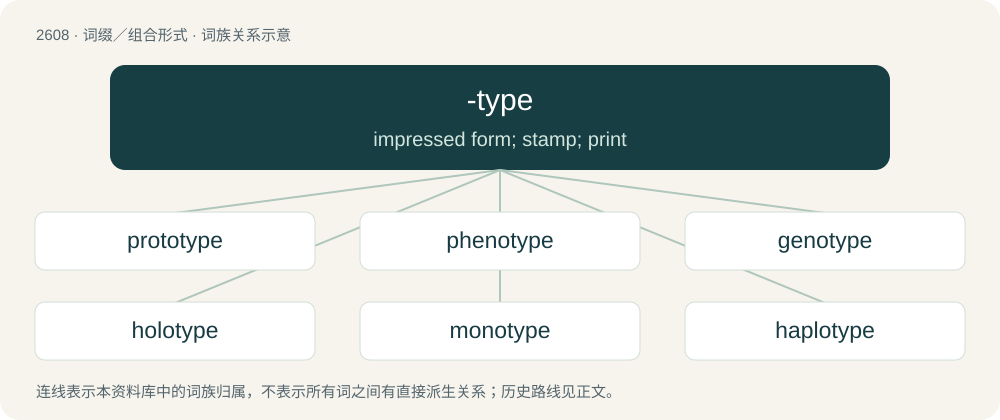

# 2707 · -type — impressed form; stamp; print

[总目录](../00_总目录_按常用程度.md)

**类型**：词缀／组合形式　｜　**来源语言**：见词源记录

## 核心含义与来源

- 核心含义：impressed form; stamp; print
- 英文含义：impressed form; stamp; print
- 词形：-type

**来源记录 1**（后缀／后置成分；impressed form; stamp; print）

From Ancient Greek τύπος (túpos, “mark, type”), see type.

## 词族图

## 单词速览（常用到不常用）

| 单词 | 音标 | 释义 |
|---|---|---|
| [prototype](#w-1) | 英 /ˈpɹəʊtətaɪp/；美 /ˈpɹoʊtəˌtaɪp/ | n. 原型；\[计\] 样机; 原型 |
| [phenotype](#w-2) | 英 /ˈfiː.nə(ʊ)ˌtaɪp/；美 /ˈfiː.nəˌtaɪp/ | n. 表现型, 有共同表现型的生物群体, 遗传环境互应结果；\[医\] 表型, 显型 |
| [genotype](#w-3) | 英 /ˈdʒɛnəʊˌtaɪp/；美 /ˈd͡ʒinoʊˌtaɪp/ | n. 基因型, 遗传型；\[医\] 遗传型, 基因型 |
| [holotype](#w-4) | /ˈhɔləu,taip/ | n. \[生\]正模标本, 全型 |
| [monotype](#w-5) | /ˈmɑnoʊˌtaɪp/ | n. 莫诺铸排机, 单型；vt. 用单字铸排机排(字) |
| [haplotype](#w-6) | /ˈhap.lə(ʊ).taɪp/ | 单模标本 |
| [karyotype](#w-7) | 英 /ˈkaɹɪə(ʊ)taɪp/ | n. \[生物\] 染色体组型 |
| [serotype](#w-8) | /ˈsiərətaip/ | \[医\] 血清型 |

## 逐词详解

### 1. prototype

**词性**：名词　｜　**音标**：英 /ˈpɹəʊtətaɪp/；美 /ˈpɹoʊtəˌtaɪp/

**中文释义**：n. 原型；\[计\] 样机; 原型

**英文义项**：An original form or object which is a basis for other forms or objects (particularly manufactured items), or for its generalizations and models. / An early sample or model built to test a concept or process.

**构词拆分**：proto- + -type

**词源与演化**：

From French prototype or Late Latin prototypon, from Ancient Greek πρωτότυπος (prōtótupos, “original; prototype”), from πρωτο- (prōto-, “first”) (from πρῶτος (prôtos, “first; earliest”)) + τῠ́πος (tŭ́pos, “blow, pressing; sort, type”) (from τύπτω (túptō, “to beat, strike”), from Proto-Indo-European \*(s)tewp- (“to push; to stick”)). The word is analysable as proto- + -type.

**例句**：

> The prototype had loose wires and rough edges, but it worked.

该用例对应义项：An early sample or model built to test a concept or process.

### 2. phenotype

**词性**：名词　｜　**音标**：英 /ˈfiː.nə(ʊ)ˌtaɪp/；美 /ˈfiː.nəˌtaɪp/

**中文释义**：n. 表现型, 有共同表现型的生物群体, 遗传环境互应结果；\[医\] 表型, 显型

**英文义项**：The appearance of an organism based on a multifactorial combination of genetic traits and environmental factors, especially used in pedigrees. / Any observable characteristic of an organism, such as its morphological, developmental, biochemical or physiological properties, or its behavior.

**构词拆分**：pheno- + -type

**词源与演化**：

From pheno- + -type, from Ancient Greek φαίνω (phaínō, “to shine, to show, to appear”) + τύπος (túpos, “mark, type”).

**例句**：

> In biology, the students learn the difference between the genotype and the phenotype.

### 3. genotype

**词性**：名词　｜　**音标**：英 /ˈdʒɛnəʊˌtaɪp/；美 /ˈd͡ʒinoʊˌtaɪp/

**中文释义**：n. 基因型, 遗传型；\[医\] 遗传型, 基因型

**英文义项**：The part (DNA sequence) of the genetic makeup of an organism which determines a specific characteristic (phenotype) of that organism. / A group of organisms having the same genetic constitution.

**构词拆分**：geno- + -type

**词源与演化**：

From geno- + -type.

**例句**：

> In biology, the students learn the difference between the genotype and the phenotype.

### 4. holotype

**词性**：名词　｜　**音标**：/ˈhɔləu,taip/

**中文释义**：n. \[生\]正模标本, 全型

**英文义项**：The single physical example (or illustration) of an organism used to formally describe the species (or lower-order taxon), subsequently to be kept as a reference.

**构词拆分**：holo- + -type

**词源与演化**：

From holo- + -type.

### 5. monotype

**词性**：名词　｜　**音标**：/ˈmɑnoʊˌtaɪp/

**中文释义**：n. 莫诺铸排机, 单型；vt. 用单字铸排机排(字)

**英文义项**：A print made by creating the design using oil paint or printer's ink on metal or glass, then transferring the image directly to paper. / The technique of making such prints.

**构词拆分**：mono- + type；mono- + -type

**词源与演化**：

From mono- + type or mono- + -type. The printing technique is so called because it allows only one impression to be taken.

### 6. haplotype

**词性**：名词　｜　**音标**：/ˈhap.lə(ʊ).taɪp/

**中文释义**：单模标本

**英文义项**：A haploid genotype: a group of alleles that are transmitted together.

**构词拆分**：haplo- + -type

**词源与演化**：

From haplo- + -type.

### 7. karyotype

**词性**：名词　｜　**音标**：英 /ˈkaɹɪə(ʊ)taɪp/

**中文释义**：n. \[生物\] 染色体组型

**英文义项**：The observed characteristics (number, type, shape, etc) of the chromosomes of an individual or species. / A record of such characteristics, usually photographic.

**构词拆分**：karyo- + -type

**词源与演化**：

Borrowed from Russian кариотип (kariotip), equivalent to karyo- + -type.

**例句**：

> A karyotype may be used to look for abnormalities in chromosome number or structure.

### 8. serotype

**词性**：名词　｜　**音标**：/ˈsiərətaip/

**中文释义**：\[医\] 血清型

**英文义项**：A group of microorganisms characterised by a specific set of antigens.

**构词拆分**：sero- + -type

**词源与演化**：

From sero- + -type.
