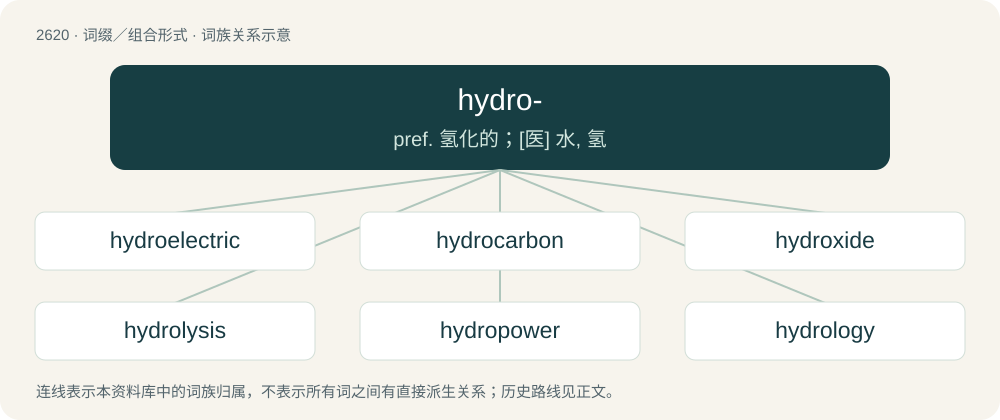

# 2723 · hydro- — pref. 氢化的；\[医\] 水, 氢

[总目录](../00_总目录_按常用程度.md)

**类型**：词缀／组合形式　｜　**来源语言**：见词源记录

## 核心含义与来源

- 核心含义：pref. 氢化的；\[医\] 水, 氢
- 英文含义：water
- 词形：hydro-

## 词族图

## 单词速览（常用到不常用）

| 单词 | 音标 | 释义 |
|---|---|---|
| [hydroelectric](#w-1) | /ˌhʌɪdrəʊɪˈlɛktrɪk/ | a. 水力电气的；\[医\] 水电的, 水电治疗的 |
| [hydrocarbon](#w-2) | /.haidrəuˈkɑːbən/ | n. 碳氢化合物；\[化\] 烃; 碳氢化合物 |
| [hydroxide](#w-3) | /haɪˈdɹɒks.aɪd/ | n. 氢氧化物；\[化\] 氢氧化物 |
| [hydrolysis](#w-4) | 英 /haɪˈdɹɒlɪsɪs/；美 /haɪˈdɹɑləsəs/ | n. 水解(作用)；\[计\] 水解作用 |
| [hydropower](#w-5) | /ˈhaidrəupauə/ | n. 水力发出的电力 |
| [hydrology](#w-6) | /haiˈdrɒlədʒi/ | n. 水文学；\[医\] 水文学 |
| [hydroxy](#w-7) | /haiˈdrɔksi/ | \[化\] 氢氧基 |
| [hydrothermal](#w-8) | /ˈhaidrəuˈθəːməl/ | \[医\] 热水的(温泉) |
| [hydrochloric](#w-9) | 美 /ˌhaɪdrəʊˈklɔrɪk/ | a. 氯化氢的, 盐酸的 |
| [hydrochloride](#w-10) | /,haidrəuˈklɔːraid/ | \[化\] 盐酸盐；\[医\] 氢氯化物, 盐酸化物, 盐酸盐 |
| [hydrostatic](#w-11) | /ˌhaɪdɹəʊˈstætɪk/ | a. 流体静力学的；\[医\] 流体静力的 |
| [hydride](#w-12) | /ˈhaɪdɹaɪd/ | \[医\] 氢化物 |
| [hydrophilic](#w-13) | /,haidrəuˈfilik/ | \[医\] 吸水的, 亲水的 |
| [hydrodynamic](#w-14) | /.haidrəudaiˈnæmik/ | a. 水动力学, 水力的, 水压的 |
| [hydrotherapy](#w-15) | /.haidrəuˈθerəpi/ | n. 水疗法；\[医\] 水疗法 |
| [hydroponics](#w-16) | 英 /ˌhaɪdɹə(ʊ)ˈpɒnɪks/；美 /ˌhaɪdɹəˈpɑnɪks/ | n. 水耕法, 水栽培 |
| [hydrogel](#w-17) | /ˈhaidrədʒel/ | \[化\] 水凝胶；\[医\] 水凝胶 |
| [hydrodynamics](#w-18) | /ˈhaidrəudaiˈnæmiks/ | n. 流体力学, 水动力学；\[化\] 流体动力学 |
| [hydrocortisone](#w-19) | 英 /ˌhʌɪ.dɹə(ʊ)ˈkɔː.tɪ.zəʊn/；美 /ˌhaɪ.dɹoʊˈkɔɹ.tɪˌsoʊn/ | n. 皮质甾醇, 氢化可的松；\[化\] 氢化可的松; 皮质醇; 皮质甾醇 |
| [hydrography](#w-20) | 英 /haɪˈdɹɒɡ.ɹə.fi/；美 /haɪˈdɹɑɡ.ɹə.fi/ | n. 水文学, 水道测量术 |
| [hydrofluoric](#w-21) | /,haidrəufluˈɔrik/ | a. 氢氟酸的 |
| [hydrofoil](#w-22) | 美 /ˈhaɪ.dɹoʊˌfɔɪl/ | n. 水翼艇；\[化\] 水翼 |
| [hydrophone](#w-23) | /ˈhaidrəfəun/ | n. 水中听音器, 检漏器, 水诊器；\[医\] 隔水听诊器 |
| [hydroquinone](#w-24) | /ˌhaɪdɹəˈkwɪnəʊn/ | n. 对苯二酚；\[化\] 氢醌; 对苯二酚 |

## 逐词详解

### 1. hydroelectric

**词性**：形容词　｜　**音标**：/ˌhʌɪdrəʊɪˈlɛktrɪk/

**中文释义**：a. 水力电气的；\[医\] 水电的, 水电治疗的

**英文义项**：That generates electricity by converting the energy of moving water, or of steam escaping under high pressure. / Of or relating to the electricity so produced.

**构词拆分**：hydro- + electric

**词源与演化**：

From hydro- + electric.

**例句**：

> The construction of a hydroelectric dam can damage the life of populations downstream and upstream.

### 2. hydrocarbon

**词性**：名词　｜　**音标**：/.haidrəuˈkɑːbən/

**中文释义**：n. 碳氢化合物；\[化\] 烃; 碳氢化合物

**英文义项**：A compound consisting only of carbon and hydrogen atoms.

**构词拆分**：hydro- + carbon

**词源与演化**：

From hydro- + carbon.

**例句**：

> Algeria's economy is largely based on its hydrocarbon sector, particularly oil and natural gas exports.

### 3. hydroxide

**词性**：名词　｜　**音标**：/haɪˈdɹɒks.aɪd/

**中文释义**：n. 氢氧化物；\[化\] 氢氧化物

**英文义项**：A univalent anion (OH⁻) based on the hydroxyl functional group. / Any substance containing such an anion.

**构词拆分**：hydro- + oxide

**词源与演化**：

From hydro- + oxide.

**例句**：

> Sodium hydroxide is used in making soaps.

### 4. hydrolysis

**词性**：名词　｜　**音标**：英 /haɪˈdɹɒlɪsɪs/；美 /haɪˈdɹɑləsəs/

**中文释义**：n. 水解(作用)；\[计\] 水解作用

**英文义项**：A chemical process of decomposition involving the splitting of a bond and the addition of the hydrogen cation and the hydroxide anion of water.

**构词拆分**：hydro- + -lysis

**词源与演化**：

From hydro- + -lysis.

### 5. hydropower

**词性**：名词　｜　**音标**：/ˈhaidrəupauə/

**中文释义**：n. 水力发出的电力

**英文义项**：hydroelectric power

**构词拆分**：hydro- + power

**词源与演化**：

From hydro- + power.

**例句**：

> Hydropower is a renewable resource, but oil, coal and natural gas are not.

### 6. hydrology

**词性**：名词　｜　**音标**：/haiˈdrɒlədʒi/

**中文释义**：n. 水文学；\[医\] 水文学

**英文义项**：The science of the properties, distribution, and effects of water on a planet's surface, in the soil and underlying rocks, and in the atmosphere. / The properties, distribution, and flows of water in a specific locale; the hydrological characteristics of a particular place or region.

**构词拆分**：hydro- + -ology

**词源与演化**：

From hydro- + -ology.

**例句**：

> When trees die, the ecology and hydrology of a forest change, which in turn promotes insect infestation and fire.

### 7. hydroxy

**词性**：形容词　｜　**音标**：/haiˈdrɔksi/

**中文释义**：\[化\] 氢氧基

**英文义项**：Being, or containing a hydroxyl radical.

**构词拆分**：hydro- + oxy

**词源与演化**：

From hydro- + oxy.

### 8. hydrothermal

**词性**：形容词　｜　**音标**：/ˈhaidrəuˈθəːməl/

**中文释义**：\[医\] 热水的(温泉)

**英文义项**：Of, or relating to hot water. / Of or relating to emanations of hot water that are rich in minerals, or to the rocks formed from them.

**构词拆分**：hydro- + thermal

**词源与演化**：

From hydro- + thermal.

### 9. hydrochloric

**词性**：形容词　｜　**音标**：美 /ˌhaɪdrəʊˈklɔrɪk/

**中文释义**：a. 氯化氢的, 盐酸的

**英文义项**：Of or relating to hydrochloric acid.

**构词拆分**：hydro- + chloric

**词源与演化**：

From hydro- + chloric.

**例句**：

> The original acid test used hydrochloric and nitric acid to distinguish gold from base metals.

### 10. hydrochloride

**词性**：名词　｜　**音标**：/,haidrəuˈklɔːraid/

**中文释义**：\[化\] 盐酸盐；\[医\] 氢氯化物, 盐酸化物, 盐酸盐

**英文义项**：A compound of hydrochloric acid with an organic base such as an amine.

**构词拆分**：hydro- + chloride

**词源与演化**：

From hydro- + chloride.

### 11. hydrostatic

**词性**：形容词　｜　**音标**：/ˌhaɪdɹəʊˈstætɪk/

**中文释义**：a. 流体静力学的；\[医\] 流体静力的

**英文义项**：Of or relating to hydrostatics. / Of or relating to fluids, especially to the pressure that they exert or transmit.

**构词拆分**：hydro- + static

**词源与演化**：

From hydro- + static.

### 12. hydride

**词性**：名词　｜　**音标**：/ˈhaɪdɹaɪd/

**中文释义**：\[医\] 氢化物

**英文义项**：A compound of hydrogen with a more electropositive element.

**构词拆分**：hydro- + -ide

**词源与演化**：

From hydro- + -ide.

### 13. hydrophilic

**词性**：形容词　｜　**音标**：/,haidrəuˈfilik/

**中文释义**：\[医\] 吸水的, 亲水的

**英文义项**：Having an affinity for water; able to absorb, or be wetted by water; water-loving.

**构词拆分**：hydro- + -philic

**词源与演化**：

From hydro- + -philic.

**例句**：

> Oil is an amphipathic molecule as it has both hydrophobic and hydrophilic characteristics.

### 14. hydrodynamic

**词性**：形容词　｜　**音标**：/.haidrəudaiˈnæmik/

**中文释义**：a. 水动力学, 水力的, 水压的

**英文义项**：Of, or relating to the science of hydrodynamics. / Operated by the force of water in motion.

**构词拆分**：hydro- + dynamic

**词源与演化**：

From hydro- + dynamic.

### 15. hydrotherapy

**词性**：名词　｜　**音标**：/.haidrəuˈθerəpi/

**中文释义**：n. 水疗法；\[医\] 水疗法

**英文义项**：Any of various techniques that use water, either externally or internally, for the treatment of disease and for the soothing of pain.

**构词拆分**：hydro- + therapy

**词源与演化**：

From hydro- + therapy.

**例句**：

> Hydrotherapy is the use of water to relieve pain and cure illnesses.

### 16. hydroponics

**词性**：名词　｜　**音标**：英 /ˌhaɪdɹə(ʊ)ˈpɒnɪks/；美 /ˌhaɪdɹəˈpɑnɪks/

**中文释义**：n. 水耕法, 水栽培

**英文义项**：The cultivation of plants in a nutrient solution rather than in the soil.

**构词拆分**：hydro- (“water”) + -ponics

**词源与演化**：

From hydro- (“water”) + -ponics, which is from geoponics.

### 17. hydrogel

**词性**：名词　｜　**音标**：/ˈhaidrədʒel/

**中文释义**：\[化\] 水凝胶；\[医\] 水凝胶

**英文义项**：A colloid gel in which water is the continuous phase; they have a number of medical and industrial applications.

**构词拆分**：hydro- + gel

**词源与演化**：

From hydro- + gel.

### 18. hydrodynamics

**词性**：名词　｜　**音标**：/ˈhaidrəudaiˈnæmiks/

**中文释义**：n. 流体力学, 水动力学；\[化\] 流体动力学

**英文义项**：The scientific study of liquids in motion. / The phenomena thus studied.

**构词拆分**：hydro- + dynamics

**词源与演化**：

From hydro- + dynamics.

**例句**：

> This type of valve doesn't have the right hydrodynamics to achieve what they're trying to achieve.

该用例对应义项：The phenomena thus studied.

### 19. hydrocortisone

**词性**：名词　｜　**音标**：英 /ˌhʌɪ.dɹə(ʊ)ˈkɔː.tɪ.zəʊn/；美 /ˌhaɪ.dɹoʊˈkɔɹ.tɪˌsoʊn/

**中文释义**：n. 皮质甾醇, 氢化可的松；\[化\] 氢化可的松; 皮质醇; 皮质甾醇

**英文义项**：Name used for cortisol, a glucocorticoid steroid hormone, when used as a medication. Used to treat e.g. inflammation resulting from rheumatism and eczema.

**构词拆分**：hydro- + cortisone

**词源与演化**：

From hydro- + cortisone.

**例句**：

> Why can't hydrocortisone cream be used on the face?

### 20. hydrography

**词性**：名词　｜　**音标**：英 /haɪˈdɹɒɡ.ɹə.fi/；美 /haɪˈdɹɑɡ.ɹə.fi/

**中文释义**：n. 水文学, 水道测量术

**英文义项**：The scientific measurement and description of the physical features and conditions of navigable waters and the shoreline.

**构词拆分**：hydro- + -graphy

**词源与演化**：

From hydro- + -graphy.

**例句**：

> Hydrography is the science that measures and describes the physical features of bodies of water.

### 21. hydrofluoric

**词性**：形容词　｜　**音标**：/,haidrəufluˈɔrik/

**中文释义**：a. 氢氟酸的

**英文义项**：Containing hydrogen and fluorine.

**构词拆分**：From hydro- + fluoric.

**词源与演化**：

From hydro- + fluoric.

### 22. hydrofoil

**词性**：名词　｜　**音标**：美 /ˈhaɪ.dɹoʊˌfɔɪl/

**中文释义**：n. 水翼艇；\[化\] 水翼

**英文义项**：A wing attached to the hull of a ship that raises it out of the water when travelling at speed and thus reduces drag. / A vessel equipped with such a device.

**构词拆分**：hydro- + foil

**词源与演化**：

From hydro- + foil.

### 23. hydrophone

**词性**：名词　｜　**音标**：/ˈhaidrəfəun/

**中文释义**：n. 水中听音器, 检漏器, 水诊器；\[医\] 隔水听诊器

**英文义项**：a transducer that converts underwater sound waves into electrical signals, rather like a microphone

**构词拆分**：hydro- + -phone

**词源与演化**：

From hydro- + -phone.

**例句**：

> A hydrophone is a microphone designed to be used underwater.

### 24. hydroquinone

**词性**：名词　｜　**音标**：/ˌhaɪdɹəˈkwɪnəʊn/

**中文释义**：n. 对苯二酚；\[化\] 氢醌; 对苯二酚

**英文义项**：The diphenol para-dihydroxy benzene, used as a mild reducing agent in photographic developing; isomeric with catechol and resorcinol.

**构词拆分**：hydro- + quinone

**词源与演化**：

From hydro- + quinone.

**例句**：

> The products, even those claiming to have so-called "natural" components, can contain mercury, hydroquinone or caustic agents like sodium hydroxide.
