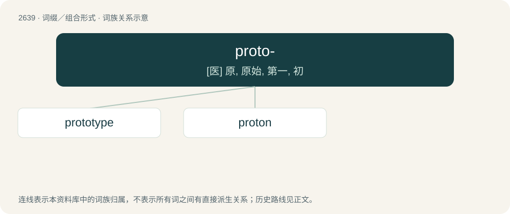

# 2742 · proto- — \[医\] 原, 原始, 第一, 初

[总目录](../00_总目录_按常用程度.md)

**类型**：词缀／组合形式　｜　**来源语言**：见词源记录

## 核心含义与来源

- 核心含义：\[医\] 原, 原始, 第一, 初
- 英文含义：An early, primitive stage of development.
- 词形：proto-

## 词族图

## 单词速览（常用到不常用）

| 单词 | 音标 | 释义 |
|---|---|---|
| [prototype](#w-1) | 英 /ˈpɹəʊtətaɪp/；美 /ˈpɹoʊtəˌtaɪp/ | n. 原型；\[计\] 样机; 原型 |
| [proton](#w-2) | 英 /ˈpɹəʊ.tɒn/；美 /ˈpɹoʊ.tɑn/ | n. 质子；\[化\] 质子 |

## 逐词详解

### 1. prototype

**词性**：名词　｜　**音标**：英 /ˈpɹəʊtətaɪp/；美 /ˈpɹoʊtəˌtaɪp/

**中文释义**：n. 原型；\[计\] 样机; 原型

**英文义项**：An original form or object which is a basis for other forms or objects (particularly manufactured items), or for its generalizations and models. / An early sample or model built to test a concept or process.

**构词拆分**：proto- + -type

**词源与演化**：

From French prototype or Late Latin prototypon, from Ancient Greek πρωτότυπος (prōtótupos, “original; prototype”), from πρωτο- (prōto-, “first”) (from πρῶτος (prôtos, “first; earliest”)) + τῠ́πος (tŭ́pos, “blow, pressing; sort, type”) (from τύπτω (túptō, “to beat, strike”), from Proto-Indo-European \*(s)tewp- (“to push; to stick”)). The word is analysable as proto- + -type.

**例句**：

> The prototype had loose wires and rough edges, but it worked.

该用例对应义项：An early sample or model built to test a concept or process.

### 2. proton

**词性**：名词　｜　**音标**：英 /ˈpɹəʊ.tɒn/；美 /ˈpɹoʊ.tɑn/

**中文释义**：n. 质子；\[化\] 质子

**英文义项**：A positively charged subatomic particle forming part of the nucleus of an atom and determining the atomic number of an element, composed of two up quarks and a down quark. / The atomic nucleus of protium (hydrogen-1)

**构词拆分**：proto- + -on

**例句**：

> The strong force is responsible for 99% of proton and neutron mass.
