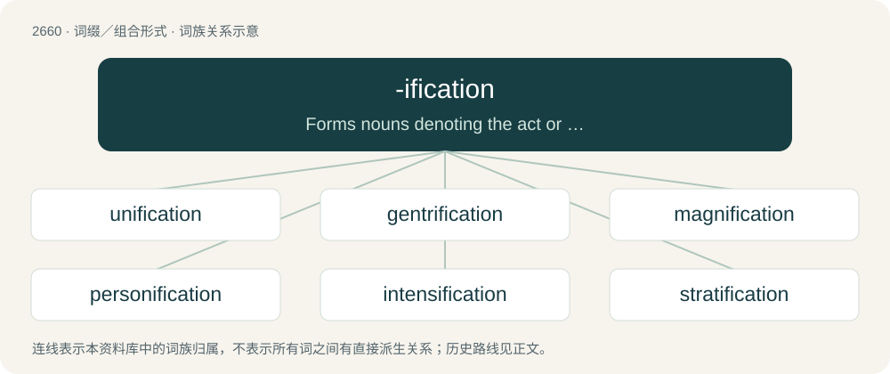

# 2760 · -ification — Forms nouns denoting the act or process whereby a subject becomes something else.

[总目录](../00_总目录_按常用程度.md)

**类型**：词缀／组合形式　｜　**来源语言**：见词源记录

## 核心含义与来源

- 核心含义：Forms nouns denoting the act or process whereby a subject becomes something else.
- 英文含义：Forms nouns denoting the act or process whereby a subject becomes something else.
- 词形：-ification

**来源记录 1**（后缀／后置成分；Forms nouns denoting the act or process whereby a subject becomes something else.）

From Middle English -ificacioun (ending on words generally borrowed whole from Old French), from Old French -ification, in turn from Latin -ficātiō, a noun ending which appears on action nouns formed using the suffix -tiō (English -tion) from verbs ending in -ficō (English -ify). Compare -faction.

## 词族图

## 单词速览（常用到不常用）

| 单词 | 音标 | 释义 |
|---|---|---|
| [unification](#w-1) | 英 /ˌjuːnɪfɪˈkeɪʃn̩/；美 /ˌjunəfəˈkeɪʃən/ | n. 统一, 联合, 一致；\[医\] 连结; 统一 |
| [gentrification](#w-2) | /d͡ʒɛn.tɹɪ.fɪˈkeɪ.ʃən/ | n. 中产阶级化 |
| [magnification](#w-3) | 美 /ˌmæɡnɪfɪˈkeɪʃən/ | n. 扩大, 放大率, 放大的复制品；\[计\] 缩放比例 |
| [personification](#w-4) | /pɚˌsɑ.nə.fəˈkeɪ.ʃən/ | n. 拟人, 人格化, 拟人法, 化身, 象征 |
| [intensification](#w-5) | /in,tensifiˈkeiʃən/ | n. 增强, 强化；\[医\] 强化\[作用\], 增强 |
| [stratification](#w-6) | /.strætifiˈkeiʃən/ | n. 层化, 阶层的形成, 成层；\[医\] 分层 |
| [acidification](#w-7) | /əˌsɪdɪfɪˈkeɪʃən/ | n. 使发酸, 酸化, 成酸性；\[化\] 酸化; 加酸 |
| [objectification](#w-8) | /ɒbˌd͡ʒɛkt.ɪ.fɪˈkeɪ.ʃʌn/ | 客观化, 对象化 |
| [nullification](#w-9) | /ˌnʌlɪfɪˈkeɪʃən/ | n. 无效, 废弃, 取消；\[法\] 无效, 废弃, 取消 |
| [falsification](#w-10) | /ˌfɔːl.sɪf.ɪˈkeɪ.ʃən/ | n. 伪造, 歪曲；\[医\] 伪造, 曲解 |
| [gamification](#w-11) |  | 【英文】The use of gameplay mechanics for non-game applications (as for example making work less onerous; incentivization; or pedagogy). |
| [desertification](#w-12) | 英 /dɪˌzɜː.tɪ.fɪˈkeɪ.ʃən/；美 /dɪˌzɝ.tɪ.fɪˈkeɪ.ʃən/ | n. （土壤）荒漠化, 沙漠化 |
| [gasification](#w-13) | /.ɡæsifiˈkeiʃən/ | n. 气化 |
| [commodification](#w-14) | 英 /kəˌmɒ.dɪ.fɪˈkeɪ.ʃən/；美 /kəˌmɑ.dɪ.fɪˈkeɪ.ʃən/ | n. 商品化；商品性 |
| [solidification](#w-15) | /sə.lidifiˈkeiʃən/ | n. 团结, 凝固, 固体化；\[化\] 凝固 |
| [ossification](#w-16) | 英 /ˌɒsɪfɪˈkeɪʃn̩/；美 /ˌɑsəfəˈkeɪʃən/ | n. 成骨, 变骨, 骨化, (思想的)僵化；\[医\] 骨化 |

## 逐词详解

### 1. unification

**词性**：名词　｜　**音标**：英 /ˌjuːnɪfɪˈkeɪʃn̩/；美 /ˌjunəfəˈkeɪʃən/

**中文释义**：n. 统一, 联合, 一致；\[医\] 连结; 统一

**英文义项**：The act or process of unifying. / The state of being unified.

**构词拆分**：unify + -ification (suffix forming nouns denoting acts or processes whereby subjects become something else)

**词源与演化**：

Either: \* from unify + -ification (suffix forming nouns denoting acts or processes whereby subjects become something else); or \* borrowed from French unification; or \* borrowed from Italian unificazione.

**例句**：

> He looked forward to the unification of his family for the holidays.

该用例对应义项：the act of making or becoming a single unit

### 2. gentrification

**词性**：名词　｜　**音标**：/d͡ʒɛn.tɹɪ.fɪˈkeɪ.ʃən/

**中文释义**：n. 中产阶级化

**英文义项**：The renewal and rebuilding that accompanies the influx of middle class or affluent people into deteriorating areas and often displaces earlier, usually poorer, residents; any example of such a process. / A geographical area that is gradually becoming prosperous due to investment.

**构词拆分**：gentry + -ification

**词源与演化**：

From gentry + -ification, after gentrify. Coined by German-born British sociologist Ruth Glass in 1964.

**例句**：

> Gentrification is a process carried out by landlords and developers, not by tenants.

### 3. magnification

**词性**：名词　｜　**音标**：美 /ˌmæɡnɪfɪˈkeɪʃən/

**中文释义**：n. 扩大, 放大率, 放大的复制品；\[计\] 缩放比例

**英文义项**：The act of magnifying; enlargement; exaggeration. / The apparent enlargement of an object in an image, for example using a lens, or by zooming in on a computer.

**构词拆分**：magnify + -ification

**词源与演化**：

From magnify + -ification.

**例句**：

> His story included a magnification of the events.

该用例对应义项：The act of magnifying; enlargement; exaggeration.

### 4. personification

**词性**：名词　｜　**音标**：/pɚˌsɑ.nə.fəˈkeɪ.ʃən/

**中文释义**：n. 拟人, 人格化, 拟人法, 化身, 象征

**英文义项**：A person, thing, or name typifying a certain quality or idea; an embodiment or exemplification. / An artistic representation of an abstract quality as a human.

**构词拆分**：personify + -ification

**词源与演化**：

From person(ify) + -ification.

**例句**：

> You might search in vain if you go looking for personification in his works: his style was very concrete.

该用例对应义项：The process of creating such a representation: a literary device or other artistic method in which an inanimate object or an idea is given human qualities.

### 5. intensification

**词性**：名词　｜　**音标**：/in,tensifiˈkeiʃən/

**中文释义**：n. 增强, 强化；\[医\] 强化\[作用\], 增强

**英文义项**：The act or process of intensifying, or of making more intense.

**构词拆分**：intense + -ification

**词源与演化**：

From intense + -ification.

**例句**：

> The United Nations warns accelerating climate change is causing a dramatic intensification of global drought disasters.

### 6. stratification

**词性**：名词　｜　**音标**：/.strætifiˈkeiʃən/

**中文释义**：n. 层化, 阶层的形成, 成层；\[医\] 分层

**英文义项**：The process leading to the formation or deposition of layers, especially of sedimentary rocks. / A layering of musical texture.

**构词拆分**：stratum + -ification

**词源与演化**：

From stratum + -ification.

### 7. acidification

**词性**：名词　｜　**音标**：/əˌsɪdɪfɪˈkeɪʃən/

**中文释义**：n. 使发酸, 酸化, 成酸性；\[化\] 酸化; 加酸

**英文义项**：The act or process of making something sour (acidifying), or changing into an acid.

**构词拆分**：acid + -ification

**词源与演化**：

Borrowed from French acidification, equivalent to acid + -ification.

**例句**：

> Increased greenhouse gases from human activities result in climate change and ocean acidification.

### 8. objectification

**词性**：名词　｜　**音标**：/ɒbˌd͡ʒɛkt.ɪ.fɪˈkeɪ.ʃʌn/

**中文释义**：客观化, 对象化

**英文义项**：The act or process of objectifying something intangible. / The act or process of objectifying someone.

**构词拆分**：object + -ification

**词源与演化**：

From object + -ification, following objectify.

**例句**：

> Meditation is the dissolution of thoughts in Eternal awareness or Pure consciousness without objectification, knowing without thinking, merging finitude in infinity.

### 9. nullification

**词性**：名词　｜　**音标**：/ˌnʌlɪfɪˈkeɪʃən/

**中文释义**：n. 无效, 废弃, 取消；\[法\] 无效, 废弃, 取消

**英文义项**：The act of nullifying; a rendering void and of no effect, or no legal effect. / The nullification crisis in U.S. history, confrontation between the state of South Carolina and the federal government in 1832–33 over the former's attempt to declare null and void within the state the federal Tariffs of 1828 and 1832.

**构词拆分**：null + -ification

**词源与演化**：

Borrowed from Late Latin nullificatio, from nullifico, equivalent to null + -ification.

### 10. falsification

**词性**：名词　｜　**音标**：/ˌfɔːl.sɪf.ɪˈkeɪ.ʃən/

**中文释义**：n. 伪造, 歪曲；\[医\] 伪造, 曲解

**英文义项**：The act of falsifying, or making false; a counterfeiting; the giving to a thing an appearance of something which it is not. / A knowingly false statement or wilful misrepresentation.

**构词拆分**：false + -ification

**词源与演化**：

From false + -ification.

**例句**：

> The natural scientific method essentially consists not of verification, but falsification: a model is valid as long as it cannot be experimentally refuted.

### 11. gamification

**词性**：名词

**英文义项**：The use of gameplay mechanics for non-game applications (as for example making work less onerous; incentivization; or pedagogy).

**构词拆分**：gam(e) + -ification

**词源与演化**：

From gam(e) + -ification.

### 12. desertification

**词性**：名词　｜　**音标**：英 /dɪˌzɜː.tɪ.fɪˈkeɪ.ʃən/；美 /dɪˌzɝ.tɪ.fɪˈkeɪ.ʃən/

**中文释义**：n. （土壤）荒漠化, 沙漠化

**英文义项**：The process by which a geographic region becomes a desert, resulting from natural changes in climate or by human activity.

**构词拆分**：desert + -ification

**词源与演化**：

From desert + -ification (“process of becoming”).

**例句**：

> The dust storms in Korea are the result of rapid desertification in China.

该用例对应义项：the gradual transformation of habitable land into desert; is usually caused by climate change or by destructive use of the land

### 13. gasification

**词性**：名词　｜　**音标**：/.ɡæsifiˈkeiʃən/

**中文释义**：n. 气化

**英文义项**：The action of gasifying. / The process of transforming carbon-based materials into a mix of carbon monoxide and hydrogen that can serve as fuel.

**构词拆分**：gas + -ification

**词源与演化**：

From gas + -ification.

**例句**：

> Coal gas is produced by the gasification of coal.

该用例对应义项：the process of changing into gas

### 14. commodification

**词性**：名词　｜　**音标**：英 /kəˌmɒ.dɪ.fɪˈkeɪ.ʃən/；美 /kəˌmɑ.dɪ.fɪˈkeɪ.ʃən/

**中文释义**：n. 商品化；商品性

**英文义项**：The assignment of a commercial value to something previously without such value. / The transformation from being commercialized on a nonfungible basis into becoming a commodity that is fungible.

**构词拆分**：commodify + -ification

**词源与演化**：

From commodify + -ification.

**例句**：

> A company that innovates to achieve the commercialization of a technology often must shift strategy some decades later in response to the advent of that technology's commodification.

该用例对应义项：The transformation from being commercialized on a nonfungible basis into becoming a commodity that is fungible.

### 15. solidification

**词性**：名词　｜　**音标**：/sə.lidifiˈkeiʃən/

**中文释义**：n. 团结, 凝固, 固体化；\[化\] 凝固

**英文义项**：The action of solidifying. / Concentration or consolidation.

**构词拆分**：solid + -ification

**词源与演化**：

From French solidification, or from solid + -ification.

### 16. ossification

**词性**：名词　｜　**音标**：英 /ˌɒsɪfɪˈkeɪʃn̩/；美 /ˌɑsəfəˈkeɪʃən/

**中文释义**：n. 成骨, 变骨, 骨化, (思想的)僵化；\[医\] 骨化

**英文义项**：The normal process by which bone is formed. / The calcification of tissue into a bonelike mass; the mass so formed.

**构词拆分**：Latin os, ossis (“bone”) + -ification

**词源与演化**：

From Latin os, ossis (“bone”) + -ification. Recorded earlier than ossify.

**例句**：

> Calcification is often confused with ossification.
