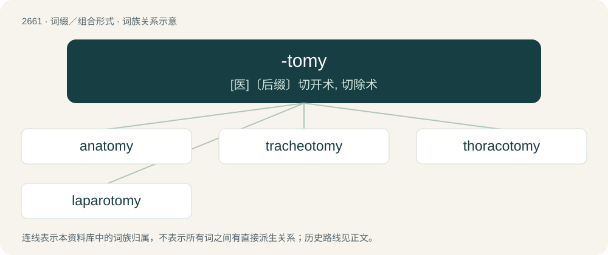

# 2761 · -tomy — \[医\]〔后缀〕切开术, 切除术

[总目录](../00_总目录_按常用程度.md)

**类型**：词缀／组合形式　｜　**来源语言**：见词源记录

## 核心含义与来源

- 核心含义：\[医\]〔后缀〕切开术, 切除术
- 英文含义：A division.
- 词形：-tomy

**来源记录 1**（后缀／后置成分；A division.）

From Ancient Greek τέμνω (témnō, “I cut”).

## 词族图

## 单词速览（常用到不常用）

| 单词 | 音标 | 释义 |
|---|---|---|
| [anatomy](#w-1) | 英 /əˈnætəmi/ | n. 剖析, 解剖学, 骨骼, 结构；\[医\] 解剖学, 解剖 |
| [tracheotomy](#w-2) | /,trækiˈɔtəmi/ | n. 气管切开术；\[医\] 气管切开术 |
| [thoracotomy](#w-3) | /,θɔːrəˈkɔtəmi/ | \[医\] 胸廓切开术 |
| [laparotomy](#w-4) | /.læpəˈrɒtəmi/ | n. 剖腹手术；\[医\] 剖腹术 |

## 逐词详解

### 1. anatomy

**词性**：名词　｜　**音标**：英 /əˈnætəmi/

**中文释义**：n. 剖析, 解剖学, 骨骼, 结构；\[医\] 解剖学, 解剖

**英文义项**：The science that deals with the form and structure of organic bodies; anatomical structure or organization. / The study of the parts of any organized body, to discover their situation, structure, and economy.

**构词拆分**：By surface analysis, ana- + -tomy

**词源与演化**：

From Middle English anatomie, from Old French anatomie, from Latin anatomia, from Ancient Greek ἀνατομή (anatomḗ, “dissection”, literally “cutting up”), from ἀνα- (ana-, “up”) + τέμνω (témnō, “to cut, incise”). By surface analysis, ana- + -tomy. Doublet of ottomy.

**例句**：

> Animal anatomy is also called zootomy; vegetable anatomy, phytotomy; and human anatomy, anthropotomy.

该用例对应义项：The science that deals with the form and structure of organic bodies; anatomical structure or organization.

### 2. tracheotomy

**词性**：名词　｜　**音标**：/,trækiˈɔtəmi/

**中文释义**：n. 气管切开术；\[医\] 气管切开术

**英文义项**：A surgical procedure in which an incision is made into the trachea, through the neck, and a tube inserted so as to make an artificial opening in order to assist breathing.

**构词拆分**：tracheo- + -tomy

**词源与演化**：

From tracheo- + -tomy.

### 3. thoracotomy

**词性**：名词　｜　**音标**：/,θɔːrəˈkɔtəmi/

**中文释义**：\[医\] 胸廓切开术

**英文义项**：The surgical procedure of making an incision into the chest, normally as a first step to gain access to the thoracic organs, such as the heart, the lungs, and the esophagus.

**构词拆分**：thoraco- + -tomy

**词源与演化**：

From thoraco- + -tomy.

### 4. laparotomy

**词性**：名词　｜　**音标**：/.læpəˈrɒtəmi/

**中文释义**：n. 剖腹手术；\[医\] 剖腹术

**英文义项**：The surgical procedure for making an incision in the abdominal wall to gain access into the abdominal cavity. Performed either as exploratory surgery, or as the first step in an abdominal operation.

**构词拆分**：laparo- + -tomy

**词源与演化**：

From laparo- + -tomy.
