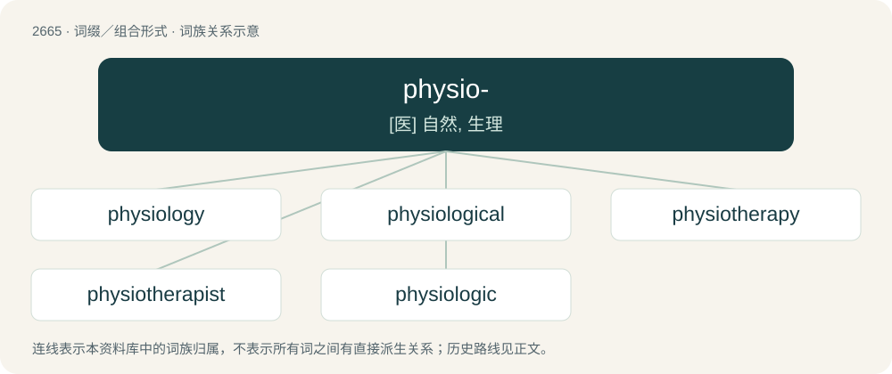

# 2768 · physio- — \[医\] 自然, 生理

[总目录](../00_总目录_按常用程度.md)

**类型**：词缀／组合形式　｜　**来源语言**：见词源记录

## 核心含义与来源

- 核心含义：\[医\] 自然, 生理
- 英文含义：nature
- 词形：physio-

**来源记录 1**（前缀／前置成分；nature）

From Ancient Greek φῠ́σῐς (phŭ́sĭs, “nature”).

## 词族图

## 单词速览（常用到不常用）

| 单词 | 音标 | 释义 |
|---|---|---|
| [physiology](#w-1) | 英 /ˌfɪziˈɒləd͡ʒi/；美 /ˌfɪziˈɑ.lə.d͡ʒi/ | n. 生理学, 生理机能；\[医\] 生理学 |
| [physiological](#w-2) | 英 /ˌfɪz.i.əˈlɒd͡ʒ.i.kəl/；美 /ˌfɪz.i.əˈlɑ.d͡ʒɪ.kəl/ | a. 生理学的, 生理学上的, 生理机能的；\[医\] 生理学的, 生理的 |
| [physiotherapy](#w-3) | /ˌfɪziəʊˈθerəpi/ | n. 物理疗法, 理疗；\[医\] 物理治疗, 理疗 |
| [physiotherapist](#w-4) |  | n. 物理疗法家, 理疗家；\[医\] 理疗医师, 理疗学家 |
| [physiologic](#w-5) |  | a. 生理学的, 生理的；\[医\] 生理学的, 生理的 |

## 逐词详解

### 1. physiology

**词性**：名词　｜　**音标**：英 /ˌfɪziˈɒləd͡ʒi/；美 /ˌfɪziˈɑ.lə.d͡ʒi/

**中文释义**：n. 生理学, 生理机能；\[医\] 生理学

**英文义项**：A branch of biology that deals with the functions and activities of life or of living matter (as organs, tissues, or cells) and of the physical and chemical phenomena involved. / The biology or form of a living organism.

**构词拆分**：physio- + -logy

**词源与演化**：

From French physiologie, from Latin physiologia, from Ancient Greek φυσιολογία (phusiología, “natural philosophy”), from φύσις (phúsis, “nature”) + λόγος (lógos, “word”). Equivalent to physio- + -logy.

**例句**：

> Individual genes specify individual functions, but the relationship between genes enables physiology.

### 2. physiological

**词性**：形容词　｜　**音标**：英 /ˌfɪz.i.əˈlɒd͡ʒ.i.kəl/；美 /ˌfɪz.i.əˈlɑ.d͡ʒɪ.kəl/

**中文释义**：a. 生理学的, 生理学上的, 生理机能的；\[医\] 生理学的, 生理的

**英文义项**：Of, or relating to physiology. / Relating to the action of a drug when given to a healthy person, as distinguished from its therapeutic action.

**构词拆分**：physio- + -logical + physiology + -ical + -al；physio- + -logical；physiology + -ical

**词源与演化**：

Either from physio- + -logical (equivalent to physiology + -ical) or Latin physiologicus + -al.

**例句**：

> My attitude to the comma is physiological; the more breath I have, the fewer commas I use.

### 3. physiotherapy

**词性**：名词　｜　**音标**：/ˌfɪziəʊˈθerəpi/

**中文释义**：n. 物理疗法, 理疗；\[医\] 物理治疗, 理疗

**英文义项**：Therapy that uses physical techniques such as massage, ultrasound, heat, and exercise.

**构词拆分**：physio- + therapy

**词源与演化**：

From physio- + therapy.

**例句**：

> I had to do ten sessions of physiotherapy after I injured my shoulder.

### 4. physiotherapist

**词性**：名词

**中文释义**：n. 物理疗法家, 理疗家；\[医\] 理疗医师, 理疗学家

**英文义项**：A therapist who treats physical injury or dysfunction, usually with exercise.

**构词拆分**：physio- + therapist；physiotherapy + -ist

**词源与演化**：

From physio- + therapist or physiotherapy + -ist.

**例句**：

> As a physiotherapist, Mary leads a group for spinal exercises.

### 5. physiologic

**词性**：形容词

**中文释义**：a. 生理学的, 生理的；\[医\] 生理学的, 生理的

**英文义项**：Of or pertaining to physiology.

**构词拆分**：physio- + -logic

**词源与演化**：

Either from physio- + -logic or Latin physiologicus.
