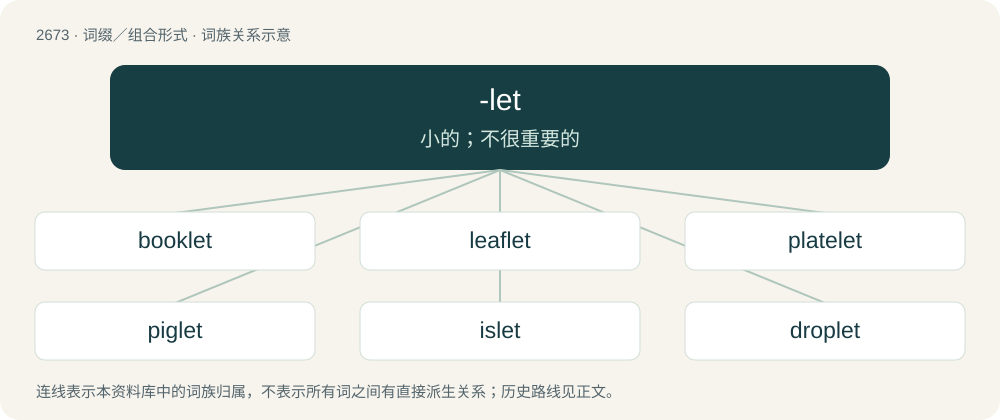

# 2775 · -let — 小的；不很重要的

[总目录](../00_总目录_按常用程度.md)

**类型**：词缀／组合形式　｜　**来源语言**：见词源记录

## 核心含义与来源

- 核心含义：小的；不很重要的
- 英文含义：A diminutive suffix.
- 词形：-let

**来源记录 1**（后缀／后置成分；A diminutive suffix.）

From Middle English -let, -elet, from Old French -elet, a double diminutive from Old French -el + -et.

## 词族图

## 单词速览（常用到不常用）

| 单词 | 音标 | 释义 |
|---|---|---|
| [booklet](#w-1) | /ˈbʊk.lət/ | n. 小册子 |
| [leaflet](#w-2) | /ˈliːflɪt/ | n. 小叶, 传单；\[医\] 小叶 |
| [platelet](#w-3) | /ˈpleɪt.lət/ | n. 血小板, 小盘, 小板 |
| [piglet](#w-4) | /ˈpɪɡ.lət/ | n. 小猪, 猪仔 |
| [islet](#w-5) | /ˈaɪ.lət/ | n. 小岛；\[医\] 岛, 小岛 |
| [droplet](#w-6) | 英 /ˈdɹɒplət/；美 /ˈdɹɑplət/ | n. 小滴；\[医\] 小滴 |
| [singlet](#w-7) | /ˈsɪŋɡlɪt/ | n. 汗衫, 运动衫；\[化\] 单峰; 单态; 单线态 |
| [starlet](#w-8) | 英 /ˈstɑːlɪt/；美 /ˈstɑɹlɪt/ | n. 小星星, 小明星 |
| [wavelet](#w-9) | /ˈweivlit/ | n. 小浪, 微波；\[化\] 子波 |
| [applet](#w-10) | /ˈæplət/ | n. 小型程式；支程序, 小应用程序；程序类型 |
| [cutlet](#w-11) | /ˈkʌtlit/ | n. 肉片, 炸肉片, 炸肉排 |
| [quizlet](#w-12) | /ˈkwɪz.lət/ | 【英文】A short quiz. |

## 逐词详解

### 1. booklet

**词性**：名词　｜　**音标**：/ˈbʊk.lət/

**中文释义**：n. 小册子

**英文义项**：A small or thin book.

**构词拆分**：book + -let

**词源与演化**：

From book + -let.

**例句**：

> The new hoover came with a thick booklet of instructions in twenty-one languages.

### 2. leaflet

**词性**：名词　｜　**音标**：/ˈliːflɪt/

**中文释义**：n. 小叶, 传单；\[医\] 小叶

**英文义项**：One of the components of a compound leaf. / A small plant leaf.

**构词拆分**：leaf + -let

**词源与演化**：

From leaf + -let.

**例句**：

> The new leaflets at the end of the branch were a lighter shade of green than the mature leaves.

该用例对应义项：A small plant leaf.

### 3. platelet

**词性**：名词　｜　**音标**：/ˈpleɪt.lət/

**中文释义**：n. 血小板, 小盘, 小板

**英文义项**：A small colorless disk-shaped particle found in the blood of mammals, which plays an important role in the formation of blood clots.

**构词拆分**：plate + -let

**词源与演化**：

From plate + -let.

### 4. piglet

**词性**：名词　｜　**音标**：/ˈpɪɡ.lət/

**中文释义**：n. 小猪, 猪仔

**英文义项**：A young swine, one not yet mature.

**构词拆分**：pig + -let (diminutive suffix)

**词源与演化**：

From pig + -let (diminutive suffix). Attested from 1855. Displaced Old English fearh.

**例句**：

> Truffles is a pink piglet with purple hooves and green eyes.

### 5. islet

**词性**：名词　｜　**音标**：/ˈaɪ.lət/

**中文释义**：n. 小岛；\[医\] 岛, 小岛

**英文义项**：A small island. / An isolated piece of tissue that has a specific function.

**构词拆分**：By surface analysis, is(le) + -let

**词源与演化**：

From Middle French islette. By surface analysis, is(le) + -let. Mostly displaced native Middle English eyt, eit and Middle English holm, holme (See eyot and holm for more).

**例句**：

> There is an islet on the other side of this body of water.

该用例对应义项：A small island.

### 6. droplet

**词性**：名词　｜　**音标**：英 /ˈdɹɒplət/；美 /ˈdɹɑplət/

**中文释义**：n. 小滴；\[医\] 小滴

**英文义项**：A very small drop.

**构词拆分**：drop + -let

**词源与演化**：

From drop + -let.

**例句**：

> What's the volume of a single water droplet?

### 7. singlet

**词性**：名词　｜　**音标**：/ˈsɪŋɡlɪt/

**中文释义**：n. 汗衫, 运动衫；\[化\] 单峰; 单态; 单线态

**英文义项**：A multiplet having a single member, especially a single spectroscopic peak. / A quantum state having zero spin.

**构词拆分**：single + -let

**词源与演化**：

From single + -let.

**例句**：

> It was a sailor, bare-armed and bare-legged, in blue singlet and canvas trousers rolled to the knee.

### 8. starlet

**词性**：名词　｜　**音标**：英 /ˈstɑːlɪt/；美 /ˈstɑɹlɪt/

**中文释义**：n. 小星星, 小明星

**英文义项**：A young actress with a promising career ahead of her. / An accomplished and important supporting player in a sports team.

**构词拆分**：star + -let

**词源与演化**：

From star + -let.

**例句**：

> The starlet showed up at the premier flanked by two big bodyguards.

### 9. wavelet

**词性**：名词　｜　**音标**：/ˈweivlit/

**中文释义**：n. 小浪, 微波；\[化\] 子波

**英文义项**：A small wave; a ripple. / A fast-decaying oscillation.

**构词拆分**：wave + -let

**词源与演化**：

From wave + -let; a calque of French ondelette, from onde (“wave”) + -ette (diminutive suffix).

### 10. applet

**词性**：名词　｜　**音标**：/ˈæplət/

**中文释义**：n. 小型程式；支程序, 小应用程序；程序类型

**英文义项**：A small program module that runs under the control of a larger application, typically a web browser.

**构词拆分**：app + -let

**词源与演化**：

From app + -let, but perhaps also influenced by Apple (the term originated in AppleScript).

**例句**：

> This is how you execute CLSID applet commands.

### 11. cutlet

**词性**：名词　｜　**音标**：/ˈkʌtlit/

**中文释义**：n. 肉片, 炸肉片, 炸肉排

**英文义项**：A thin slice of meat, usually fried. / A chop, a specific piece of meat (especially pork, chicken, or beef) cut from the side of an animal.

**构词拆分**：cut + -let

**词源与演化**：

From French côtelette (recorded in English since 1706), from Middle French costelette (“little rib”), from coste + -elette, from Old French coste (“rib, side”), from Latin costa. Influenced by English cut, as if from cut + -let. Doublet of kotlet and kotleta.

**例句**：

> The breaded pork cutlet they serve in Tom's company cafeteria is so crispy and delicious.

### 12. quizlet

**词性**：名词　｜　**音标**：/ˈkwɪz.lət/

**英文义项**：A short quiz.

**构词拆分**：quiz + -let

**词源与演化**：

From quiz + -let.
