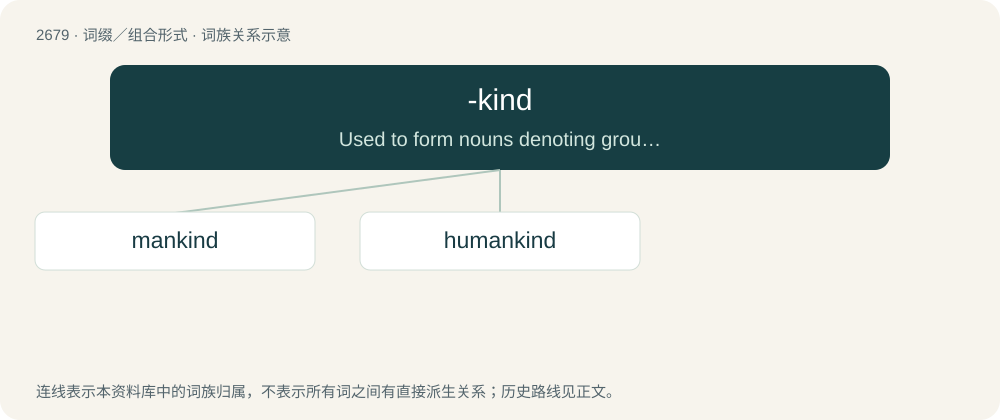

# 2781 · -kind — Used to form nouns denoting groups or classes taken collectively from animate nouns

[总目录](../00_总目录_按常用程度.md)

**类型**：词缀／组合形式　｜　**来源语言**：见词源记录

## 核心含义与来源

- 核心含义：Used to form nouns denoting groups or classes taken collectively from animate nouns
- 英文含义：Used to form nouns denoting groups or classes taken collectively from animate nouns
- 词形：-kind

**来源记录 1**（后缀／后置成分；Used to form nouns denoting groups or classes taken collectively from animate nouns）

From Middle English -kinde, -kunde, -kuinde, alteration (due to the noun kind (“type, class”)) of -kin, -kun, -cun, from Old English cynn (“family, race”), see kin. Most uses appear to have been formed by analogy with mankind.

## 词族图

## 单词速览（常用到不常用）

| 单词 | 音标 | 释义 |
|---|---|---|
| [mankind](#w-1) | /mænˈkaɪnd/ | n. 人类, 男性 |
| [humankind](#w-2) | /ˌhjuːmənˈkaɪnd/ | n. 人类 |

## 逐词详解

### 1. mankind

**词性**：名词　｜　**音标**：/mænˈkaɪnd/

**中文释义**：n. 人类, 男性

**英文义项**：The human race in its entirety. / Men collectively, as opposed to all women.

**构词拆分**：man + kin；man + -kind

**词源与演化**：

From Middle English mankynde, alteration (due to kynde = “kind, nature, sort”) of earlier mankyn, from Old English mancynn. Equivalent to man + kin, and/or man + -kind. Cognate with Scots mankind, Middle High German mankünne, Danish mandkøn, Icelandic mannkyn (“mankind”). See also mankin.

**例句**：

> One small step for a man can be a giant leap for mankind.

该用例对应义项：The human race in its entirety.

### 2. humankind

**词性**：名词　｜　**音标**：/ˌhjuːmənˈkaɪnd/

**中文释义**：n. 人类

**英文义项**：The human race; mankind, humanity; Homo sapiens.

**构词拆分**：human + -kind

**词源与演化**：

From human + -kind.

**例句**：

> She always used `humankind' because `mankind' seemed to slight the women.

该用例对应义项：all of the living human inhabitants of the earth
