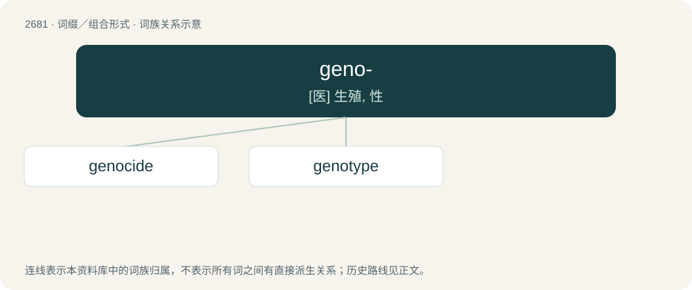

# 2783 · geno- — \[医\] 生殖, 性

[总目录](../00_总目录_按常用程度.md)

**类型**：词缀／组合形式　｜　**来源语言**：见词源记录

## 核心含义与来源

- 核心含义：\[医\] 生殖, 性
- 英文含义：genetics - e.g. genotype
- 词形：geno-

**来源记录 1**（前缀／前置成分；genetics - e.g. genotype）

From the stem of Ancient Greek γένος (génos, “race, kind”), also Ancient Greek γεννάω (gennáō, “to produce”) and from Latin gēns (“tribe, clan”).

## 词族图

## 单词速览（常用到不常用）

| 单词 | 音标 | 释义 |
|---|---|---|
| [genocide](#w-1) | /ˈd͡ʒɛnəsaɪd/ | n. 种族灭绝, 灭绝整个种族的大屠杀；\[医\] 种族灭绝(侵略军队加害居民的罪行) |
| [genotype](#w-2) | 英 /ˈdʒɛnəʊˌtaɪp/；美 /ˈd͡ʒinoʊˌtaɪp/ | n. 基因型, 遗传型；\[医\] 遗传型, 基因型 |

## 逐词详解

### 1. genocide

**词性**：名词　｜　**音标**：/ˈd͡ʒɛnəsaɪd/

**中文释义**：n. 种族灭绝, 灭绝整个种族的大屠杀；\[医\] 种族灭绝(侵略军队加害居民的罪行)

**英文义项**：The systematic and deliberate destruction of a group of people; typically by killing substantial numbers of them, on the basis of their ethnicity, religion, nationality, or similar grounds. / The systematic suppression of ideas or practices on the basis of cultural or ethnic origin; culturicide.

**构词拆分**：-cide + geno-；geno- + -cide (“killing”)

**词源与演化**：

From the stem of Ancient Greek γένος (génos, “race, kind”) (cognate with Latin gēns (“tribe, clan”), whence genus), corresponding to geno- + -cide (“killing”). Piecewise doublet of gendercide. Compare genticide. Coined by Polish Jewish lawyer Raphael Lemkin in 1943 or 1944 in reference to the Armenian Genocide (then known by other names; for more information, see Terminology of the Armenian genocide on Wikipedia), massacres of Assyrians (such as the Simele massacre and Seyfo) and the Jewish Holocaust.

**例句**：

> A genocide will always be followed by the denial that it ever happened.

该用例对应义项：The systematic and deliberate destruction of a group of people; typically by killing substantial numbers of them, on the basis of their ethnicity, religion, nationality, or similar grounds.

### 2. genotype

**词性**：名词　｜　**音标**：英 /ˈdʒɛnəʊˌtaɪp/；美 /ˈd͡ʒinoʊˌtaɪp/

**中文释义**：n. 基因型, 遗传型；\[医\] 遗传型, 基因型

**英文义项**：The part (DNA sequence) of the genetic makeup of an organism which determines a specific characteristic (phenotype) of that organism. / A group of organisms having the same genetic constitution.

**构词拆分**：geno- + -type

**词源与演化**：

From geno- + -type.

**例句**：

> In biology, the students learn the difference between the genotype and the phenotype.
