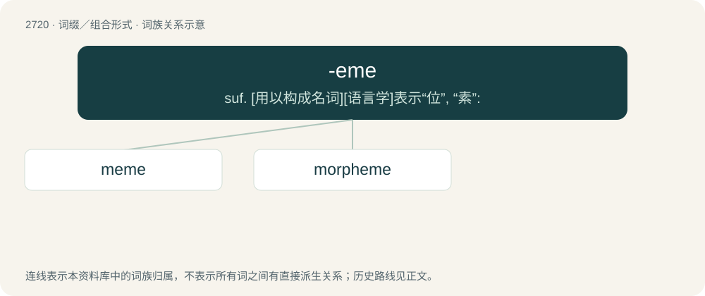

# 2821 · -eme — suf. \[用以构成名词\]\[语言学\]表示“位”, “素”:

[总目录](../00_总目录_按常用程度.md)

**类型**：词缀／组合形式　｜　**来源语言**：见词源记录

## 核心含义与来源

- 核心含义：suf. \[用以构成名词\]\[语言学\]表示“位”, “素”:
- 英文含义：Indicating a fundamental unit in some kind of structure, chiefly linguistic structure.
- 词形：-eme

**来源记录 1**（后缀／后置成分；Indicating a fundamental unit in some kind of structure, chiefly linguistic structure.）

Extracted from phoneme, from Ancient Greek φώνημα (phṓnēma, “sound”), from φωνέω (phōnéō, “to sound”), from φωνή (phōnḗ, “sound”).

## 词族图

## 单词速览（常用到不常用）

| 单词 | 音标 | 释义 |
|---|---|---|
| [meme](#w-1) | /miːm/ | n. 大脑模仿病毒；文化基因；弥母 |
| [morpheme](#w-2) | 英 /ˈmɔː.fiːm/；美 /ˈmɔɹ.fim/ | n. 语素, 词素 |

## 逐词详解

### 1. meme

**词性**：名词　｜　**音标**：/miːm/

**中文释义**：n. 大脑模仿病毒；文化基因；弥母

**英文义项**：Any unit of (originally cultural) information, such as a practice or idea, that is transmitted verbally or by repeated action from one mind to another in a comparable way to the transmission of genes. / Media, usually humorous, which is copied and circulated online with slight adaptations, such as basic pictures, video templates, etc.

**构词拆分**：mime + -eme

**词源与演化**：

Clipping of mimeme, equivalent to mime + -eme. Coined by British biologist Richard Dawkins in 1976 in his book The Selfish Gene. Shortened (after gene) from mimeme (compare English phoneme), anglicized as if from a noun derived from Ancient Greek μῑμέομαι (mīméomai) with the deverbal suffix -μα (-ma), from μῖμος (mîmos, “imitation, copy”). The concept was later applied to the Internet by Mike Godwin.

**例句**：

> He stuck memes on the wall to campaign for the position of President.

该用例对应义项：Media, usually humorous, which is copied and circulated online with slight adaptations, such as basic pictures, video templates, etc.

### 2. morpheme

**词性**：名词　｜　**音标**：英 /ˈmɔː.fiːm/；美 /ˈmɔɹ.fim/

**中文释义**：n. 语素, 词素

**英文义项**：The smallest linguistic unit within a word that can carry a meaning. It may be a letter, a syllable, or otherwise.

**构词拆分**：By surface analysis, morph + -eme

**词源与演化**：

From French morphème. Ultimately from Ancient Greek μορφή (morphḗ, “shape, form”). By surface analysis, morph + -eme.
