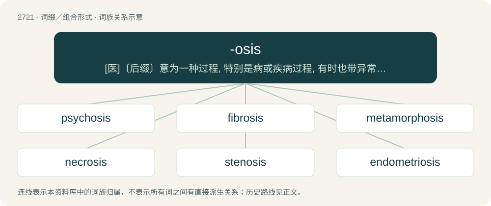

# 2822 · -osis — \[医\]〔后缀〕意为一种过程, 特别是病或疾病过程, 有时也带异常增多的意思。另见sis项下

[总目录](../00_总目录_按常用程度.md)

**类型**：词缀／组合形式　｜　**来源语言**：见词源记录

## 核心含义与来源

- 核心含义：\[医\]〔后缀〕意为一种过程, 特别是病或疾病过程, 有时也带异常增多的意思。另见sis项下
- 英文含义：functional disease or condition such as hepatosis
- 词形：-osis

**来源记录 1**（后缀／后置成分；functional disease or condition such as hepatosis）

Learned borrowing from New Latin -ōsis, from Ancient Greek -ωσις (-ōsis, “state, abnormal condition, or action”), from -όω (-óō) stem verbs + -σις (-sis).

## 词族图

## 单词速览（常用到不常用）

| 单词 | 音标 | 释义 |
|---|---|---|
| [psychosis](#w-1) | 英 /saɪˈkəʊsɪs/；美 /saɪˈkoʊsɪs/ | n. 精神病, 精神不正常；\[医\] 精神病 |
| [fibrosis](#w-2) | 美 /faɪˈbɹoʊsɪs/ | n. 纤维变性, 纤维化；\[医\] 纤维变性, 纤维化 |
| [metamorphosis](#w-3) | 英 /ˌmɛtəˈmɔːfəsɪs/；美 /ˌmɛtəˈmoɹfəsɪs/ | n. 蜕变, 变质, 变形；\[医\] 变态, 变形, 变质 |
| [necrosis](#w-4) | 英 /nəˈkɹəʊ.sɪs/；美 /nɛˈkɹoʊ.sɪs/ | n. 坏死, 枯斑；\[医\] 坏死 |
| [stenosis](#w-5) | 英 /stɪˈnəʊ.sɪs/；美 /stəˈnoʊ.sɪs/ | n. 狭窄；\[医\] 狭窄 |
| [endometriosis](#w-6) | /ˌɛndoʊˌmiːtɹiˈoʊsɪs/ | \[医\] 子宫内膜异位 |
| [mitosis](#w-7) | 英 /maɪˈtəʊ.sɪs/；美 /maɪˈtoʊ.sɪs/ | n. 有丝分裂；\[医\] 有丝分裂, \[间接\]核分裂 |
| [acidosis](#w-8) | 英 /ˌæs.ɪˈdəʊ.sɪs/；美 /ˌæs.ɪˈdoʊ.sɪs/ | n. 酸中毒；\[化\] 酸中毒 |
| [ketosis](#w-9) | /kiːˈtəʊsɪs/ | n. 酮症；\[医\] 酮病 |
| [amyloidosis](#w-10) | 英 /æmɪlɔɪˈdəʊsɪs/ | \[医\] 淀粉样变性 |
| [sarcoidosis](#w-11) | /.sɑːkɒiˈdəusis/ | n. 肉状瘤病, 类肉状瘤病；\[医\] 肉样瘤病, 类肉瘤病 |
| [toxoplasmosis](#w-12) | /ˌtɒksəʊplæzˈməʊsɪs/ | n. 弓形体病, 弓浆虫病；\[医\] 弓形体病 |
| [phagocytosis](#w-13) | 英 /ˌfæɡ.əʊ.saɪˈtəʊ.sɪs/；美 /ˌfæɡ.oʊ.saɪˈtəʊ.sɪs/ | n. 噬菌作用, 吞噬作用 |
| [neurofibromatosis](#w-14) |  | \[医\] 神经纤维瘤病, 多发性神经纤维瘤 |
| [brucellosis](#w-15) | /.bruːsiˈləusis/ | n. 布鲁氏菌病；\[医\] 波状热, 布鲁氏\[杆\]菌病 |
| [leptospirosis](#w-16) | /,leptəuspaiˈrəusis/ | \[医\] 钩端螺旋体病 |

## 逐词详解

### 1. psychosis

**词性**：名词　｜　**音标**：英 /saɪˈkəʊsɪs/；美 /saɪˈkoʊsɪs/

**中文释义**：n. 精神病, 精神不正常；\[医\] 精神病

**英文义项**：A severe mental disorder, sometimes with physical damage to the brain, marked by a deranged personality and a distorted view of reality.

**构词拆分**：psych- + -osis

**词源与演化**：

From psych- + -osis. Not descended from Ancient Greek ψύχωσις (psúkhōsis, “animation, principle of life”), which is a piecewise cognate.

**例句**：

> Fortunately, I have never succumbed to the psychosis they call love.

### 2. fibrosis

**词性**：名词　｜　**音标**：美 /faɪˈbɹoʊsɪs/

**中文释义**：n. 纤维变性, 纤维化；\[医\] 纤维变性, 纤维化

**英文义项**：The formation of (excess) fibrous connective tissue in an organ.

**构词拆分**：fibro- + -osis

**词源与演化**：

From fibro- + -osis.

**例句**：

> Cystic fibrosis is a genetic disease.

### 3. metamorphosis

**词性**：名词　｜　**音标**：英 /ˌmɛtəˈmɔːfəsɪs/；美 /ˌmɛtəˈmoɹfəsɪs/

**中文释义**：n. 蜕变, 变质, 变形；\[医\] 变态, 变形, 变质

**英文义项**：A transformation, such as one performed by magic. / A noticeable change in character, appearance, function, or condition.

**构词拆分**：meta- + -morph + -osis

**词源与演化**：

First attested in 1533, from Latin metamorphōsis, from Ancient Greek μεταμόρφωσις (metamórphōsis), from μετά (metá, “change”) + μορφή (morphḗ, “form”). Analyzable as meta- + -morph + -osis

**例句**：

> The metamorphosis of the old house into something new and exciting.

该用例对应义项：a striking change in appearance or character or circumstances

### 4. necrosis

**词性**：名词　｜　**音标**：英 /nəˈkɹəʊ.sɪs/；美 /nɛˈkɹoʊ.sɪs/

**中文释义**：n. 坏死, 枯斑；\[医\] 坏死

**英文义项**：The localized death of cells or tissues through injury, disease, or the interruption of blood supply.

**构词拆分**：necro- + -osis

**词源与演化**：

From Ancient Greek νέκρωσις (nékrōsis), equivalent to necro- + -osis.

**例句**：

> Usually gangrene will follow necrosis unless the dead tissue is resected.

该用例对应义项：The localized death of cells or tissues through injury, disease, or the interruption of blood supply.

### 5. stenosis

**词性**：名词　｜　**音标**：英 /stɪˈnəʊ.sɪs/；美 /stəˈnoʊ.sɪs/

**中文释义**：n. 狭窄；\[医\] 狭窄

**英文义项**：An abnormal narrowing or stricture in a blood vessel or other tubular organ. / A reduction in either mental or physical capacity.

**构词拆分**：steno- + -osis

**词源与演化**：

From New Latin stenōsis, from Ancient Greek στένωσις (sténōsis, “narrowing”), from στενόω (stenóō, “to confine, to contract”) + -σις (-sis, nominal suffix), equivalent to steno- + -osis.

### 6. endometriosis

**词性**：名词　｜　**音标**：/ˌɛndoʊˌmiːtɹiˈoʊsɪs/

**中文释义**：\[医\] 子宫内膜异位

**英文义项**：A generally painful condition characterised by the presence of endometrial-like tissue in places other than the lining of the uterus; an instance of such tissue being present.

**构词拆分**：endometrium + -osis

**词源与演化**：

From endometrium + -osis.

**例句**：

> Women with mothers or sisters who have endometriosis are at elevated risk of developing the condition themselves.

### 7. mitosis

**词性**：名词　｜　**音标**：英 /maɪˈtəʊ.sɪs/；美 /maɪˈtoʊ.sɪs/

**中文释义**：n. 有丝分裂；\[医\] 有丝分裂, \[间接\]核分裂

**英文义项**：The division of a cell nucleus in which the genome is copied and separated into two identical halves. It is normally followed by cell division.

**词源与演化**：

From German Mitose, from Ancient Greek μίτος (mítos, “thread”) + -osis, probably in reference to the thread-like chromatin seen during mitosis.

**例句**：

> The alien microorganisms continued their mitosis.

### 8. acidosis

**词性**：名词　｜　**音标**：英 /ˌæs.ɪˈdəʊ.sɪs/；美 /ˌæs.ɪˈdoʊ.sɪs/

**中文释义**：n. 酸中毒；\[化\] 酸中毒

**英文义项**：An abnormally increased acidity of the blood.

**构词拆分**：acid + -osis

**词源与演化**：

From acid + -osis.

### 9. ketosis

**词性**：名词　｜　**音标**：/kiːˈtəʊsɪs/

**中文释义**：n. 酮症；\[医\] 酮病

**英文义项**：A metabolic state in which the body produces ketones to be used as fuel by some organs so that glycogen can be reserved for organs that depend on it. This condition occurs during times of fasting, starvation, or while on a ketogenic diet.

**构词拆分**：keto- + -osis

**词源与演化**：

From keto- + -osis.

### 10. amyloidosis

**词性**：名词　｜　**音标**：英 /æmɪlɔɪˈdəʊsɪs/

**中文释义**：\[医\] 淀粉样变性

**英文义项**：Any of a group of disorders in which the fibrous protein amyloid is deposited in an organ of the body.

**构词拆分**：amyloid + -osis

**词源与演化**：

From amyloid + -osis.

### 11. sarcoidosis

**词性**：名词　｜　**音标**：/.sɑːkɒiˈdəusis/

**中文释义**：n. 肉状瘤病, 类肉状瘤病；\[医\] 肉样瘤病, 类肉瘤病

**英文义项**：A multisystem disorder characterized by granulomas.

**构词拆分**：sarcoid + -osis

**词源与演化**：

From sarcoid + -osis.

### 12. toxoplasmosis

**词性**：名词　｜　**音标**：/ˌtɒksəʊplæzˈməʊsɪs/

**中文释义**：n. 弓形体病, 弓浆虫病；\[医\] 弓形体病

**英文义项**：A disease, caused by the parasite Toxoplasma gondii, that primarily affects felids, but also other mammals including humans.

**词源与演化**：

From French toxoplasmose, from translingual Toxoplasma + -osis.

**例句**：

> What are the risks of toxoplasmosis during pregnancy?

### 13. phagocytosis

**词性**：名词　｜　**音标**：英 /ˌfæɡ.əʊ.saɪˈtəʊ.sɪs/；美 /ˌfæɡ.oʊ.saɪˈtəʊ.sɪs/

**中文释义**：n. 噬菌作用, 吞噬作用

**英文义项**：A form of endocytosis in which a cell incorporates a particle by extending pseudopodia and drawing the particle into a vacuole of its cytoplasm.

**构词拆分**：phagocyte + -osis

**词源与演化**：

From German Phagocytosis; equivalent to phagocyte + -osis; compare French phagocytose.

### 14. neurofibromatosis

**词性**：名词

**中文释义**：\[医\] 神经纤维瘤病, 多发性神经纤维瘤

**英文义项**：A genetic disorder characterized by the presence of multiple neurofibromas under the skin.

**构词拆分**：neurofibroma + -osis

**词源与演化**：

From neurofibroma + -osis.

### 15. brucellosis

**词性**：名词　｜　**音标**：/.bruːsiˈləusis/

**中文释义**：n. 布鲁氏菌病；\[医\] 波状热, 布鲁氏\[杆\]菌病

**英文义项**：Infection by a bacterium of the genus Brucella, which is carried by ruminants and other mammals, with symptoms including recurring fevers, sweating, weakness, anorexia, headaches, depression, and generalized aches and pains.

**词源与演化**：

From Translingual Brucella + English -osis.

**例句**：

> Botulism, brucellosis, Lyme-disease and tetanus are infectious, but not contagious diseases.

### 16. leptospirosis

**词性**：名词　｜　**音标**：/,leptəuspaiˈrəusis/

**中文释义**：\[医\] 钩端螺旋体病

**英文义项**：An acute, infectious, febrile disease of both humans and animals, caused by spirochetes of the genus Leptospira.

**词源与演化**：

From Leptospira + -osis.
