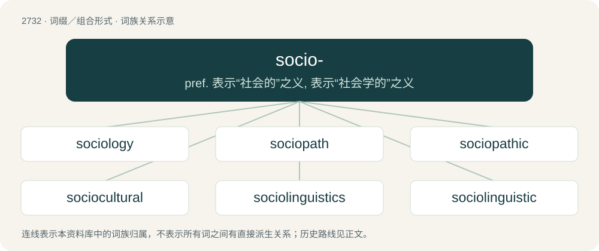

# 2831 · socio- — pref. 表示“社会的”之义, 表示“社会学的”之义

[总目录](../00_总目录_按常用程度.md)

**类型**：词缀／组合形式　｜　**来源语言**：见词源记录

## 核心含义与来源

- 核心含义：pref. 表示“社会的”之义, 表示“社会学的”之义
- 英文含义：society
- 词形：socio-

**来源记录 1**（前缀／前置成分；society）

From Latin socius (“associated, allied; partner, companion, ally”), from Proto-Indo-European \*sokʷ-yo- (“companion”), from Proto-Indo-European \*sekʷ- (“to follow”).

## 词族图

## 单词速览（常用到不常用）

| 单词 | 音标 | 释义 |
|---|---|---|
| [sociology](#w-1) | 英 /ˌsəʊsiːˈɒləd͡ʒiː/；美 /ˌsoʊsiˈɑləd͡ʒi/ | n. 社会学；\[医\] 社会学 |
| [sociopath](#w-2) | /ˈsəʊ.si.ə(ʊ)ˌpæθ/ | n. 反社会的人；\[医\] 反社会者(一种精神病人) |
| [sociopathic](#w-3) | /səusiəuˈpæθik/ | a. 反社会的, 不爱社交的 |
| [sociocultural](#w-4) | /.səuʃiəuˈkʌltʃrəl/ | a. 社会文化的 |
| [sociolinguistics](#w-5) | 英 /ˌsəʊsi.əʊlɪŋˈɡwɪstɪks/；美 /ˌsoʊsi.oʊlɪŋˈɡwɪstɪks/ | n. 社会语言学 |
| [sociolinguistic](#w-6) | /ˌsəʊsi.əʊlɪŋˈɡwɪstɪk/ | 社会语言学的 |

## 逐词详解

### 1. sociology

**词性**：名词　｜　**音标**：英 /ˌsəʊsiːˈɒləd͡ʒiː/；美 /ˌsoʊsiˈɑləd͡ʒi/

**中文释义**：n. 社会学；\[医\] 社会学

**英文义项**：A social science that studies society, human social interaction, patterns of social relationships, and the interactions of culture. Through both theory and applied research, it engages subject matters across a range of microanalysis, mesoanalysis, and macroanalysis.

**构词拆分**：socio- + -logy

**词源与演化**：

From French sociologie, coined by Auguste Comte in 1834, itself a combination of Latin socius (“companion, fellowship”) and the Greek suffix Ancient Greek -λογία (-logía), itself from Ancient Greek λόγος (lógos, “word, knowledge”), from socio- + -logy. Previous mentions of the field in English usually referred to it as social physics.

**例句**：

> He not only graduated from studying sociology, but also philosophy.

### 2. sociopath

**词性**：名词　｜　**音标**：/ˈsəʊ.si.ə(ʊ)ˌpæθ/

**中文释义**：n. 反社会的人；\[医\] 反社会者(一种精神病人)

**英文义项**：A person with an antisocial personality disorder.

**构词拆分**：socio- + -path

**词源与演化**：

From socio- + -path. First use appears c. 1914.

**例句**：

> The CEO of this large company is a narcissist and a sociopath.

### 3. sociopathic

**词性**：形容词　｜　**音标**：/səusiəuˈpæθik/

**中文释义**：a. 反社会的, 不爱社交的

**英文义项**：Having the characteristics of a sociopath. / Unconcerned about the adverse consequences of one's actions on others.

**构词拆分**：socio- + -pathic

**词源与演化**：

From socio- + -pathic.

**例句**：

> Last summer, one of those sick sociopathic terrorists started harassing Berber-language activist Hamid Oubagha online.

### 4. sociocultural

**词性**：形容词　｜　**音标**：/.səuʃiəuˈkʌltʃrəl/

**中文释义**：a. 社会文化的

**英文义项**：Of or relating to both society and culture.

**构词拆分**：socio- + cultural

**词源与演化**：

From socio- + cultural.

### 5. sociolinguistics

**词性**：名词　｜　**音标**：英 /ˌsəʊsi.əʊlɪŋˈɡwɪstɪks/；美 /ˌsoʊsi.oʊlɪŋˈɡwɪstɪks/

**中文释义**：n. 社会语言学

**英文义项**：The study of social and cultural effects on language and vice-versa.

**构词拆分**：socio- + linguistics

**词源与演化**：

From socio- + linguistics.

**例句**：

> Sociolinguistics recognizes that a person may speak his mother tongue using various registers depending on the social situation.

### 6. sociolinguistic

**词性**：形容词　｜　**音标**：/ˌsəʊsi.əʊlɪŋˈɡwɪstɪk/

**中文释义**：社会语言学的

**英文义项**：Pertaining to sociolinguistics.

**构词拆分**：socio- + linguistic

**词源与演化**：

From socio- + linguistic.
