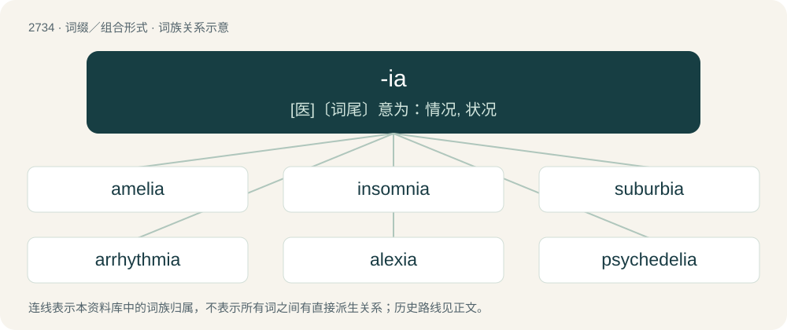

# 2835 · -ia — \[医\]〔词尾〕意为：情况, 状况

[总目录](../00_总目录_按常用程度.md)

**类型**：词缀／组合形式　｜　**来源语言**：见词源记录

## 核心含义与来源

- 核心含义：\[医\]〔词尾〕意为：情况, 状况
- 英文含义：Used in forming placenames, especially of countries.
- 词形：-ia

**多个词源／构词路径**：同一拼写可能有不同来源；以下按词性和含义分别列出。

**来源记录 1**（后缀／后置成分；Used in forming placenames, especially of countries.）

From Latin -ia and Ancient Greek -ία (-ía), -εια (-eia), which form abstract nouns of feminine gender.

**来源记录 2**（后缀／后置成分；Used in forming plurals of nouns in -ium and -ion.）

From the endings of corresponding Latin and Ancient Greek plural nouns.

**来源记录 3**（后缀／后置成分；Used in forming female given names.）

From Latin -ia, feminine of -ius, a suffix forming adjectives and the ending of most Classical Latin nomina gentilicia.

## 词族图

## 单词速览（常用到不常用）

| 单词 | 音标 | 释义 |
|---|---|---|
| [amelia](#w-1) | /əˈmiːljə/ | \[医\] 无肢\[畸形\], 缺肢\[畸形\] |
| [insomnia](#w-2) | /ɪnˈsɒmniə/ | n. 失眠症；\[医\] 失眠\[症\] |
| [suburbia](#w-3) | 英 /səˈbɜːbi.ə/；美 /səˈbɝbi.ə/ | n. 都市的郊区, 郊区居民, 郊区居民所特有的风俗习惯 |
| [arrhythmia](#w-4) | /eɪˈɹɪð.mɪ.ə/ | n. 心律不齐；\[医\] 心律失常, 心律不齐, 无节律 |
| [alexia](#w-5) | 美 /əˈlɛk.si.ə/ | n. 失读症；\[医\] 读字不能, 失读\[症\] |
| [psychedelia](#w-6) | /,saikiˈdiːliə/ | n. 幻觉剂 |
| [poinsettia](#w-7) | 英 /ˌpɔɪnˈsɛ.tɪə/；美 /ˌpɔɪnˈsɛ.t(i)ə/ | n. 一品红 |
| [dyspepsia](#w-8) | 英 /dɪsˈpɛp.si.ə/ | n. 消化不良；\[医\] 消化不良 |

## 逐词详解

### 1. amelia

**词性**：名词　｜　**音标**：/əˈmiːljə/

**中文释义**：\[医\] 无肢\[畸形\], 缺肢\[畸形\]

**英文义项**：The congenital absence of one or more limbs.

**词源与演化**：

From a- + Ancient Greek μέλος (mélos, “limb”) + -ia.

**例句**：

> Amelia Earhart was the first woman to fly across the Atlantic solo.

### 2. insomnia

**词性**：名词　｜　**音标**：/ɪnˈsɒmniə/

**中文释义**：n. 失眠症；\[医\] 失眠\[症\]

**英文义项**：A sleeping disorder that is known for its symptoms of unrest and the inability to sleep. / Temporary inability to sleep.

**构词拆分**：in- + somn- + -ia

**词源与演化**：

Borrowed from Latin īnsomnia, from Latin in- (“without”) + somnus (“sleep”, noun) + -ia, equivalent to in- + somn- + -ia.

**例句**：

> My mother suffers from insomnia.

该用例对应义项：A sleeping disorder that is known for its symptoms of unrest and the inability to sleep.

### 3. suburbia

**词性**：名词　｜　**音标**：英 /səˈbɜːbi.ə/；美 /səˈbɝbi.ə/

**中文释义**：n. 都市的郊区, 郊区居民, 郊区居民所特有的风俗习惯

**英文义项**：The suburbs as a whole and all that characterizes or pertains to them; (sometimes derogatory) the suburbs as encapsulated or represented by the typical characteristics or qualities of the people living there, especially complacency, conformity, conservativeness, dullness, etc.

**构词拆分**：suburb + -ia (suffix forming abstract nouns, the names of collections of things, etc.)

**词源与演化**：

From suburb + -ia (suffix forming abstract nouns, the names of collections of things, etc.), perhaps modelled after Latin suburbia (“suburbs”), the plural of suburbium.

**例句**：

> Nicolette loved living in suburbia: not too far from the city, but not too close, either.

### 4. arrhythmia

**词性**：名词　｜　**音标**：/eɪˈɹɪð.mɪ.ə/

**中文释义**：n. 心律不齐；\[医\] 心律失常, 心律不齐, 无节律

**英文义项**：An irregular heartbeat; a lack of a regular pulse. / A disease entity involving such beats, such as atrial fibrillation, ventricular tachycardia, AV nodal reentrant tachycardia, or others.

**构词拆分**：a- + rhythm + -ia

**词源与演化**：

Borrowed from New Latin arrhythmia, from Ancient Greek ἀρρυθμία (arrhuthmía), equivalent to a- + rhythm + -ia.

**例句**：

> My family has a history of cardiac arrhythmia.

### 5. alexia

**词性**：名词　｜　**音标**：美 /əˈlɛk.si.ə/

**中文释义**：n. 失读症；\[医\] 读字不能, 失读\[症\]

**英文义项**：The inability, due to a cerebral disorder, to comprehend or understand writing.

**词源与演化**：

From Ancient Greek ἀ- (a-, “not”) + λέξις (léxis, “speech”) + -ia.

### 6. psychedelia

**词性**：名词　｜　**音标**：/,saikiˈdiːliə/

**中文释义**：n. 幻觉剂

**英文义项**：The subculture associated with those who take psychedelic drugs.

**构词拆分**：psychedelic + -ia

**词源与演化**：

From psychedelic + -ia.

**例句**：

> There were titles intercut with the action, abstract designs, special effects and psychedelia.

### 7. poinsettia

**词性**：名词　｜　**音标**：英 /ˌpɔɪnˈsɛ.tɪə/；美 /ˌpɔɪnˈsɛ.t(i)ə/

**中文释义**：n. 一品红

**英文义项**：A plant, Euphorbia pulcherrima, with rather small and insignificant flowers surrounded by large bright red leaves; native to Mexico and Central America and widely cultivated as a garden plant; widely used in Christmas floral displays.

**构词拆分**：Poinsett + -ia

**词源与演化**：

After the obsolete genus name Poinsettia, named after Joel Roberts Poinsett (19th-century US minister to Mexico); equivalent to Poinsett + -ia.

### 8. dyspepsia

**词性**：名词　｜　**音标**：英 /dɪsˈpɛp.si.ə/

**中文释义**：n. 消化不良；\[医\] 消化不良

**英文义项**：Any mild disorder of digestion characterised by stomach pain, discomfort, heartburn, and nausea, often following a meal. / Irritation or disgruntlement.

**词源与演化**：

From dys- + Ancient Greek πέψις (pépsis, “digestion”) + -ia.

**例句**：

> He divides dyspepsias into accidental, temporary (indigestions) and habitual.

该用例对应义项：Any mild disorder of digestion characterised by stomach pain, discomfort, heartburn, and nausea, often following a meal.
