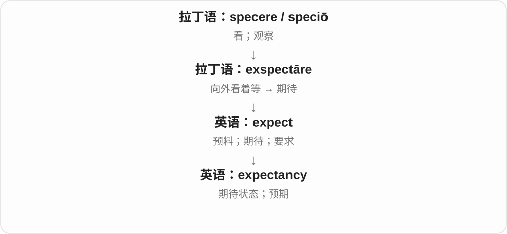
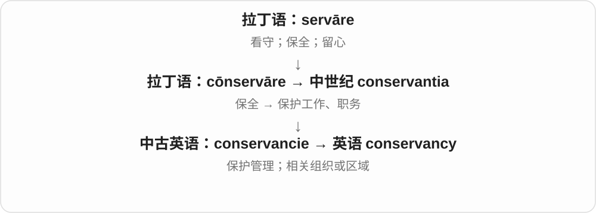

# 2843 · -ancy — 把性质、状态或相关活动命名的词尾形式

[逐词精讲目录](../00_逐词精讲目录.md) · [总目录](../00_总目录_按常用程度.md)

## 核心词根与来源

浮起的性质可以叫浮性，期待的状态可以叫期待；consultancy、accountancy 等又已发展成业务、行业名称，不能全套一个生硬中文后缀。

**-ANCY：从某种性质，抽出一种状态、能力或领域**

buoyant → buoyancy；expectant → expectancy；其他借词各有历史。

- **期待、升势与浮性**：expectancy · ascendancy · buoyancy
- **业务、职业和保护领域**：consultancy · accountancy · conservancy
- **恶性性质**：malignancy

## 词形与演化规律

-ant 与 -ancy 常有对应；不少词整词经法语、拉丁语借入，具体形成逐词看。

## 单词速览（按词族由简到繁）

同一基础词的相关扩展放在一起，先读基础形式，再读扩展；各组之间优先读常用的。具体词源关系见各词讲解。

| 单词 | 音标 | 核心意思 |
|---|---|---|
| [expectancy](#w-1) | /ɪkˈspektənsi/ | 期待；预期 |
| [consultancy](#w-2) | /kənˈsʌltənsi/ | 咨询业务；顾问服务；咨询公司 |
| [accountancy](#w-3) | /əˈkaʊntənsi/ | 会计业；会计专业、工作 |
| [conservancy](#w-4) | 英 /kənˈsɜːvənsi/；美 /kənˈsɜːrvənsi/ | 自然资源保护；保护管理机构或区域 |
| [buoyancy](#w-5) | /ˈbɔɪənsi/ | 浮力、浮性；轻快乐观、景气 |
| [ascendancy](#w-6) | 英、美 /əˈsendənsi/ | 优势地位；支配地位 |
| [malignancy](#w-7) | /məˈlɪɡnənsi/ | 恶性；恶性肿瘤、癌症；恶毒 |

## 逐词讲解

### 1. expectancy — 期待；预期

**音标**：/ɪkˈspektənsi/

**先抓住这个画面**

expectancy 像大家看着舞台、等帷幕拉开的那种心情；也可表示根据资料作出的预期。

**怎么拆**

与 expect + -ancy 或 expectant + -cy 对应，构成状态名词。

**怎么变成今天的意思**

life expectancy 是某种统计条件下的预期寿命，不是对一个人寿命的保证。日常语境则常指期待气氛。

**常见搭配与例句**

a sense of expectancy；life expectancy；in an atmosphere of expectancy。

> A sense of expectancy filled the room.

房间里充满了期待的气氛。

> The chart compares life expectancy across several decades.

图表比较了几十年间的预期寿命。

**别混淆**

expectation 常有具体期待内容；expectancy 更常突出等待的状态，或固定统计表达。

### 2. consultancy — 咨询业务；顾问服务；咨询公司

**音标**：/kənˈsʌltənsi/

**先抓住这个画面**

把替别人分析问题、提供建议当作一种专业服务；也可以指经营这种服务的机构。

**怎么拆**

英语 consultant 的 -ant 换成 -ancy，或分析为 consult + -ancy；都是现代英语中的性质、业务名词构成。

**怎么变成今天的意思**

**拉丁 consulere → consultare**  
商议、考虑 → 征求意见、商量

↓

**法语 consulter → 英语 consult → consultant**  
请教 → 提供专业意见的人

↓

**英语 consultancy**  
顾问工作、咨询服务或咨询机构

做咨询业务用不可数 consultancy；一家机构可说 a consultancy。它卖的主要是知识和建议，未必替客户执行每一步。

**常见搭配与例句**

management consultancy；provide consultancy；a small consultancy。

> After leaving the company, she moved into consultancy.

离开公司后，她转行从事咨询工作。

> A local consultancy helped us assess the proposal.

一家当地咨询公司帮我们评估了这份提案。

**别混淆**

consultation 是一次咨询或咨询过程；consultancy 更常指这一行的业务、服务或公司。

### 3. accountancy — 会计业；会计专业、工作

**音标**：/əˈkaʊntənsi/

**先抓住这个画面**

不只是某一张账，而是把做账、核算、报表等工作作为一个职业、专业来谈。

**怎么拆**

account + -ancy 的词族名词，对应 accountant 会计师等用法。account 更早经法语接计算、账目词族，不能直接把后缀认成 agency 机构。

**怎么变成今天的意思**

**法语、拉丁计算词族 → account**  
计算、账目与说明

↓

**account + -ancy → accountancy**  
账务工作 → 会计专业、职业

study accountancy 学会计，an accountancy firm 会计师事务所；英式常见，美国也用 accounting 说这一领域。

**常见搭配与例句**

study accountancy；an accountancy firm；a career in accountancy。

> She studied accountancy at college.

她在大学学会计。

> He works for a small accountancy firm.

他在一家小型会计师事务所工作。

**别混淆**

accountancy 会计领域，accountant 从业者；account 还可能是账号、叙述等，不能把每个 account 都代换成会计。

### 4. conservancy — 自然资源保护；保护管理机构或区域

**音标**：英 /kənˈsɜːvənsi/；美 /kənˈsɜːrvənsi/

**先抓住这个画面**

给一片土地或一条河安排长期看护，让保护成为一项持续的工作。

**怎么拆**

更早的 conservancie 借自中世纪拉丁语 conservantia，与 conservāre“保全”相连；现代能看出 conserve 与 -ancy，但不把它冒充全部历史。

**怎么变成今天的意思**

常见于机构和保护项目名称；具体是组织、工作还是管理区，需要看上下文。

**常见搭配与例句**

a river conservancy；a local conservancy；land conservancy。

> The local conservancy maintains trails through the wetland.

当地保护组织维护着穿过湿地的小径。

> She volunteers with a land conservancy.

她在一家土地保护组织做志愿者。

**别混淆**

conservation 较常指保护工作本身；conservancy 更常见于承担保护工作的组织、区域或管理体系。

### 5. buoyancy — 浮力、浮性；轻快乐观、景气

**音标**：/ˈbɔɪənsi/

**先抓住这个画面**

物体浸在水里，水向上托着它，这股托力是 buoyancy；人遇到挫折仍能精神往上浮，也用 buoyancy 说乐观。

**怎么拆**

buoyant + -cy，词尾 -ant 对应 -ancy；也可看出 buoy + -ancy 的表面联系。由能浮的性质扩展到上托力，以及情绪、市场的轻快活跃。

**怎么变成今天的意思**

**buoy 浮标、托浮 → buoyant**  
能浮起、轻快的；形容词早期形成有借入等讨论

↓

**buoyant 去 -t + -cy → buoyancy**  
浮力、浮性；乐观、轻快情绪的比喻

the buoyancy of a boat 船的浮性，market buoyancy 市场活跃，emotional buoyancy 情绪上的乐观复原力。

**常见搭配与例句**

buoyancy in water；market buoyancy；natural buoyancy。

> The experiment compared the buoyancy of different objects.

实验比较了不同物体的浮性。

> Her natural buoyancy helped the team recover from the setback.

她天生的乐观帮助团队从挫折中恢复。

**别混淆**

浮力存在于液体也存在于气体，物体下沉时仍可能受向上的浮力；是否浮起还要比较重力等。

### 6. ascendancy — 优势地位；支配地位

**音标**：英、美 /əˈsendənsi/

**先抓住这个画面**

一路向上之后，站到了能影响别人走向的位置。

**怎么拆**

来自 ascend + -ancy，或按 ascendant + -cy 分析；是英语名词派生。

**怎么变成今天的意思**

**拉丁语：ad**  
朝向；靠近；加到

↓

**拉丁语：scandere → ascendere**  
攀登 → 向上爬

↓

**古法语 ascendre → 中古英语 ascenden → ascend**  
上升；登上

↓

**英语 ascend / ascendant → ascendancy**  
上升势头 → 优势、支配地位

不是一次普通的上升，而是在某个领域占据上风。in the ascendancy 强调正走强、越来越有影响。

**常见搭配与例句**

gain ascendancy；ascendancy over；in the ascendancy。

> The new party gained ascendancy in local politics.

新政党在地方政治中取得了优势地位。

> Digital photography was soon in the ascendancy.

数字摄影很快占据了上风。

**别混淆**

dominance 强调支配状态；ascendancy 常让人想到力量上升后取得的优势。

### 7. malignancy — 恶性；恶性肿瘤、癌症；恶毒

**音标**：/məˈlɪɡnənsi/

**先抓住这个画面**

把恶性这一性质，或一个具体的恶性病变，作为名词来说。

**怎么拆**

常分析为 malignant 对应 -cy 名词；也有拉丁 malignantia 借入或影响的分析，不把一种说法写成唯一历史。

**怎么变成今天的意思**

**拉丁 male 坏地 + -gnus〔与出生相关〕→ malignus**  
本性不良、有恶意的

↓

**晚期拉丁 malignans / malignantia；英语 malignant → malignancy**  
恶性的性质；英语构词和拉丁对应形式都被词源资料提及

evidence of malignancy 是恶性证据；a malignancy 可指一个恶性肿瘤或癌症。医学里比日常的坏严谨得多，不能与肿块直接画等号。

**常见搭配与例句**

evidence of malignancy；a suspected malignancy；the risk of malignancy。

> The biopsy showed no evidence of malignancy.

活检未发现恶性证据。

> The lecture compared several types of malignancy.

讲座比较了几种恶性肿瘤。

**别混淆**

tumour 是肿瘤，不自动意味着恶性；malignancy 明确涉及恶性，是否成立要靠医学判断。

## 这一组要分清什么

词形对应不等于都在现代英语直接加后缀；buoyancy 的浮力与实际是否上浮分清。

## 串起来练习

The lesson compares expectancy, buoyancy and other nouns ending in -ancy.

这节课比较期待、浮性等以 -ancy 结尾的名词。
