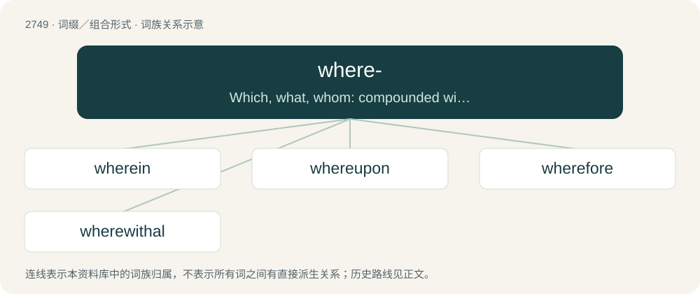

# 2850 · where- — Which, what, whom: compounded with prepositions to form compound relative and interrogative pronouns.

[总目录](../00_总目录_按常用程度.md)

**类型**：词缀／组合形式　｜　**来源语言**：见词源记录

## 核心含义与来源

- 核心含义：Which, what, whom: compounded with prepositions to form compound relative and interrogative pronouns.
- 英文含义：Which, what, whom: compounded with prepositions to form compound relative and interrogative pronouns.
- 词形：where-

**来源记录 1**（前缀／前置成分；Which, what, whom: compounded with prepositions to form compound relative and interrogative pronouns.）

See where § Etymology.

## 词族图

## 单词速览（常用到不常用）

| 单词 | 音标 | 释义 |
|---|---|---|
| [wherein](#w-1) | 英 /wɛəˈɹɪn/；美 /wɛˈɹɪn/ | adv. 在哪方面, 在那方面 |
| [whereupon](#w-2) | 英 /ˌwɛərəˈpɒn/；美 /ˌ(h)wɛrəˈpɑn/ | conj. 因此, 于是 |
| [wherefore](#w-3) | 英 /ˈwɛəˌfɔː/；美 /ˈweɹˌfɔɹ/ | conj. 为此, 因此；adv. 为此；n. 理由, 原因 |
| [wherewithal](#w-4) | 英 /ˈwɛə.wɪ.ðɔːl/；美 /ˈwɛɚ.wɪ.ðɔl/ | n. 必要的资金；\[法\] 必要的方法, 必要物 |

## 逐词详解

### 1. wherein

**词性**：副词　｜　**音标**：英 /wɛəˈɹɪn/；美 /wɛˈɹɪn/

**中文释义**：adv. 在哪方面, 在那方面

**英文义项**：How, or in what way.

**构词拆分**：where- + in

**词源与演化**：

From Middle English wherin; equivalent to where- + in.

**例句**：

> Wherein did I misspeak myself?

该用例对应义项：How, or in what way.

### 2. whereupon

**词性**：连词　｜　**音标**：英 /ˌwɛərəˈpɒn/；美 /ˌ(h)wɛrəˈpɑn/

**中文释义**：conj. 因此, 于是

**英文义项**：After which; in consequence; at which point. / Upon which.

**构词拆分**：where- + upon

**词源与演化**：

From Middle English wherupon; equivalent to where- + upon.

**用法示例／搭配（非完整句）**：

> The network went down, whereupon I made a cup of tea

该用例对应义项：After which; in consequence; at which point.

### 3. wherefore

**词性**：名词　｜　**音标**：英 /ˈwɛəˌfɔː/；美 /ˈweɹˌfɔɹ/

**中文释义**：conj. 为此, 因此；adv. 为此；n. 理由, 原因

**英文义项**：An intent or purpose; a why.

**构词拆分**：where- (“what”) + for

**词源与演化**：

From Middle English wherfor, wherfore, hwarfore, equivalent to where- (“what”) + for. Compare Dutch waarvoor (“what for, wherefore”), German wofür (“for what, what for, why”), Danish and Norwegian hvorfor (“wherefore, why”), Swedish varför (“wherefore, why”). More at where, for.

**例句**：

> But wherefore do not you a mightier way make war upon this bloody tyrant Time?

### 4. wherewithal

**词性**：名词　｜　**音标**：英 /ˈwɛə.wɪ.ðɔːl/；美 /ˈwɛɚ.wɪ.ðɔl/

**中文释义**：n. 必要的资金；\[法\] 必要的方法, 必要物

**英文义项**：The ability and means required to accomplish some task.

**构词拆分**：where- + withal

**词源与演化**：

From where- + withal. Originally only an adverb, nominal use since ca. 1800.

**例句**：

> I would like to help your project, but I do not have the wherewithal.

该用例对应义项：The ability and means required to accomplish some task.
