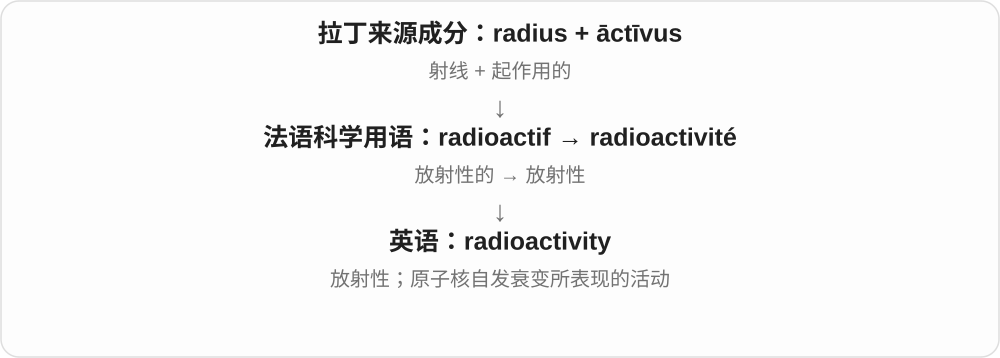

# 2859 · radio- — 射线的来源成分，按对象区分放射性、成像和测量

[逐词精讲目录](../00_逐词精讲目录.md) · [总目录](../00_总目录_按常用程度.md)

## 核心词根与来源

radio- 不限广播。放射性材料、射线影像与辐射计各有具体对象；用后半部分定位任务，再读领域含义。

**RADIO-：先问是哪类辐射，再看研究、活动或仪器**

radioisotope、radionuclide 看放射性；radiometer 看测量；radiography 看成像。

- **性质、活动与具体原子类别**：radioactive · radioactivity · radioisotope · radionuclide · radiocarbon
- **研究、成像、治疗与测量**：radiology · radiography · radiotherapy · radiometer

## 词形与演化规律

radius 光线、射线 → radi- + -o- → radio-；isotope 同位素，nuclide 核素，-meter 仪器。

## 单词速览（按词族由简到繁）

同一基础词的相关扩展放在一起，先读基础形式，再读扩展；各组之间优先读常用的。具体词源关系见各词讲解。

| 单词 | 音标 | 核心意思 |
|---|---|---|
| [radioactive](#w-1) | 英 /ˌreɪdiəʊˈæktɪv/；美 /ˌreɪdioʊˈæktɪv/ | 有放射性的；与放射性有关的 |
| [radioactivity](#w-4) | 英 /ˌreɪdiəʊækˈtɪvəti/；美 /ˌreɪdioʊækˈtɪvəti/ | 放射性；放射性活动 |
| [radiology](#w-2) | 英 /ˌreɪdiˈɒlədʒi/；美 /ˌreɪdiˈɑːlədʒi/ | 放射学；医学影像相关专科 |
| [radiotherapy](#w-3) | 英 /ˌreɪdiəʊˈθerəpi/；美 /ˌreɪdioʊˈθerəpi/ | 放射治疗；放疗 |
| [radiocarbon](#w-5) | 英 /ˌreɪdiəʊˈkɑːbən/；美 /ˌreɪdioʊˈkɑːrbən/ | 放射性碳，通常指碳十四 |
| [radiography](#w-6) | 英 /ˌreɪdiˈɒɡrəfi/；美 /ˌreɪdiˈɑːɡrəfi/ | 射线照相、放射摄影 |
| [radioisotope](#w-7) | 英 /ˌreɪdiəʊˈaɪsətəʊp/；美 /ˌreɪdioʊˈaɪsətoʊp/ | 放射性同位素 |
| [radionuclide](#w-8) | 英 /ˌreɪdiəʊˈnjuːklaɪd/；美 /ˌreɪdioʊˈnuːklaɪd/ | 放射性核素 |
| [radiometer](#w-9) | 英 /ˌreɪdiˈɒmɪtə/；美 /ˌreɪdiˈɑːmɪtər/ | 辐射计 |

## 逐词讲解

### 1. radioactive — 有放射性的；与放射性有关的

**音标**：英 /ˌreɪdiəʊˈæktɪv/；美 /ˌreɪdioʊˈæktɪv/

**先抓住这个画面**

物质中的不稳定原子核会自行衰变，发出相应的辐射。

**怎么拆**

来自19世纪法语科学用语 radio-actif，结合 radio-“射线”与 actif“活跃、起作用的”；英语对应 radio- + active。这里的 radio- 早于把 radio 当作收音机来理解。

**怎么变成今天的意思**

**拉丁 radius**  
棒、辐条、光线；更早来源未定

↓

**近代法语 radio- + actif → radio-actif**  
以射线为命名基础的放射性术语

↓

**英语 radioactive**  
有放射性的；与放射性过程有关的

radioactive material 说的是材料的核性质，不是“接通了无线电的材料”。新闻也会比喻一个提案 politically radioactive：谁碰它都可能付出政治代价，像大家避着走。

**常见搭配与例句**

radioactive material；radioactive decay；radioactive waste；politically radioactive。

> The samples were tested for radioactive contamination.

这些样本接受了放射性污染检测。

> The proposal became politically radioactive after the scandal.

丑闻发生后，这项提案成了各方都不愿碰的政治烫手山芋。

**别混淆**

radiation 是辐射；radioactive 是放射性的。发出无线电波或可见光，不自动等于发生放射性衰变。

### 2. radioactivity — 放射性；放射性活动

**音标**：英 /ˌreɪdiəʊækˈtɪvəti/；美 /ˌreɪdioʊækˈtɪvəti/

**先抓住这个画面**

radioactivity 的画面是不稳定原子核自行发生变化，向外发出粒子或辐射。

**怎么拆**

现代可拆 radio-（辐射）+ activity，或 radioactive + -ity；历史借自法语 radioactivité。这里 radio- 不是“收音机”。

**怎么变成今天的意思**

这里的 active 是发生物理变化，不是说物体活泼。radioactivity 与一般 radiation 的范围不同：并非所有辐射都来自放射性衰变。

**常见搭配与例句**

natural radioactivity；measure radioactivity；levels of radioactivity。

> The instrument measures radioactivity in the sample.

仪器测量样本中的放射性。

> The lesson explains the difference between radioactivity and radiation.

这节课解释放射性与辐射的区别。

**别混淆**

radioactivity 是放射性现象或活动；radiation 是辐射，阳光中的光也属于辐射但不因此叫放射性。

### 3. radiology — 放射学；医学影像相关专科

**音标**：英 /ˌreɪdiˈɒlədʒi/；美 /ˌreɪdiˈɑːlədʒi/

**先抓住这个画面**

借助影像看身体内部，并把影像用于诊断或引导治疗。

**怎么拆**

radio- 在这里接拉丁 radius“射线”，加 -logy；名称与早期射线应用有关，现代范围已扩大。

**怎么变成今天的意思**

**希腊 légō / lógos**  
选取、收集 → 讲述；话语、说明、道理、计算

↓

**拉丁 radius〔光线、射线〕→ radio- + -logy**  
以射线研究和应用命名的近代词

↓

**英语 radiology**  
医学影像专科，现代也使用超声、磁共振等技术

虽然名称中有“放射”，科室也会使用不依赖电离辐射的超声和 MRI。不能因此把所有 radiology 检查都理解成照 X 光。

**常见搭配与例句**

a radiology department；diagnostic radiology；interventional radiology。

> The images were sent to the radiology department for review.

这些影像被送到放射科审阅。

> The radiology service offers both ultrasound and MRI examinations.

放射科提供超声和磁共振检查。

**别混淆**

radiography 较具体地指影像获取，常见于 X 光成像；radiology 是更广的专业领域。

### 4. radiotherapy — 放射治疗；放疗

**音标**：英 /ˌreɪdiəʊˈθerəpi/；美 /ˌreɪdioʊˈθerəpi/

**先抓住这个画面**

把辐射作为治疗工具，用来杀伤或控制病变细胞。

**怎么拆**

英语 radio- + therapy；这里 radio- 是辐射、射线这一支，不是收音机。

**怎么变成今天的意思**

**希腊 therapeúein / therapeía**  
照料、服务；照料病人、治疗

↓

**近代拉丁 therapia → 英语 therapy**  
治疗；一种治疗方式

↓

**英语 radio- + therapy → radiotherapy**  
利用辐射进行治疗

常见于癌症治疗报道。radiation therapy 是同一术语的两个词写法。放疗与拍片检查的目的不同：前者用于治疗，后者主要为了看清身体内部。

**常见搭配与例句**

receive radiotherapy；a radiotherapy session；radiotherapy treatment。

> His treatment plan includes radiotherapy.

他的治疗方案包括放疗。

> The hospital has opened a new radiotherapy unit.

医院新设了一个放疗科室。

**别混淆**

radiology 是利用影像等方法的医学领域；radiotherapy 特别指放射治疗。

### 5. radiocarbon — 放射性碳，通常指碳十四

**音标**：英 /ˌreɪdiəʊˈkɑːbən/；美 /ˌreɪdioʊˈkɑːrbən/

**先抓住这个画面**

同样是碳，其中有一种会按可测的节奏衰变，像给古老有机物留下一只钟。

**怎么拆**

radio- 这里表示放射性 + carbon 碳，不是广播里的 radio。

**怎么变成今天的意思**

**拉丁 carbo，词干 carbon-**  
木炭、煤

↓

**法语 carbone → 英语 carbon**  
借旧有的炭名命名化学元素碳

↓

**英语 radio- + carbon → radiocarbon**  
具有放射性的碳；常指碳十四

考古中 radiocarbon dating 利用样本中碳十四的变化来估计年代，常用于木材、骨骼等曾属于生物的材料。记住“碳的一种同位素”就好，别理解成所有碳都会发出危险辐射，或任何石头都能直接这样测年。

**常见搭配与例句**

radiocarbon dating；a radiocarbon date；radiocarbon analysis。

> Radiocarbon dating helped estimate the age of the wooden tool.

放射性碳测年帮助估计了这件木工具的年代。

> The laboratory analysed the bone sample for radiocarbon dating.

实验室分析了这份骨样本，用于放射性碳测年。

**别混淆**

radioactive 是一般的放射性；radiocarbon 限定为碳。dating 在这里是测定年代，不是约会。

### 6. radiography — 射线照相、放射摄影

**音标**：英 /ˌreɪdiˈɒɡrəfi/；美 /ˌreɪdiˈɑːɡrəfi/

**先抓住这个画面**

用射线穿过物体，不同部分留下不同影像，就是 radiography 的基本画面。医院能检查身体，工业也能看材料内部。

**怎么拆**

radio- 射线、辐射 + -graphy 记录、成像，现代科学构词。这里 radio- 接射线义，不是广播节目。

**怎么变成今天的意思**

**希腊 graphein 写、描画 → -graphia → -graphy**  
写下、画出、记录、描述的活动及成果

↓

**radio- + -graphy → radiography**  
用射线产生影像

industrial radiography 工业射线照相，digital radiography 数字放射摄影，chest radiography 胸部放射摄影。

**常见搭配与例句**

digital radiography；industrial radiography。

> Industrial radiography revealed a defect inside the component.

工业射线照相显出了零件内部的缺陷。

> The department uses digital radiography.

这个科室使用数字放射摄影。

**别混淆**

radiography 是一种成像过程；radiology 放射学范围更广，不只这个词命名的单一技术。

### 7. radioisotope — 放射性同位素

**音标**：英 /ˌreɪdiəʊˈaɪsətəʊp/；美 /ˌreɪdioʊˈaɪsətoʊp/

**先抓住这个画面**

同一种元素可以有不同中子数的原子；其中不稳定、会自发衰变并放出辐射的同位素，就叫 radioisotope。

**怎么拆**

radio- 放射性 + isotope 同位素；isotope 的 iso- 相同与 -tope 位置，背景是同一元素在周期表占同一位置。

**怎么变成今天的意思**

**拉丁 radius 光线、射线 → radio-**  
射线、辐射；另有无线电相关用法

↓

**radio- + isotope、nuclide、-meter**  
放射性同位素、放射性核素；辐射测量仪

a radioactive isotope／radioisotope 放射性同位素，radioisotope tracing 放射性同位素示踪。

**常见搭配与例句**

a carbon radioisotope；radioisotope tracing。

> Carbon-14 is a radioisotope of carbon.

碳十四是碳的一种放射性同位素。

> The textbook distinguishes stable isotopes from radioisotopes.

教材区分了稳定同位素与放射性同位素。

**别混淆**

同位素不一定都有放射性；radio- 才加上这项性质。radioisotope 与 radionuclide 常指同一对象，但前者突出同元素中的同位素关系。

### 8. radionuclide — 放射性核素

**音标**：英 /ˌreɪdiəʊˈnjuːklaɪd/；美 /ˌreɪdioʊˈnuːklaɪd/

**先抓住这个画面**

nuclide 按原子核的组成、状态给原子分类；radio- 再说明这一类会自发衰变。这个名字把注意力放在核素本身。

**怎么拆**

radio- 放射性 + nuclide 核素，现代科学组合词。nuclide 与 nucleus 核的词族有关，不是 nucleotide 核苷酸。

**怎么变成今天的意思**

**拉丁 radius 光线、射线 → radio-**  
射线、辐射；另有无线电相关用法

↓

**radio- + nuclide → radionuclide**  
具有放射性的一种核素

a naturally occurring radionuclide 天然存在的放射性核素，radionuclide decay 放射性核素衰变。

**常见搭配与例句**

radionuclide decay；radionuclides in a sample。

> The sample contains several radionuclides.

样品中含有几种放射性核素。

> Each radionuclide has its own decay properties.

每种放射性核素都有自身的衰变特性。

**别混淆**

radionuclide 与 radioisotope 日常科学文本中常交替出现；nuclide 的分类对象与 isotope 同元素间关系的角度略有不同。

### 9. radiometer — 辐射计

**音标**：英 /ˌreɪdiˈɒmɪtə/；美 /ˌreɪdiˈɑːmɪtər/

**先抓住这个画面**

radio- 在这里指辐射，-meter 是测量仪器。radiometer 把来自物体、太阳等的辐射信号量出来，具体测什么波段看仪器。

**怎么拆**

radio- 射线、辐射 + -meter 测量工具，现代科学组合词。radi- 与连接元音 -o- 形成前部。

**怎么变成今天的意思**

**拉丁 radius 光线、射线 → radio-**  
射线、辐射；另有无线电相关用法

↓

**radio- + -meter → radiometer**  
测量辐射的仪器

a microwave radiometer 微波辐射计，radiometer measurements 辐射计测量。

**常见搭配与例句**

a microwave radiometer；a calibrated radiometer。

> The satellite carries a microwave radiometer.

卫星搭载一台微波辐射计。

> The radiometer measured radiation from the surface.

辐射计测量了来自表面的辐射。

**别混淆**

radiometer 不等于收音机，也不只测放射性核素；光、微波等都可能是测量对象。

## 这一组要分清什么

radiometer 不限核放射性；同位素也不一定全有放射性。

## 串起来练习

The chapter distinguishes radionuclides from instruments such as a radiometer.

本章区分放射性核素与辐射计这类仪器。
