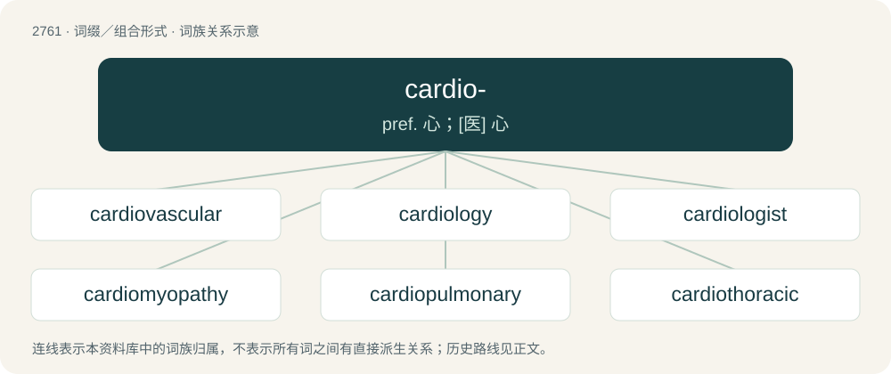

# 2865 · cardio- — pref. 心；\[医\] 心

[总目录](../00_总目录_按常用程度.md)

**类型**：词缀／组合形式　｜　**来源语言**：见词源记录

## 核心含义与来源

- 核心含义：pref. 心；\[医\] 心
- 英文含义：Relating to the heart.
- 词形：cardio-

## 词族图

## 单词速览（常用到不常用）

| 单词 | 音标 | 释义 |
|---|---|---|
| [cardiovascular](#w-1) | 英 /ˌkɑːdi.əʊˈvæskjʊlə(ɹ)/；美 /ˌkɑɹdi.oʊˈvæskjəlɚ/ | a. 心血管的；\[医\] 心血管的 |
| [cardiology](#w-2) | /ˌkɑː(ɹ)diˈɒlədʒi/ | n. 心脏病学；\[医\] 心\[脏\]病学 |
| [cardiologist](#w-3) | 英 /ˌkɑːdiˈɒlədʒɪst/；美 /ˌkɑɹdiˈɑlədʒɪst/ | n. 心脏病学家；\[医\] 心\[脏\]病学家 |
| [cardiomyopathy](#w-4) | /,kɑːdiəjmaiˈɔpəθi/ | n. 心肌病 |
| [cardiopulmonary](#w-5) | /,kɑːdiəjˈpʌlmənəri/ | a. 心肺的；\[医\] 心肺的 |
| [cardiothoracic](#w-6) |  | 心胸的 |
| [electrocardiogram](#w-7) | Canada /əˌlɛktɹəˈkɑɹdi.əˌɡɹæm/ | n. 心电图；\[计\] 心电图 |

## 逐词详解

### 1. cardiovascular

**词性**：形容词　｜　**音标**：英 /ˌkɑːdi.əʊˈvæskjʊlə(ɹ)/；美 /ˌkɑɹdi.oʊˈvæskjəlɚ/

**中文释义**：a. 心血管的；\[医\] 心血管的

**英文义项**：Relating to the circulatory system, that is the heart and blood vessels.

**构词拆分**：cardio- + vascular

**词源与演化**：

From cardio- + vascular.

**例句**：

> Cardiovascular endurance is one of the six components of physical fitness.

### 2. cardiology

**词性**：名词　｜　**音标**：/ˌkɑː(ɹ)diˈɒlədʒi/

**中文释义**：n. 心脏病学；\[医\] 心\[脏\]病学

**英文义项**：The study of the structure, function, and disorders of the heart.

**构词拆分**：cardio- + -logy

**词源与演化**：

From cardio- + -logy.

**例句**：

> She became the director of the cardiology department at the city hospital.

### 3. cardiologist

**词性**：名词　｜　**音标**：英 /ˌkɑːdiˈɒlədʒɪst/；美 /ˌkɑɹdiˈɑlədʒɪst/

**中文释义**：n. 心脏病学家；\[医\] 心\[脏\]病学家

**英文义项**：A physician who specializes in medical problems related to the heart.

**构词拆分**：cardio- + -logist

**词源与演化**：

From cardio- + -logist.

**例句**：

> I'll refer you to a cardiologist for further evaluation.

### 4. cardiomyopathy

**词性**：名词　｜　**音标**：/,kɑːdiəjmaiˈɔpəθi/

**中文释义**：n. 心肌病

**英文义项**：The deterioration of the myocardium.

**构词拆分**：cardio- + myopathy

**词源与演化**：

From cardio- + myopathy.

### 5. cardiopulmonary

**词性**：形容词　｜　**音标**：/,kɑːdiəjˈpʌlmənəri/

**中文释义**：a. 心肺的；\[医\] 心肺的

**英文义项**：Of or pertaining to both the heart and the lungs.

**构词拆分**：cardio- + pulmonary

**词源与演化**：

From cardio- + pulmonary.

**例句**：

> Cardiopulmonary resuscitation is an emergency procedure that should be mastered by everyone.

### 6. cardiothoracic

**词性**：形容词

**中文释义**：心胸的

**英文义项**：Of or pertaining to both the heart and the chest

**构词拆分**：cardio- + thoracic

**词源与演化**：

From cardio- + thoracic.

### 7. electrocardiogram

**词性**：名词　｜　**音标**：Canada /əˌlɛktɹəˈkɑɹdi.əˌɡɹæm/

**中文释义**：n. 心电图；\[计\] 心电图

**英文义项**：The recording that an electrocardiograph produces.

**构词拆分**：electro- + cardio- + -gram

**词源与演化**：

From electro- + cardio- + -gram, Modelled on German Electrocardiogramm(modern German Elektrokardiogramm)

**例句**：

> I have to shave your chest for the electrocardiogram.
