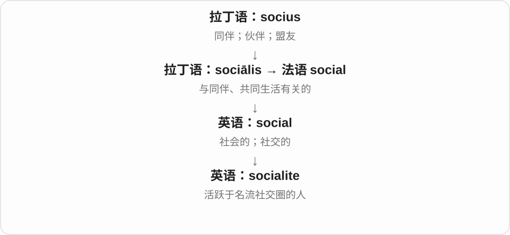

# 2869 · -ite — 属于、来自某处的名称形式，扩展到矿物、化石和物质

[逐词精讲目录](../00_逐词精讲目录.md) · [总目录](../00_总目录_按常用程度.md)

## 核心词根与来源

不要把所有 -ite 都当同一种矿物：有矿石、煤、化石，也有人物和生物化学类别。以具体前项和整词定义为准。

**-ITE：前项给来历，后缀给它一个成员、材料式名称**

bauxite 地名、lignite 木、ammonite 羊角神名；kryptonite 仿材料命名。

- **矿石、煤与矿物名称**：bauxite · lignite · calcite · magnetite · pyrite · ferrite
- **天外来源与古生物名称**：meteorite · ammonite
- **其他物质及虚构命名**：dynamite · kryptonite
- **人物、生物化学与形状名称**：socialite · metabolite · dendrite

## 词形与演化规律

希腊 -itēs 经拉丁、法语发展；另一化学盐后缀 -ite 与 -ate 的命名体系有关，逐词辨。

## 单词速览（按词族由简到繁）

同一基础词的相关扩展放在一起，先读基础形式，再读扩展；各组之间优先读常用的。具体词源关系见各词讲解。

| 单词 | 音标 | 核心意思 |
|---|---|---|
| [dynamite](#w-1) | /ˈdaɪnəmaɪt/ | 达纳炸药；有爆炸性影响的事物；精彩极了的〔口语〕 |
| [meteorite](#w-2) | /ˈmiːtiəraɪt/ | 陨石 |
| [kryptonite](#w-4) | /ˈkrɪptənaɪt/ | 〔虚构〕氪石；致命弱点、难以抗拒的东西 |
| [socialite](#w-5) | 英 /ˈsəʊʃəlaɪt/；美 /ˈsoʊʃəlaɪt/ | 社交名流 |
| [metabolite](#w-6) | 英 /mɪˈtæbəlaɪt/；美 /məˈtæbəlaɪt/ | 代谢物 |
| [bauxite](#w-7) | 英 /ˈbɔːksaɪt/；美 /ˈbɔːksaɪt/ | 铝土矿 |
| [calcite](#w-8) | 英 /ˈkælsaɪt/；美 /ˈkælsaɪt/ | 方解石 |
| [magnetite](#w-9) | /ˈmæɡnɪtaɪt/ | 磁铁矿 |
| [pyrite](#w-10) | /ˈpaɪraɪt/ | 黄铁矿 |
| [lignite](#w-11) | /ˈlɪɡnaɪt/ | 褐煤 |
| [ferrite](#w-17) | /ˈferaɪt/ | 铁氧体；〔冶金〕铁素体 |
| [ammonite](#w-18) | /ˈæmənaɪt/ | 菊石；菊石化石 |
| [dendrite](#w-31) | /ˈdendraɪt/ | 树突；树枝状结晶或纹样 |

## 逐词讲解

### 1. dynamite — 达纳炸药；有爆炸性影响的事物；精彩极了的〔口语〕

**音标**：/ˈdaɪnəmaɪt/

**先抓住这个画面**

字面是炸药名称；比喻时说某条消息会掀起大波澜，或某次表演能量十足、效果惊人。

**怎么拆**

阿尔弗雷德·诺贝尔用希腊 dunamis“力量”加命名成分 -ite 造出瑞典语 dynamit，英语借作 dynamite。不是从现代英语 dynamo“发电机”派生。

**怎么变成今天的意思**

**希腊 dunasthai → dunamis（δύναμις）**  
能够、有力量 → 力量、能力

↓

**瑞典语 dynamit，诺贝尔的命名**  
以“力量”命名的一种炸药

↓

**英语 dynamite**  
炸药；后来比喻爆炸性影响或精彩表现

历史文章可谈 dynamite 在采矿中的应用；political dynamite 指可能引爆争议的消息；The show was dynamite 是非正式赞叹。它也可作动词表示用这种炸药爆破。

**常见搭配与例句**

political dynamite；a dynamite performance；the invention of dynamite。

> The museum explains how dynamite changed nineteenth-century mining.

博物馆介绍了达纳炸药如何改变十九世纪的采矿业。

> The band’s final performance was absolute dynamite.

乐队最后那场演出精彩极了。

**别混淆**

explosive 是更广的爆炸物或爆炸性的；dynamite 原指特定炸药，口语的称赞义不能反过来当作化学分类。

### 2. meteorite — 陨石

**音标**：/ˈmiːtiəraɪt/

**先抓住这个画面**

亮光已经过去，地面上还留下来自太空的一块物质。

**怎么拆**

meteor + -ite；-ite 在这里标记相关物体、石质材料。

**怎么变成今天的意思**

**希腊 meta- + aeirein → meteōros**  
抬起、悬在空中的

↓

**希腊 meteōron → 拉丁 meteorum → 法语 météore → 英语 meteor**  
空中现象；现代常特指流星现象

↓

**英语 meteorite**  
穿过大气后到达地表的天然天体残留物

并不是每道流星都能留下可找到的陨石；很多小颗粒在进入大气时就消散。陨石可能含石质或金属，不是外表发黑的普通石头都算。

**常见搭配与例句**

a meteorite fragment；find a meteorite；a meteorite sample。

> The museum displays a fragment of a meteorite.

博物馆展出了一块陨石碎片。

> Scientists examined the meteorite’s mineral composition.

科学家检查了这块陨石的矿物组成。

**别混淆**

meteor 是可见现象，meteorite 是能作为样本研究的残留物；从物体到现象到残留，不是三个完全无关的东西。

### 3. kryptonite — 〔虚构〕氪石；致命弱点、难以抗拒的东西

**音标**：/ˈkrɪptənaɪt/

**先抓住这个画面**

超人平时很强，碰到某些氪石就会受影响；日常说 chocolate is my kryptonite，是夸张说自己一遇巧克力就没了抵抗力。

**怎么拆**

Krypton 虚构星球名 + -ite，仿矿物、材料命名。普通小写用法从故事弱点扩展为个人难以克服的诱惑、短板。

**怎么变成今天的意思**

**希腊 -itēs，经拉丁、法语 -ite**  
属于、来自、与……相关；用于人物、地方及矿物等名

↓

**超人故乡 Krypton + -ite**  
仿物质名称形成虚构氪石名

↓

**超人故事中的弱点 → 日常 kryptonite**  
让强者失去优势、抵抗力的弱点比喻

someone’s kryptonite 某人的致命弱点、难抗拒之物，green kryptonite 绿色氪石；虚构故事不同种类的设定不完全相同。

**常见搭配与例句**

someone’s kryptonite；my kryptonite。

> In the story, green kryptonite weakens Superman.

故事里，绿色氪石削弱了超人的力量。

> Chocolate cake is my kryptonite.

巧克力蛋糕是我的软肋，我一见就没抵抗力。

**别混淆**

kryptonite 是虚构材料、文化比喻，不是现实元素 krypton 氪的另一个科学名称；比喻也不必真有危险。

### 4. socialite — 社交名流

**音标**：英 /ˈsəʊʃəlaɪt/；美 /ˈsoʊʃəlaɪt/

**先抓住这个画面**

经常出现在知名聚会和社交圈中，因这种社交生活而广为人知的人。

**怎么拆**

social 的上流社交圈义 + -ite 人；有资料提到可能带 social light 的文字游戏，不必把它当确定拆解。

**怎么变成今天的意思**

强调身份、圈子和公众知名度，通常带财富或上流生活背景。不是每个爱聚会的人都叫 socialite。

**常见搭配与例句**

a well-known socialite；a local socialite；a socialite’s party。

> The socialite hosted a charity dinner.

这位社交名流举办了一场慈善晚宴。

> The magazine interviewed several artists and socialites.

杂志采访了几位艺术家和社交名流。

**别混淆**

sociable person 是合群的人；socialite 是社交名流，指的不是普通性格。

### 5. metabolite — 代谢物

**音标**：英 /mɪˈtæbəlaɪt/；美 /məˈtæbəlaɪt/

**先抓住这个画面**

身体化学流水线上，某一步产生或参与转化的物质。

**怎么拆**

metabolism 的词干 + -ite，后缀在这里给具体物质命名。

**怎么变成今天的意思**

**古希腊语：bállein〔βάλλειν〕；bolḗ〔βολή〕**  
扔、放；投掷动作

↓

**古希腊 metá- + bállein → metabállein → metabolḗ**  
转变 → 变化

↓

**法语 métabolisme → 英语 metabolism；亦按希腊词基加 -ism 分析**  
生物体内的化学转变过程

↓

**英语 metabolism → metabolite**  
代谢过程 → 其中的化学物质

可以是中间产物，也可以是最终产物；不是所有 metabolite 都是要排出的废物。

**常见搭配与例句**

a metabolic intermediate；a metabolite of；detect a metabolite。

> The test detected a metabolite of the drug.

检测发现了这种药物的一种代谢产物。

> Some metabolites are used as building blocks for larger molecules.

一些代谢物会被用作构建更大分子的原料。

**别混淆**

metabolism 是过程总称；metabolite 是过程中的物质。

### 6. bauxite — 铝土矿

**音标**：英 /ˈbɔːksaɪt/；美 /ˈbɔːksaɪt/

**先抓住这个画面**

看名字别先找一种叫 baux 的元素：baux 来自法国地名 Les Baux。它是按产地命名、富含铝的矿石材料。

**怎么拆**

Les Baux 地名 + -ite 矿物、材料命名后缀；英语按拼写读出 /ks/。铝土矿是多种矿物组成的材料，不是一个纯净单一矿物种。

**怎么变成今天的意思**

**希腊 -itēs，经拉丁、法语 -ite**  
属于、来自、与……相关；用于人物、地方及矿物等名

↓

**现代科学与文化命名**  
矿石、化石、物质名及虚构材料，具体前项各有来历

↓

**法国 Les Baux + -ite → bauxite**  
以产地命名的铝土矿

bauxite ore 铝土矿石，bauxite deposits 铝土矿矿床；是重要的铝矿石来源。

**常见搭配与例句**

bauxite ore；bauxite deposits。

> The region has large deposits of bauxite.

这个地区有大规模铝土矿矿床。

> Bauxite is an important ore used to produce aluminium.

铝土矿是生产铝的重要矿石。

**别混淆**

bauxite 是矿石，aluminium／aluminum 是元素铝；二者不在同一个物质类别层次。

### 7. calcite — 方解石

**音标**：英 /ˈkælsaɪt/；美 /ˈkælsaɪt/

**先抓住这个画面**

同样是碳酸钙，以一种特定晶体结构形成了矿物。

**怎么拆**

calc- 石灰 + 矿物名称后缀 -ite；名称取自拉丁 calx。

**怎么变成今天的意思**

**拉丁 calx，词干 calc-**  
石灰、石灰石

↓

**科学命名 calc- + -ite → calcite**  
石灰相关的矿物 → 方解石

石灰岩、大理岩里常见 calcite。学习时把层次分开：calcium 是元素，calcium carbonate 是化合物名称，calcite 是这种化合物的一种矿物形态。它们有关，但不是三个随意互换的名字。

**常见搭配与例句**

calcite crystals；a calcite sample；calcite veins。

> The rock contains small crystals of calcite.

这块岩石里含有小颗粒的方解石晶体。

> The museum label identifies the transparent mineral as calcite.

博物馆的标签把这种透明矿物标为方解石。

**别混淆**

calcite 是矿物；calcium 是元素；calculus 在普通数学语境是微积分。

### 8. magnetite — 磁铁矿

**音标**：/ˈmæɡnɪtaɪt/

**先抓住这个画面**

名字直接提醒你：这是一种与磁性密切相关的矿物。

**怎么拆**

magnet + 矿物名后缀 -ite，参照德语 Magnetit。

**怎么变成今天的意思**

**希腊磁石名称 → 拉丁 magnes、magnet- → 英语 magnet**  
磁石 → 磁铁

↓

**德语 Magnetit／英语 magnet + -ite → magnetite**  
磁铁 + 矿物名称 → 磁铁矿

magnetite 是一种铁氧化物矿物，化学式 Fe₃O₄。天然磁化的磁铁矿可形成 lodestone 天然磁石。矿物名称讲的是成分和晶体类别，magnet 则是磁铁这一类物体。

**常见搭配与例句**

magnetite ore；magnetite crystals；a sample of magnetite。

> The sample contains small crystals of magnetite.

这个样品含有细小的磁铁矿晶体。

> Students compared magnetite with other iron minerals.

学生比较了磁铁矿和其他含铁矿物。

**别混淆**

magnetite 是特定矿物，magnet 可以由不同材料制成。别把所有磁铁都叫 magnetite。

### 9. pyrite — 黄铁矿

**音标**：/ˈpaɪraɪt/

**先抓住这个画面**

看起来闪着金光，名字却接“火”：这种矿物有产生火花的历史用途。“愚人金”的外号提醒你，金色不等于黄金。

**怎么拆**

希腊 pyr“火” → pyritēs (lithos)“火石”，经拉丁 pyrites、古法语 pyrite 进入英语。现代矿物词尾常见 -ite，但本词有完整的古典词名传承，不能只讲英语 fire 加矿物后缀。

**怎么变成今天的意思**

**希腊 pyr → pyritēs (lithos)**  
火 → 火石这一名称

↓

**拉丁 pyrites → 古法语 pyrite → 英语 pyrite**  
古老石名进入英语矿物名称

↓

**现代矿物学 pyrite**  
二硫化铁矿物，常呈黄铜色金属光泽

现代黄铁矿的主要成分是 FeS₂。它常有金色或黄铜色光泽、规则晶体，所以容易被不熟悉矿物的人误认作金；这个外观与“火石”的词源是两条不同的记忆线。古老名称涵盖的石头也不必与今天的精确矿物分类完全相同。

**常见搭配与例句**

pyrite crystals；a sample of pyrite；fool’s gold。

> The shiny crystals turned out to be pyrite rather than gold.

那些闪亮晶体原来是黄铁矿，并非黄金。

> The museum label explains why pyrite was associated with fire.

博物馆标签解释了黄铁矿为何与火联系在一起。

**别混淆**

gold 是金；pyrite 是含铁与硫的矿物。fool’s gold 是常见外号，不是它的化学组成，也不表示它没有研究或其他用途。

### 10. lignite — 褐煤

**音标**：/ˈlɪɡnaɪt/

**先抓住这个画面**

lign- 让你想到木、木质材料；lignite 是一种煤，名字借了这种联系。先把它认成煤的类别，不当作普通木柴。

**怎么拆**

借法语 lignite，由拉丁 lignum 木材、木柴 + -ite 构成材料名称；现代指较低煤阶的褐煤。

**怎么变成今天的意思**

**希腊 -itēs，经拉丁、法语 -ite**  
属于、来自、与……相关；用于人物、地方及矿物等名

↓

**现代科学与文化命名**  
矿石、化石、物质名及虚构材料，具体前项各有来历

↓

**拉丁 lignum + -ite，经法语 → lignite**  
以木质联系命名的褐煤

lignite deposits 褐煤矿藏，lignite mining 褐煤开采，brown coal 褐煤的另一常用称呼。

**常见搭配与例句**

lignite deposits；brown coal。

> The mine produces lignite rather than hard coal.

这座矿生产褐煤，而不是硬煤。

> The report describes the region’s lignite deposits.

报告介绍了这个地区的褐煤矿藏。

**别混淆**

lignite 与 lignin 木质素都含木词根，但不是同一物质；词根关联不等于化学、地质类别相同。

### 11. ferrite — 铁氧体；〔冶金〕铁素体

**音标**：/ˈferaɪt/

**先抓住这个画面**

同一个英文材料名，在电子器件和钢铁组织里要换成不同中文。

**怎么拆**

由拉丁 ferrum 铁的词干与 -ite 物质名称结尾形成。后来在不同材料学语境中使用，不能只按铁加石头来猜。

**怎么变成今天的意思**

**拉丁 ferrum；-ite**  
铁；物质名称成分

↓

**英语 ferrite**  
电子材料中的铁氧体；钢铁中的铁素体

电子元件里的 ferrite core 常是由含铁氧化物制成的磁性陶瓷芯，不是普通铁块。钢铁显微组织里的 ferrite 通常译为铁素体，指以铁为基础的一种固溶体组织。先看文章是在讲电子器件，还是钢的内部结构。

**常见搭配与例句**

a ferrite core；ferrite beads；ferrite in steel。

> The coil was wound around a ferrite core.

线圈绕在铁氧体磁芯上。

> The metallurgist identified ferrite in the steel sample.

冶金研究者在钢样中辨认出了铁素体。

**别混淆**

ferrite 与 ferric、ferrous 不是简单的同义词。前者是材料或相的名称，后两者是性质或化学状态的形容词。铁氧体也不能直接翻成铁素体。

### 12. ammonite — 菊石；菊石化石

**音标**：/ˈæmənaɪt/

**先抓住这个画面**

常见菊石化石一圈圈盘起来，像卷曲羊角。名字里的 Ammon 联系带羊角形象的阿蒙神，因此不是按今天中文菊花来拆英文。

**怎么拆**

经法语 ammonite 接旧的阿蒙之角命名传统，Ammon + -ite。现代指已灭绝的有壳头足类及其化石；常见盘卷外形有多种变化。

**怎么变成今天的意思**

**Ammon／Amun 神名及羊角形象**  
旧名称把盘曲外壳比作阿蒙的羊角

↓

**法语 ammonite → ammonite**  
菊石及其化石，使用 -ite 名称形式

an ammonite fossil 一块菊石化石，an ammonite shell 菊石壳；化石记录的是曾经生活的海洋动物。

**常见搭配与例句**

an ammonite fossil；an ammonite shell。

> The museum displayed a large ammonite fossil.

博物馆展出了一块大型菊石化石。

> The ammonite’s shell had a clear spiral pattern.

菊石壳有清晰的螺旋纹路。

**别混淆**

ammonite 不是普通蜗牛，属于已灭绝的头足类；外形相似不等于现代动物分类相同。

### 13. dendrite — 树突；树枝状结晶或纹样

**音标**：/ˈdendraɪt/

**先抓住这个画面**

像树枝一样伸出、分叉的结构。

**怎么拆**

接希腊 dendrítēs“树的、像树的”，来自 déndron“树”。英语早先用来描述石头上的树枝状纹样，后来借同一个外形命名神经细胞树突；现代可认出 dendr- 与 -ite。

**怎么变成今天的意思**

**希腊 déndron → dendrítēs**  
树 → 树的、像树的

↓

**英语 dendrite**  
先用于树枝状纹样，后来也用于神经细胞的树突

在神经科普里，它常指神经元分枝状的突起，通常承担接收信号的作用。在矿物或材料文章里，dendrite 也可能是一簇树枝状结晶。共同点是分枝外形，不是说矿物里有神经。

**常见搭配与例句**

a neuron’s dendrites；branching dendrites；crystal dendrites。通常可数。

> The model shows dendrites branching from the neuron’s cell body.

模型展示了从神经元细胞体分出的树突。

> The mineral sample contains dark dendrites that resemble tiny trees.

这块矿物样本中有像小树一样的深色树枝状纹样。

**别混淆**

axon 通常是神经元传出信号的长突起；dendrite 通常联系接收与分枝。离开神经语境后，要留意它也有矿物结构义。

## 这一组要分清什么

相同词尾不等于相同分类；bauxite 不是单一纯矿物，ammonite 是动物、化石，kryptonite 是虚构材料。

## 串起来练习

The display separated bauxite ore, an ammonite fossil and a fictional kryptonite prop.

展台把铝土矿、菊石化石和虚构氪石道具分开放置。
