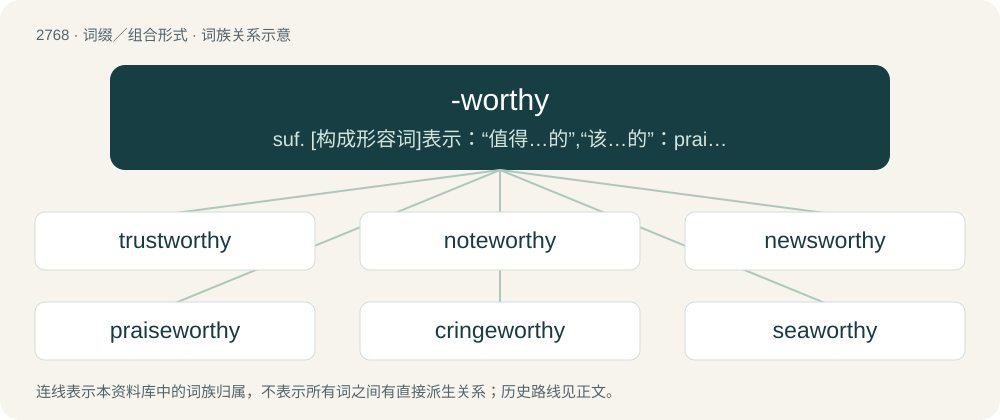

# 2870 · -worthy — suf. \[构成形容词\]表示：“值得…的”,“该…的”：praiseworthy,“适于…的”,“易于…的”：roadworthy

[总目录](../00_总目录_按常用程度.md)

**类型**：词缀／组合形式　｜　**来源语言**：见词源记录

## 核心含义与来源

- 核心含义：suf. \[构成形容词\]表示：“值得…的”,“该…的”：praiseworthy,“适于…的”,“易于…的”：roadworthy
- 英文含义：Of sufficient worth for; deserving of.
- 词形：-worthy

**来源记录 1**（后缀／后置成分；Of sufficient worth for; deserving of.）

Partly from worthy (combining form), and partly continuing Middle English -wurthe (“-able”), from Old English -wierþe (“-able”), from Proto-West Germanic -\*wirþī, from Proto-West Germanic \*wirþī, from Proto-Germanic \*wirþijaz (“worthy”), from Proto-Indo-European \*wert- (“to turn, bend”). Cognate with Dutch -waardig (“-worthy”), German -würdig (“-worthy”).

## 词族图

## 单词速览（常用到不常用）

| 单词 | 音标 | 释义 |
|---|---|---|
| [trustworthy](#w-1) | 英 /ˈtɹʌst.wɜː.ði/；美 /ˈtɹʌstˌwɜɹ.ði/ | a. 可信赖的；\[法\] 可信任的, 可靠的, 可信赖的 |
| [noteworthy](#w-2) | 英 /ˈnəʊtˌwɜːði/；美 /ˈnoʊtˌwɝði/ | a. 值得注目的, 显著的 |
| [newsworthy](#w-3) | /ˈnjuːzwəːði/ | a. 有报导价值的 |
| [praiseworthy](#w-4) | 英 /ˈpɹeɪz.wɜː.ði/；美 /ˈpɹeɪz.wɝ.ði/ | a. 值得称赞的, 令人钦佩的, 可钦佩的 |
| [cringeworthy](#w-5) | 英 /ˈkɹɪnd͡ʒˌwɜːði/；美 /ˈkɹɪnd͡ʒˌwɝði/ | 令人感到尴尬（或不舒服）的 |
| [seaworthy](#w-6) | 英 /ˈsiːwɜːði/；美 /ˈsiːwɝði/ | a. 适于航海的, 经得起航海的；\[法\] 适于航海的 |

## 逐词详解

### 1. trustworthy

**词性**：形容词　｜　**音标**：英 /ˈtɹʌst.wɜː.ði/；美 /ˈtɹʌstˌwɜɹ.ði/

**中文释义**：a. 可信赖的；\[法\] 可信任的, 可靠的, 可信赖的

**英文义项**：Deserving of trust, reliable.

**构词拆分**：trust + -worthy

**词源与演化**：

From trust + -worthy.

**例句**：

> An experienced and trustworthy traveling companion.

该用例对应义项：worthy of trust or belief

### 2. noteworthy

**词性**：形容词　｜　**音标**：英 /ˈnəʊtˌwɜːði/；美 /ˈnoʊtˌwɝði/

**中文释义**：a. 值得注目的, 显著的

**英文义项**：Deserving attention; notable; worthy of notice.

**构词拆分**：note + -worthy

**词源与演化**：

From note + -worthy.

**例句**：

> Zukertort represent the other most noteworthy tournaments.

该用例对应义项：Deserving attention; notable; worthy of notice.

### 3. newsworthy

**词性**：形容词　｜　**音标**：/ˈnjuːzwəːði/

**中文释义**：a. 有报导价值的

**英文义项**：Interesting enough to be reported as a news

**构词拆分**：From news + -worthy.

**词源与演化**：

From news + -worthy.

**用法示例／搭配（非完整句）**：

> newsworthy event

该用例对应义项：Interesting enough to be reported as a news

### 4. praiseworthy

**词性**：形容词　｜　**音标**：英 /ˈpɹeɪz.wɜː.ði/；美 /ˈpɹeɪz.wɝ.ði/

**中文释义**：a. 值得称赞的, 令人钦佩的, 可钦佩的

**英文义项**：Meriting praise; worthy of high praise

**构词拆分**：From praise + -worthy.

**词源与演化**：

From praise + -worthy.

**例句**：

> A significant and praiseworthy increase in computer intelligence.

该用例对应义项：worthy of high praise

### 5. cringeworthy

**词性**：形容词　｜　**音标**：英 /ˈkɹɪnd͡ʒˌwɜːði/；美 /ˈkɹɪnd͡ʒˌwɝði/

**中文释义**：令人感到尴尬（或不舒服）的

**英文义项**：That causes or may cause one to cringe with disgust, embarrassment (often vicarious embarrassment), etc.; awkward, disgusting, embarrassing.

**构词拆分**：cringe + -worthy

**词源与演化**：

From cringe (verb) + -worthy (suffix meaning of ‘sufficient worth for, deserving of’), popularized by the surname of the character Cuthbert Cringeworthy, an extremely studious pupil introduced in 1972 into The Bash Street Kids, a comic strip by the Scottish cartoonist David Sutherland (1933–2023) published in the British magazine The Beano.

**例句**：

> This movie is an unwatchable, cringeworthy piece of shit.

### 6. seaworthy

**词性**：形容词　｜　**音标**：英 /ˈsiːwɜːði/；美 /ˈsiːwɝði/

**中文释义**：a. 适于航海的, 经得起航海的；\[法\] 适于航海的

**英文义项**：Fit for service at sea.

**构词拆分**：From sea + -worthy.

**词源与演化**：

From sea + -worthy.

**例句**：

> This boat is no longer seaworthy.
