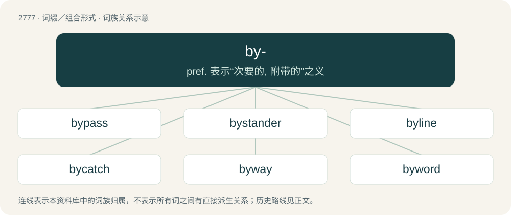

# 2878 · by- — pref. 表示“次要的, 附带的”之义

[总目录](../00_总目录_按常用程度.md)

**类型**：词缀／组合形式　｜　**来源语言**：见词源记录

## 核心含义与来源

- 核心含义：pref. 表示“次要的, 附带的”之义
- 英文含义：Town or city.
- 词形：by-

**多个词源／构词路径**：同一拼写可能有不同来源；以下按词性和含义分别列出。

**来源记录 1**（前缀／前置成分；Town or city.）

From Middle English by (“town”), of North Germanic origin, from Old Norse býr (“dwelling, town”), from Proto-Germanic \*būwiz (“dwelling”). Cognate with Danish by (“town”). More at bower.

**来源记录 2**（前缀／前置成分；Near or roundabout.）

Partly from a combining form of by (“by, near, around”), and partly continuing Middle English bi-, by-, from Old English bī- (“by, near, around”), from Proto-Germanic \*bi-, whence also be-. Cognate with Dutch bij-, German bei-.

## 词族图

## 单词速览（常用到不常用）

| 单词 | 音标 | 释义 |
|---|---|---|
| [bypass](#w-1) | 英 /ˈbaɪpɑːs/；美 /ˈbaɪpæs/ | n. 旁路；vt. 省略, 绕过, 忽视, 回避 |
| [bystander](#w-2) | /ˈbaɪˌstænd.ə(ɹ)/ | n. 旁观者, 目击者；\[法\] 候补陪审员, 旁观者 |
| [byline](#w-3) | /ˈbaɪlaɪn/ | n. 副业, 署名报道 |
| [bycatch](#w-4) |  | 误捕的鱼（捕捞其他种类的鱼时意外捕获） |
| [byway](#w-5) | /ˈbaɪweɪ/ | n. 旁道, 偏僻小路 |
| [byword](#w-6) | 英 /ˈbaɪ.wə(ɹ)d/；美 /ˈbaɪ.wɚd/ | n. 谚语, 俗话, 笑柄 |

## 逐词详解

### 1. bypass

**词性**：名词　｜　**音标**：英 /ˈbaɪpɑːs/；美 /ˈbaɪpæs/

**中文释义**：n. 旁路；vt. 省略, 绕过, 忽视, 回避

**英文义项**：A road that passes around something, such as a residential area or business district. / A replacement road for obsolete road that is no longer in use because devastating natural disasters (earthquakes, tsunamis, landslides).

**构词拆分**：by- + pass

**词源与演化**：

From Middle English \*bypassen, \*bipassen (suggested by past participle by-past, bipast), equivalent to by- + pass.

**例句**：

> There was a pile-up on the town bypass involving about twenty cars.

### 2. bystander

**词性**：名词　｜　**音标**：/ˈbaɪˌstænd.ə(ɹ)/

**中文释义**：n. 旁观者, 目击者；\[法\] 候补陪审员, 旁观者

**英文义项**：A person who, although present at some event, does not take part in it; an observer, witness, or spectator.

**构词拆分**：by- + stander

**词源与演化**：

From by- + stander. Compare passerby.

**例句**：

> The incident happened to be captured on video by a bystander.

### 3. byline

**词性**：名词　｜　**音标**：/ˈbaɪlaɪn/

**中文释义**：n. 副业, 署名报道

**英文义项**：A line at the head of a newspaper or magazine article carrying the writer's name. / A touchline.

**构词拆分**：by- + line

**词源与演化**：

From by- + line.

**例句**：

> Mary was so excited to see her byline featured in the New York Times.

### 4. bycatch

**词性**：名词

**中文释义**：误捕的鱼（捕捞其他种类的鱼时意外捕获）

**英文义项**：Any fish (or other creatures) that are not targeted as a catch but are unintentionally caught, and often discarded back into the sea. / Any person, animal, or thing, captured unintentionally on camera or film.

**构词拆分**：by- + catch

**词源与演化**：

From by- + catch.

**例句**：

> Trawling causes a devastating waste of life in the form of bycatch.

### 5. byway

**词性**：名词　｜　**音标**：/ˈbaɪweɪ/

**中文释义**：n. 旁道, 偏僻小路

**英文义项**：A road or track not following a main route; a secondary or minor road or path. / A road that is not frequently travelled.

**构词拆分**：by- + way

**词源与演化**：

From Middle English bywey, equivalent to by- + way.

### 6. byword

**词性**：名词　｜　**音标**：英 /ˈbaɪ.wə(ɹ)d/；美 /ˈbaɪ.wɚd/

**中文释义**：n. 谚语, 俗话, 笑柄

**英文义项**：A proverb or proverbial expression, common saying; a frequently used word or phrase. / A characteristic word or expression; a word or phrase associated with a person or group.

**构词拆分**：by- + word

**词源与演化**：

From Middle English byword, byworde (“proverb”), from Old English bīword, bīwyrd, bīwyrde (“proverb, household word", also "adverb”), from Proto-West Germanic \*bīwurdī, equivalent to by- + word. Compare Latin proverbium, which byword may possibly be a translation of. Cognate with Old High German pīwurti (“proverb”). Compare also Old English bīspel (“proverb, example”), bīcwide (“byword, proverb, tale, fable”), Dutch bijwoord (“adverb”).

**例句**：

> The name Cleopatra has become a byword for a beautiful woman.
