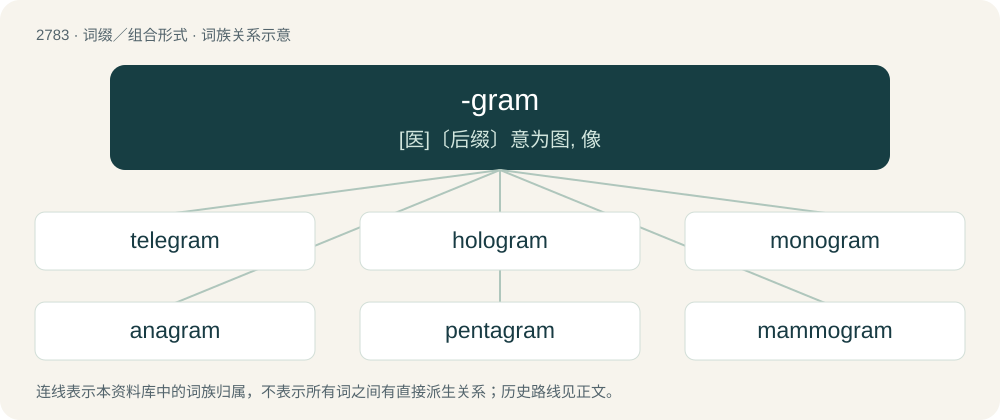

# 2887 · -gram — \[医\]〔后缀〕意为图, 像

[总目录](../00_总目录_按常用程度.md)

**类型**：词缀／组合形式　｜　**来源语言**：见词源记录

## 核心含义与来源

- 核心含义：\[医\]〔后缀〕意为图, 像
- 英文含义：Something written, drawn or otherwise recorded.
- 词形：-gram

**来源记录 1**（后缀／后置成分；Something written, drawn or otherwise recorded.）

From γράμμα (grámma, “written character, letter, that which is drawn”), from γράφω (gráphō, “to scratch, to scrape, to graze”).

## 词族图

## 单词速览（常用到不常用）

| 单词 | 音标 | 释义 |
|---|---|---|
| [telegram](#w-1) | /ˈtɛləˌɡɹæm/ | n. 电报, 一封电报；\[计\] 电报 |
| [hologram](#w-2) | 英 /ˈhɒləɡɹæm/；美 /ˈhɑləˌɡɹæm/ | n. 全息照相图；\[计\] 全息照相, 全息图 |
| [monogram](#w-3) | 英 /ˈmɒ.nəˌɡɹæm/；美 /ˈmɑ.nəˌɡɹæm/ | 【英文】A sentence consisting of only one line, or an epigram consisting of only one verse, of poetry. |
| [anagram](#w-4) | /ˈæ.nə.ɡɹæm/ | n. 回文构词法 |
| [pentagram](#w-5) | /ˈpɛn.təˌɡɹæm/ | n. 五角星形 |
| [mammogram](#w-6) | /ˈmæmə,^ræm/ | \[医\] 乳房X线照片 |
| [sonogram](#w-7) | 英 /ˈsəʊ.nəˌɡɹæm/；美 /ˈsɑnəˌɡɹæm/ | 语图 |
| [electrocardiogram](#w-8) | Canada /əˌlɛktɹəˈkɑɹdi.əˌɡɹæm/ | n. 心电图；\[计\] 心电图 |
| [angiogram](#w-9) | /ˈændʒiəj^ræm/ | n. \[医\]血管造影(照)片 |
| [enneagram](#w-10) | /eˈniːɡrəm/ | n. 九型人格核心课程 www.enneagram.cn; 九型人格；adj. 九个尖的圆形 |

## 逐词详解

### 1. telegram

**词性**：名词　｜　**音标**：/ˈtɛləˌɡɹæm/

**中文释义**：n. 电报, 一封电报；\[计\] 电报

**英文义项**：A message transmitted by telegraph.

**构词拆分**：tele- + -gram

**词源与演化**：

From tele- + -gram.

**例句**：

> Next time you decide to play like that send me a telegram.

### 2. hologram

**词性**：名词　｜　**音标**：英 /ˈhɒləɡɹæm/；美 /ˈhɑləˌɡɹæm/

**中文释义**：n. 全息照相图；\[计\] 全息照相, 全息图

**英文义项**：A three-dimensional image of an object created by holography.

**构词拆分**：holo- + -gram

**词源与演化**：

From holo- + -gram, from Ancient Greek ὅλος (hólos, “whole”) + γρᾰ́μμᾰ (grắmmă, “that which is written or drawn”), coined by Hungarian-born British scientist Dennis Gabor in 1948, the Nobel prize winner in physics in 1971 for his work in holography.

**例句**：

> Tom wasn't really performing at the concert. That was just his hologram.

### 3. monogram

**词性**：名词　｜　**音标**：英 /ˈmɒ.nəˌɡɹæm/；美 /ˈmɑ.nəˌɡɹæm/

**英文义项**：A sentence consisting of only one line, or an epigram consisting of only one verse, of poetry.

**构词拆分**：mono- + -gram

**词源与演化**：

Formed as mono- + -gram, by analogy with epigram.

### 4. anagram

**词性**：名词　｜　**音标**：/ˈæ.nə.ɡɹæm/

**中文释义**：n. 回文构词法

**英文义项**：A word or phrase that is created by rearranging the letters of another word or phrase.

**构词拆分**：ana- (“up, back”) + -gram (“letter”)

**词源与演化**：

Late 16th century, either from Middle French anagramme or Latin anagramma, formed on Ancient Greek ἀνά (aná, “up, back”) + γράμμα (grámma, “letter”). Analyzable as ana- (“up, back”) + -gram (“letter”).

**例句**：

> 'Toast' is an anagram of 'stoat'.

### 5. pentagram

**词性**：名词　｜　**音标**：/ˈpɛn.təˌɡɹæm/

**中文释义**：n. 五角星形

**英文义项**：The shape of a five-pointed star constructed of five intersecting lines meeting at the vertices, such that a central pentagon and five surrounding isosceles triangles are formed; often with magical connotations; a 5/2 (or 5/3) star polygon.

**构词拆分**：penta- + -gram

**词源与演化**：

From Ancient Greek πεντάγραμμον (pentágrammon), noun form of the adjectives πεντάγραμμος (pentágrammos) and πεντέγραμμος (pentégrammos, “five-lined, having five lines”). Equivalent to penta- + -gram.

**例句**：

> Ziri found a pentagram in the middle of the clearing.

### 6. mammogram

**词性**：名词　｜　**音标**：/ˈmæmə,^ræm/

**中文释义**：\[医\] 乳房X线照片

**英文义项**：An X-ray picture of the breasts (mammaries), used to screen for breast cancer.

**构词拆分**：mammo- + -gram

**词源与演化**：

From mammo- + -gram.

**例句**：

> It's recommended that you get a mammogram every year.

### 7. sonogram

**词性**：名词　｜　**音标**：英 /ˈsəʊ.nəˌɡɹæm/；美 /ˈsɑnəˌɡɹæm/

**中文释义**：语图

**英文义项**：A spectrogram.

**构词拆分**：Latin sonus (“sound”) + -gram；sono- + -gram

**词源与演化**：

From Latin sonus (“sound”) + -gram, equivalent to sono- + -gram.

### 8. electrocardiogram

**词性**：名词　｜　**音标**：Canada /əˌlɛktɹəˈkɑɹdi.əˌɡɹæm/

**中文释义**：n. 心电图；\[计\] 心电图

**英文义项**：The recording that an electrocardiograph produces.

**构词拆分**：electro- + cardio- + -gram

**词源与演化**：

From electro- + cardio- + -gram, Modelled on German Electrocardiogramm(modern German Elektrokardiogramm)

**例句**：

> I have to shave your chest for the electrocardiogram.

### 9. angiogram

**词性**：名词　｜　**音标**：/ˈændʒiəj^ræm/

**中文释义**：n. \[医\]血管造影(照)片

**英文义项**：An X-ray image of the blood vessels gained after the injection of a radiopaque contrast medium.

**构词拆分**：angio- + -gram

**词源与演化**：

From angio- + -gram.

**例句**：

> The angiogram showed that his blood vessels were healthy.

### 10. enneagram

**词性**：名词　｜　**音标**：/eˈniːɡrəm/

**中文释义**：n. 九型人格核心课程 www.enneagram.cn; 九型人格；adj. 九个尖的圆形

**英文义项**：A nine-pointed stellate polygon / Such a figure used to indicate nine personality traits of a subject

**构词拆分**：ennea- + -gram

**词源与演化**：

From ennea- + -gram.
