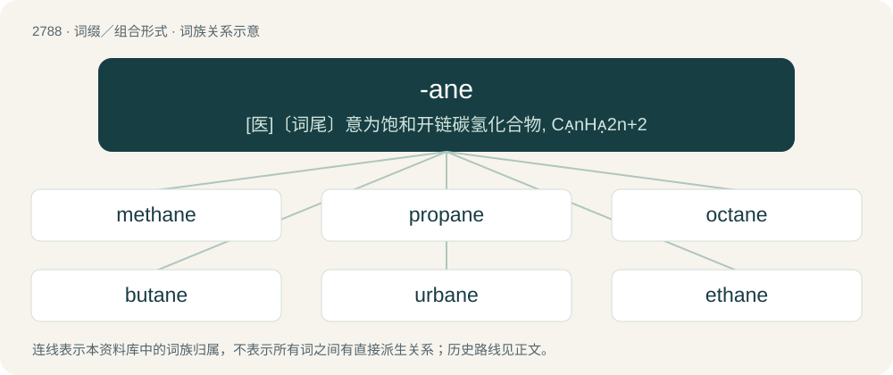

# 2892 · -ane — \[医\]〔词尾〕意为饱和开链碳氢化合物, CnH2n+2

[总目录](../00_总目录_按常用程度.md)

**类型**：词缀／组合形式　｜　**来源语言**：见词源记录

## 核心含义与来源

- 核心含义：\[医\]〔词尾〕意为饱和开链碳氢化合物, CnH2n+2
- 英文含义：A saturated hydrocarbon; an alkane.
- 词形：-ane

**来源记录 1**（后缀／后置成分；A saturated hydrocarbon; an alkane.）

From Latin -ānus, which forms adjectives from nouns with the sense of "belonging to" or "origin from". Doublet of English -an.

## 词族图

## 单词速览（常用到不常用）

| 单词 | 音标 | 释义 |
|---|---|---|
| [methane](#w-1) | 英 /ˈmiːθeɪn/；美 /ˈmɛθeɪn/ | n. 甲烷, 沼气；\[化\] 甲烷; 沼气 |
| [propane](#w-2) | /ˈpɹoʊpeɪn/ | n. 丙烷；\[化\] 丙烷 |
| [octane](#w-3) | /ˈɒkteɪn/ | n. 辛烷；\[化\] 辛烷; 正辛烷; 辛烷; 辛级烷 |
| [butane](#w-4) | /ˈbjuːteɪn/ | n. 丁烷；\[医\] 丁烷 |
| [urbane](#w-5) | 英 /ɜːˈbeɪn/；美 /ˈɝˈbeɪn/ | a. 彬彬有礼的 |
| [ethane](#w-6) | 英 /ˈiːθeɪn/；美 /ˈɛθeɪn/ | n. 乙烷；\[化\] 乙烷 |
| [germane](#w-7) | /dʒəːˈmein/ | 【英文】germanium tetrahydride, GeH₄ |
| [hexane](#w-8) | /ˈhɛkseɪn/ | \[化\] 己烷；\[医\] 己烷 |

## 逐词详解

### 1. methane

**词性**：名词　｜　**音标**：英 /ˈmiːθeɪn/；美 /ˈmɛθeɪn/

**中文释义**：n. 甲烷, 沼气；\[化\] 甲烷; 沼气

**英文义项**：The simplest aliphatic hydrocarbon, CH₄, being a constituent of natural gas, and one of the most abundant greenhouse gases. / Any of very many derivatives of methane.

**构词拆分**：methyl + -ane

**词源与演化**：

From methyl + -ane.

**例句**：

> Cattle emit a large amount of methane.

该用例对应义项：The simplest aliphatic hydrocarbon, CH₄, being a constituent of natural gas, and one of the most abundant greenhouse gases.

### 2. propane

**词性**：名词　｜　**音标**：/ˈpɹoʊpeɪn/

**中文释义**：n. 丙烷；\[化\] 丙烷

**英文义项**：An aliphatic hydrocarbon, C₃H₈, a constituent of natural gas. / LPG.

**构词拆分**：prop- + -ane

**词源与演化**：

From clipping of propionic acid + -ane, from French propionique, from Ancient Greek πρό (pró) + πίων (píōn, “fat”). Analyzable as prop- + -ane, borrowing or calque of German Propan.

**例句**：

> It's a show about a propane salesman and his family.

### 3. octane

**词性**：名词　｜　**音标**：/ˈɒkteɪn/

**中文释义**：n. 辛烷；\[化\] 辛烷; 正辛烷; 辛烷; 辛级烷

**英文义项**：Any of the eighteen isomeric aliphatic hydrocarbons (C₈H₁₈) found in petroleum, especially an iso-octane 2,2,4 trimethyl-pentane; they are used as fuels and solvents. / octane number

**构词拆分**：oct- + -ane

**词源与演化**：

From oct- + -ane.

### 4. butane

**词性**：名词　｜　**音标**：/ˈbjuːteɪn/

**中文释义**：n. 丁烷；\[医\] 丁烷

**英文义项**：A hydrocarbon (either of the two isomers of C₄H₁₀, n-butane and 2-methylpropane) found in gaseous petroleum fractions. / The n-butane isomer only.

**构词拆分**：but- (“four carbon prefix”) + -ane (“alkane suffix”)

**例句**：

> We have to move the butane tank.

### 5. urbane

**词性**：形容词　｜　**音标**：英 /ɜːˈbeɪn/；美 /ˈɝˈbeɪn/

**中文释义**：a. 彬彬有礼的

**英文义项**：Of a person (usually a man): having refined manners; courteous, polite, suave. / Of an act, expression, etc.: suited to a person of refined manners; elegant, sophisticated.

**词源与演化**：

A variant of urban + -ane (a variant of -an (suffix meaning ‘of or pertaining to’ forming adjectives)). Urban is borrowed from Middle French urbain (“belonging to a city, urban; courteous, refined, urbane”) (modern French urbain), or from its etymon Latin urbānus (“of or belonging to a city, urban; of manners or style: like those of city dwellers: cultivated, polished, refined, sophisticated”), from urbs (“city; walled town; Rome”) (further etymology uncertain, possibly from Proto-Indo-European \*gʰerdʰ- (“to encircle, enclose; a belt; an enclosure, fence”) or \*werbʰ- (“to enclose”)) + -ānus (suffix meaning ‘of or pertaining to’ forming adjectives). Compare typologically civil, courteous.

**例句**：

> The tall, dark and classically handsome actor was the epitome of urbane sophistication.

### 6. ethane

**词性**：名词　｜　**音标**：英 /ˈiːθeɪn/；美 /ˈɛθeɪn/

**中文释义**：n. 乙烷；\[化\] 乙烷

**英文义项**：An aliphatic hydrocarbon, C₂H₆, gaseous at normal temperatures and pressures, being a constituent of natural gas. / The same compound, subjected to modification by replacing one or more of the hydrogen atoms with other radicals.

**构词拆分**：eth- + -ane

**词源与演化**：

From eth- + -ane.

### 7. germane

**词性**：名词　｜　**音标**：/dʒəːˈmein/

**英文义项**：germanium tetrahydride, GeH₄ / Any organic derivative of this compound.

**构词拆分**：germ(anium) + -ane

**词源与演化**：

From germ(anium) + -ane.

### 8. hexane

**词性**：名词　｜　**音标**：/ˈhɛkseɪn/

**中文释义**：\[化\] 己烷；\[医\] 己烷

**英文义项**：Any of five isomeric aliphatic hydrocarbons, C₆H₁₄. They are colorless, volatile liquids.

**构词拆分**：hex- + -ane

**词源与演化**：

From hex- + -ane.
