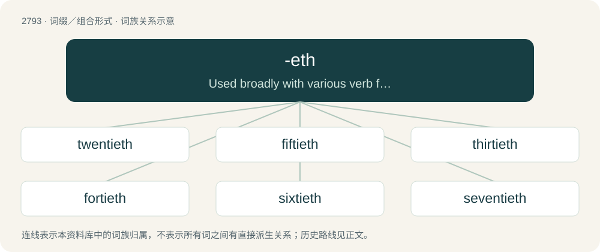

# 2899 · -eth — Used broadly with various verb forms for ironic pseudoarchaic or pseudoecclesiastical effect.

[总目录](../00_总目录_按常用程度.md)

**类型**：词缀／组合形式　｜　**来源语言**：见词源记录

## 核心含义与来源

- 核心含义：Used broadly with various verb forms for ironic pseudoarchaic or pseudoecclesiastical effect.
- 英文含义：Used broadly with various verb forms for ironic pseudoarchaic or pseudoecclesiastical effect.
- 词形：-eth

**多个词源／构词路径**：同一拼写可能有不同来源；以下按词性和含义分别列出。

**来源记录 1**（后缀／后置成分；Used broadly with various verb forms for ironic pseudoarchaic or pseudoecclesiastical effect.）

From Middle English -eth, -th, -ith, from Old English -eþ, -aþ, -þ, from Proto-Germanic \*-þi, \*-di, from Proto-Indo-European \*-ti.

**来源记录 2**（后缀／后置成分；used to create ordinal numbers from cardinal numbers ending in -y, namely the multiples of ten (other than ten itself): 20, 30, 40, 50, 60, 70, 80, and 90; e.g. twentieth, thirtieth.）

From Middle English -th, -eth, -the, -ethe, from Old English -þa, -þe, -oþa, from Proto-Germanic \*-þô, \*-tô, \*-udô, \*-dô, from Proto-Indo-European \*-tós.

## 词族图

## 单词速览（常用到不常用）

| 单词 | 音标 | 释义 |
|---|---|---|
| [twentieth](#w-1) | 英 /ˈtwɛn.ti.əθ/；美 /ˈtwɛn.ti.əθ/ | num. 第二十, 二十分之一 |
| [fiftieth](#w-2) | /ˈfɪf.ti.əθ/ | num. 第五十, 五十分之一 |
| [thirtieth](#w-3) | 英 /ˈθɜːti.əθ/；美 /ˈθɝti.əθ/ | num. 第三十, 三十分之一 |
| [fortieth](#w-4) | 英 /ˈfɔː.ti.əθ/；美 /ˈfɔɹ.ti.əθ/ | num. 第四十, 四十分之一 |
| [sixtieth](#w-5) | /ˈsɪksti.əθ/ | num. 第六十, 六十分之一 |
| [seventieth](#w-6) | /ˈsɛvnti.əθ/ | num. 第七十, 七十分之一 |

## 逐词详解

### 1. twentieth

**词性**：形容词　｜　**音标**：英 /ˈtwɛn.ti.əθ/；美 /ˈtwɛn.ti.əθ/

**中文释义**：num. 第二十, 二十分之一

**英文义项**：The ordinal form of the number twenty.

**构词拆分**：twenty + -eth

**词源与演化**：

From earlier twenteth, twentith, from Middle English twentithe, twentiþe, from Old English twēntigoþa. Equivalent to twenty + -eth. Etymological notes twentith, twenteth is the expected development from Middle English twentithe, but in time, the opaque twent- was replaced by a more transparent twenty-, resulting in modern twentieth (in the speech varieties this occurred in, the weak vowel in the final syllable of twenteth, twentith was clearly distinct from that in twenty); similar processes explain the modern pronunciation of thirtieth, fourtieth, etc. This analogy was assisted by synizetic pronunciations of words such as carrying, which allowed twenteth, twentith to be interpreted as contractions of twentieth.

**例句**：

> Genocides of the twentieth century killed more people than all the wars.

### 2. fiftieth

**词性**：形容词　｜　**音标**：/ˈfɪf.ti.əθ/

**中文释义**：num. 第五十, 五十分之一

**英文义项**：The ordinal form of the number fifty.

**构词拆分**：fifty + -eth

**词源与演化**：

From earlier fifteth, from Middle English fiftithe, fyftith; equivalent to fifty + -eth. For the modern form, see the etymological notes at twentieth.

**例句**：

> By the fiftieth heartbreak, rejection becomes much easier to handle.

### 3. thirtieth

**词性**：形容词　｜　**音标**：英 /ˈθɜːti.əθ/；美 /ˈθɝti.əθ/

**中文释义**：num. 第三十, 三十分之一

**英文义项**：The ordinal form of the number thirty.

**构词拆分**：thirty + -eth

**词源与演化**：

From earlier thirteth, from Middle English thrittithe, threttiþe, thrittyde, from Old English þrītigoþa; equivalent to thirty + -eth. For the modern form, see the etymological notes at twentieth.

**例句**：

> Tom and Mary will be celebrating their thirtieth wedding anniversary on Monday.

### 4. fortieth

**词性**：形容词　｜　**音标**：英 /ˈfɔː.ti.əθ/；美 /ˈfɔɹ.ti.əθ/

**中文释义**：num. 第四十, 四十分之一

**英文义项**：The ordinal form of the number forty.

**构词拆分**：forty + -eth

**词源与演化**：

From earlier fourteth, from Middle English fourtithe, fourtiþe; equivalent to forty + -eth. For the modern form, see the etymological notes at twentieth.

**例句**：

> Tom celebrated his fortieth birthday the other day, without pomp or ceremony.

### 5. sixtieth

**词性**：形容词　｜　**音标**：/ˈsɪksti.əθ/

**中文释义**：num. 第六十, 六十分之一

**英文义项**：The ordinal form of the number sixty.

**构词拆分**：sixty + -eth

**词源与演化**：

From earlier sixteth, from Middle English sixtithe; equivalent to sixty + -eth. For the modern form, see the etymological notes at twentieth.

**例句**：

> He suffered a breakdown in the sixtieth kilometer of the race.

### 6. seventieth

**词性**：名词　｜　**音标**：/ˈsɛvnti.əθ/

**中文释义**：num. 第七十, 七十分之一

**英文义项**：The person or thing in the seventieth position. / One of seventy equal parts of a whole.

**构词拆分**：seventy + -eth

**词源与演化**：

From earlier seventeth, from Middle English seventiþe, seventithe; equivalent to seventy + -eth. For the modern form, see the etymological notes at twentieth.

**例句**：

> All the septuagenarians remembered their seventieths fondly.

该用例对应义项：The person or thing in the seventieth position.
