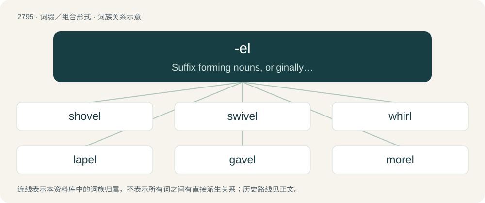

# 2901 · -el — Suffix forming nouns, originally denoting an instrument, from verbs, usually spelt -le except after n and e.

[总目录](../00_总目录_按常用程度.md)

**类型**：词缀／组合形式　｜　**来源语言**：见词源记录

## 核心含义与来源

- 核心含义：Suffix forming nouns, originally denoting an instrument, from verbs, usually spelt -le except after n and e.
- 英文含义：Suffix forming nouns, originally denoting an instrument, from verbs, usually spelt -le except after n and e.
- 词形：-el

**多个词源／构词路径**：同一拼写可能有不同来源；以下按词性和含义分别列出。

**来源记录 1**（后缀／后置成分；Suffix forming nouns, originally denoting an instrument, from verbs, usually spelt -le except after n and e.）

From Middle English -el, from Old English -el, from Proto-Germanic \*-ilaz.

**来源记录 2**（后缀／后置成分；Suffix, originally diminutive, in words of mostly Romance origin.）

From Middle English -el, a merger of two suffixes: \* Old English -el (diminutive suffix) \* Old French -el (diminutive suffix), from Latin -ellus

## 词族图

## 单词速览（常用到不常用）

| 单词 | 音标 | 释义 |
|---|---|---|
| [shovel](#w-1) | 英 /ˈʃʌv.əl/ | n. 铲, 铁铲；v. 铲 |
| [swivel](#w-2) | /ˈswɪvəl/ | n. 转环, 旋转轴承, 转椅座架；v. (使)旋转 |
| [whirl](#w-3) | 英 /wɜːl/；美 /(h)wɝl/ | 【英文】An act of whirling. |
| [lapel](#w-4) | 英 /ləˈpɛl/ | n. 翻领 |
| [gavel](#w-5) | 英 /ˈɡa.vəl/；美 /ˈɡæ.vəl/ | n. 槌；\[法\] 赋税或租金, 议事槌, 小木槌 |
| [morel](#w-6) | 英 /məˈɹɛl/ | n. 茄属植物, 龙葵；\[医\] 羊肚菌, 龙葵 |
| [sorrel](#w-7) | 英 /ˈsɒɹəl/；美 /ˈsɔɹəl/ | a. 栗色的；n. 栗色, 栗色动物, 三岁雄鹿, 酸模, 酢浆草 |
| [lintel](#w-8) | /ˈlɪn.təl/ | n. 过梁 |
| [hovel](#w-9) | 英 /ˈhɒvəl/；美 /ˈhɑvəl/ | n. 简陋小屋, 杂物间, 家畜小屋 |
| [cudgel](#w-10) | /ˈkʌd͡ʒəl/ | n. 棍棒；vt. 用棍棒打 |

## 逐词详解

### 1. shovel

**词性**：动词　｜　**音标**：英 /ˈʃʌv.əl/

**中文释义**：n. 铲, 铁铲；v. 铲

**英文义项**：To move materials with a shovel. / To move with a shoveling motion.

**构词拆分**：shove + -el (instrumental/agent suffix)

**词源与演化**：

From Middle English schovele, schovel, showell, shole (&gt; English dialectal shoul, shool), from Old English scofl (“shovel”), from Proto-Germanic \*skuflō, \*skūflō (“shovel”), equivalent to shove + -el (instrumental/agent suffix). Cognate with Scots shuffle, shule, shuil (“shovel”), Saterland Frisian Sköifel (“shovel”), West Frisian skoffel, schoffel (“hoe, spade, shovel”), Dutch schoffel (“spade, hoe”), Low German Schüfel, Schuffel (“shovel”), German Schaufel (“shovel”), Danish skovl (“shovel”), Faroese skupla (“shovel”), Icelandic skófla (“shovel”), Norwegian skyfle (“shovel”), skyffel (“shovel, hoe”), Swedish skyffel, skovel (“shovel”). Compare typologically Russian пешня (pešnja) (akin to пиха́ть (pixátʹ)), сово́к (sovók) (akin to сова́ть (sovátʹ)).

**例句**：

> After the blizzard, we shoveled the driveway for the next two days.

该用例对应义项：To move materials with a shovel.

### 2. swivel

**词性**：名词　｜　**音标**：/ˈswɪvəl/

**中文释义**：n. 转环, 旋转轴承, 转椅座架；v. (使)旋转

**英文义项**：A piece, such as a ring or hook, attached to another piece by a pin, in such a manner as to permit rotation about the pin as an axis. / A small piece of ordnance, turning on a point or swivel; called also swivel gun.

**构词拆分**：swive + -el

**词源与演化**：

From Middle English swyvel, swivel, from a derivative of Old English swīfan (“to revolve”), + -el, an instrumental suffix, equivalent to swive + -el.

**例句**：

> Bob ain't got no swivel.

该用例对应义项：Strength of mind or character that enables one to overcome adversity; confidence; force of will.

### 3. whirl

**词性**：名词　｜　**音标**：英 /wɜːl/；美 /(h)wɝl/

**英文义项**：An act of whirling. / Something that whirls, such as a whirlwind.

**构词拆分**：wharve + -el

**词源与演化**：

From Middle English whirl, wherwille, whorwhil, wervel, from Old English hwirfel, hwyrfel (“whirlpool”), from Proto-West Germanic \*hwirbil, from Proto-Germanic \*hwirbilaz, \*hwarbilaz (“swirl, whirl, whirlpool”), equivalent to wharve + -el; and also Old Norse hvirfill (“ring, circle, crown”), whence Danish hvirvel (“cowlick”), Dutch werveling (“whirling, vortex”), German Low German Warvel (“whirl, whirlpool”), German Wirbel (“whirl, whirlpool”).

**例句**：

> She gave the top a whirl and it spun across the floor.

该用例对应义项：An act of whirling.

### 4. lapel

**词性**：名词　｜　**音标**：英 /ləˈpɛl/

**中文释义**：n. 翻领

**英文义项**：Each of the two triangular pieces of cloth on the front of a jacket or coat that are folded back below the throat, leaving a triangular opening between.

**构词拆分**：From lap + -el (“diminutive suffix”).

**词源与演化**：

From lap + -el (“diminutive suffix”).

**例句**：

> She fastened the medal on the lapel with a pin.

### 5. gavel

**词性**：动词　｜　**音标**：英 /ˈɡa.vəl/；美 /ˈɡæ.vəl/

**中文释义**：n. 槌；\[法\] 赋税或租金, 议事槌, 小木槌

**英文义项**：To divide or distribute according to the gavel system.

**构词拆分**：give + -el

**词源与演化**：

From Middle English gavel, from Old English gafol, from Proto-West Germanic \*gabul, from Proto-Germanic \*gebaną (“to give”), equivalent to give + -el.

**例句**：

> Finally, the judge closed the session with a strike from his gavel.

### 6. morel

**词性**：名词　｜　**音标**：英 /məˈɹɛl/

**中文释义**：n. 茄属植物, 龙葵；\[医\] 羊肚菌, 龙葵

**英文义项**：A true morel; any of several fungi in the genus Morchella, the upper part of which is covered with a reticulated and pitted hymenium.

**构词拆分**：more (“carrot, root”) + -el (diminutive suffix)

**词源与演化**：

Borrowed from French morille (compare Picard merouille, meroule (“morel, mushroom”)), from Middle High German morhel, morchel (“edible fungus, morel”), from Old High German morhila (“edible root”), diminutive of Proto-West Germanic \*morhā (“tree root, plant root”), from Proto-Germanic \*murhǭ, \*murhijǭ (“edible root”), from Proto-Indo-European \*mork- (“tuber, edible herb”). Akin to German Morchel (“morel”), Middle Low German morke (“mushroom, morel”), German Möhre (“carrot”). Equivalent to dialectal more (“carrot, root”) + -el (diminutive suffix).

**例句**：

> Carlos Morel was the first Argentine painter.

### 7. sorrel

**词性**：名词　｜　**音标**：英 /ˈsɒɹəl/；美 /ˈsɔɹəl/

**中文释义**：a. 栗色的；n. 栗色, 栗色动物, 三岁雄鹿, 酸模, 酢浆草

**英文义项**：Any of various plants with acidic leaves of the genus Rumex, especially / Rumex acetosa (common sorrel, garden sorrel), sometimes used as a salad vegetable.

**构词拆分**：sour + -el (diminutive suffix)

**词源与演化**：

From Middle English sorel, from Old French sorel, surele (“sorrel”), from Old French sur (“sour”), of Germanic origin, ultimately from Proto-Germanic \*sūraz (“sour”); equivalent to sour + -el (diminutive suffix). Compare Old English sūre (“sorrel”), Icelandic súra (“sorrel”), Dutch zuring (“dock (plant), sorrel”). More at sour.

**例句**：

> He's gone to harness the sorrel mare to go to Carmody for the doctor.

### 8. lintel

**词性**：名词　｜　**音标**：/ˈlɪn.təl/

**中文释义**：n. 过梁

**英文义项**：A horizontal structural beam spanning an opening, such as between the uprights of a door or a window, and which supports the wall above.

**构词拆分**：limit + -el

**词源与演化**：

From Middle English lyntel, from Old French lintel, from Vulgar Latin \*līntellus, for \*līmitellus, diminutive noun from līmes. Equivalent to limit + -el.

**例句**：

> In older buildings, a wooden lintel can sometimes sag or rot, requiring replacement.

### 9. hovel

**词性**：名词　｜　**音标**：英 /ˈhɒvəl/；美 /ˈhɑvəl/

**中文释义**：n. 简陋小屋, 杂物间, 家畜小屋

**英文义项**：An open shed for sheltering cattle, or protecting produce, etc., from the weather. / A poor cottage; a small, mean house; a hut.

**构词拆分**：howf + -el

**词源与演化**：

From Middle English hovel, hovil, hovylle, diminutive of \*hove, \*hof (“structure, building, house”), from Old English hof (“an enclosure, court, dwelling, house”), from Proto-West Germanic \*hof, from Proto-Germanic \*hufą (“hill, farm”), from Proto-Indo-European \*kewp- (“arch, bend, buckle”), equivalent to howf + -el. Compare Middle High German hobel (“cover, lid, covered wagon”). Cognate with Dutch hof (“garden, court”), German Hof (“yard, garden, court, palace”), Icelandic hof (“temple, hall”). Related to hove and hover.

**例句**：

> Is this the hovel you live in?

### 10. cudgel

**词性**：名词　｜　**音标**：/ˈkʌd͡ʒəl/

**中文释义**：n. 棍棒；vt. 用棍棒打

**英文义项**：A short heavy club with a rounded head used as a weapon. / Anything that can be used as a threat to force one's will on another.

**构词拆分**：cog + -el (diminutive suffix)

**词源与演化**：

From Middle English kuggel, from Old English cyċġel (“a large stick, cudgel”), from Proto-West Germanic \*kuggil, from Proto-Germanic \*kuggilaz (“a knobbed instrument”), derivative of Proto-Germanic \*kuggǭ (“cog, swelling”), from Proto-Indo-European \*gewgʰ- (“swelling, bow”), from Proto-Indo-European \*gew- (“to bow, bend, arch, curve”), equivalent to cog + -el (diminutive suffix). Cognate with Middle Dutch coghele (“a stick with a rounded end”).

**例句**：

> The guard hefted his cudgel menacingly and looked at the inmates.

该用例对应义项：A short heavy club with a rounded head used as a weapon.
