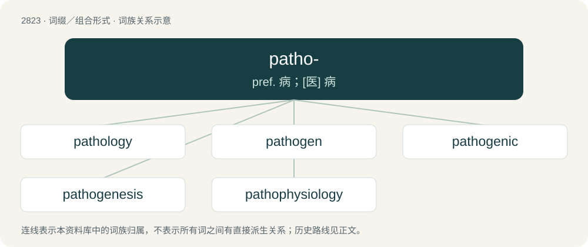

# 2928 · patho- — pref. 病；\[医\] 病

[总目录](../00_总目录_按常用程度.md)

**类型**：词缀／组合形式　｜　**来源语言**：见词源记录

## 核心含义与来源

- 核心含义：pref. 病；\[医\] 病
- 英文含义：disease
- 词形：patho-

**来源记录 1**（前缀／前置成分；disease）

From Ancient Greek πάθος (páthos).

## 词族图

## 单词速览（常用到不常用）

| 单词 | 音标 | 释义 |
|---|---|---|
| [pathology](#w-1) | /pəˈθɒləd͡ʒi/ | n. 病理学, 病理, 病状, 病变；\[医\] 闰理学 |
| [pathogen](#w-2) | /ˈpæθəd͡ʒn̩/ | n. 病原体；\[医\] 病原体 |
| [pathogenic](#w-3) | 美 /pæθəˈd͡ʒɛnɪk/ | a. 致病的, 成为病原的, 病原的；\[医\] 致病的, 病原的 |
| [pathogenesis](#w-4) | 英 /ˌpæθ.ə(ʊ)ˈd͡ʒɛn.ə.sɪs/；美 /ˌpæθ.oʊˈd͡ʒɛn.ə.sɪs/ | n. 致病, 发病；\[医\] 发病机理 |
| [pathophysiology](#w-5) | /ˈpæθəj,fiziˈɔlədʒi/ | n. 病理生理学；\[医\] 病理生理学 |

## 逐词详解

### 1. pathology

**词性**：名词　｜　**音标**：/pəˈθɒləd͡ʒi/

**中文释义**：n. 病理学, 病理, 病状, 病变；\[医\] 闰理学

**英文义项**：The clinical biomedical specialty that provides microscopy and other laboratory services to clinicians (e.g., cytology, histology, cytopathology, histopathology, cytometry). / The academic biomedical specialty that advances the aspects of the biomedical sciences that allow for those clinical applications and their advancements over time.

**构词拆分**：patho- + -logy

**词源与演化**：

From French pathologie, from Ancient Greek πάθος (páthos, “disease”) and -λογία (-logía, “study of”). By surface analysis, path- + -ology or patho- + -logy.

**例句**：

> Some sort of mental and social pathology seemed to sweep over the discourse later that autumn.

该用例对应义项：Pathosis: any deviation from a healthy or normal structure or function; abnormality; illness or malformation.

### 2. pathogen

**词性**：名词　｜　**音标**：/ˈpæθəd͡ʒn̩/

**中文释义**：n. 病原体；\[医\] 病原体

**英文义项**：An agent that can cause disease, especially an infectious microorganism, such as a bacterium, virus, protozoon or fungus.

**构词拆分**：patho- + -gen

**词源与演化**：

From patho- + -gen. Second element ultimately from Proto-Indo-European \*ǵenh₁- (“lineage”) through Ancient Greek γένος (génos, “birth”)

**例句**：

> Have I been exposed to the pathogen?

### 3. pathogenic

**词性**：形容词　｜　**音标**：美 /pæθəˈd͡ʒɛnɪk/

**中文释义**：a. 致病的, 成为病原的, 病原的；\[医\] 致病的, 病原的

**英文义项**：Able to cause (harmful) disease. / Consisting of harsh, percussive, nonverbal sounds.

**构词拆分**：patho- + -genic

**词源与演化**：

From patho- + -genic.

**例句**：

> While the environment is teeming with bacteria and fungi, most are not pathogenic.

该用例对应义项：Able to cause (harmful) disease.

### 4. pathogenesis

**词性**：名词　｜　**音标**：英 /ˌpæθ.ə(ʊ)ˈd͡ʒɛn.ə.sɪs/；美 /ˌpæθ.oʊˈd͡ʒɛn.ə.sɪs/

**中文释义**：n. 致病, 发病；\[医\] 发病机理

**英文义项**：The origin and development of a disease. / The mechanism whereby something causes a disease.

**构词拆分**：patho- + -genesis

**词源与演化**：

From patho- + -genesis.

**例句**：

> Dr. Birx attended the recent International AIDS Society Conference on Pathogenesis, Prevention and Treatment in Vancouver, Canada.

### 5. pathophysiology

**词性**：名词　｜　**音标**：/ˈpæθəj,fiziˈɔlədʒi/

**中文释义**：n. 病理生理学；\[医\] 病理生理学

**英文义项**：The physiological processes associated with disease or injury.

**构词拆分**：patho- + physiology

**词源与演化**：

From patho- + physiology.

**例句**：

> Explain the pathophysiology of that disease.
