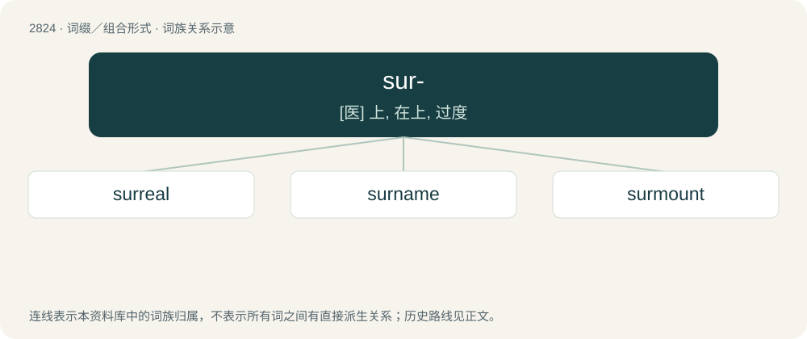

# 2930 · sur- — \[医\] 上, 在上, 过度

[总目录](../00_总目录_按常用程度.md)

**类型**：词缀／组合形式　｜　**来源语言**：见词源记录

## 核心含义与来源

- 核心含义：\[医\] 上, 在上, 过度
- 英文含义：A syncopic variant of super-.
- 词形：sur-

**来源记录 1**（前缀／前置成分；A syncopic variant of super-.）

From Middle English sur-, from Old French sur-, sour-, sor-, soure-, a syncopic form of the Latin super. Doublet of super-, over-, and hyper-.

## 词族图

## 单词速览（常用到不常用）

| 单词 | 音标 | 释义 |
|---|---|---|
| [surreal](#w-1) | 英 /səˈɹiː(.ə)l/ | a. 超现实主义的；离奇的；不真实的 |
| [surname](#w-2) | 英 /ˈsɜːˌneɪm/；美 /ˈsɝˌneɪm/ | n. 姓, 别号, 绰号；vt. 呼以姓氏, 起绰号 |
| [surmount](#w-3) | 英 /səˈmaʊnt/；美 /sɚˈmaʊnt/ | vt. 战胜, 超越, 克服 |

## 逐词详解

### 1. surreal

**词性**：形容词　｜　**音标**：英 /səˈɹiː(.ə)l/

**中文释义**：a. 超现实主义的；离奇的；不真实的

**英文义项**：Resembling a dream: fantastic and incongruous.

**构词拆分**：sur- + real

**词源与演化**：

A back-formation from surrealism, equivalent to sur- + real.

**例句**：

> The movie had a dreamlike, surreal atmosphere.

该用例对应义项：Resembling a dream: fantastic and incongruous.

### 2. surname

**词性**：名词　｜　**音标**：英 /ˈsɜːˌneɪm/；美 /ˈsɝˌneɪm/

**中文释义**：n. 姓, 别号, 绰号；vt. 呼以姓氏, 起绰号

**英文义项**：The portion of a person's name that is generally hereditary or treated as an indicator of a person's family, which may be shared with other members of the family, or otherwise derived from their names in some fashion; distinguished from that person's given name(s). / Synonym of epithet, an additional name, particularly those derived from a birthplace, quality, or achievement.

**构词拆分**：sur- + name

**词源与演化**：

Inherited from Middle English surname, a partial calque of Old French surnum, surnoun (“surname; nickname”) (whence Middle English surnoun), from Late Latin supernōmen, suprānōmen (“surname”), from super- (“over, above, beyond”) and nōmen (“name”), equivalent to sur- + name.

**例句**：

> James is my first name, and Smith is my surname.

该用例对应义项：The portion of a person's name that is generally hereditary or treated as an indicator of a person's family, which may be shared with other members of the family, or otherwise derived from their names in some fashion; distinguished from that person's given name(s).

### 3. surmount

**词性**：动词　｜　**音标**：英 /səˈmaʊnt/；美 /sɚˈmaʊnt/

**中文释义**：vt. 战胜, 超越, 克服

**英文义项**：To get or be over without touching or resting on; to overcome. / To cap; to sit on top of.

**构词拆分**：sur- + mount

**词源与演化**：

From Middle English surmounten, from Old French surmonter (“to rise above, surmount”), from sur- (“above”) + monter (“to mount”), equivalent to sur- + mount.

**例句**：

> There are many obstacles to surmount when translating literary texts.
