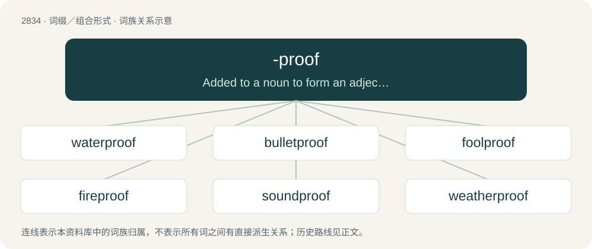

# 2941 · -proof — Added to a noun to form an adjective denoting imperviousness to that noun.

[总目录](../00_总目录_按常用程度.md)

**类型**：词缀／组合形式　｜　**来源语言**：见词源记录

## 核心含义与来源

- 核心含义：Added to a noun to form an adjective denoting imperviousness to that noun.
- 英文含义：Added to a noun to form an adjective denoting imperviousness to that noun.
- 词形：-proof

**来源记录 1**（后缀／后置成分；Added to a noun to form an adjective denoting imperviousness to that noun.）

From the adjective proof (“fully resistant”), from the same Old French root as prove.

## 词族图

## 单词速览（常用到不常用）

| 单词 | 音标 | 释义 |
|---|---|---|
| [waterproof](#w-1) | 英 /ˈwɔːtəˌpruːf/；美 /ˈwɔt̬ɚˌpruf/ | n. 防水材料；a. 不透水的, 防水的；vt. 使防水 |
| [bulletproof](#w-2) | 英 /ˈbʊlɪtpɹuːf/；美 /ˈbʊlɪtpɹuf/ | a. 防弹的 |
| [foolproof](#w-3) | /ˈfuːl ˌpɹuːf/ | a. 十分简单的, 十分安全的 |
| [fireproof](#w-4) | /ˈfaiəpruːf/ | a. 耐火的, 防火的；vi. 变成有耐火性 |
| [soundproof](#w-5) | /ˈsaundpruːf/ | a. 隔音的 |
| [weatherproof](#w-6) | /ˈwɛðəpruːf/ | a. 防风雨的, 不受天气影响的；vt. 使防风雨 |

## 逐词详解

### 1. waterproof

**词性**：形容词　｜　**音标**：英 /ˈwɔːtəˌpruːf/；美 /ˈwɔt̬ɚˌpruf/

**中文释义**：n. 防水材料；a. 不透水的, 防水的；vt. 使防水

**英文义项**：Resistant to the effects of water. / Made of or covered with material that doesn't allow water in; impervious to water and immune to its effects.

**构词拆分**：water + -proof

**词源与演化**：

From water + -proof. Compare West Frisian wetterproef (“waterproof”), Dutch waterproef (“waterproof”).

**例句**：

> Keep the map in a waterproof bag.

把地图放在防水袋里。

### 2. bulletproof

**词性**：形容词　｜　**音标**：英 /ˈbʊlɪtpɹuːf/；美 /ˈbʊlɪtpɹuf/

**中文释义**：a. 防弹的

**英文义项**：Capable of withstanding a direct shot by a bullet fired from a gun. / Reliable, infallible, sturdy or error-tolerant.

**构词拆分**：bullet + -proof

**词源与演化**：

From bullet + -proof.

**用法示例／搭配（非完整句）**：

> bulletproof hosting

该用例对应义项：Reliable, infallible, sturdy or error-tolerant.

### 3. foolproof

**词性**：动词　｜　**音标**：/ˈfuːl ˌpɹuːf/

**中文释义**：a. 十分简单的, 十分安全的

**英文义项**：To render (something) foolproof.

**构词拆分**：fool + -proof

**词源与演化**：

From fool + -proof.

**例句**：

> We foolproofed the operations.

该用例对应义项：To render (something) foolproof.

### 4. fireproof

**词性**：形容词　｜　**音标**：/ˈfaiəpruːf/

**中文释义**：a. 耐火的, 防火的；vi. 变成有耐火性

**英文义项**：Resistant to damage from fire.

**构词拆分**：fire + -proof

**词源与演化**：

From fire + -proof.

**例句**：

> The fireproof safe will protect documents inside for up to four hours in a standard house fire.

该用例对应义项：Resistant to damage from fire.

### 5. soundproof

**词性**：形容词　｜　**音标**：/ˈsaundpruːf/

**中文释义**：a. 隔音的

**英文义项**：Not allowing sound through.

**构词拆分**：sound + -proof

**词源与演化**：

From sound + -proof.

**例句**：

> The contestant was placed in a soundproof booth so he could not receive help from the audience.

该用例对应义项：Not allowing sound through.

### 6. weatherproof

**词性**：形容词　｜　**音标**：/ˈwɛðəpruːf/

**中文释义**：a. 防风雨的, 不受天气影响的；vt. 使防风雨

**英文义项**：Capable of resisting damage caused by the weather.

**构词拆分**：From weather + -proof.

**词源与演化**：

From weather + -proof.
