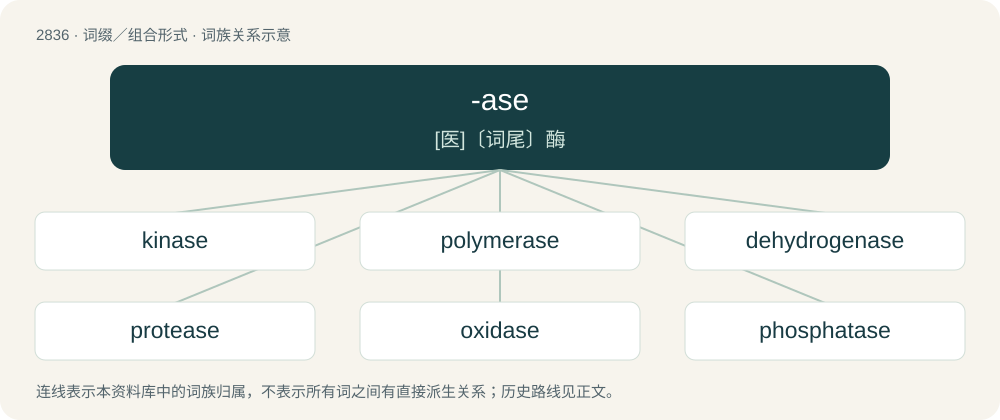

# 2943 · -ase — \[医\]〔词尾〕酶

[总目录](../00_总目录_按常用程度.md)

**类型**：词缀／组合形式　｜　**来源语言**：见词源记录

## 核心含义与来源

- 核心含义：\[医\]〔词尾〕酶
- 英文含义：Used to form the names of enzymes.
- 词形：-ase

**来源记录 1**（后缀／后置成分；Used to form the names of enzymes.）

Derived from ending of diastase; a libfix.

## 词族图

## 单词速览（常用到不常用）

| 单词 | 音标 | 释义 |
|---|---|---|
| [kinase](#w-1) | /ˈkaɪneɪz/ | n. 激酶, 致活酶；\[化\] 激酶 |
| [polymerase](#w-2) | /ˈpɔlimə,reis/ | n. 聚合酶；\[化\] 聚合酶 |
| [dehydrogenase](#w-3) | 英 /diːˌhaɪdˈɹɒdʒəneɪz/ | n. 脱氢酶；\[化\] 脱氢酶 |
| [protease](#w-4) | /ˈpɹəʊtɪeɪz/ | n. 朊酶, 蛋白酶；\[化\] 蛋白酶; 蛋白水解酶 |
| [oxidase](#w-5) | /ˈɔksideis/ | \[化\] 氧化酶；\[医\] 氧化酶 |
| [phosphatase](#w-6) | /ˈfɔsfəteis/ | n. 磷酸酶；\[化\] 磷酸酶; 磷酸酯酶 |
| [amylase](#w-7) | /ˈæmɪleɪs/ | n. 淀粉酶；\[化\] 淀粉酶 |
| [hydroxylase](#w-8) | /haiˈdrɔksileis/ | n. \[生化\]羟化酶 |
| [peroxidase](#w-9) | /pəˈrɔksideis, -deiz/ | \[化\] 过氧化物酶；\[医\] 过氧化物酶 |
| [transferase](#w-10) | /ˈtrænsfə,reis, -,reiz/ | n. \[生化\]转移酶 |
| [synthetase](#w-11) | /ˈsɪnθəteɪ̯s/ | n. \[生化\]合成酶 |
| [transcriptase](#w-12) | /trænsˈkripteis/ | \[化\] 转录酶 |
| [catalase](#w-13) | /ˈkætəleis/ | n. 过氧化氢酶；\[化\] 过氧化氢酶; 催化酶; 触酶 |
| [telomerase](#w-14) | 英 /teˈlɒməɹeɪz/；美 /teˈlɑməɹeɪs/ | n. 端粒酶 |
| [lactase](#w-15) | /ˈlækteis/ | n. 乳糖酶；\[化\] 乳糖酶 |
| [cyclase](#w-16) | /ˈsikleis/ | n. \[生化\]环化酶 |
| [phosphodiesterase](#w-17) | /,fɔsfə,daiəˈstereis/ | n. \[生化\]磷酸二酯酶 |
| [ligase](#w-18) | 英 /ˈlɪɡeɪz/；美 /ˈlaɪɡeɪz/ | n. \[生化\]连接酶 |
| [luciferase](#w-19) | /luːˈsifəreis/ | n. 虫萤光素酶；\[化\] 荧光素酶(虫的) |
| [nuclease](#w-20) | /ˈnjuːkli,eis/ | n. \[生化\]核酸酶 |

## 逐词详解

### 1. kinase

**词性**：名词　｜　**音标**：/ˈkaɪneɪz/

**中文释义**：n. 激酶, 致活酶；\[化\] 激酶

**英文义项**：Any of a group of enzymes that transfer phosphate groups from high-energy donor molecules, such as ATP, to specific target molecules (substrates), in a process termed phosphorylation.

**词源与演化**：

From Ancient Greek κινέω (kinéō, “to move”) + -ase, a suffix forming enzyme names.

**例句**：

> A kinase is an enzyme which phosphorylates other proteins.

### 2. polymerase

**词性**：名词　｜　**音标**：/ˈpɔlimə,reis/

**中文释义**：n. 聚合酶；\[化\] 聚合酶

**英文义项**：Any of various enzymes that catalyze the formation of polymers of DNA or RNA using an existing strand of RNA or DNA respectively as a template.

**构词拆分**：polymer + -ase

**词源与演化**：

From polymer + -ase.

### 3. dehydrogenase

**词性**：名词　｜　**音标**：英 /diːˌhaɪdˈɹɒdʒəneɪz/

**中文释义**：n. 脱氢酶；\[化\] 脱氢酶

**英文义项**：Any of several enzymes that catalyze the removal of hydrogen (a proton) from biological compounds.

**构词拆分**：de- + hydrogen + -ase

**词源与演化**：

From de- + hydrogen + -ase.

### 4. protease

**词性**：名词　｜　**音标**：/ˈpɹəʊtɪeɪz/

**中文释义**：n. 朊酶, 蛋白酶；\[化\] 蛋白酶; 蛋白水解酶

**英文义项**：An enzyme that cuts or cleaves proteins.

**构词拆分**：protein + -ase

**词源与演化**：

From prote(in) + -ase.

### 5. oxidase

**词性**：名词　｜　**音标**：/ˈɔksideis/

**中文释义**：\[化\] 氧化酶；\[医\] 氧化酶

**英文义项**：Any of many enzymes which catalyze oxidation reactions, especially ones using molecular oxygen.

**构词拆分**：oxide + -ase

**词源与演化**：

From oxide + -ase introduced by Gabriel Bertrand.

### 6. phosphatase

**词性**：名词　｜　**音标**：/ˈfɔsfəteis/

**中文释义**：n. 磷酸酶；\[化\] 磷酸酶; 磷酸酯酶

**英文义项**：Any of several enzymes that hydrolyze phosphate esters, and are important in the metabolism of carbohydrates, nucleotides and phospholipids, and in the formation of bone.

**构词拆分**：phosphate + -ase

**词源与演化**：

From phosphate + -ase.

### 7. amylase

**词性**：名词　｜　**音标**：/ˈæmɪleɪs/

**中文释义**：n. 淀粉酶；\[化\] 淀粉酶

**英文义项**：Any of a class of digestive enzymes, present in saliva and also contributed to the gut by the exocrine pancreas, that break down complex carbohydrates such as starch into simpler sugars such as glucose.

**构词拆分**：amyl- + -ase

**词源与演化**：

From amyl- + -ase.

**用法示例／搭配（非完整句）**：

> egg yolk amylase

该用例对应义项：Any of a class of digestive enzymes, present in saliva and also contributed to the gut by the exocrine pancreas, that break down complex carbohydrates such as starch into simpler sugars such as glucose.

### 8. hydroxylase

**词性**：名词　｜　**音标**：/haiˈdrɔksileis/

**中文释义**：n. \[生化\]羟化酶

**英文义项**：Any of several enzymes that catalyze the oxidation of compounds by the introduction of hydroxyl groups.

**构词拆分**：hydroxyl + -ase

**词源与演化**：

From hydroxyl + -ase.

### 9. peroxidase

**词性**：名词　｜　**音标**：/pəˈrɔksideis, -deiz/

**中文释义**：\[化\] 过氧化物酶；\[医\] 过氧化物酶

**英文义项**：Any of a class of enzymes that act on substrates such as hydrogen peroxide and organic hydroperoxides such as lipid peroxides.

**构词拆分**：peroxide + -ase

**词源与演化**：

From peroxide + -ase.

### 10. transferase

**词性**：名词　｜　**音标**：/ˈtrænsfə,reis, -,reiz/

**中文释义**：n. \[生化\]转移酶

**英文义项**：Any of various enzymes that catalyze the transfer of a functional group, such as amine or phosphate from one molecule to another.

**构词拆分**：transfer + -ase

**词源与演化**：

From transfer + -ase.

### 11. synthetase

**词性**：名词　｜　**音标**：/ˈsɪnθəteɪ̯s/

**中文释义**：n. \[生化\]合成酶

**英文义项**：Any enzyme that catalyzes the synthesis of a biological compound. / Such an enzyme that, more specifically, uses ATP as a source of energy.

**构词拆分**：synthesis + -ase

**词源与演化**：

From synthesis + -ase.

### 12. transcriptase

**词性**：名词　｜　**音标**：/trænsˈkripteis/

**中文释义**：\[化\] 转录酶

**英文义项**：A polymerase that catalyzes the transcription of DNA to RNA.

**构词拆分**：transcript + -ase

**词源与演化**：

From transcript + -ase.

### 13. catalase

**词性**：名词　｜　**音标**：/ˈkætəleis/

**中文释义**：n. 过氧化氢酶；\[化\] 过氧化氢酶; 催化酶; 触酶

**英文义项**：An enzyme found in the liver that catalyses the decomposition of hydrogen peroxide to water and oxygen.

**词源与演化**：

From catalysis + -ase.

### 14. telomerase

**词性**：名词　｜　**音标**：英 /teˈlɒməɹeɪz/；美 /teˈlɑməɹeɪs/

**中文释义**：n. 端粒酶

**英文义项**：An enzyme in eukaryotic cells that adds a specific sequence of DNA to the telomeres of chromosomes after they divide; gives the chromosomes stability over time.

**构词拆分**：telomere + -ase

**词源与演化**：

From telomere + -ase.

### 15. lactase

**词性**：名词　｜　**音标**：/ˈlækteis/

**中文释义**：n. 乳糖酶；\[化\] 乳糖酶

**英文义项**：A β-galactosidase enzyme that is involved in the hydrolysis of the disaccharide lactose into constituent galactose and glucose monomers.

**构词拆分**：lacto- + -ase

**词源与演化**：

From lacto- + -ase.

### 16. cyclase

**词性**：名词　｜　**音标**：/ˈsikleis/

**中文释义**：n. \[生化\]环化酶

**英文义项**：Any enzyme that catalyzes the cyclization of a compound

**构词拆分**：cyclo- + -ase；cycle + -ase

**词源与演化**：

From cyclo- + -ase or cycle + -ase.

### 17. phosphodiesterase

**词性**：名词　｜　**音标**：/,fɔsfə,daiəˈstereis/

**中文释义**：n. \[生化\]磷酸二酯酶

**英文义项**：Any of a family of enzymes that catalyze the cleavage of phosphodiester links in nucleic acids.

**构词拆分**：phosphodiester + -ase

**词源与演化**：

From phosphodiester + -ase.

### 18. ligase

**词性**：名词　｜　**音标**：英 /ˈlɪɡeɪz/；美 /ˈlaɪɡeɪz/

**中文释义**：n. \[生化\]连接酶

**英文义项**：Any of a group of enzymes that catalyze the binding of two molecules; synthetase.

**构词拆分**：ligation + -ase

**词源与演化**：

From ligation + -ase.

### 19. luciferase

**词性**：名词　｜　**音标**：/luːˈsifəreis/

**中文释义**：n. 虫萤光素酶；\[化\] 荧光素酶(虫的)

**英文义项**：Any one of a group of enzymes that produce bioluminescence by oxidizing luciferin.

**构词拆分**：luciferin + -ase

**词源与演化**：

From luciferin + -ase.

### 20. nuclease

**词性**：名词　｜　**音标**：/ˈnjuːkli,eis/

**中文释义**：n. \[生化\]核酸酶

**英文义项**：Any of several enzymes capable of cleaving the phosphodiester bonds between the nucleotide subunits of nucleic acids.

**构词拆分**：nucleo- + -ase

**词源与演化**：

From nucleo- + -ase.
