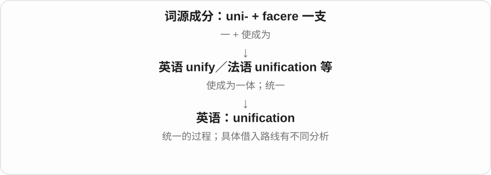
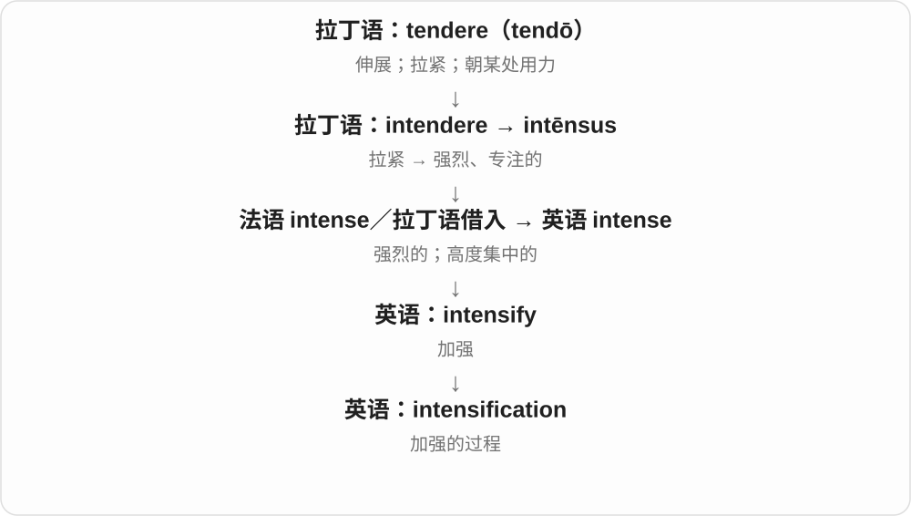

# 2944 · -ification — 使成为、发生变化的相应过程或结果名词

[逐词精讲目录](../00_逐词精讲目录.md) · [总目录](../00_总目录_按常用程度.md)

## 核心词根与来源

unify 到 unification 是统一过程，personify 到 personification 是拟人、体现。长词不要只译成某某化，还要把到底什么改变了说清楚。

**-IFICATION：把“使它变成怎样”这件事作为名词谈**

-ify 动词与 -ification 名词常配对：变化动作与变化过程、结果相对应。

- **统一、强化与结构变化**：unification · magnification · intensification · stratification · solidification · ossification
- **物质、环境与城市变化**：acidification · gasification · desertification · gentrification
- **表达、评价与社会过程**：personification · objectification · nullification · falsification · gamification · commodification

## 词形与演化规律

拉丁 -ficāre、-ficātiō → -ify、-ification；-ify 到 -ification 是对应词尾替换；不同词还有整词借入的历史。

## 单词速览（按词族由简到繁）

同一基础词的相关扩展放在一起，先读基础形式，再读扩展；各组之间优先读常用的。具体词源关系见各词讲解。

| 单词 | 音标 | 核心意思 |
|---|---|---|
| [unification](#w-1) | /ˌjuːnɪfɪˈkeɪʃn̩/ | 统一；合并为一体 |
| [gentrification](#w-2) | /ˌdʒentrɪfɪˈkeɪʃən/ | 街区绅士化、中产阶层化 |
| [magnification](#w-3) | 英、美 /ˌmæɡnɪfɪˈkeɪʃən/ | 放大；放大率；放大倍数 |
| [personification](#w-4) | 英 /pəˌsɒnɪfɪˈkeɪʃən/；美 /pərˌsɑːnɪfɪˈkeɪʃən/ | 拟人；人格化；某种品质的化身 |
| [intensification](#w-5) | /ɪnˌtensɪfɪˈkeɪʃən/ | 加强；强化；集约化 |
| [stratification](#w-6) | 英 /ˌstrætɪfɪˈkeɪʃən/；美 /ˌstrætəfɪˈkeɪʃən/ | 分层；层理；社会分层 |
| [acidification](#w-7) | /əˌsɪdɪfɪˈkeɪʃən/ | 酸化；酸化过程 |
| [objectification](#w-8) | 英 /əbˌdʒektɪfɪˈkeɪʃən/；美 /əbˌdʒektəfəˈkeɪʃən/ | 物化；把人当作物件；使抽象内容成为对象 |
| [nullification](#w-9) | /ˌnʌlɪfɪˈkeɪʃən/ | 使无效；废止；抵消 |
| [falsification](#w-10) | /ˌfɔːlsɪfɪˈkeɪʃən/ | 伪造、篡改；证伪 |
| [gamification](#w-11) | /ˌɡeɪmɪfɪˈkeɪʃən/ | 游戏化 |
| [desertification](#w-12) | 英 /dɪˌzɜːtɪfɪˈkeɪʃən/；美 /dɪˌzɜːrtɪfɪˈkeɪʃən/ | 荒漠化 |
| [gasification](#w-13) | 英 /ˌɡæsɪfɪˈkeɪʃən/；美 /ˌɡæsəfɪˈkeɪʃən/ | 气化；制取可燃气体的转化过程 |
| [commodification](#w-14) | 英 /kəˌmɒdɪfɪˈkeɪʃən/；美 /kəˌmɑːdɪfɪˈkeɪʃən/ | 商品化 |
| [solidification](#w-15) | /səˌlɪdɪfɪˈkeɪʃən/ | 凝固、固化；巩固的过程 |
| [ossification](#w-16) | 英 /ˌɒsɪfɪˈkeɪʃən/；美 /ˌɑːsəfəˈkeɪʃən/ | 骨化；僵化 |

## 逐词讲解

### 1. unification — 统一；合并为一体

**音标**：/ˌjuːnɪfɪˈkeɪʃn̩/

**先抓住这个画面**

几条分开的路线终于接到同一张网络里，几个分开的部分形成一个整体：这叫 unification。

**怎么拆**

uni-（一）+ -fy（使成为，来自 facere）形成 unify，可对应 -fication 名词；历史也可能借自法语或意大利语相关形式。

**怎么变成今天的意思**

核心是从多个单位走向一个整体；可能是国家、制度、标准，也可能是理论解释。

**常见搭配与例句**

national unification；the unification of standards。

> The unification of the ticketing systems took a year.

统一票务系统花了一年时间。

> The book examines the country’s unification.

这本书考察了这个国家的统一过程。

**别混淆**

unity 是统一或团结的状态；unification 更强调达到该状态的过程。

### 2. gentrification — 街区绅士化、中产阶层化

**音标**：/ˌdʒentrɪfɪˈkeɪʃən/

**先抓住这个画面**

一个原本较低收入的街区吸引更富裕居民和投资，房屋、店铺、价格及居民构成都变了，原住民还可能被高成本挤走。gentrification 说的是这整套变化，不只是街道刷了新漆。

**怎么拆**

gentry 较高社会阶层 + -ification，对应 gentrify。社会学家 Ruth Glass 在 1964 年以此命名伦敦相关街区变化，借旧阶层词描述新一轮居民、空间重组。

**怎么变成今天的意思**

**拉丁语 -ficāre、-ficātiō 相关构词 → -ify、-ification**  
使成为、使发生相应变化；相应过程、结果名词

↓

**英语 -ify ↔ -ification**  
动词与过程名词对应，也可按名词词干 + -ification 理解

↓

**gentry／gentrify → gentrification**  
街区的阶层构成、居住成本与空间用途变化

neighbourhood gentrification 街区绅士化；debates about gentrification 关于街区阶层化变化的争议。

**常见搭配与例句**

neighbourhood gentrification；the effects of gentrification。

> The study examines how gentrification changed the neighbourhood.

研究考察绅士化怎样改变了这个街区。

> Residents debated the benefits and costs of gentrification.

居民讨论了街区绅士化的收益与代价。

**别混淆**

renovation 是翻修，gentrification 还涉及居民阶层、成本和用途变化；不能把任何一次修路都直接叫绅士化。

### 3. magnification — 放大；放大率；放大倍数

**音标**：英、美 /ˌmæɡnɪfɪˈkeɪʃən/

**先抓住这个画面**

关注的是“放大的这件事”或“放到了原来的几倍”，像显微镜旁标出的倍率。

**怎么拆**

经法语 magnificacion 或直接借晚期拉丁 magnificatio／magnificationem，接 magnificare。现代对应 magnify 的名词，但拉丁、法语已有独立名词，不能把古词说成由现代英语倒造。

**怎么变成今天的意思**

**拉丁 magnus**  
大、伟大、有分量

↓

**拉丁 magnus + facere 的构词形式 → magnificus**  
做大事的、高贵的、壮丽的

↓

**拉丁 magnificare → magnificatio／magnificationem**  
放大、颂扬 → 对应动作名词

↓

**古法语 magnificacion／直接拉丁借入 → 英语 magnification**  
放大过程；后来用于光学放大及倍率

at high magnification 是在高倍率下观察。更高倍率不总能看到更多真实细节，还取决于成像能分开多细的结构；所以 magnification 与 resolution 要区分。

**常见搭配与例句**

at high magnification；under magnification；a magnification of ten times；increase the magnification。

> The fibres become visible under magnification.

这些纤维放大后就看得见了。

> The microscope offers several levels of magnification.

这台显微镜提供几档放大倍率。

**别混淆**

magnification 是放大或倍率；magnificence 是壮丽、气派。resolution 是分辨细节的能力，不能直接当成倍率。

### 4. personification — 拟人；人格化；某种品质的化身

**音标**：英 /pəˌsɒnɪfɪˈkeɪʃən/；美 /pərˌsɑːnɪfɪˈkeɪʃən/

**先抓住这个画面**

说“风在低语”，把人的行为给了风，是 personification。说某人是耐心的化身，则像把“耐心”这个抽象品质变成了眼前的人。

**怎么拆**

personify 与 personification 对应，现代可用 person + -ification 识别，把事物赋予人的性质、形象及其结果。-ify 动词到 -ification 名词有词尾替换，不是 personify 后直接保留 y 再加全套后缀。

**怎么变成今天的意思**

**拉丁语 -ficāre、-ficātiō 相关构词 → -ify、-ification**  
使成为、使发生相应变化；相应过程、结果名词

↓

**英语 -ify ↔ -ification**  
动词与过程名词对应，也可按名词词干 + -ification 理解

↓

**personify → personification**  
赋予人性、人的形象；把品质具体体现出来

the personification of patience 耐心的化身；use personification 使用拟人手法。

**常见搭配与例句**

use personification；the personification of。

> The poet uses personification to make the wind seem alive.

诗人用拟人让风仿佛有了生命。

> To the children, she was the personification of kindness.

在孩子们眼里，她就是善良的化身。

**别混淆**

personification 给非人的东西人的特征，simile 明说像什么；某些表达会兼有多种修辞，不能只凭一个词机械判定。

### 5. intensification — 加强；强化；集约化

**音标**：/ɪnˌtensɪfɪˈkeɪʃən/

**先抓住这个画面**

intensification 是强度一步步升高的过程，像颜色加深或竞争升温。

**怎么拆**

intensify 的名词形式，-ify 转成 -ification；表示加强的过程或结果。

**怎么变成今天的意思**

agricultural intensification 常指在同样土地上增加投入、提高产出；不只是扩大土地面积。

**常见搭配与例句**

an intensification of competition；agricultural intensification；rapid intensification。

> The report notes an intensification of competition.

报告指出竞争正在加剧。

> The study examines agricultural intensification in the region.

研究考察了该地区农业的集约化。

**别混淆**

expansion 常是规模扩大；intensification 是已有活动变得更密集、更强。

### 6. stratification — 分层；层理；社会分层

**音标**：英 /ˌstrætɪfɪˈkeɪʃən/；美 /ˌstrætəfɪˈkeɪʃən/

**先抓住这个画面**

不只看到一层，还看到整个东西是怎样被分成不同层次的。

**怎么拆**

来自学术拉丁语 stratificatio，与 stratificare“使成层”有关；英语名词记录早于 stratify，不能把实际历史只写成现代动词加 -ation。

**怎么变成今天的意思**

**拉丁语 sternere → 过去分词 stratus**  
铺开、铺下 → 铺好的、展开的

↓

**拉丁语 stratum + facere → stratificare → stratificatio**  
使成层 → 分层的过程、结果

↓

**英语 stratification**  
自然形成的层次；社会或研究中的分层

social stratification 讨论资源、地位等如何形成层次；temperature stratification 讨论不同温度水层。一个讲社会安排，一个讲物理分布，具体判断要跟着场景走。

**常见搭配与例句**

social stratification；thermal stratification；stratification by age。

> The course examines social stratification and inequality.

这门课研究社会分层与不平等。

> Summer warming produces strong thermal stratification in the lake.

夏季增温使湖泊形成明显的温度分层。

**别混淆**

stratum 是其中一层；stratification 是形成层次的过程或整体格局。

### 7. acidification — 酸化；酸化过程

**音标**：/əˌsɪdɪfɪˈkeɪʃən/

**先抓住这个画面**

把“越来越酸”这段变化当作一个过程来研究。

**怎么拆**

借法语 acidification；现代与 acidify 对应，可理解 acid + -ification。

**怎么变成今天的意思**

**拉丁 acidus → 英语 acid**  
酸的 → 酸、酸的

↓

**法语 acidification → 英语 acidification**  
使变酸这一过程 → 酸化

ocean acidification 是海水的 pH 长期下降，主要与海洋吸收二氧化碳有关。海水仍可呈碱性而正在酸化，就像天气从温暖变凉，不必已经到了冰点。

**常见搭配与例句**

ocean acidification；soil acidification；the effects of acidification；slow acidification。

> The report examines the effects of ocean acidification on shellfish.

报告研究了海洋酸化对贝类的影响。

> The team has tracked soil acidification for ten years.

团队已经连续十年跟踪土壤酸化情况。

**别混淆**

acidity 是某一时刻的酸度或酸性；acidification 是向更酸方向变化的过程。

### 8. objectification — 物化；把人当作物件；使抽象内容成为对象

**音标**：英 /əbˌdʒektɪfɪˈkeɪʃən/；美 /əbˌdʒektəfəˈkeɪʃən/

**先抓住这个画面**

看一个人时，只看他能提供什么用途，忽略他自己的感受和意愿。

**怎么拆**

与 objectify 对应的 -ification 名词；词底 object 在这里是可被观看、使用或思考的对象。

**怎么变成今天的意思**

**拉丁语：iacere；分词 iactus**  
投掷、抛出

↓

**拉丁语：ob- + iacere → obicere / obiect-**  
放在面前；提出反对

↓

**英语：object → objectify / objectification**  
对象 → 当作对象；物化

当代社会讨论里常指把人当成身体、工具或商品；哲学中也可指把思想外化为可认识的对象，未必带同样的贬义。

**常见搭配与例句**

the objectification of people；sexual objectification。

> The campaign challenged the objectification of women in advertising.

这场活动质疑广告中把女性当作物品的做法。

> The essay treats art as the objectification of an idea.

这篇文章把艺术看作观念成为具体对象的过程。

**别混淆**

objectivity 是判断尽量不受个人偏好左右；objectification 是把某者当成对象，意思很不同。

### 9. nullification — 使无效；废止；抵消

**音标**：/ˌnʌlɪfɪˈkeɪʃən/

**先抓住这个画面**

把“让它不再起作用”这件事作为一个名词来谈。

**怎么拆**

借后期拉丁 nullificātiō，接 nullificāre 使归于无。现代对应 nullify → nullification 的动名词变化，但历史名词本身有拉丁借入路线。

**怎么变成今天的意思**

**拉丁 nūllus〔没有任何；无〕**  
把某物看成没有、算不上

↓

**后期拉丁 nullificāre → nullificātiō**  
使归于无 → 这个行为或结果

↓

**英语 nullification**  
使某物失效；在政治与法律中也有专门用法

读到 the nullification of the result，就把它展开为“让这个结果失效”。比 cancellation 更正式，常用于评论一项结果、决定或规则如何被取消效力。历史上的政治专名用法，还要结合具体背景理解。

**常见搭配与例句**

the nullification of an election result；the nullification of a decision。

> The report called for the nullification of the disputed result.

报告呼吁宣布那个有争议的结果无效。

> The novel ends with the nullification of the king’s decree.

小说以国王法令被废止而告终。

**别混淆**

nullity 偏向无效状态，nullification 偏向使它无效的行为或结果。

### 10. falsification — 伪造、篡改；证伪

**音标**：/ˌfɔːlsɪfɪˈkeɪʃən/

**先抓住这个画面**

把造假的行为，或者揭出假说错误的行为，作为一件事来讨论。

**怎么拆**

借后期拉丁 falsificātiō，接 falsificāre；现代与 falsify 的行为名词对应，不必断言是英语动词先出现后才造名词。

**怎么变成今天的意思**

**拉丁 fallere；完成分词 falsus**  
欺骗、使落空；错误的、虚假的

↓

**后期拉丁 falsificāre → falsificātiō**  
使假、证明不真 → 相关行为

↓

**英语 falsification**  
篡改、伪造；证伪

falsification of data 是不当篡改数据；falsification of a prediction 则是结果与预测冲突，从而否定预测。后者在科学方法讨论中不是“把预测故意写假”。

**常见搭配与例句**

falsification of records；data falsification；attempted falsification of a theory。

> The investigation uncovered deliberate falsification of the results.

调查发现结果遭到了故意篡改。

> The seminar discussed the role of falsification in testing scientific claims.

研讨课讨论了证伪在检验科学主张中的作用。

**别混淆**

falsification 表示行为或结果；falsifiability 表示理论是否容许出现反驳它的观察，两者不是同一个阶段。

### 11. gamification — 游戏化

**音标**：/ˌɡeɪmɪfɪˈkeɪʃən/

**先抓住这个画面**

原本不是游戏的学习、工作，用上积分、挑战、进度等玩法，让参与过程像玩游戏。

**怎么拆**

gam(e) + -ification，表示使具有某种特征的过程、做法；可与 gamify“游戏化”对应，不把后半当无意义的长字串。

**怎么变成今天的意思**

**古英语 gamen → 中古英语 game / gamen**  
欢乐、娱乐、游戏

↓

**英语 game**  
游戏、比赛；又有猎物、愿意尝试等义

↓

**gam(e) + -ification → gamification**  
把游戏机制用于其他活动

不是只在课件里放一个游戏图标，而是引入目标、反馈、奖励等机制。效果取决于设计，名字不保证一定提升学习。

**常见搭配与例句**

the gamification of learning；use gamification；gamification features。

> The app uses gamification to encourage daily language practice.

应用用游戏化方式鼓励每天练习语言。

> The workshop explored the gamification of workplace training.

研讨会探讨了工作培训的游戏化。

**别混淆**

gamification 是把游戏机制用于非游戏任务，game design 是设计游戏本身；两者有工具交集，但对象不同。

### 12. desertification — 荒漠化

**音标**：英 /dɪˌzɜːtɪfɪˈkeɪʃən/；美 /dɪˌzɜːrtɪfɪˈkeɪʃən/

**先抓住这个画面**

原来还能长草、耕种的旱地，土壤、植被和生产能力逐步退化，是 desertification 的关键画面。它不要求最后变成全是沙丘的沙漠。

**怎么拆**

desert 荒漠 + -ification，对应 desertify 使荒漠化。专业定义特别指干旱、半干旱及干旱亚湿润地区的土地退化，因素包括气候变动、人类活动等。

**怎么变成今天的意思**

**拉丁语 -ficāre、-ficātiō 相关构词 → -ify、-ification**  
使成为、使发生相应变化；相应过程、结果名词

↓

**英语 -ify ↔ -ification**  
动词与过程名词对应，也可按名词词干 + -ification 理解

↓

**desert／desertify → desertification**  
旱地区域土地退化的过程

combat desertification 防治荒漠化；the causes of desertification 荒漠化成因；land affected by desertification 受荒漠化影响的土地。

**常见搭配与例句**

combat desertification；the causes of desertification。

> The report links desertification to the loss of productive land.

报告把荒漠化与土地生产能力丧失联系起来。

> The project studies ways to combat desertification in drylands.

项目研究防治旱地荒漠化的方法。

**别混淆**

desertification 不只是现有沙漠自然向外扩张；drought 干旱说水分短缺状况，也不能与荒漠化过程完全等同。

### 13. gasification — 气化；制取可燃气体的转化过程

**音标**：英 /ˌɡæsɪfɪˈkeɪʃən/；美 /ˌɡæsəfɪˈkeɪʃən/

**先抓住这个画面**

把煤、生物质等原料经过反应，变成可使用的气体混合物；工业语境常说这种处理。

**怎么拆**

gas + -ification，后部表示使成为的过程，关联动词 gasify。技术义已固定，不能只按变成气就把所有蒸发都这样叫。

**怎么变成今天的意思**

**17世纪范·海尔蒙特创造 Dutch gas**  
通常认为联系希腊 khaos 空阔、虚空

↓

**英语 gas**  
气体 → 燃气；另有 gasoline 的美式缩略

↓

**gas + -ification → gasification**  
转化成气体；工业上将含碳原料转成合成气等

coal gasification 煤气化，biomass gasification 生物质气化。工业过程常得到含一氧化碳、氢等成分的气体混合物。

**常见搭配与例句**

coal gasification；biomass gasification；a gasification plant。

> The report compares coal gasification with other fuel processes.

报告比较煤气化与其他燃料处理过程。

> The plant uses biomass gasification to produce a fuel gas.

工厂用生物质气化生产燃料气。

**别混淆**

工业 gasification 常包含化学反应；vaporization 汽化常强调液体变气体的物理变化。中文都近气化，英文需看过程。

### 14. commodification — 商品化

**音标**：英 /kəˌmɒdɪfɪˈkeɪʃən/；美 /kəˌmɑːdɪfɪˈkeɪʃən/

**先抓住这个画面**

原本可能按感情、公共价值或共同生活看待的东西，越来越被当成可以买卖、标价的商品。

**怎么拆**

来自英语 commodify“使成为商品”的名词化；commodity 变为 commodify，再形成 commodification，-fy 与 -fication 相对应。

**怎么变成今天的意思**

**拉丁语：modus**  
尺度、分寸；方式

↓

**拉丁语：commodus**  
合适的、便利的〔com- + modus〕

↓

**拉丁语 commoditas → 法语 commoditee → 英语 commodity**  
可用之物 → 商品

↓

**英语 commodify → commodification**  
使商品化 → 商品化过程

常讨论文化、数据、劳动等如何成为市场交易对象。这个词常带批判意味，但具体判断需要看谁卖什么、如何定价。

**常见搭配与例句**

the commodification of culture；data commodification。

> The essay discusses the commodification of personal data.

这篇文章讨论个人数据的商品化。

> Local artists questioned the commodification of their traditions.

当地艺术家对把他们的传统商品化提出了质疑。

**别混淆**

commercialization 可指开发商业用途；commodification 更突出把对象按商品关系来处理。

### 15. solidification — 凝固、固化；巩固的过程

**音标**：/səˌlɪdɪfɪˈkeɪʃən/

**先抓住这个画面**

把 solidify 变稳固、变成固体这件事作为一个过程来讲，例如液态蜡逐渐定住的过程。

**怎么拆**

与法语 solidification 相接，也对应 solidify 的动作名词；现代可分析 solid + -ification，或看 -ify 对应 -ification 的派生关系，不说保留 y 直接加 -ation。

**怎么变成今天的意思**

**拉丁 solidus → 法语 solide → 中古英语 solide → solid**  
完整、坚实 → 实心、稳固、可靠

↓

**法语 solidification、英语相应动作名词 → solidification**  
使成固体、变稳固的过程

the solidification of wax 蜡的凝固，during solidification 在凝固过程中，the solidification of an alliance 联盟的巩固。

**常见搭配与例句**

the solidification of；during solidification；a solidification process。

> The experiment measured the solidification of the wax.

实验测量了蜡的凝固过程。

> Cooling conditions affected the solidification process.

冷却条件影响了凝固过程。

**别混淆**

solidification 过程，solidity 性质；solidification 不专指水变冰，也不表示冷却速度一定相同。

### 16. ossification — 骨化；僵化

**音标**：英 /ˌɒsɪfɪˈkeɪʃən/；美 /ˌɑːsəfəˈkeɪʃən/

**先抓住这个画面**

把“逐渐形成骨，或逐渐失去弹性”这个过程当作名词。

**怎么拆**

由拉丁 oss-“骨”与英语 -ification 构成，历史记录早于 ossify。现代二者可配套记，但不能倒推成必定先有动词、再加 -ation。

**怎么变成今天的意思**

**拉丁 os，属格 ossis**  
骨；组合时出现 oss-

↓

**英语 oss- + -ification → ossification**  
骨组织的形成；后来也比喻制度、观念僵化

骨化不只是“有钙沉进去”，而是形成骨组织的过程；钙化描述钙盐沉积，二者不能随意互换。the ossification of bureaucracy 则把官僚结构比成越长越硬、越来越难改变的骨架。

**常见搭配与例句**

bone ossification；an ossification centre；the ossification of institutions。

> The students compared two different patterns of bone ossification.

学生们比较了两种不同的骨形成方式。

> The essay criticizes the ossification of the political system.

这篇文章批评政治体制的僵化。

**别混淆**

ossify 是发生或造成这个过程；ossification 是过程本身。calcification 不一定产生真正的骨组织。

## 这一组要分清什么

gentrification 不只是翻修；desertification 不只指沙丘扩张；personification 可是修辞，也可是品质化身。

## 串起来练习

The chapter compares personification in language with gentrification in cities and desertification in drylands.

这一章对比语言里的拟人、城市里的绅士化与旱地的荒漠化。
