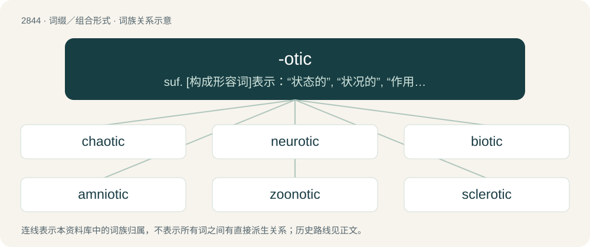

# 2952 · -otic — suf. \[构成形容词\]表示：“状态的”, “状况的”, “作用的”, “过程的”：hypnotic; “增多的”：leukocytotic; “变态的”,“病的”：neurotic; \[构成形容词\]表示“耳的”：periotic

[总目录](../00_总目录_按常用程度.md)

**类型**：词缀／组合形式　｜　**来源语言**：见词源记录

## 核心含义与来源

- 核心含义：suf. \[构成形容词\]表示：“状态的”, “状况的”, “作用的”, “过程的”：hypnotic; “增多的”：leukocytotic; “变态的”,“病的”：neurotic; \[构成形容词\]表示“耳的”：periotic
- 英文含义：Having disease or abnormal condition.
- 词形：-otic

**来源记录 1**（后缀／后置成分；Having disease or abnormal condition.）

Borrowed from French -otique, from Latin -ōticus, from Ancient Greek -ωτικός (-ōtikós), from -όω (-óō)-stem verbs + -τικός (-tikós). Equivalent to -όω (-óō) + -σις (-sis) + -ικός (-ikós).

## 词族图

## 单词速览（常用到不常用）

| 单词 | 音标 | 释义 |
|---|---|---|
| [chaotic](#w-1) | 英 /keɪˈɒtɪk/；美 /keɪˈɑtɪk/ | a. 混乱的, 无秩序的；\[法\] 混乱的, 混沌的 |
| [neurotic](#w-2) | /n(j)ʊəˈɹɒtɪk/ | n. 神经症患者；a. 神经质的, 神经症的 |
| [biotic](#w-3) | 英 /baɪˈɒt.ɪk/；美 /baɪˈɑ.tɪk/ | a. 生命的, 生物的；\[医\] 生命的, 生物的, 生物区\[系\]的 |
| [amniotic](#w-4) | 英 /æmniˈɒtɪk/；美 /æmniˈɑtɪk/ | a. 羊膜的；\[医\] 羊膜的 |
| [zoonotic](#w-5) | 英 /ˌzəʊ.əˈnɒ.tɪk/；美 /ˌzoʊ.əˈnɑ.tɪk/ | \[医\] 动物传染病的 |
| [sclerotic](#w-6) | 英 /skləˈɹɒtɪk/；美 /skləˈɹɑtɪk/ | a. 巩膜的, 硬化的；\[医\] 硬的, 硬化的, 巩膜 |

## 逐词详解

### 1. chaotic

**词性**：形容词　｜　**音标**：英 /keɪˈɒtɪk/；美 /keɪˈɑtɪk/

**中文释义**：a. 混乱的, 无秩序的；\[法\] 混乱的, 混沌的

**英文义项**：Filled with chaos. / Extremely disorganized or in disarray.

**构词拆分**：chaos + -otic

**词源与演化**：

From Late Latin chaoticus (“of or pertaining to the primordial state of the universe”), from Latin chaos (“chaos”) + -ticus (suffix forming adjectives from nouns); analysable as chaos + -otic. Doublet of gassy.

**例句**：

> Tom's paintings were so chaotic and abstract that they tended to bewilder viewers.

### 2. neurotic

**词性**：形容词　｜　**音标**：/n(j)ʊəˈɹɒtɪk/

**中文释义**：n. 神经症患者；a. 神经质的, 神经症的

**英文义项**：Affected with a neurosis. / Overly anxious.

**构词拆分**：neuro- (“of nerves or the nervous system”) + -otic (“having abnormal condition”)

**词源与演化**：

Formed of neuro- (“of nerves or the nervous system”) + -otic (“having abnormal condition”). The initial element, in turn, is from Ancient Greek νεῦρον (neûron, “nerve”). Attested from the 17th century. Compare French névrotique.

**例句**：

> He is getting neurotic about time-keeping.

该用例对应义项：Overly anxious.

### 3. biotic

**词性**：形容词　｜　**音标**：英 /baɪˈɒt.ɪk/；美 /baɪˈɑ.tɪk/

**中文释义**：a. 生命的, 生物的；\[医\] 生命的, 生物的, 生物区\[系\]的

**英文义项**：Of, pertaining to, or produced by life or living organisms.

**构词拆分**：bio- + -otic

**词源与演化**：

From Ancient Greek βιωτικός (biōtikós, “of life”), from βίος (bíos, “life”). Equivalent to bio- + -otic.

**例句**：

> Panspermia, the idea that biotic matter infested planets from falling objects from space, became taught as fact by the 22nd century.

### 4. amniotic

**词性**：形容词　｜　**音标**：英 /æmniˈɒtɪk/；美 /æmniˈɑtɪk/

**中文释义**：a. 羊膜的；\[医\] 羊膜的

**英文义项**：Pertaining to the amnion.

**构词拆分**：amnion + -otic

**词源与演化**：

Likely borrowed from French amniotique, from Ancient Greek ἀμνίον (amníon, “vessel for collecting the blood from sacrifices”). Equivalent to amnion + -otic.

**例句**：

> They say amniotic fluid has roughly the same composition as sea water.

### 5. zoonotic

**词性**：形容词　｜　**音标**：英 /ˌzəʊ.əˈnɒ.tɪk/；美 /ˌzoʊ.əˈnɑ.tɪk/

**中文释义**：\[医\] 动物传染病的

**英文义项**：relating to, or having a zoonosis

**构词拆分**：zoonosis + -otic

**词源与演化**：

From zoonosis + -otic.

**例句**：

> The Ebola virus is believed to be zoonotic.

该用例对应义项：of or relating to or constituting zoonosis

### 6. sclerotic

**词性**：形容词　｜　**音标**：英 /skləˈɹɒtɪk/；美 /skləˈɹɑtɪk/

**中文释义**：a. 巩膜的, 硬化的；\[医\] 硬的, 硬化的, 巩膜

**英文义项**：Of or relating to the sclera of the eye. / Having or relating to sclerosis; hardened.

**构词拆分**：sclera + -otic

**词源与演化**：

From scler(a) + -otic.

**用法示例／搭配（非完整句）**：

> sclerotic bureaucracy

该用例对应义项：Hard and insular; resistant to change.
