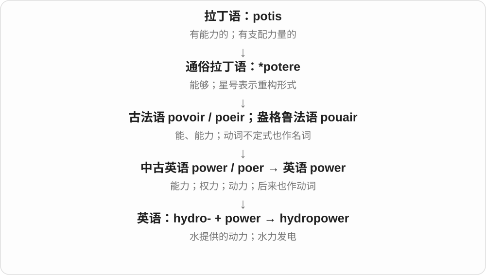

# 2953 · hydro- — 水；化学构词另有由氢延伸的一支

[逐词精讲目录](../00_逐词精讲目录.md) · [总目录](../00_总目录_按常用程度.md)

## 核心词根与来源

hydropower、hydroelectric 抓水的能量，hydrology 抓水的研究，hydrogel 抓材料中的水。hydrocarbon、hydride、hydrochloride 则需接氢的命名线。

**HYDRO-：先看水，化学词再判断是否指氢**

水能提供动力、形成环境、托起翼面；hydro- 的化学用法有时联系氢，不能只按一个中文字翻到底。

- **水的动力、环境与运动**：hydropower · hydroelectric · hydrology · hydrothermal · hydrostatic · hydrodynamic · hydrodynamics
- **水与材料、装置、应用**：hydrogel · hydrofoil · hydrophone · hydroponics · hydrotherapy · hydrophilic · hydrolysis
- **化学名称中的氢与相关基团**：hydrocarbon · hydrochloric · hydrochloride · hydride · hydroxide

## 词形与演化规律

希腊 hydōr，词干 hydr-，复合 hydro-；hydrogen 原命名有生成水之意，化学缩合形式 hydro- 因而可接氢。

## 单词速览（按词族由简到繁）

同一基础词的相关扩展放在一起，先读基础形式，再读扩展；各组之间优先读常用的。具体词源关系见各词讲解。

| 单词 | 音标 | 核心意思 |
|---|---|---|
| [hydroelectric](#w-1) | 英 /ˌhaɪdrəʊɪˈlektrɪk/；美 /ˌhaɪdroʊɪˈlektrɪk/ | 水力发电的 |
| [hydrocarbon](#w-2) | 英 /ˌhaɪdrəʊˈkɑːbən/；美 /ˌhaɪdroʊˈkɑːrbən/ | 烃；碳氢化合物 |
| [hydroxide](#w-3) | 英 /haɪˈdrɒksaɪd/；美 /haɪˈdrɑːksaɪd/ | 氢氧化物；氢氧根 |
| [hydrolysis](#w-4) | 英 /haɪˈdrɒləsɪs/；美 /haɪˈdrɑːləsɪs/ | 水解 |
| [hydropower](#w-5) | 英 /ˈhaɪdrəʊˌpaʊə/；美 /ˈhaɪdroʊˌpaʊər/ | 水力；水力发电 |
| [hydrology](#w-6) | 英 /haɪˈdrɒlədʒi/；美 /haɪˈdrɑːlədʒi/ | 水文学 |
| [hydrothermal](#w-8) | 英 /ˌhaɪdrəʊˈθɜːməl/；美 /ˌhaɪdrəˈθɜːrməl/ | 热液的；与热水作用有关的 |
| [hydrochloric](#w-9) | 英 /ˌhaɪdrəˈklɒrɪk/；美 /ˌhaɪdrəˈklɔːrɪk/ | 盐酸的；与氯化氢相关的 |
| [hydrochloride](#w-10) | 英 /ˌhaɪdrəʊˈklɔːraɪd/；美 /ˌhaɪdroʊˈklɔːraɪd/ | 盐酸盐 |
| [hydrostatic](#w-11) | 英 /ˌhaɪdrəʊˈstætɪk/；美 /ˌhaɪdroʊˈstætɪk/ | 流体静力的；静水压的 |
| [hydride](#w-12) | /ˈhaɪdraɪd/ | 氢化物 |
| [hydrophilic](#w-13) | 英 /ˌhaɪdrəʊˈfɪlɪk/；美 /ˌhaɪdrəˈfɪlɪk/ | 亲水的 |
| [hydrodynamic](#w-14) | 英 /ˌhaɪdrəʊdaɪˈnæmɪk/；美 /ˌhaɪdroʊdaɪˈnæmɪk/ | 流体动力学的；水动力的 |
| [hydrodynamics](#w-18) | 英 /ˌhaɪdrəʊdaɪˈnæmɪks/；美 /ˌhaɪdroʊdaɪˈnæmɪks/ | 流体动力学；水动力学 |
| [hydrotherapy](#w-15) | 英 /ˌhaɪdrəʊˈθerəpi/；美 /ˌhaɪdroʊˈθerəpi/ | 水疗；以水为手段的治疗 |
| [hydroponics](#w-16) | 英 /ˌhaɪdrəˈpɒnɪks/；美 /ˌhaɪdrəˈpɑːnɪks/ | 水培；营养液无土栽培 |
| [hydrogel](#w-17) | 英 /ˈhaɪdrəʊdʒel/；美 /ˈhaɪdroʊdʒel/ | 水凝胶 |
| [hydrofoil](#w-22) | 英 /ˈhaɪdrəʊfɔɪl/；美 /ˈhaɪdroʊfɔɪl/ | 水翼；水翼船 |
| [hydrophone](#w-23) | 英 /ˈhaɪdrəfəʊn/；美 /ˈhaɪdrəfoʊn/ | 水听器、水下拾音器 |

## 逐词讲解

### 1. hydroelectric — 水力发电的

**音标**：英 /ˌhaɪdrəʊɪˈlektrɪk/；美 /ˌhaɪdroʊɪˈlektrɪk/

**先抓住这个画面**

水往下落或流动，把涡轮推动起来，再由发电机把机械能转成电能。水在这里提供的是运动的力量。

**怎么拆**

hydro- 水，来自希腊 hydor + electric 电的；是近代工程科学的组合词。

**怎么变成今天的意思**

**古希腊 elektron → 拉丁 electrum**  
琥珀；摩擦后能吸引轻小物体

↓

**近代拉丁 electricus**  
像琥珀那样具有电性；吉尔伯特在 1600 年用于这一现象

↓

**近代英语 hydro- + electric → hydroelectric**  
利用水力产生电的

a hydroelectric dam 是与水力发电有关的坝；hydroelectric power 指水电。不要把它拆成“水本身是一种电”，也不要与电解水制氢混在一起：那是用电推动化学变化，方向不同。

**常见搭配与例句**

hydroelectric power；a hydroelectric plant；a hydroelectric dam。

> The region gets much of its electricity from hydroelectric power.

这个地区的大部分电力来自水力发电。

> The museum model shows water turning a turbine in a hydroelectric plant.

博物馆模型展示了水在水电站中推动涡轮的过程。

**别混淆**

hydroelectric 用水的流动或落差发电；electrolysis of water 是用电使水发生化学变化。

### 2. hydrocarbon — 烃；碳氢化合物

**音标**：英 /ˌhaɪdrəʊˈkɑːbən/；美 /ˌhaɪdroʊˈkɑːrbən/

**先抓住这个画面**

把分子的零件摊开，只有碳和氢两种元素。

**怎么拆**

hydro- 在这里指 hydrogen 氢 + carbon 碳；不能把 hydro- 一律理解成水。

**怎么变成今天的意思**

**拉丁 carbo，词干 carbon-**  
木炭、煤

↓

**法语 carbone → 英语 carbon**  
借旧有的炭名命名化学元素碳

↓

**英语 hydro-（氢）+ carbon → hydrocarbon**  
由碳与氢构成的化合物

甲烷 methane 就是简单的 hydrocarbon。这个词在石油、天然气、燃料报道里很常见，但它首先是按元素组成分的化学类别。酒精虽然也有碳和氢，还含氧，所以不能仅凭“有碳有氢”就把它归进去。

**常见搭配与例句**

a hydrocarbon molecule；hydrocarbon fuels；hydrocarbon production。

> Methane is the simplest hydrocarbon.

甲烷是最简单的烃。

> The report discusses alternatives to hydrocarbon fuels.

报告讨论了碳氢燃料的替代品。

**别混淆**

hydrocarbon 只由碳、氢构成；carbohydrate 碳水化合物通常还含氧，不能靠字母相近当成同一类。

### 3. hydroxide — 氢氧化物；氢氧根

**音标**：英 /haɪˈdrɒksaɪd/；美 /haɪˈdrɑːksaɪd/

**先抓住这个画面**

名字里同时有氢与氧，常见关键单位是 OH⁻。

**怎么拆**

hydro- 的氢相关用法与 oxide 组合，形成 hydroxide；更远的 hydr- 来自希腊“水”，但现代化学意义不能机械理解成“水加氧化物”。

**怎么变成今天的意思**

**希腊 oxýs**  
尖锐的；酸的

↓

**近代法语 oxygène**  
用希腊来源成分造出“产酸者”名称

↓

**法语 oxide / oxyde**  
由 oxygène 与 acide 的成分组合，命名氧化物

↓

**英语 oxide**  
氧化物

↓

**近代 hydro- + oxide → hydroxide**  
氢氧化物；氢氧根

sodium hydroxide 是 NaOH；hydroxide ion 是 OH⁻。一个常见例子能帮助记住它不是 hydrogen peroxide，也不是水分子的另一写法。

**常见搭配与例句**

sodium hydroxide；calcium hydroxide；hydroxide ions。

> The formula for sodium hydroxide is NaOH.

氢氧化钠的化学式是 NaOH。

> The diagram marks each hydroxide ion with a negative charge.

图中给每个氢氧根离子标上了负电荷。

**别混淆**

hydroxyl 常指 –OH 基团等概念；hydroxide 常指氢氧根离子或相应化合物，具体电荷和结构不能忽略。

### 4. hydrolysis — 水解

**音标**：英 /haɪˈdrɒləsɪs/；美 /haɪˈdrɑːləsɪs/

**先抓住这个画面**

水参与反应，把原来连着的化学键断开。

**怎么拆**

现代科学构词 hydro-“水” + -lysis“分解”；两个成分分别接希腊 hýdōr 和 lýsis。不是古希腊人已经使用今天完整的化学术语。

**怎么变成今天的意思**

**古希腊 hýdōr；lúein → lýsis**  
水；解开、分解

↓

**现代科学 hydro- + -lysis → hydrolysis**  
水参与的断键反应

水解时水是反应参与者；把糖搅进水里直到看不见，通常只是溶解，并没有因此变成水解。消化中的一些分解过程就涉及酶促水解。

**常见搭配与例句**

the hydrolysis of；undergo hydrolysis；enzyme-catalysed hydrolysis。

> The experiment measured the rate of hydrolysis.

实验测量了水解反应的速率。

> Water participates directly in the hydrolysis of an ester.

水直接参与酯的水解反应。

**别混淆**

dissolution 是溶解；hydrolysis 是化学反应。catalysis 说反应被催化，两者关注点不同。

### 5. hydropower — 水力；水力发电

**音标**：英 /ˈhaɪdrəʊˌpaʊə/；美 /ˈhaɪdroʊˌpaʊər/

**先抓住这个画面**

hydropower 是借流动或下落的水把机器推起来，再把这种运动用于发电等工作。

**怎么拆**

hydro- 水，源自希腊语构词成分，加英语 power；这是在英语里组合的混合来源词，不是完整的古希腊借词。

**怎么变成今天的意思**

能源报道里通常指水力发电或其供电能力。读到 hydropower station，就把画面放在利用水推动涡轮的设施上。

**常见搭配与例句**

hydropower generation；a hydropower plant；small hydropower。

> The valley has several small hydropower plants.

这条山谷里有几座小型水电站。

> The report compares hydropower with wind energy.

报告比较了水力发电与风能。

**别混淆**

water power 可泛指水的机械动力；hydropower 在现代能源语境中特别常与发电相连。

### 6. hydrology — 水文学

**音标**：英 /haɪˈdrɒlədʒi/；美 /haɪˈdrɑːlədʒi/

**先抓住这个画面**

研究水从哪里来、流到哪里去、在地表和地下怎样存留与变化。

**怎么拆**

接新拉丁 hydrologia，也可按 hydro- 水 + -logy 研究理解；是近代学科名称。

**怎么变成今天的意思**

**希腊 hydōr，词干 hydr-**  
水；近代构词常用 hydro-

↓

**新拉丁 hydrologia → 英语 hydrology；也可按 hydro- + -logy 分析**  
水 + 研究 → 水文学

river hydrology 研究河流中的水；groundwater hydrology 研究地下水。降雨、蒸发、径流等一起构成水的循环，不只研究海洋。

**常见搭配与例句**

river hydrology；groundwater hydrology；a hydrology course。

> She studies hydrology to understand how rainfall affects river flow.

她学习水文学，以理解降雨怎样影响河流流量。

> The report combines geology with groundwater hydrology.

报告结合了地质学与地下水水文学。

**别混淆**

hydraulics 更侧重液体流动和工程应用；hydrology 更侧重自然环境中水的分布与循环。

### 7. hydrothermal — 热液的；与热水作用有关的

**音标**：英 /ˌhaɪdrəʊˈθɜːməl/；美 /ˌhaɪdrəˈθɜːrməl/

**先抓住这个画面**

把“水”和“热”放在一起，尤其想热水在岩石中流动、搬运矿物，再从裂隙中涌出。

**怎么拆**

英语 hydro-“水”+ thermal“热的”，由希腊来源构件组成的近代科学词。它不是 hydroelectric“水力发电的”换一个说法。

**怎么变成今天的意思**

**希腊 hydōr → hydro-；thermē → thermal 的词源支线**  
水；热

↓

**英语 hydro- + thermal → hydrothermal**  
与热水及其作用有关的

↓

**地质与材料科学用法**  
热液活动、热液喷口、热液形成的矿物

hydrothermal vents 是热液喷口，海水可进入海底裂隙，被地下热源加热后重新涌出，并携带矿物质。hydrothermal deposits 则关注这些热液作用形成的矿床。

**常见搭配与例句**

hydrothermal vents；hydrothermal activity；hydrothermal fluids；hydrothermal deposits。

> The submarine recorded organisms living near hydrothermal vents.

潜水器记录了生活在热液喷口附近的生物。

> The geologist studied minerals formed by hydrothermal activity.

地质学家研究了热液活动形成的矿物。

**别混淆**

geothermal 广泛指地球内部的热；hydrothermal 更具体地把热与水或热液联系起来。hydropower 讲水运动带来的动力。

### 8. hydrochloric — 盐酸的；与氯化氢相关的

**音标**：英 /ˌhaɪdrəˈklɒrɪk/；美 /ˌhaɪdrəˈklɔːrɪk/

**先抓住这个画面**

最常见的整组搭配 hydrochloric acid 就是盐酸。

**怎么拆**

hydro- 在这里取 hydrogen 氢，chlor- 取 chlorine 氯，再接 -ic；不能拆成水加绿色就当作现代定义。

**怎么变成今天的意思**

**希腊 hydōr，词干 hydr-**  
水；近代构词常用 hydro-

↓

**氢的名称 hydrogen → hydro-；与 chlor- 氯、-ic 组合 → hydrochloric**  
近代化学命名，表示氢与氯有关

↓

**hydrochloric acid**  
氯化氢的水溶液，即盐酸

hydrochloric acid 是氯化氢溶于水形成的酸。书面中几乎总与 acid 一起出现；胃液含盐酸是常见阅读场景。

**常见搭配与例句**

hydrochloric acid；dilute hydrochloric acid；hydrochloric acid solution。

> The textbook identifies hydrochloric acid as a component of gastric fluid.

教材指出，盐酸是胃液的一种成分。

> The report lists the concentration of the hydrochloric acid solution.

报告列出了该盐酸溶液的浓度。

**别混淆**

hydrochloric acid 是盐酸，chloric acid 是氯酸，是不同物质；多出的 hydro- 不能略掉。

### 9. hydrochloride — 盐酸盐

**音标**：英 /ˌhaɪdrəʊˈklɔːraɪd/；美 /ˌhaɪdroʊˈklɔːraɪd/

**先抓住这个画面**

看到某种物质名称后跟 hydrochloride，可先理解为“它的盐酸盐形式”。名字说化学形态，不是在说瓶子里只装着盐酸。

**怎么拆**

构词为 hydro- + chloride，此处 hydro- 联系 hydrogen 氢；hydrogen chloride 是氯化氢，其水溶液是盐酸。hydrochloride 常指有机碱与盐酸形成的盐。

**怎么变成今天的意思**

**希腊语 hydōr，词干 hydr- → hydro-**  
水，复合词常用连接形式 hydro-

↓

**hydro- 水；化学词中也可承 hydrogen 氢的缩合形式**  
水相关装置、材料，与氢相关化合物要分支理解

↓

**hydro- + chloride → hydrochloride**  
与氯化氢、盐酸有关的盐名称

the hydrochloride salt 盐酸盐；in hydrochloride form 以盐酸盐形式。阅读化学、成分名称时可先认主体，再认这一形式限定。

**常见搭配与例句**

a hydrochloride salt；in hydrochloride form。

> The compound was supplied as a hydrochloride salt.

这种化合物以盐酸盐形式提供。

> The report distinguishes the base from its hydrochloride.

报告区分了该碱和它的盐酸盐。

**别混淆**

hydrochloric acid 盐酸与 hydrochloride 盐酸盐不同；chloride 氯化物也不能一律替换成盐酸盐。

### 10. hydrostatic — 流体静力的；静水压的

**音标**：英 /ˌhaɪdrəʊˈstætɪk/；美 /ˌhaɪdroʊˈstætɪk/

**先抓住这个画面**

水看似不动，也会从各个方向压住周围的东西。

**怎么拆**

hydro-“水、流体” + static，近代科学合成。

**怎么变成今天的意思**

**古希腊语：hístēmi / histánai；stásis**  
使站立、设立；站立、状态

↓

**古希腊 statikós → 法语 statique → 英语 static**  
与平衡、静止有关的 → 静态的、不变的

↓

**英语 hydro- + static → hydrostatic**  
与静止流体及其压力有关的

hydrostatic pressure 通常随着液体深度增加而增大。名称里有“静”，不表示压力为零。

**常见搭配与例句**

hydrostatic pressure；hydrostatic equilibrium；a hydrostatic test。

> Hydrostatic pressure increases with depth in the tank.

水箱内的静水压随深度增加而增大。

> The engineer calculated the hydrostatic force on the wall.

工程师计算了作用在墙上的静水压力。

**别混淆**

hydrodynamic 关注流体运动；hydrostatic 关注静止或平衡时的作用。

### 11. hydride — 氢化物

**音标**：/ˈhaɪdraɪd/

**先抓住这个画面**

hydride 的关键是氢与另一种元素、基团结合成化合物。比如 metal hydride 先看成金属氢化物，别把开头误会成里面有水。

**怎么拆**

由表示氢的 hydr- 与化合物词尾 -ide 形成，常记作 hydro- + -ide 的缩合。常用定义涉及氢与更电正性元素或基团结合；不同类别的成键方式不同。

**怎么变成今天的意思**

**希腊语 hydōr，词干 hydr- → hydro-**  
水，复合词常用连接形式 hydro-

↓

**hydro- 水；化学词中也可承 hydrogen 氢的缩合形式**  
水相关装置、材料，与氢相关化合物要分支理解

↓

**hydr- + -ide → hydride**  
氢化物，名称联系氢而非水

a metal hydride 金属氢化物，hydride compounds 氢化物。遇到具体式子再看相应物质，不能只凭词尾推断全部性质。

**常见搭配与例句**

a metal hydride；hydride compounds。

> The chapter introduces several metal hydrides.

这一章介绍了几种金属氢化物。

> The student confused hydride with hydroxide.

学生把氢化物和氢氧化物混淆了。

**别混淆**

hydride 氢化物与 hydroxide 氢氧化物拼写接近，后者含 hydroxide 氢氧根这一命名重点。

### 12. hydrophilic — 亲水的

**音标**：英 /ˌhaɪdrəʊˈfɪlɪk/；美 /ˌhaɪdrəˈfɪlɪk/

**先抓住这个画面**

分子或表面容易与水相互作用，像是愿意让水靠近。

**怎么拆**

现代可拆 hydro- 水 + -philic 亲和的；也有近代拉丁 hydrophilus 的构词背景。这里的喜爱是化学性质的比喻，没有人的感情。

**怎么变成今天的意思**

**古希腊语 philos / philein**  
亲爱的、喜爱；喜欢、亲近

↓

**希腊 hydr- 水、-philos 亲近 → 近代拉丁 hydrophilus 一系**  
亲水的古典构词基础

↓

**英语 hydrophilic**  
能与水等极性介质相互作用的

hydrophilic groups 是亲水基团，hydrophilic surfaces 容易被水润湿。亲水不等于整个物体必定完全溶于水：一个表面或某一部分也可以亲水。

**常见搭配与例句**

a hydrophilic surface；hydrophilic groups；a hydrophilic coating。

> The coating makes the surface more hydrophilic.

这种涂层让表面更亲水。

> The diagram shows the molecule’s hydrophilic head facing the water.

图中显示，分子的亲水头部朝向水。

**别混淆**

hydrophobic 是疏水的；hydrophilic 是亲水的。两者可以分别出现在同一个分子的不同部位。

### 13. hydrodynamic — 流体动力学的；水动力的

**音标**：英 /ˌhaɪdrəʊdaɪˈnæmɪk/；美 /ˌhaɪdroʊdaɪˈnæmɪk/

**先抓住这个画面**

水绕着船壳或桥墩流动时，会推、拉、阻碍物体；这个形容词把话题放到这类流动与力上。

**怎么拆**

hydro-“水” + dynamic，近代英语形容词。相关学科名 hydrodynamics 经近代拉丁语进入英语，记录更早；不能把名词一律说成由这个英语形容词后来派生。

**怎么变成今天的意思**

**希腊 hudor 与 dunamikos 的构词成分**  
水 + 力量相关的

↓

**英语 hydro- + dynamic → hydrodynamic**  
与流动的水、液体及其作用力有关的

hydrodynamic resistance 是流体造成的阻力；hydrodynamic forces 是水流等作用的力。在较广的科学用法中可涉及流体，不必一看到 hydro- 就只想到自来水。

**常见搭配与例句**

hydrodynamic forces；hydrodynamic resistance；a hydrodynamic model。

> The team measured the hydrodynamic resistance of the new hull.

团队测量了新船壳受到的水动力阻力。

> The model estimates hydrodynamic forces around the bridge piers.

这个模型估算桥墩周围的水动力作用。

**别混淆**

hydroelectric 说水力发电；hydrodynamic 说流体运动及力。研究一艘船受到的水阻，不等于它使用水力发电。

### 14. hydrodynamics — 流体动力学；水动力学

**音标**：英 /ˌhaɪdrəʊdaɪˈnæmɪks/；美 /ˌhaɪdroʊdaɪˈnæmɪks/

**先抓住这个画面**

关心流体怎样流动、流动又对物体产生什么力；日常可先从水流冲过桥墩、船穿过水面来理解。

**怎么拆**

源于近代拉丁 hydrodynamica，使用希腊来源的 hydro-“水”和 dynam-“力量”；英语改为 -ics 学科词形。它有自己的较早名词借入路线，不从较晚英语 hydrodynamic 硬造祖先。

**怎么变成今天的意思**

**希腊 hudor（水）与 dunamis（力量）的构词成分**  
hydro- 与 dynam-

↓

**近代拉丁 hydrodynamica → 英语 hydrodynamics**  
研究流动的流体及其作用力

hydrodynamics 常用于水或其他液体的运动研究，也能在更广的流体研究里使用。marine hydrodynamics 是海洋工程常见课程名，词尾虽有 s，学科名通常当单数。

**常见搭配与例句**

marine hydrodynamics；the hydrodynamics of；study hydrodynamics。

> The course teaches hydrodynamics through examples involving ships and waves.

这门课用船舶和波浪的例子讲授水动力学。

> Researchers studied the hydrodynamics of water flowing around the pier.

研究者分析了水流绕过桥墩时的流动与受力情况。

**别混淆**

hydrostatics 侧重流体静止时的情况；hydrodynamics 侧重流动与相关作用。fluid mechanics 是更宽的流体力学范围。

### 15. hydrotherapy — 水疗；以水为手段的治疗

**音标**：英 /ˌhaɪdrəʊˈθerəpi/；美 /ˌhaɪdroʊˈθerəpi/

**先抓住这个画面**

把水的浮力、温度等变成帮助身体活动或舒缓的工具。

**怎么拆**

现代科学构词 hydro-“水” + -therapy“治疗”；两部分远接希腊词。它属于近代疗法名称，不是古希腊完整词直接原样传下来的。

**怎么变成今天的意思**

**希腊 therapeúein / therapeía**  
照料、服务；照料病人、治疗

↓

**近代科学构词 hydro- + -therapy**  
水 + 治疗

↓

**英语 hydrotherapy**  
利用水的治疗方式

康复语境中常见在水池里做受指导的活动；更广也可以指利用水浴等方法的治疗。它不只是喝水，也不等于一切游泳活动。

**常见搭配与例句**

a hydrotherapy pool；hydrotherapy exercises；a hydrotherapy session。

> The hospital has a warm hydrotherapy pool.

医院有一个温水水疗池。

> During hydrotherapy, he practised gentle movements in the water.

水疗时，他在水中练习轻缓的动作。

**别混淆**

physiotherapy 是更宽的物理治疗；水中进行的一些治疗活动可以同时属于 hydrotherapy 和 physiotherapy。

### 16. hydroponics — 水培；营养液无土栽培

**音标**：英 /ˌhaɪdrəˈpɒnɪks/；美 /ˌhaɪdrəˈpɑːnɪks/

**先抓住这个画面**

不用普通土壤供养根，而把所需矿质养分放在水溶液里送到根部。

**怎么拆**

hydro- 水 + -ponics，后者取自希腊 ponos 劳作；20世纪英语造词。

**怎么变成今天的意思**

**希腊 hydōr，词干 hydr-**  
水；近代构词常用 hydro-

↓

**hydro- + 取自希腊 ponos 劳作的 -ponics → 英语 hydroponics**  
借水进行栽培 → 营养液无土栽培

hydroponics 不一定让根一直完全浸在水中，也可用惰性材料支撑植物。核心是营养液供养，不是只把植物放进清水就能长期正常生长。

**常见搭配与例句**

grow plants using hydroponics；a hydroponics system；study hydroponics。

> The greenhouse uses hydroponics to grow lettuce without soil.

这座温室用水培方式无土种植生菜。

> Students measured the nutrient solution in the hydroponics system.

学生测量了水培系统中的营养液。

**别混淆**

hydroponics 通常作单数学科、技术名词；aquaponics 还把养鱼等水产系统结合进来，不能当成同一个词。

### 17. hydrogel — 水凝胶

**音标**：英 /ˈhaɪdrəʊdʒel/；美 /ˈhaɪdroʊdʒel/

**先抓住这个画面**

把大量水留在一张细密的材料网络里，整体仍像柔软胶体，而不是一杯能随便倒出的水，这就是理解 hydrogel 的画面。

**怎么拆**

hydro- 水 + gel 凝胶。近代材料术语，把液相为水的凝胶与其他凝胶区分；这里 hydro- 直接联系水。

**怎么变成今天的意思**

**希腊语 hydōr，词干 hydr- → hydro-**  
水，复合词常用连接形式 hydro-

↓

**hydro- + gel → hydrogel**  
以水为液体部分的凝胶

a hydrogel layer 水凝胶层，a hydrogel material 水凝胶材料。隐形眼镜、材料研究等文章可见，不等于所有胶都叫水凝胶。

**常见搭配与例句**

a hydrogel layer；hydrogel materials。

> The soft hydrogel held a large amount of water.

这块柔软的水凝胶含有大量水。

> The researchers compared two hydrogel materials.

研究人员比较了两种水凝胶材料。

**别混淆**

gel 是凝胶大类；hydrogel 进一步点明水这一部分。含水并不等于材料只是液态水。

### 18. hydrofoil — 水翼；水翼船

**音标**：英 /ˈhaɪdrəʊfɔɪl/；美 /ˈhaɪdroʊfɔɪl/

**先抓住这个画面**

把机翼放到水里，船前进时水翼产生升力，把船身托起、减少阻力。hydrofoil 既可说那片水下翼，也可说装着水翼的船。

**怎么拆**

hydro- 水 + foil 翼面。foil 在流体力学里指能产生升力的翼形部件；装置名又转指整艘船。

**怎么变成今天的意思**

**希腊语 hydōr，词干 hydr- → hydro-**  
水，复合词常用连接形式 hydro-

↓

**hydro- + foil → hydrofoil**  
水中翼面 → 装水翼的船

a hydrofoil vessel 水翼船，travel by hydrofoil 乘水翼船；the hydrofoil generates lift 水翼产生升力。

**常见搭配与例句**

a hydrofoil vessel；travel by hydrofoil。

> The hydrofoil lifted the hull partly out of the water.

水翼把船体部分托离了水面。

> We crossed the bay by hydrofoil.

我们乘水翼船穿过海湾。

**别混淆**

foil 在这里看翼形、升力用途，不按厨房铝箔来想；水翼产生升力仍需要适当的相对水流。

### 19. hydrophone — 水听器、水下拾音器

**音标**：英 /ˈhaɪdrəfəʊn/；美 /ˈhaɪdrəfoʊn/

**先抓住这个画面**

把传感器放进水里，听船声、鲸声等水下声音；像水里的麦克风，不是给鱼打电话的手机。

**怎么拆**

hydro- 水 + -phone 声音，希腊来源的科学构词材料。phone 在这里取声音、拾音器材这一支，不直接套现代电话意思。

**怎么变成今天的意思**

**希腊 hydōr 与 phōnē**  
水；声音

↓

**hydro- + -phone → hydrophone**  
把水下声压变化转换成电信号的传感器

a hydrophone array 水听器阵列，record with a hydrophone 用水听器录音，underwater hydrophones 水下拾音器。

**常见搭配与例句**

a hydrophone array；record with a hydrophone。

> The researchers lowered a hydrophone into the water.

研究人员把水听器放进了水中。

> A hydrophone recorded the whale’s calls.

水听器录下了鲸的叫声。

**别混淆**

hydrophone 主要接收水下声音，loudspeaker 常把电信号转为可听声音；声呐系统可能有发射、接收等部件，水听器本身不等于整个系统。

## 这一组要分清什么

hydrofoil 的 foil 是翼面；hydride 氢化物、hydroxide 氢氧化物、hydrochloride 盐酸盐不能互换。

## 串起来练习

The exhibit shows a hydrofoil, a hydrogel sample, and a chart of metal hydrides.

展览陈列了一片水翼、一份水凝胶样品和一张金属氢化物图表。
