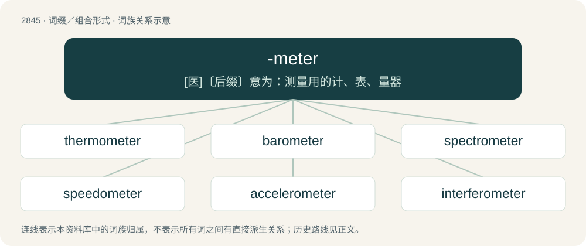

# 2953 · -meter — \[医\]〔后缀〕意为：测量用的计、表、量器

[总目录](../00_总目录_按常用程度.md)

**类型**：词缀／组合形式　｜　**来源语言**：见词源记录

## 核心含义与来源

- 核心含义：\[医\]〔后缀〕意为：测量用的计、表、量器
- 英文含义：Used to form the names of measuring devices.
- 词形：-meter

**来源记录 1**（后缀／后置成分；Used to form the names of measuring devices.）

Borrowed from French -mètre, a learned borrowing from Ancient Greek μέτρον (métron).

## 词族图

## 单词速览（常用到不常用）

| 单词 | 音标 | 释义 |
|---|---|---|
| [thermometer](#w-1) | 英 /θəˈmɒm.ɪ.tə/；美 /θɚˈmɑ.mɪ.tɚ/ | n. 温度计, 体温计；\[化\] 温度计 |
| [barometer](#w-2) | 英 /bəˈɹɒm.ɪ.tə(ɹ)/；美 /bəˈɹɑ.mə.tɚ/ | n. 气压计；\[化\] 气压计 |
| [spectrometer](#w-3) | 英 /spɛkˈtɹɒm.ɪ.tə/；美 /spɛkˈtɹɑm.ɪ.təɹ/ | n. 分光计, 谱仪；\[化\] 分光计; 分光仪 |
| [speedometer](#w-4) | 英 /spɪˈdɒm.ɪ.tə/；美 /spɪˈdɑ.mɪ.təɹ/ | n. 速度计, 里程计；\[机\] 里程计, 速度计 |
| [accelerometer](#w-5) | 美 /ækˌsɛl.əˈɹɑ.mə.tɚ/ | n. 加速度计；\[化\] 加速度计 |
| [interferometer](#w-6) | /.intəfəˈrɒmitə/ | n. 干涉仪；\[化\] 干涉仪 |
| [altimeter](#w-7) | 美 /ælˈtɪm.ɪ.tɚ/ | n. 高度计；\[化\] 测高仪 |
| [odometer](#w-8) | 英 /əʊˈdɒmətə/；美 /oʊˈdɑːmətɚ/ | n. 里程表 |
| [micrometer](#w-9) | 英 /maɪˈkɹɒmɪtə/；美 /maɪˈkɹɑmɪtəɹ/ | n. 测微计；\[化\] 测微计 |
| [chronometer](#w-10) | 英 /kɹəˈnɒm.ə.tə(ɹ)/；美 /krə(ʊ)ˈnɒmɪtər/ | n. 天文钟, 航海用的精密时计, 精密的时钟；\[化\] 精密记时计 |
| [magnetometer](#w-11) | 英 /ˌmæɡnɪˈtɒmɪtə/；美 /ˌmæɡnɪˈtɑmɪtɚ/ | n. 磁强计；\[医\] 磁强计, 地磁仪 |
| [pedometer](#w-12) | 英 /pɪˈdɒmətə/；美 /pɪˈdɑmətɚ/ | n. 步数计, 步程计；\[医\] 婴儿测量器; 步数计 |
| [tachometer](#w-13) | /təˈkɒmətə(ɹ)/ | n. 转速计, 流速计；\[医\] 血流速度计 |
| [multimeter](#w-14) | 美 /ˈmʌl.ti.mi.tɚ/ | \[化\] 多用表; 多用电表; 万用表 |
| [radiometer](#w-15) | /.reidiˈɒmitə/ | n. 辐射计, 放射计；\[医\] 辐射计(光,热), 放射量计, 放射量测定器 |
| [calorimeter](#w-16) | 英 /ˌkæləˈɹɪmɪtɚ/ | n. 热量计；\[化\] 量热计; 量热器; 热量计 |
| [voltmeter](#w-17) | 美 /ˈvoʊltˌmitɚ/ | n. 伏特计；\[化\] 伏特计 |

## 逐词详解

### 1. thermometer

**词性**：名词　｜　**音标**：英 /θəˈmɒm.ɪ.tə/；美 /θɚˈmɑ.mɪ.tɚ/

**中文释义**：n. 温度计, 体温计；\[化\] 温度计

**英文义项**：An apparatus used to measure temperature.

**构词拆分**：thermo- + -meter

**词源与演化**：

Borrowed from French thermomètre; equivalent to thermo- + -meter.

**例句**：

> Did you take your temperature with a thermometer in your mouth?

### 2. barometer

**词性**：名词　｜　**音标**：英 /bəˈɹɒm.ɪ.tə(ɹ)/；美 /bəˈɹɑ.mə.tɚ/

**中文释义**：n. 气压计；\[化\] 气压计

**英文义项**：An instrument for measuring atmospheric pressure. / Anything used as a gauge or indicator.

**构词拆分**：baro- + -meter

**词源与演化**：

From baro- + -meter. Coined in 1665 by Robert Boyle as a name for the instrument invented by Torricelli some 20 years earlier; soon thereafter borrowed from English into various languages.

**例句**：

> The retail price index is a barometer of economic activity.

### 3. spectrometer

**词性**：名词　｜　**音标**：英 /spɛkˈtɹɒm.ɪ.tə/；美 /spɛkˈtɹɑm.ɪ.təɹ/

**中文释义**：n. 分光计, 谱仪；\[化\] 分光计; 分光仪

**英文义项**：An optical instrument for measuring the absorption of light by chemical substances; typically it will plot a graph of absorption versus wavelength or frequency, and the patterns produced are used to identify the substances present, and their internal structure.

**构词拆分**：spectro- + -meter

**词源与演化**：

From spectro- + -meter.

**例句**：

> A spectrometer uses light to identify the chemical composition of matter.

### 4. speedometer

**词性**：名词　｜　**音标**：英 /spɪˈdɒm.ɪ.tə/；美 /spɪˈdɑ.mɪ.təɹ/

**中文释义**：n. 速度计, 里程计；\[机\] 里程计, 速度计

**英文义项**：An instrument located within the dashboard of a vehicle that measures and indicates the current speed of the vehicle. / Such a device incorporating an odometer.

**构词拆分**：speed + -o- + -meter

**词源与演化**：

From speed + -o- + -meter; by surface analysis, speed + -ometer.

**例句**：

> Your car's speedometer tells you the car's instantaneous speed, not its average speed.

### 5. accelerometer

**词性**：名词　｜　**音标**：美 /ækˌsɛl.əˈɹɑ.mə.tɚ/

**中文释义**：n. 加速度计；\[化\] 加速度计

**英文义项**：An instrument for measuring acceleration. / An instrument made for detecting and measuring vibrations.

**构词拆分**：accelerate + -o- + -meter

**词源与演化**：

From accelerate + -o- + -meter.

### 6. interferometer

**词性**：名词　｜　**音标**：/.intəfəˈrɒmitə/

**中文释义**：n. 干涉仪；\[化\] 干涉仪

**英文义项**：Any of several instruments that use the interference of waves to determine wavelengths and wave velocities, determine refractive indices, measure small distances, temperature changes, stresses, and many other useful measurements.

**构词拆分**：interfere + -o- + -meter

**词源与演化**：

From interfer(e) + -o- + -meter.

**例句**：

> The Laser Interferometer Space Antenna (LISA) is a space mission that will be able to detect gravitational waves.

### 7. altimeter

**词性**：名词　｜　**音标**：美 /ælˈtɪm.ɪ.tɚ/

**中文释义**：n. 高度计；\[化\] 测高仪

**英文义项**：An apparatus for measuring altitude.

**词源与演化**：

Coined based on Latin altus (“high”) + -meter.

**例句**：

> You will find the altimeter on the left side of the cockpit.

### 8. odometer

**词性**：名词　｜　**音标**：英 /əʊˈdɒmətə/；美 /oʊˈdɑːmətɚ/

**中文释义**：n. 里程表

**英文义项**：An instrument, usually embedded within the speedometer of a vehicle, that measures the distance the vehicle has traveled since production. / A wheel used by surveyors, which registers distance traveled.

**构词拆分**：odo- + -meter

**词源与演化**：

From French odomètre, from Ancient Greek ὁδός (hodós, “road, path, way”) + μέτρον (métron, “measure”), equivalent to odo- + -meter.

**例句**：

> Tom set his car's odometer back before selling it to an unsuspecting buyer.

### 9. micrometer

**词性**：名词　｜　**音标**：英 /maɪˈkɹɒmɪtə/；美 /maɪˈkɹɑmɪtəɹ/

**中文释义**：n. 测微计；\[化\] 测微计

**英文义项**：A device used to measure distance very precisely but within a limited range, especially depth, thickness, and diameter.

**构词拆分**：micro- + -meter

**词源与演化**：

From French micromètre, equivalent to micro- + -meter.

**例句**：

> You'll need a micrometer to measure the change in length.

### 10. chronometer

**词性**：名词　｜　**音标**：英 /kɹəˈnɒm.ə.tə(ɹ)/；美 /krə(ʊ)ˈnɒmɪtər/

**中文释义**：n. 天文钟, 航海用的精密时计, 精密的时钟；\[化\] 精密记时计

**英文义项**：A device for measuring time, particularly a precision mechanism for measuring time of day.

**构词拆分**：chrono- + -meter

**词源与演化**：

From chrono- + -meter, possibly after the model of earlier French chronomètre (“metronome”), ultimately from Ancient Greek χρόνος (khrónos, “time”) + μέτρον (métron, “meter, measuring device”).

**例句**：

> A wristwatch costs $20; a chronometer costs $20,000.

该用例对应义项：A device for measuring time, particularly a precision mechanism for measuring time of day.

### 11. magnetometer

**词性**：名词　｜　**音标**：英 /ˌmæɡnɪˈtɒmɪtə/；美 /ˌmæɡnɪˈtɑmɪtɚ/

**中文释义**：n. 磁强计；\[医\] 磁强计, 地磁仪

**英文义项**：An instrument used to measure the intensity and direction of a magnetic field, especially at points on the Earth's surface; sometimes used as metal detector.

**构词拆分**：magneto- + -meter

**词源与演化**：

From magneto- + -meter.

**例句**：

> During the first week of its journey, the spacecraft will deploy its high-gain antenna and magnetometer boom.

### 12. pedometer

**词性**：名词　｜　**音标**：英 /pɪˈdɒmətə/；美 /pɪˈdɑmətɚ/

**中文释义**：n. 步数计, 步程计；\[医\] 婴儿测量器; 步数计

**英文义项**：A device, often electronic, that measures the number of steps taken, and thus estimates the distance walked.

**构词拆分**：pedo- + -ometer

**词源与演化**：

According to the American Heritage Dictionary, from French pédomètre, from pedi-, combining form for Latin pēs (“foot”), plus -ometer, from Greek. In French now the word is podomètre, and similar in other Romance languages and in Greek (ποδόμετρο (podómetro)). By surface analysis, pedo- (“foot”) + -meter = pedo- + -ometer.

**例句**：

> He thought that buying a pedometer would spur him on to exercise.

该用例对应义项：A device, often electronic, that measures the number of steps taken, and thus estimates the distance walked.

### 13. tachometer

**词性**：名词　｜　**音标**：/təˈkɒmətə(ɹ)/

**中文释义**：n. 转速计, 流速计；\[医\] 血流速度计

**英文义项**：A device for measuring the revolutions per minute (RPMs) of a revolving shaft, as with the driveshaft of an automobile. / A device for measuring or indicating velocity or speed, as of blood, a river, a machine, etc.

**构词拆分**：tacho- + -meter

**词源与演化**：

From tacho- + -meter.

### 14. multimeter

**词性**：名词　｜　**音标**：美 /ˈmʌl.ti.mi.tɚ/

**中文释义**：\[化\] 多用表; 多用电表; 万用表

**英文义项**：An electronic measuring instrument that combines multiple functions; a combined voltmeter, ammeter and ohmmeter.

**构词拆分**：multi- + -meter

**词源与演化**：

From multi- + -meter.

**例句**：

> Tom used his multimeter to measure the voltage.

### 15. radiometer

**词性**：名词　｜　**音标**：/.reidiˈɒmitə/

**中文释义**：n. 辐射计, 放射计；\[医\] 辐射计(光,热), 放射量计, 放射量测定器

**英文义项**：A device that measures radiant energy.

**构词拆分**：radio- + -meter

**词源与演化**：

From radio- + -meter.

### 16. calorimeter

**词性**：名词　｜　**音标**：英 /ˌkæləˈɹɪmɪtɚ/

**中文释义**：n. 热量计；\[化\] 量热计; 量热器; 热量计

**英文义项**：An apparatus for measuring the heat generated or absorbed by either a chemical reaction, change of phase or some other physical change.

**词源与演化**：

From Latin calor (“warmth, heat”) + -meter.

### 17. voltmeter

**词性**：名词　｜　**音标**：美 /ˈvoʊltˌmitɚ/

**中文释义**：n. 伏特计；\[化\] 伏特计

**英文义项**：An instrument for measuring electric potential in volts.

**构词拆分**：volt + -meter

**词源与演化**：

From volt + -meter.
