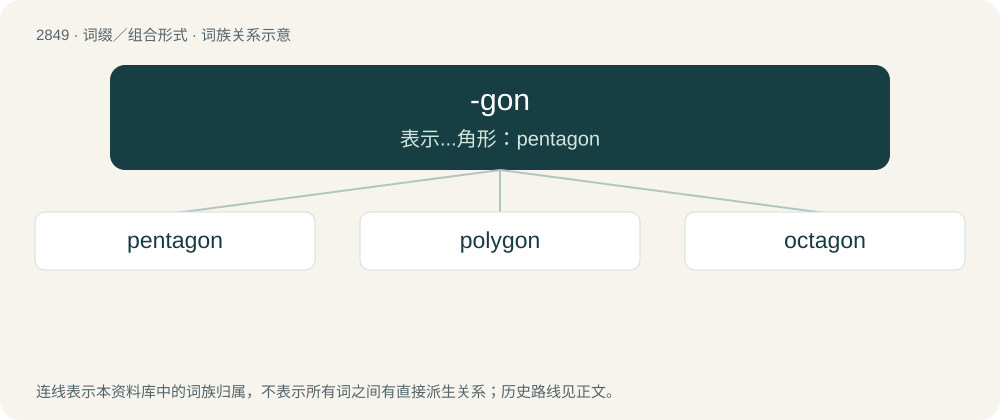

# 2958 · -gon — 表示...角形：pentagon

[总目录](../00_总目录_按常用程度.md)

**类型**：词缀／组合形式　｜　**来源语言**：见词源记录

## 核心含义与来源

- 核心含义：表示...角形：pentagon
- 英文含义：Forms the names of plane figures containing a given number of internal angles, and thus bounded by that number of line segments (polygons).
- 词形：-gon

**来源记录 1**（后缀／后置成分；Forms the names of plane figures containing a given number of internal angles, and thus bounded by that number of line segments (polygons).）

From Ancient Greek γωνία (gōnía, “corner, angle”), from Proto-Indo-European \*ǵónu (“knee”).

## 词族图

## 单词速览（常用到不常用）

| 单词 | 音标 | 释义 |
|---|---|---|
| [pentagon](#w-1) | 英 /ˈpɛn.tə.ɡən/；美 /ˈpɛn.təˌɡɑn/ | n. 五角形, 五边形；\[经\] 五角平台 |
| [polygon](#w-2) | 英 /ˈpɒlɪɡən/；美 /ˈpɑliˌɡɑn/ | n. 多角形, 多边形；\[计\] 多边形 |
| [octagon](#w-3) | 英 /ˈɒktəɡ(ə)n/；美 /ˈɑktəˌɡɑn/ | n. 八边形, 八角形 |

## 逐词详解

### 1. pentagon

**词性**：名词　｜　**音标**：英 /ˈpɛn.tə.ɡən/；美 /ˈpɛn.təˌɡɑn/

**中文释义**：n. 五角形, 五边形；\[经\] 五角平台

**英文义项**：A polygon with five sides and five angles. / A fort with five bastions.

**构词拆分**：penta- + -gon

**词源与演化**：

From Middle French pentagone, from Late Latin pentagōnum, from Ancient Greek πεντάγωνον (pentágōnon), noun use of the neuter of the adjective πεντάγωνος (pentágōnos, “five-angled”), from πέντε (pénte, “five”) + -γωνος (-gōnos, “angled”). Equivalent to penta- + -gon.

**例句**：

> I wear this tinfoil hat to keep the Pentagon from spying on me.

### 2. polygon

**词性**：名词　｜　**音标**：英 /ˈpɒlɪɡən/；美 /ˈpɑliˌɡɑn/

**中文释义**：n. 多角形, 多边形；\[计\] 多边形

**英文义项**：A plane figure bounded by edges that are all straight lines. / The boundary of such a figure.

**构词拆分**：poly- + -gon

**词源与演化**：

From Ancient Greek πολύγωνον (polúgōnon), from πολύς (polús, “many”) + γωνία (gōnía, “angle”), equivalent to poly- + -gon.

**例句**：

> A nonagon, sometimes called an enneagon, is a polygon with nine sides.

### 3. octagon

**词性**：名词　｜　**音标**：英 /ˈɒktəɡ(ə)n/；美 /ˈɑktəˌɡɑn/

**中文释义**：n. 八边形, 八角形

**英文义项**：A polygon with eight sides and eight angles. / An arena for mixed martial arts.

**构词拆分**：octa- + -gon

**词源与演化**：

From Latin octagōnon, octōgōnon (“octagon”), and from its etymon Ancient Greek ὀκτάγωνον (oktágōnon, “octagon”), probably from Koine Greek ὀκτάγωνος (oktágōnos, “having eight corners”) + -ον (-on, suffix forming nouns). ὀκτάγωνος is derived from ὀκτᾰ- (oktă-, prefix meaning ‘eight’) (from ὀκτώ (oktṓ, “eight”), ultimately from Proto-Indo-European \*oḱtṓw (“eight”)) + γωνία (gōnía, “angle; corner”) (probably ultimately from Proto-Indo-European \*ǵónu (“knee”)); analysable as octa- + -gon. The English word is cognate with Middle French octogone (modern French octogone), Italian octagono (obsolete), ottagono, Spanish octágono, octógono. Sense 2 (“arena for mixed martial arts”) refers to its shape.

**例句**：

> The internal angles of an octagon total 1080°.
