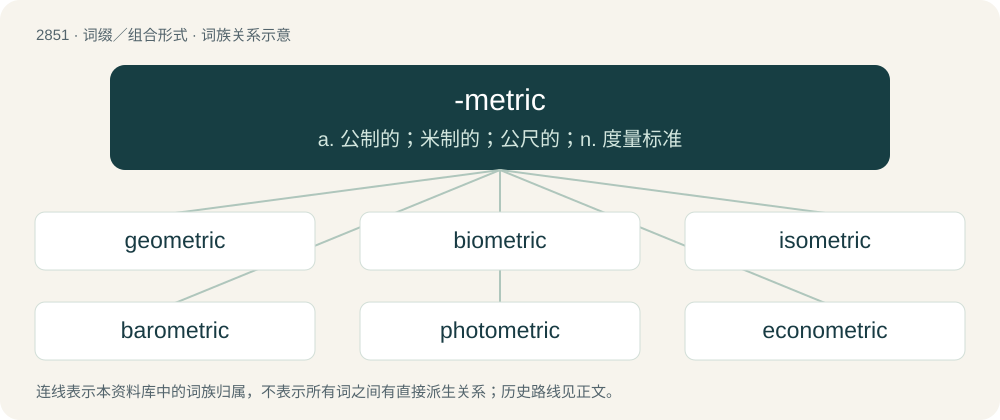

# 2960 · -metric — a. 公制的；米制的；公尺的；n. 度量标准

[总目录](../00_总目录_按常用程度.md)

**类型**：词缀／组合形式　｜　**来源语言**：见词源记录

## 核心含义与来源

- 核心含义：a. 公制的；米制的；公尺的；n. 度量标准
- 英文含义：Forming adjectives corresponding to nouns in -meter.
- 词形：-metric

**来源记录 1**（后缀／后置成分；Forming adjectives corresponding to nouns in -meter.）

Borrowed from French -métrique, from Latin metricus.

## 词族图

## 单词速览（常用到不常用）

| 单词 | 音标 | 释义 |
|---|---|---|
| [geometric](#w-1) | 英 /ˌd͡ʒiː.əʊˈmɛt.ɹɪk/；美 /ˌd͡ʒi.oʊˈmɛt.ɹɪk/ | a. 几何学的, 几何学上的, 几何学图形的 |
| [biometric](#w-2) | 美 /ˌbaɪ.oʊˈmɛt.ɹɪk/ | 计量生物学 |
| [isometric](#w-3) | 英 /ˌaɪ.səʊˈmɛt.ɹɪk/；美 /ˌaɪ.soʊˈmɛt.ɹɪk/ | a. 立方的, 等体积的, 等容积的, 等比例的, 等径的, 等距离的, 等角的；\[计\] 等角的, 等距的, 等轴的, 等体积的 |
| [barometric](#w-4) | 英 /ˌbæɹəˈmɛtɹɪk/ | a. 气压的；\[机\] 气压的, 测定气压的 |
| [photometric](#w-5) | /ˌfoʊ.təˈmɛt.ɹɪk/ | a. 光度学的, 光度计的, 光度测定的 |
| [econometric](#w-6) | /i,kɔnəˈmetrik/ | a. 计量经济学的 |
| [stoichiometric](#w-7) | /,stɒɪkɪə(ʊ)ˈmetrɪk/ | a. 化学计量的；化学计算的 |
| [gravimetric](#w-8) | /,^ræviˈmetrik/ | a. 测定重量的, 重量分析的 |
| [bathymetric](#w-9) | /,bæθiˈmetrik/ | a. 深测法的 |

## 逐词详解

### 1. geometric

**词性**：形容词　｜　**音标**：英 /ˌd͡ʒiː.əʊˈmɛt.ɹɪk/；美 /ˌd͡ʒi.oʊˈmɛt.ɹɪk/

**中文释义**：a. 几何学的, 几何学上的, 几何学图形的

**英文义项**：Of or relating to geometry. / Increasing or decreasing in a geometric progression.

**构词拆分**：geo- + -metric

**词源与演化**：

From Latin geōmetricus, from Ancient Greek γεωμετρικός (geōmetrikós), from γεωμέτρης (geōmétrēs). By surface analysis, geometer + -ic or geo- + -metric.

**例句**：

> Bacteria exhibit geometric increase in numbers when the environment is not limiting.

该用例对应义项：Increasing or decreasing in a geometric progression.

### 2. biometric

**词性**：形容词　｜　**音标**：美 /ˌbaɪ.oʊˈmɛt.ɹɪk/

**中文释义**：计量生物学

**英文义项**：Of, relating to, or using biometrics. / Of or relating to biometry.

**构词拆分**：bio- + -metric；biometry + -ic

**词源与演化**：

From bio- + -metric, or biometry + -ic.

**例句**：

> Soon, the airport will implement the first biometric access systems in the country.

### 3. isometric

**词性**：形容词　｜　**音标**：英 /ˌaɪ.səʊˈmɛt.ɹɪk/；美 /ˌaɪ.soʊˈmɛt.ɹɪk/

**中文释义**：a. 立方的, 等体积的, 等容积的, 等比例的, 等径的, 等距离的, 等角的；\[计\] 等角的, 等距的, 等轴的, 等体积的

**英文义项**：Of or exhibiting equality in dimensions. / Being or relating to a geometric system of three equal axes lying at right angles to each other (especially in crystallography).

**构词拆分**：iso- + -metric

**词源与演化**：

From iso- + -metric.

**用法示例／搭配（非完整句）**：

> isometric exercise

该用例对应义项：Of exercises, involving moves and routines that produce such muscular contraction.

### 4. barometric

**词性**：形容词　｜　**音标**：英 /ˌbæɹəˈmɛtɹɪk/

**中文释义**：a. 气压的；\[机\] 气压的, 测定气压的

**英文义项**：Of or pertaining to atmospheric pressure. / Made or done with a barometer.

**构词拆分**：baro- + -metric

**词源与演化**：

From baro- + -metric.

**例句**：

> A low barometric pressure is characteristic of hurricanes.

该用例对应义项：Of or pertaining to atmospheric pressure.

### 5. photometric

**词性**：形容词　｜　**音标**：/ˌfoʊ.təˈmɛt.ɹɪk/

**中文释义**：a. 光度学的, 光度计的, 光度测定的

**英文义项**：Of or relating to photometry or to photometers. / Adjusting position with respect to light.

**构词拆分**：photo- + -metric

**词源与演化**：

From photo- + -metric.

### 6. econometric

**词性**：形容词　｜　**音标**：/i,kɔnəˈmetrik/

**中文释义**：a. 计量经济学的

**英文义项**：Combining economics and mathematics; relating to measurement of an economy

**构词拆分**：econo- + -metric

**词源与演化**：

From econo- + -metric.

### 7. stoichiometric

**词性**：形容词　｜　**音标**：/,stɒɪkɪə(ʊ)ˈmetrɪk/

**中文释义**：a. 化学计量的；化学计算的

**英文义项**：Of or relating to stoichiometry. / Existing in a ratio of small integers.

**词源与演化**：

From Ancient Greek στοιχεῖον (stoikheîon, “element”) + -metric.

### 8. gravimetric

**词性**：形容词　｜　**音标**：/,^ræviˈmetrik/

**中文释义**：a. 测定重量的, 重量分析的

**英文义项**：Of or pertaining to measurement by weight. / Of or pertaining to measurement of the local gravitational field.

**构词拆分**：gravi- + -metric

**词源与演化**：

From gravi- + -metric.

### 9. bathymetric

**词性**：形容词　｜　**音标**：/,bæθiˈmetrik/

**中文释义**：a. 深测法的

**英文义项**：Of, pertaining to, or derived from bathymetry.

**构词拆分**：bathy- + -metric

**词源与演化**：

From bathy- + -metric.
