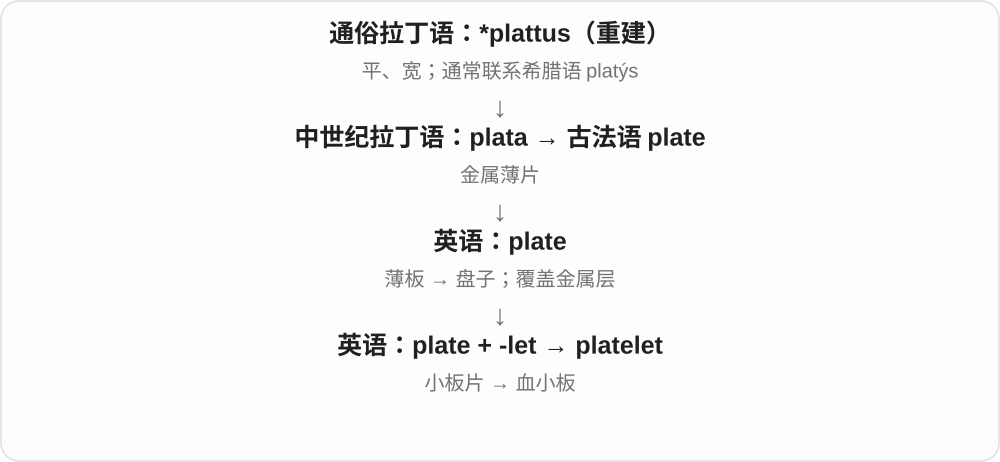

# 2962 · -let — 小个体、小物或较小形式，具体词还需接各自历史

[逐词精讲目录](../00_逐词精讲目录.md) · [总目录](../00_总目录_按常用程度.md)

## 核心词根与来源

一本小册子、一滴小水珠、一头小猪，都可看尺寸或幼小个体。starlet 还带新秀角色用法，applet 则是较小的应用程序名称。

**-LET：把较小的个体或物件单独命名**

booklet、droplet 等现代透明；cutlet 等还有外语整词借入路线，不把所有词都当英语临时相加。

- **小册、纸片与小个体**：booklet · leaflet · piglet · islet · droplet
- **科学、技术与角色名称**：platelet · singlet · wavelet · applet · starlet
- **外语借入的菜名**：cutlet

## 词形与演化规律

英语 -let 与法语小称构词材料相关；book + -let，drop + -let；islet、cutlet 等需接各自借词路线。

## 单词速览（按词族由简到繁）

同一基础词的相关扩展放在一起，先读基础形式，再读扩展；各组之间优先读常用的。具体词源关系见各词讲解。

| 单词 | 音标 | 核心意思 |
|---|---|---|
| [booklet](#w-1) | /ˈbʊklət/ | 小册子 |
| [leaflet](#w-2) | /ˈliːflɪt/ | 传单、小册页；小叶、复叶中的小叶片 |
| [platelet](#w-3) | 英 /ˈpleɪtlət/；美 /ˈpleɪtlət/ | 血小板；小板片 |
| [piglet](#w-4) | /ˈpɪɡlət/ | 小猪、幼猪 |
| [islet](#w-5) | /ˈaɪlət/ | 小岛；胰岛等小岛状细胞团 |
| [droplet](#w-6) | 英 /ˈdrɒplət/；美 /ˈdrɑːplət/ | 小滴；微滴 |
| [singlet](#w-7) | /ˈsɪŋɡlət/ | 背心；某些运动中的紧身单件服 |
| [starlet](#w-8) | 英 /ˈstɑːlət/；美 /ˈstɑːrlət/ | 初露头角的年轻女演员；演艺新星 |
| [wavelet](#w-9) | /ˈweɪvlət/ | 小波、小浪；小波〔数学、信号分析〕 |
| [applet](#w-10) | /ˈæplət/ | 小应用程序；嵌在较大环境中执行的小程序 |
| [cutlet](#w-11) | /ˈkʌtlət/ | 肉排；肉饼等食品 |

## 逐词讲解

### 1. booklet — 小册子

**音标**：/ˈbʊklət/

**先抓住这个画面**

信息比一张传单多，又不需要装成一本很厚的大书。

**怎么拆**

book + -let，-let 表较小的东西；不是 book + let“让书做某事”。

**怎么变成今天的意思**

**古英语 bōc → 中古英语 bok / book**  
书、书面记录

↓

**英语 book**  
书；账簿；预订、登记等动词用法

↓

**book + -let → booklet**  
较小、较薄的书册

an information booklet 是资料小册，an instruction booklet 是说明小册。页数没有由词尾规定统一界线。

**常见搭配与例句**

an information booklet；an instruction booklet；a small booklet。

> The museum provides a free information booklet.

博物馆提供免费资料小册。

> The booklet explains the history of the building.

小册子介绍了建筑历史。

**别混淆**

booklet 小册，leaflet 传单或折页常更薄；实际形式有重叠，不要只按一页、两页死分。

### 2. leaflet — 传单、小册页；小叶、复叶中的小叶片

**音标**：/ˈliːflɪt/

**先抓住这个画面**

leaf 加一个小的词尾，先是小叶、叶片单位；把书纸张那条 leaf 变小，又得到一张说明、宣传用的 leaflet。

**怎么拆**

leaf + -let，小称后缀。植物与印刷品两条都能从 leaf 的常用意义理解，不必只认其中一个。

**怎么变成今天的意思**

**古英语 lēaf → 中古英语 lef／leef → leaf**  
植物叶片

↓

**片状外形的扩展**  
书中一张纸、金箔等薄片；翻动纸页

↓

**组合与后缀**  
leafy 多叶、leafless 无叶、leaflet 小叶或单页印品

↓

**leaf + -let → leaflet**  
小叶、复叶小叶片；单页或折页信息印品

an information leaflet 说明折页，a travel leaflet 旅游宣传册页，leaflets of a compound leaf 复叶的小叶片。leaflet 作动词可说发传单。

**常见搭配与例句**

an information leaflet；a travel leaflet；distribute leaflets。

> The museum provides an information leaflet at the entrance.

博物馆在入口提供说明折页。

> The compound leaf has several small leaflets.

这片复叶有几片小叶。

**别混淆**

leaflet 通常较薄、篇幅较短，与 brochure 用法有交叠，不用硬定每种只能多少页。植物义 leaflet 不等于所有叶芽。

### 3. platelet — 血小板；小板片

**音标**：英 /ˈpleɪtlət/；美 /ˈpleɪtlət/

**先抓住这个画面**

名字像“小盘片”；在血液里，这些很小的细胞碎片参与形成凝块，帮助堵住出血处。

**怎么拆**

plate 板片 + -let 小，先抓住小而扁的形状，再联系血液里的专门含义。

**怎么变成今天的意思**

最常见于 platelet count“血小板计数”。血小板不是红细胞，也不是负责携氧的那一类血液成分。

**常见搭配与例句**

platelet count；blood platelets；platelet function。

> The blood test included a platelet count.

这次血液检查包括血小板计数。

> Platelets help form clots at the site of an injury.

血小板帮助在受损部位形成凝块。

**别混淆**

platelet 主要按形状命名；另一个术语 thrombocyte 更突出血凝块这一功能联系。

### 4. piglet — 小猪、幼猪

**音标**：/ˈpɪɡlət/

**先抓住这个画面**

不是把成年猪叫可爱一点，而是明确说尚未长大的幼猪。-let 给 pig 加上小、幼的意思。

**怎么拆**

pig + -let，小称后缀，形成幼猪的名称。这里的 let 不是允许的动词。

**怎么变成今天的意思**

**古英语相关词形 → 中古英语 pigge**  
原先主要说小猪；更远来源不确定

↓

**pig 泛指猪**  
不再限于幼龄；也产生形象、材料等扩展

↓

**pig + -let → piglet**  
幼小的猪

newborn piglets 新生小猪，a litter of piglets 一窝小猪。可以说真实动物，也可以作故事角色称呼。

**常见搭配与例句**

newborn piglets；a litter of piglets。

> The sow was followed by six piglets.

母猪后面跟着六只小猪。

> The farmer checked the newborn piglets.

农场主查看了新生小猪。

**别混淆**

piglet 强调幼龄；piggy 更像儿语昵称，也可以说像猪的性质。

### 5. islet — 小岛；胰岛等小岛状细胞团

**音标**：/ˈaɪlət/

**先抓住这个画面**

把岛缩小到一小块；在解剖学中，也用小岛形象说分散在其他组织里的细胞团。

**怎么拆**

借法语 islette，是 isle 的指小形式。现代可以用 isle + -let 来记，但历史上完整的小岛词形已经在法语中形成。

**怎么变成今天的意思**

**拉丁 insula 岛**  
再早的来源未定；不硬拆为 in 加某个英语词

↓

**古法语 isle → 法语 islette 小岛 → 英语 islet**  
由岛的名称形成指小词

↓

**islet 借作组织中小岛状细胞团的名称**  
如胰腺内的 pancreatic islets

a rocky islet 是多岩的小岛；pancreatic islets 是胰岛，包含不同类型的细胞，其中 β 细胞产生胰岛素。不能把整个胰腺都叫一个 islet。

**常见搭配与例句**

a small rocky islet；offshore islets；pancreatic islets。

> Seabirds nested on the rocky islet.

海鸟在那座岩石小岛上筑巢。

> The diagram shows several islets within the pancreas.

图中显示了胰腺里的几个胰岛。

**别混淆**

islet 强调小，island 不限大小。医学中 islet 说细胞团，insulin 说它里面某类细胞产生的激素。

### 6. droplet — 小滴；微滴

**音标**：英 /ˈdrɒplət/；美 /ˈdrɑːplət/

**先抓住这个画面**

比普通说一滴更强调细小，雾气、喷雾或玻璃上细细的水珠都能这样说。

**怎么拆**

drop + -let，-let 表小，是清楚的小称派生。t 不双写成 dropplet。

**怎么变成今天的意思**

**古英语 dropa〔名词〕及相关动词 → 中古英语 droppe**  
一滴；落下、滴下

↓

**英语 drop**  
滴、下降 → 放下、丢掉、退出、投放

↓

**drop + -let → droplet**  
小的一滴 → 微滴

water droplets 小水滴，tiny droplets 微小液滴，droplets on glass 玻璃上的水珠。

**常见搭配与例句**

water droplets；tiny droplets；droplets on the glass。

> Tiny droplets covered the window.

细小水珠布满窗户。

> The spray broke the liquid into fine droplets.

喷雾把液体分散成细小液滴。

**别混淆**

droplet 是具体液滴，mist 雾是许多微小水滴等形成的整体状态；不用因小就把它当水蒸气分子。

### 7. singlet — 背心；某些运动中的紧身单件服

**音标**：/ˈsɪŋɡlət/

**先抓住这个画面**

现在通常想到无袖贴身上衣；历史名字却抓住它没有里衬、单层这一点。

**怎么拆**

single + 指小后缀 -let / -et 的构形，仿照 doublet 等衣物名称。早期用于无衬短上衣，后来发展为背心等服装名称；不是一份单人票。

**怎么变成今天的意思**

**拉丁语 singulus → 古法语 sengle → 中古英语 single**  
一个的、单个的

↓

**英语 single**  
单个、单独；相关词按数量、状态或衣物名称继续发展

↓

**single 的单层义 + 指小形式 → singlet**  
无衬衣物名称 → 背心、某类运动服

a running singlet 跑步背心；a wrestling singlet 摔跤紧身连体服。地区、项目不同，衣物具体样式也不同。

**常见搭配与例句**

a cotton singlet；a running singlet；a wrestling singlet。

> He wore a light running singlet for the race.

他比赛时穿了一件轻薄跑步背心。

> The team’s singlets were blue with white numbers.

队员的比赛背心是蓝色的，印着白色号码。

**别混淆**

single 是单个的，singlet 是固定衣物名；不能给所有 single things 都改叫 singlet。

### 8. starlet — 初露头角的年轻女演员；演艺新星

**音标**：英 /ˈstɑːlət/；美 /ˈstɑːrlət/

**先抓住这个画面**

还没成为大明星，但已经进入聚光灯的小新星；常用于年轻女演员的媒体称呼。

**怎么拆**

star 明星 + -let 指小后缀。现代是演艺人物标签，不是真正尺寸很小的恒星，也不保证评价总是尊重。

**怎么变成今天的意思**

**古英语 steorra → 中古英语 sterre → star**  
星

↓

**现代 star**  
恒星、星形标记 → 明星、突出者；主演、标星等

↓

**star + -let → starlet**  
明星 → 年轻、尚未成名的演艺新星

a rising starlet 初露头角的演艺新星，a Hollywood starlet 好莱坞年轻女演员；语气可能带外貌、资历等媒体标签意味。

**常见搭配与例句**

a young starlet；a Hollywood starlet；an aspiring starlet。

> The film introduced an unknown starlet to a wider audience.

电影让一位不知名的年轻女演员进入了更多观众的视野。

> The article follows a starlet’s first year in the industry.

文章追踪了一位演艺新星入行第一年的经历。

**别混淆**

starlet 常带年轻女演员含义，a rising star 新星适用领域、性别更宽；不把 -let 一律当亲切赞美。

### 9. wavelet — 小波、小浪；小波〔数学、信号分析〕

**音标**：/ˈweɪvlət/

**先抓住这个画面**

日常可说小小的波纹；技术上用集中在一小段范围的波形来分析变化，名称保留“小波”的形象。

**怎么拆**

wave + 小称后缀 -let，英语构词也与法语 ondelette 的对应翻译有关。-let 是后缀，不是动词 let 让。

**怎么变成今天的意思**

**古英语 wafian → 中古英语 waven → wave〔动词〕**  
来回、上下摆动

↓

**中古英语 wawe 等旧水波名词，受动词形式影响 → wave〔名词〕**  
水浪；现代词形与摆动动词靠拢

↓

**wave + -let → wavelet；对应法语 ondelette**  
小波；再作数学分析名称

wavelets on the water 水面小波，wavelet analysis 小波分析，a wavelet transform 小波变换。

**常见搭配与例句**

wavelets on the water；wavelet analysis；a wavelet transform。

> Small wavelets moved across the pond.

池面泛过一道道小波纹。

> The paper uses wavelet analysis to study the signal.

论文用小波分析研究该信号。

**别混淆**

wavelet 技术含义不能只理解为体积小的海浪；wavelength 测波长，wavelet 命名波形或分析材料。

### 10. applet — 小应用程序；嵌在较大环境中执行的小程序

**音标**：/ˈæplət/

**先抓住这个画面**

不是完整的大套软件，而是负责一小件事的程序单元；常在某个宿主环境中运行。

**怎么拆**

app〔application 缩短〕+ 小称后缀 -let。名称的具体早期背景还有其他影响说法，但基本构词可以这样理解；不拆成 apple 苹果加 t。

**怎么变成今天的意思**

**application program 等 → application**  
为具体任务服务的应用程序

↓

**application 缩短 → app**  
应用程序，常用于手机、电脑软件

↓

**app + -let → applet**  
小型应用程序；依附特定环境运行的程序单元

a Java applet 常见于旧技术文献，a small applet 小程序。这个英语词泛指的类别不必等同某个平台特定产品名里的小程序。

**常见搭配与例句**

a Java applet；run an applet；a small applet。

> The old manual describes a Java applet for drawing graphs.

旧手册介绍了一个绘图用的 Java 小程序。

> The applet performs a single calculation.

这个小程序完成一项计算。

**别混淆**

app 常泛称应用，applet 突出小型、宿主环境等背景；不是所有体积小的手机 app 都惯常叫 applet。

### 11. cutlet — 肉排；肉饼等食品

**音标**：/ˈkʌtlət/

**先抓住这个画面**

菜单里通常是一份成片的肉排，某些菜系也指由碎料做成的饼；不是看见 -let 就能推出小切块。

**怎么拆**

实际来自法语 côtelette，小肋骨、肉排，接 côte 肋骨，再上溯拉丁 costa。英语拼写受 cut 影响，看似 cut + -let，却不是这条真正历史来源。

**怎么变成今天的意思**

**拉丁 costa → 法语 côte、côtelette**  
肋骨 → 小肋骨、肉排

↓

**英语 cutlet**  
借入后拼写受 cut 影响的食品名

a pork cutlet 猪排，a breaded cutlet 裹面包糠的肉排；vegetable cutlet 在一些地区菜单里是蔬菜饼。

**常见搭配与例句**

a pork cutlet；a chicken cutlet；a breaded cutlet。

> She ordered a breaded chicken cutlet.

她点了一份裹面包糠的鸡排。

> The menu also offers vegetable cutlets.

菜单上也有蔬菜饼。

**别混淆**

cutlet 是固定菜名，具体食材、是否带骨依菜式；不能用来泛称所有小刀切出的材料。

## 这一组要分清什么

后缀提供小称线索，但 platelet 血小板不是小盘子食具；cutlet 的最早构词也不是英语 cut 加 -let。

## 串起来练习

The booklet uses droplets and wavelets to explain the idea.

小册子用小水滴与小波来解释这个想法。
