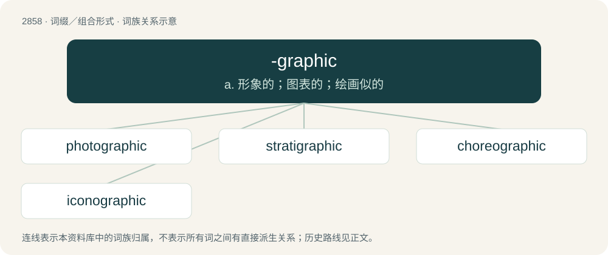

# 2966 · -graphic — a. 形象的；图表的；绘画似的

[总目录](../00_总目录_按常用程度.md)

**类型**：词缀／组合形式　｜　**来源语言**：见词源记录

## 核心含义与来源

- 核心含义：a. 形象的；图表的；绘画似的
- 英文含义：Forming adjectives pertaining to writing (of a type specified by the first element).
- 词形：-graphic

**来源记录 1**（后缀／后置成分；Forming adjectives pertaining to writing (of a type specified by the first element).）

From Ancient Greek -γραφικός (-graphikós), or formed in English from -graphy + -ic.

## 词族图

## 单词速览（常用到不常用）

| 单词 | 音标 | 释义 |
|---|---|---|
| [photographic](#w-1) | 英 /ˌfəʊtəˈɡɹæfɪk/ | a. 照相的, 摄影用的, 详细记录的, 逼真的, 酷似的 |
| [stratigraphic](#w-2) | /ˌstɹætɪˈɡɹæfɪk/ | a. 地层学的 |
| [choreographic](#w-3) | /.kɒriəˈgræfik/ | a. 舞蹈艺术的, 舞台舞蹈的 |
| [iconographic](#w-4) | /ai.kɔnəˈɡræfik/ | a. 图像材料的；肖像学的；肖像的；图示法的象征 |

## 逐词详解

### 1. photographic

**词性**：形容词　｜　**音标**：英 /ˌfəʊtəˈɡɹæfɪk/

**中文释义**：a. 照相的, 摄影用的, 详细记录的, 逼真的, 酷似的

**英文义项**：Pertaining to photographs or photography. / Synonym of accurate.

**构词拆分**：photo- + -graphic + photograph + -ic；photo- + -graphic；photograph + -ic

**词源与演化**：

From photo- + -graphic or photograph + -ic.

**例句**：

> This shop stocks all the latest photographic equipment.

该用例对应义项：Pertaining to photographs or photography.

### 2. stratigraphic

**词性**：形容词　｜　**音标**：/ˌstɹætɪˈɡɹæfɪk/

**中文释义**：a. 地层学的

**英文义项**：Of or pertaining to the arrangement of stratigraphy or strata.

**构词拆分**：stratum + -graphic

**词源与演化**：

From stratum + -graphic c. 1830.

### 3. choreographic

**词性**：形容词　｜　**音标**：/.kɒriəˈgræfik/

**中文释义**：a. 舞蹈艺术的, 舞台舞蹈的

**英文义项**：Of or pertaining to choreography. / Balletic.

**构词拆分**：choreography + -ic；choreo- + -graphic

**词源与演化**：

From choreography + -ic or choreo- + -graphic.

### 4. iconographic

**词性**：形容词　｜　**音标**：/ai.kɔnəˈɡræfik/

**中文释义**：a. 图像材料的；肖像学的；肖像的；图示法的象征

**英文义项**：Of or pertaining to iconography. / Of or pertaining to a secular person or topic that has attained cult status.

**构词拆分**：icono- + -graphic；iconography + -ic

**词源与演化**：

From icono- + -graphic or iconography + -ic.
