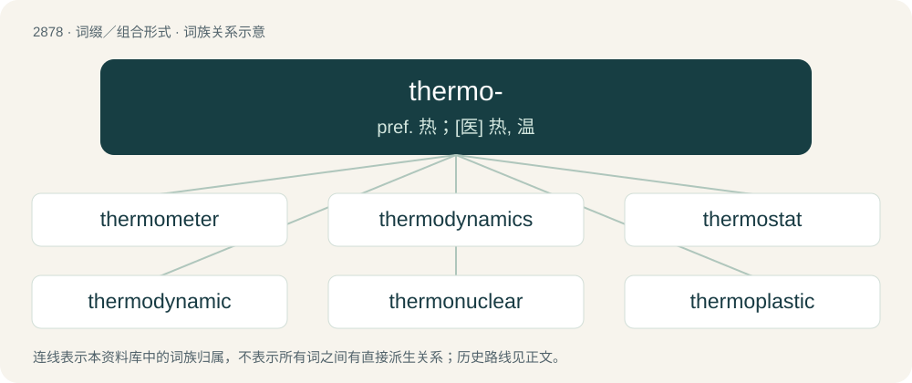

# 2986 · thermo- — pref. 热；\[医\] 热, 温

[总目录](../00_总目录_按常用程度.md)

**类型**：词缀／组合形式　｜　**来源语言**：见词源记录

## 核心含义与来源

- 核心含义：pref. 热；\[医\] 热, 温
- 英文含义：Thermal: of, being, or pertaining to heat or temperature.
- 词形：thermo-

**来源记录 1**（前缀／前置成分；Thermal: of, being, or pertaining to heat or temperature.）

From Ancient Greek θερμός (thermós, “warm, hot”).

## 词族图

## 单词速览（常用到不常用）

| 单词 | 音标 | 释义 |
|---|---|---|
| [thermometer](#w-1) | 英 /θəˈmɒm.ɪ.tə/；美 /θɚˈmɑ.mɪ.tɚ/ | n. 温度计, 体温计；\[化\] 温度计 |
| [thermodynamics](#w-2) | /ˌθɜː(ɹ)moʊdaɪˈnæmɪks/ | n. 热力学；\[化\] 热力学 |
| [thermostat](#w-3) | 美 /ˈθɝməstæt/ | n. 自动调温器, 温度自动启闭装置；\[化\] 恒温器; 恒温箱 |
| [thermodynamic](#w-4) | 美 /ˌθɝmoʊdaɪˈnæmɪk/ | a. 热力学的, 使用热动力的 |
| [thermonuclear](#w-5) | 英 /ˌθɜː.məʊˈnjuːk.liː.ə/；美 /ˌθɜɹ.moʊˈn(j)uk.li.əɹ/ | a. 热核的, 热核武器的 |
| [thermoplastic](#w-6) | /.θəːməuˈplæstik/ | a. 热塑性的；n. 热塑塑料 |
| [thermoelectric](#w-7) | /.θəːməuiˈlektrik/ | a. 热电的 |
| [thermite](#w-8) | 英 /ˈθɜː(ɹ).maɪt/ | \[医\] 铝热剂 |
| [thermocouple](#w-9) | /ˈθəːməu.kʌpl/ | n. 热电偶；\[化\] 温差电偶; 热电偶 |
| [thermostatic](#w-10) | /.θəːməuˈstætik/ | a. 趋温性的, 体温调节的 |

## 逐词详解

### 1. thermometer

**词性**：名词　｜　**音标**：英 /θəˈmɒm.ɪ.tə/；美 /θɚˈmɑ.mɪ.tɚ/

**中文释义**：n. 温度计, 体温计；\[化\] 温度计

**英文义项**：An apparatus used to measure temperature.

**构词拆分**：thermo- + -meter

**词源与演化**：

Borrowed from French thermomètre; equivalent to thermo- + -meter.

**例句**：

> Did you take your temperature with a thermometer in your mouth?

### 2. thermodynamics

**词性**：名词　｜　**音标**：/ˌθɜː(ɹ)moʊdaɪˈnæmɪks/

**中文释义**：n. 热力学；\[化\] 热力学

**英文义项**：The science of the conversions between heat and other forms of energy.

**构词拆分**：thermo- + dynamics

**词源与演化**：

From thermo- + dynamics. First attested in the 1850s.

**例句**：

> Thermodynamics is a branch of physics which deals with the energy and work of a system.

### 3. thermostat

**词性**：名词　｜　**音标**：美 /ˈθɝməstæt/

**中文释义**：n. 自动调温器, 温度自动启闭装置；\[化\] 恒温器; 恒温箱

**英文义项**：A device that automatically responds to changes in temperature by activating a heating or cooling system to maintain the temperature at a desired setting. / An algorithm used to maintain a simulated system at a set temperature by absorbing or releasing heat

**构词拆分**：thermo- + -stat

**词源与演化**：

From thermo- + -stat.

**例句**：

> You don't need to turn up your thermostat when it's cold outside.

### 4. thermodynamic

**词性**：形容词　｜　**音标**：美 /ˌθɝmoʊdaɪˈnæmɪk/

**中文释义**：a. 热力学的, 使用热动力的

**英文义项**：Of, or relating to the conversion of heat into other forms of energy. / Of, or relating to thermodynamics.

**构词拆分**：thermo- + dynamic

**词源与演化**：

From thermo- + dynamic.

**例句**：

> A singularity is a thermodynamic dead end and does not explain the origin of the universe.

### 5. thermonuclear

**词性**：名词　｜　**音标**：英 /ˌθɜː.məʊˈnjuːk.liː.ə/；美 /ˌθɜɹ.moʊˈn(j)uk.li.əɹ/

**中文释义**：a. 热核的, 热核武器的

**英文义项**：A thermonuclear weapon.

**构词拆分**：thermo- + nuclear

**词源与演化**：

From thermo- + nuclear.

**例句**：

> China detonated her first thermonuclear in June 1967.

该用例对应义项：A thermonuclear weapon.

### 6. thermoplastic

**词性**：形容词　｜　**音标**：/.θəːməuˈplæstik/

**中文释义**：a. 热塑性的；n. 热塑塑料

**英文义项**：Softening when heated and hardening when cooled, and thus able to be moulded, remelted, and remoulded.

**构词拆分**：thermo- + plastic

**词源与演化**：

From thermo- + plastic.

**例句**：

> Thermoplastic materials can be remelted and cooled time after time without undergoing any appreciable chemical change.

该用例对应义项：having the property of softening or fusing when heated and of hardening and becoming rigid again when cooled

### 7. thermoelectric

**词性**：形容词　｜　**音标**：/.θəːməuiˈlektrik/

**中文释义**：a. 热电的

**英文义项**：Of, pertaining to, or exhibiting thermoelectricity

**构词拆分**：thermo- + electric

**词源与演化**：

From thermo- + electric.

**例句**：

> The ingredients in this thermoelectric recipe include carbon nanotubes, polymers and a carbon material called graphene, which is a nanoparticle.

### 8. thermite

**词性**：名词　｜　**音标**：英 /ˈθɜː(ɹ).maɪt/

**中文释义**：\[医\] 铝热剂

**英文义项**：A mixture of a metal and a metal oxide capable of producing a thermite reaction, such as aluminium metal and ferric oxide; used in incendiary devices.

**构词拆分**：therm- + -ite

**词源与演化**：

From German Thermit, from Ancient Greek θερμός (thermós, “heat”) + -it; comparable to English therm- + -ite.

**例句**：

> The chemical equation for a thermite reaction is quite simple, really.

### 9. thermocouple

**词性**：名词　｜　**音标**：/ˈθəːməu.kʌpl/

**中文释义**：n. 热电偶；\[化\] 温差电偶; 热电偶

**英文义项**：A transducer consisting of two different metals welded together at each end; a voltage is produced that is proportional to the difference in temperature between the two junctions (one of which is normally held at a known temperature)

**构词拆分**：thermo- + couple

**词源与演化**：

From thermo- + couple.

### 10. thermostatic

**词性**：形容词　｜　**音标**：/.θəːməuˈstætik/

**中文释义**：a. 趋温性的, 体温调节的

**英文义项**：having or maintaining a consistent temperature / Relating to thermostasis

**构词拆分**：thermo- + -static

**词源与演化**：

From thermo- + -static.

**例句**：

> The shower has a thermostatic water-mixing valve.

该用例对应义项：having or maintaining a consistent temperature
