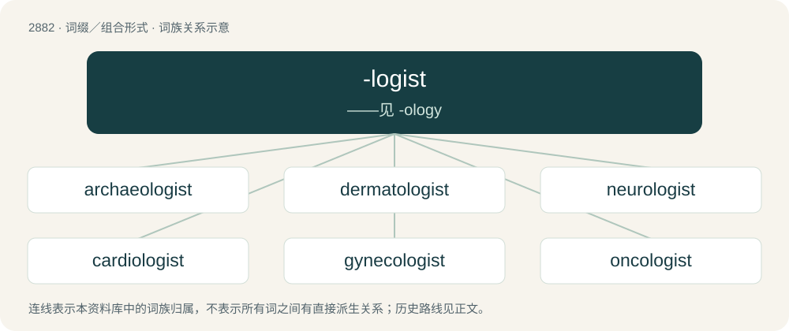

# 2991 · -logist — ——见 -ology

[总目录](../00_总目录_按常用程度.md)

**类型**：词缀／组合形式　｜　**来源语言**：见词源记录

## 核心含义与来源

- 核心含义：——见 -ology
- 英文含义：A person who studies or is an expert in the related -logy.
- 词形：-logist

**来源记录 1**（后缀／后置成分；A person who studies or is an expert in the related -logy.）

From -logy (“study of”) + -ist (“(agent)”).

## 词族图

## 单词速览（常用到不常用）

| 单词 | 音标 | 释义 |
|---|---|---|
| [archaeologist](#w-1) | 英 /ˌɑː.kiˈɒl.ə.d͡ʒɪst/；美 /ˌɑɹ.kiˈɑ.lə.d͡ʒɪst/ | n. 考古学家 |
| [dermatologist](#w-2) | 英 /ˌdɜːməˈtɒlədʒɪst/；美 /ˌdɝ.məˈtɑ.lə.d͡ʒɪst/ | n. 皮肤学者, 皮肤科医生；\[医\] 皮肤病学家, 皮肤科医师 |
| [neurologist](#w-3) | /njuˈrɒlədʒist/ | n. 神经病学者, 神经科医师；\[医\] 神经病学家 |
| [cardiologist](#w-4) | 英 /ˌkɑːdiˈɒlədʒɪst/；美 /ˌkɑɹdiˈɑlədʒɪst/ | n. 心脏病学家；\[医\] 心\[脏\]病学家 |
| [gynecologist](#w-5) | /ˌɡaɪnəˈkɒləd͡ʒɪst/ | n. 妇科医生；\[医\] 妇科学家 |
| [oncologist](#w-6) | /ɒŋˈkɒləd͡ʒɪst/ | n. 肿瘤学家；肿瘤医师 |
| [ecologist](#w-7) | /iːˈkɒləd͡ʒɪst/ | n. 生态学者 |
| [urologist](#w-8) | /juəˈrɒlədʒist/ | n. 泌尿科医师；\[医\] 泌尿科学家, 泌尿科医师 |
| [bacteriologist](#w-9) | /bækˌtɪəɹiˈɒlədʒɪst/ | n. 细菌学家；\[医\] 细菌学 |
| [mineralogist](#w-10) | /.minəˈrælədʒist/ | n. 矿物学者 |

## 逐词详解

### 1. archaeologist

**词性**：名词　｜　**音标**：英 /ˌɑː.kiˈɒl.ə.d͡ʒɪst/；美 /ˌɑɹ.kiˈɑ.lə.d͡ʒɪst/

**中文释义**：n. 考古学家

**英文义项**：Someone who studies or practises archaeology.

**构词拆分**：archaeology + -ist + archaeo- + -logist

**词源与演化**：

From archaeolog(y) + -ist. By surface analysis, archaeo- + -logist.

**例句**：

> This female archaeologist is interested in the daily life of ordinary people.

### 2. dermatologist

**词性**：名词　｜　**音标**：英 /ˌdɜːməˈtɒlədʒɪst/；美 /ˌdɝ.məˈtɑ.lə.d͡ʒɪst/

**中文释义**：n. 皮肤学者, 皮肤科医生；\[医\] 皮肤病学家, 皮肤科医师

**英文义项**：A person who is skilled in, professes or practices dermatology.

**构词拆分**：dermatology + -ist；dermato- + -logist

**词源与演化**：

From dermatology + -ist or dermato- + -logist.

**例句**：

> I didn't know that Tom was a dermatologist.

### 3. neurologist

**词性**：名词　｜　**音标**：/njuˈrɒlədʒist/

**中文释义**：n. 神经病学者, 神经科医师；\[医\] 神经病学家

**英文义项**：A doctor or scientist who practices or specializes in neurology.

**构词拆分**：neuro- + -logist

**词源与演化**：

From neuro- + -logist.

**例句**：

> Tom thought that he might want to become a pediatric neurologist.

### 4. cardiologist

**词性**：名词　｜　**音标**：英 /ˌkɑːdiˈɒlədʒɪst/；美 /ˌkɑɹdiˈɑlədʒɪst/

**中文释义**：n. 心脏病学家；\[医\] 心\[脏\]病学家

**英文义项**：A physician who specializes in medical problems related to the heart.

**构词拆分**：cardio- + -logist

**词源与演化**：

From cardio- + -logist.

**例句**：

> I'll refer you to a cardiologist for further evaluation.

### 5. gynecologist

**词性**：名词　｜　**音标**：/ˌɡaɪnəˈkɒləd͡ʒɪst/

**中文释义**：n. 妇科医生；\[医\] 妇科学家

**英文义项**：A physician specializing in diseases of the female reproductive system.

**构词拆分**：gyneco- + -logist

**词源与演化**：

From Ancient Greek γυνή (gunḗ, “woman”) (genitive form γυναικός) + -λογία (-logía, “branch of study”), itself the combination form of -λόγος (-lógos, “word, knowledge, reason”). By surface analysis, gynecology + -ist or gyneco- + -logist.

**例句**：

> A trans woman with breast cancer may need to see a gynecologist.

### 6. oncologist

**词性**：名词　｜　**音标**：/ɒŋˈkɒləd͡ʒɪst/

**中文释义**：n. 肿瘤学家；肿瘤医师

**英文义项**：A doctor or scientist who specializes in oncology.

**构词拆分**：oncology + -ist；onco- + -logist

**词源与演化**：

From oncology + -ist or onco- + -logist.

**例句**：

> The oncologist outlined a treatment plan for the cancer patient.

### 7. ecologist

**词性**：名词　｜　**音标**：/iːˈkɒləd͡ʒɪst/

**中文释义**：n. 生态学者

**英文义项**：A scholar of ecology. / An environmentalist (one who advocates for the protection of the environment).

**构词拆分**：eco- + -logist

**词源与演化**：

From eco- + -logist. The less common sense “environmentalist” might be from association with deep ecology, or influenced by Romance-language equivalents such as Spanish ecologista (“environmentalist”).

**例句**：

> “It is called a kowari," said ecologist John Augusteyn, who shot the footage.

### 8. urologist

**词性**：名词　｜　**音标**：/juəˈrɒlədʒist/

**中文释义**：n. 泌尿科医师；\[医\] 泌尿科学家, 泌尿科医师

**英文义项**：A doctor of urology.

**构词拆分**：urolog(y) + -ist；uro- + -logist

**词源与演化**：

From urolog(y) + -ist or uro- + -logist.

**例句**：

> John Jackson is a urologist, his wife Tao is an ear-nose-throat specialist.

### 9. bacteriologist

**词性**：名词　｜　**音标**：/bækˌtɪəɹiˈɒlədʒɪst/

**中文释义**：n. 细菌学家；\[医\] 细菌学

**英文义项**：A microbiologist whose speciality is bacteriology.

**构词拆分**：bacterio- + -logist

**词源与演化**：

From bacterio- + -logist.

### 10. mineralogist

**词性**：名词　｜　**音标**：/.minəˈrælədʒist/

**中文释义**：n. 矿物学者

**英文义项**：An expert in mineralogy.

**构词拆分**：mineral + -logist

**词源与演化**：

From mineral + -logist. Compare later mineralogy and French minéralogiste.

**例句**：

> The space agency's mineralogist says this asteroid was unique because researchers can compare the data collected before it came down, with the recovered fragments.
