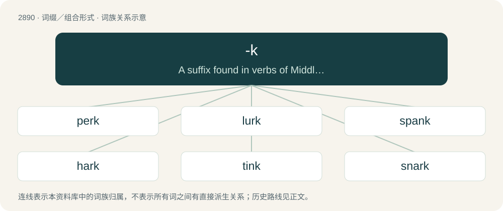

# 3000 · -k — A suffix found in verbs of Middle English, Old English, usually with an intensive or frequentative effect.

[总目录](../00_总目录_按常用程度.md)

**类型**：词缀／组合形式　｜　**来源语言**：见词源记录

## 核心含义与来源

- 核心含义：A suffix found in verbs of Middle English, Old English, usually with an intensive or frequentative effect.
- 英文含义：A suffix found in verbs of Middle English, Old English, usually with an intensive or frequentative effect.
- 词形：-k

**多个词源／构词路径**：同一拼写可能有不同来源；以下按词性和含义分别列出。

**来源记录 1**（后缀／后置成分；A suffix found in verbs of Middle English, Old English, usually with an intensive or frequentative effect.）

From Middle English -ken, -kien, from Old English -cian, from Proto-West Germanic \*-ukōn, \*-ikōn, from Proto-Germanic \*-ukōną, \*-ikōną. Cognate with West Frisian -kje, German -chen, Danish -ke, Swedish -ka, Faroese -ka. Perhaps related to Old English diminutive suffix -uc, -oc. More at -ock.

**来源记录 2**（后缀／后置成分；A suffix found in nouns, usually with a diminutive effect.）

From Middle English -ke, from Old English -(u)c and -ca (diminutive suffix). More at -ock.

## 词族图

## 单词速览（常用到不常用）

| 单词 | 音标 | 释义 |
|---|---|---|
| [perk](#w-1) | 英 /pɜːk/；美 /pɝk/ | 【英文】To peer; to look narrowly, sharply, or inquisitively. |
| [lurk](#w-2) | 英 /lɜːk/；美 /lɝk/ | n. 潜伏, 潜行；vi. 暗藏, 潜伏, 埋伏；\[计\] 隐匿阅读 |
| [spank](#w-3) | 美 /ˈspeɪ̯ŋk/；/ˈspæŋk/ | 【英文】To move quickly and nimbly on foot; to stride or run at a brisk pace. |
| [hark](#w-4) | /hɑː(ɹ)k/ | vi. 倾听 |
| [tink](#w-5) | /ˈtɪŋk/ | vi.& n.(发)丁当声,(发)丁零声 |
| [snark](#w-6) | /snɑː(ɹ)k/ | n. 蛇鲨 |
| [chink](#w-7) | 英 /t͡ʃɪŋk/ | n. 裂口, 裂缝, 弱点, 叮当声；vt. 使叮当响；vi. 堵裂缝, 叮当响 |
| [gawk](#w-8) | /ɡɔːk/ | 【英文】To stare or gape stupidly. |
| [shuck](#w-9) | /ʃʌk/ | n. 壳, 外皮, 牡蛎壳；v. 剥去, 脱去 |

## 逐词详解

### 1. perk

**词性**：动词　｜　**音标**：英 /pɜːk/；美 /pɝk/

**英文义项**：To peer; to look narrowly, sharply, or inquisitively. / To examine thoroughly.

**词源与演化**：

The origin is uncertain. Perhaps a variant of peer + -k (frequentative ending).

### 2. lurk

**词性**：动词　｜　**音标**：英 /lɜːk/；美 /lɝk/

**中文释义**：n. 潜伏, 潜行；vi. 暗藏, 潜伏, 埋伏；\[计\] 隐匿阅读

**英文义项**：To remain concealed in order to ambush. / To remain unobserved.

**构词拆分**：lour + -k (frequentative suffix)

**词源与演化**：

From Middle English lurken, from Old Norse \*lúrka, possibly from Proto-Germanic \*lūrukōną (“to be lying in wait, lurk”), equivalent to lour + -k (frequentative suffix). Cognate with Norwegian Nynorsk lurka (“to sneak away, go slowly”), dialectal Swedish lurka (“to dawdle, be slow in one's work”), Saterland Frisian lüürkje (“to look secretly, spy”), West Frisian luorkje (“to lurk”), Middle Low German lûrken (“to deceitfully stalk”).

**例句**：

> Cyber espionage and identity theft abound while organized criminals and national spies lurk.

### 3. spank

**词性**：动词　｜　**音标**：美 /ˈspeɪ̯ŋk/；/ˈspæŋk/

**英文义项**：To move quickly and nimbly on foot; to stride or run at a brisk pace. / To move or turn rapidly, as the gears of a machine or the sails of a ship.

**构词拆分**：span + -k

**词源与演化**：

Uncertain. Likely of Dutch or Low German origin. Compare North Frisian spanke (“to step with pride”), Saterland Frisian spankje (“to splash”), dialectal Dutch spanken (“to limp, hobble”), Dutch spankeren (“to run away quickly, gallop off”), German Low German spenkern (“to burst, explode, shatter, splash, spray”), Danish spanke (“to strut”), Swedish spånka (“to strut proudly”); originally, equivalent to span + -k. Compare also dialectal English spang (“to leap, bound; shoot out, fling”).

**例句**：

> The ship was really spanking along.

该用例对应义项：To move or turn rapidly, as the gears of a machine or the sails of a ship.

### 4. hark

**词性**：名词　｜　**音标**：/hɑː(ɹ)k/

**中文释义**：vi. 倾听

**英文义项**：A whisper

**构词拆分**：hear + -k

**词源与演化**：

From Middle English herken, herkien, from Old English \*hercian, \*heorcian, \*hiercian, from Proto-West Germanic \*hauʀikōn, \*hauʀukōn, derived ultimately from Proto-Germanic \*hauzijaną (“to hear”) + formative/intensive -k (see also the related hīeran, whence English hear). Equivalent to hear + -k. Cognate with Scots herk (“to hark”), North Frisian harke (“to hark”), West Frisian harkje (“to listen”), obsolete Dutch horken (“to hark, listen to”), Middle Low German horken (“to hark”), German horchen (“to hark, harken to”).

**例句**：

> Hark! midnight from the church tower vibrates through the frosty air.

### 5. tink

**词性**：动词　｜　**音标**：/ˈtɪŋk/

**中文释义**：vi.& n.(发)丁当声,(发)丁零声

**英文义项**：To emit a high-pitched sharp or metallic noise.

**构词拆分**：tin + -k

**词源与演化**：

From Middle English tinken, possibly from Old English \*tincian, equivalent to tin + -k. Compare Dutch tinken (“to tink, toll, strike the bells of a clock”), German Low German tinken (“to tink”). Compare also English ting.

**例句**：

> Jimmy heard the bells tink.

该用例对应义项：To emit a high-pitched sharp or metallic noise.

### 6. snark

**词性**：名词　｜　**音标**：/snɑː(ɹ)k/

**中文释义**：n. 蛇鲨

**英文义项**：an attitude or expression of mocking irreverence and sarcasm.

**构词拆分**：snore + -k

**词源与演化**：

Noun sense “snide remark” as back-formation from snarky (1906), from obsolete snark (“to snore, snort”, verb) (1866), from Middle English \*snarken (“to snore”), from Proto-West Germanic \*snarkōn, equivalent to snore + -k. Compare Low German snarken, North Frisian snarke, Swedish snarka, German schnarchen, and English snort and snore. Of Germanic origin, but ultimately onomatopoeic.

### 7. chink

**词性**：名词　｜　**音标**：英 /t͡ʃɪŋk/

**中文释义**：n. 裂口, 裂缝, 弱点, 叮当声；vt. 使叮当响；vi. 堵裂缝, 叮当响

**英文义项**：A narrow opening such as a fissure or crack. / A narrow beam or patch of light admitted by such an opening.

**构词拆分**：chine + -k

**词源与演化**：

Of uncertain origin, but apparently an extension, with diminutive -k (see more at -ock), of Middle English chine (or, if already suffixed in Middle English, \*chinek), from Old English ċine (“a crack, chine, chink”), equivalent to chine + -k.

**例句**：

> The warrior saw a chink in her enemy's armor, and aimed her spear accordingly.

该用例对应义项：A chip or dent in something metallic.

### 8. gawk

**词性**：动词　｜　**音标**：/ɡɔːk/

**英文义项**：To stare or gape stupidly. / To stare conspicuously.

**构词拆分**：gaw (“to stare; gawk”) + -k

**词源与演化**：

Perhaps from English dialectal gaw (“to stare; gawk”) + -k, as in talk, stalk, etc., ultimately from Old Norse gá (“to heed”).

### 9. shuck

**词性**：动词　｜　**音标**：/ʃʌk/

**中文释义**：n. 壳, 外皮, 牡蛎壳；v. 剥去, 脱去

**英文义项**：To remove the shuck from (walnuts, oysters, etc.). / To remove (any outer covering).

**构词拆分**：shell + -ock (diminutive suffix)；shell + -k (diminutive suffix)

**词源与演化**：

Origin unknown. Possibly a dialectal survival of unrecorded Middle English \*schulk(e), \*schullok (“small shell”); either from Old English \*sċylluc, \*sċylloc, diminutive of Old English sċyll (“shell”), or alternatively created in Middle English from Middle English schulle, schelle (“shell, husk, pod”) + -ok, making it equivalent to shell + -ock (diminutive suffix) or shell + -k (diminutive suffix).

**例句**：

> I will shuck my clothes and dive naked into the pool.

该用例对应义项：To remove (any outer covering).
